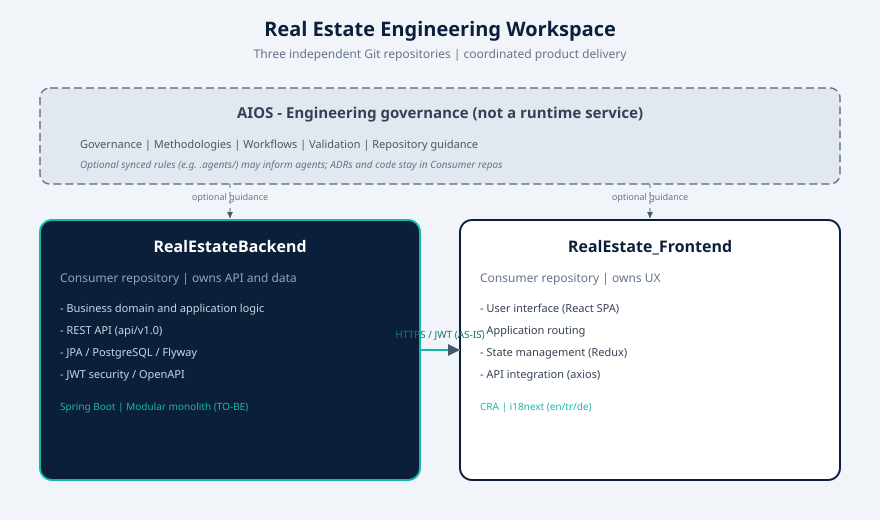
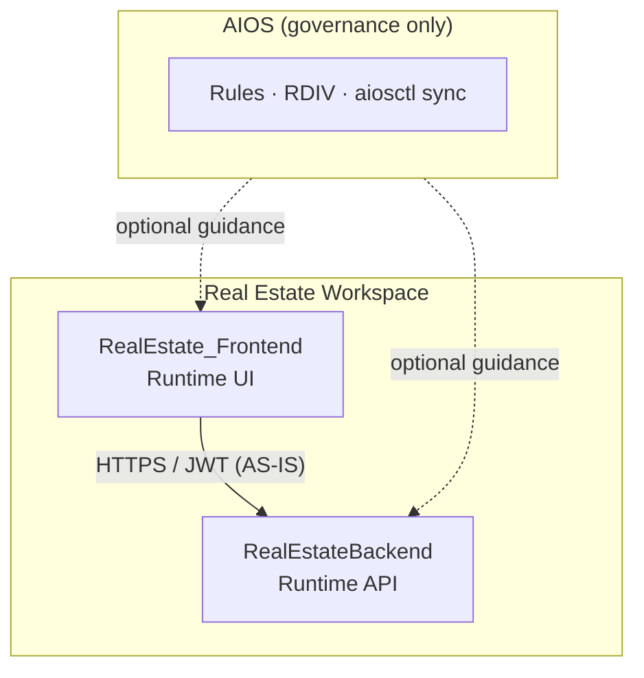
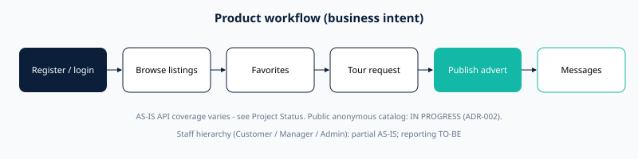
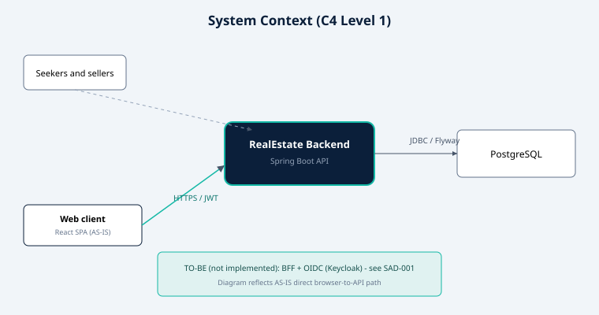
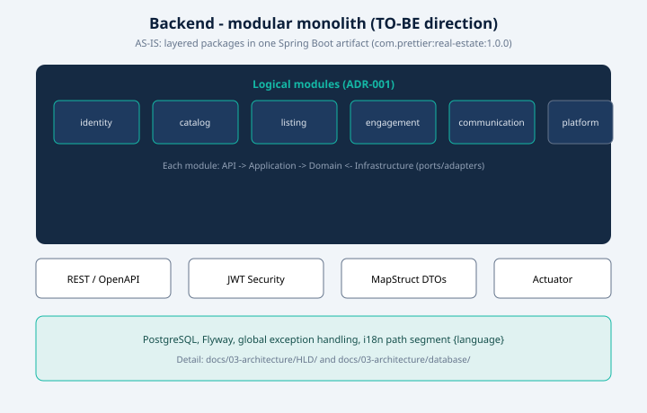
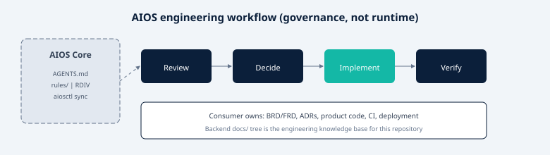
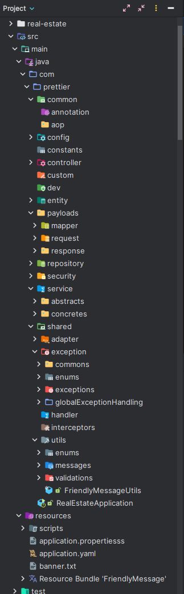

  

  <strong>Prettier Homes</strong> — a B2C property marketplace backed by a documented, modernization-ready Spring Boot API.

  
  

  
  
  

  
  
  
  
  

---

## Table of contents

- [Product overview](#product-overview)
- [Workspace architecture](#workspace-architecture)
- [Product capabilities](#product-capabilities)
- [Architecture](#architecture)
- [Technology stack](#technology-stack)
- [Engineering with AIOS](#engineering-with-aios)
- [Documentation](#documentation)
- [Getting started](#getting-started)
- [Project status](#project-status)
- [API explorer (Swagger)](#api-explorer-swagger)
- [Contributing](#contributing)

---

## Product overview

**Prettier Homes / RealEstate** connects property seekers with sellers and renters. Customers publish and manage listings; staff roles (Customer, Manager, Admin) support moderation and operations; seekers browse, favorite listings, request tours, and contact the business.

| Audience | Value |
|----------|--------|
| Property seekers | Discovery, favorites, engagement channels |
| Customers / agents | Registration, adverts, messaging |
| Engineering teams | Versioned API, governance-ready docs under `docs/` |
| Learners | Bilingual curriculum in `docs/07-education/` |

This repository is the **backend API and persistence** half of the product. The React web client lives in a separate Frontend repository. Engineering methods may be informed by [AIOS](https://github.com/fdeniz07/AIOS); product decisions and ADRs are owned here.

---

## Workspace architecture

The Real Estate program spans **three independent Git repositories**. Backend and Frontend are **consumer** codebases. **AIOS is not a runtime service** — it provides shared engineering governance (rules, methodologies, validation) while ADRs, backlog, and implementations remain in each consumer repo.

  

| Repository | Role | Owns |
|------------|------|------|
| [RealEstateBackend](https://github.com/fdeniz07/RealEstateBackend) | API & data | REST API, PostgreSQL, security, `docs/` |
| [RealEstate_Frontend](https://github.com/fdeniz07/RealEstate_Frontend) | Web UX | React SPA, routing, Redux, i18n |
| [AIOS](https://github.com/fdeniz07/AIOS) | Engineering framework | AGENTS.md, `rules/`, RDIV — **not** deployed with the product |

---

## Product capabilities

Capabilities are tagged by evidence class: **AS-IS** (verified in code), **IN PROGRESS**, **TO-BE** (approved target), **PLANNED**.

| Capability | Status | Notes |
|------------|--------|--------|
| User registration & JWT login | **AS-IS** | `POST /api/v1.0/auth/{language}/signUp`, `login` |
| User & admin management | **AS-IS** | Users, admins, roles |
| Geography (country, city, district) | **AS-IS** | CRUD APIs |
| Categories (properties) | **AS-IS** | CRUD and property endpoints on `CategoryController` |
| Advert types | **stub / gap** | `AdvertTypeController` present; **0** HTTP mappings (inventory) |
| Advert CRUD | **AS-IS** | Listing lifecycle; approval rules per FRD |
| Contact messages & in-app messaging | **AS-IS** | Mailbox-style messages |
| Favorites | **AS-IS** (partial) | Some endpoints commented / gaps per FRD |
| Multilingual API paths (`{language}`) | **AS-IS** | FE i18n + backend path segment |
| **Public anonymous catalog** (ADR-002) | **IN PROGRESS** | Design approved; Java endpoints not complete |
| Multilingual advert content (DEC-007) | **IN PROGRESS** | Registry + `AdvertTranslation` on roadmap |
| Tour requests API | **TO-BE / gap** | Controller present, **0** mapped methods (inventory) |
| Image upload / delivery | **TO-BE / gap** | Controller stubbed |
| Manager reporting (LEGACY) | **PLANNED** | Documented in BRD, not AS-IS |
| Redis, RabbitMQ, Elasticsearch | **PLANNED** | Legacy README intent; not in `pom.xml` |

  

---

## Architecture

### System context

  

Full narrative: [docs/03-architecture/SAD/SAD-001-system-context.md](docs/03-architecture/SAD/SAD-001-system-context.md). Companion SVG (older palette): [docs/assets/diagrams/c4-context.svg](docs/assets/diagrams/c4-context.svg).

### Backend (modular monolith direction)

Approved style: **one Spring Boot deployable**, evolving toward **package-by-module** clean/hexagonal layers ([ADR-001](docs/03-architecture/ADR/ADR-001-modular-monolith.md)).

  

| Topic | Document |
|-------|----------|
| Containers & modules | [HLD-001-containers.md](docs/03-architecture/HLD/HLD-001-containers.md) |
| Clean architecture layers | [HLD-002-clean-architecture.md](docs/03-architecture/HLD/HLD-002-clean-architecture.md) |
| Domain boundaries | [DOMAIN-OVERVIEW.md](docs/03-architecture/domain/DOMAIN-OVERVIEW.md) |
| REST conventions & versioning | [API-ARCHITECTURE.md](docs/03-architecture/api/API-ARCHITECTURE.md) |
| Security (JWT; authorization partial AS-IS) | [SECURITY-ARCHITECTURE.md](docs/03-architecture/security/SECURITY-ARCHITECTURE.md) — ownership-based RBAC is **TO-BE**, not operational AS-IS |
| Persistence & Flyway | [PERSISTENCE-ARCHITECTURE.md](docs/03-architecture/database/PERSISTENCE-ARCHITECTURE.md) |

**AS-IS note:** Code is still largely **layered** (`controller` / `service` / `entity`) inside one artifact; module packages are **TO-BE**.

### Public vs private data (approved boundary)

  

See [ADR-002-public-read-api.md](docs/03-architecture/ADR/ADR-002-public-read-api.md) · [ADR-002-public-read-api-TR.md](docs/03-architecture/ADR/ADR-002-public-read-api-TR.md).

---

## Technology stack

Versions below are **verified from this repository** (`pom.xml`, `compose.yaml`, CI). The root README previously listed Spring Boot 3.0 — that is **outdated**; see [TECHNOLOGY_BASELINE.md](docs/05-infrastructure/TECHNOLOGY_BASELINE.md).

### Backend (AS-IS)

| Component | Version / note |
|-----------|----------------|
| Java | 17 |
| Spring Boot | **4.1.2** (parent BOM) |
| PostgreSQL | Runtime driver; CI uses Postgres **16** |
| Flyway | Enabled; migrations on classpath |
| JWT (jjwt) | 0.12.7 |
| springdoc OpenAPI | 3.2.0 |
| MapStruct | 1.6.3 |
| Lombok, Validation, Actuator | Via Spring Boot starters |
| Build | Maven (`mvnw` present) |

### Frontend (read-only reference)

| Component | Version / note |
|-----------|----------------|
| React | 18.2 |
| Build | Create React App (`react-scripts` 5.0.1) |
| UI | Ant Design 5, Bootstrap 5 |
| State | Redux Toolkit |
| HTTP | axios |
| i18n | i18next; locales en / tr / de |

Detail: [FRONTEND-ARCHITECTURE.md](docs/03-architecture/frontend/FRONTEND-ARCHITECTURE.md).

### Not in runtime (TO-BE / planned)

Object storage (S3/MinIO), Redis caching, Testcontainers library, application Docker image — documented under `docs/03-architecture/` and **not** in `pom.xml`. Integration tests AS-IS use an **external PostgreSQL** instance (Docker Compose or CI service), not embedded Testcontainers.

---

## Engineering with AIOS

[AIOS](https://github.com/fdeniz07/AIOS) (**Artificial Intelligence Operating System**) is an open-source **repository-driven AI engineering framework**. It helps coding agents follow durable rules, RDIV (Review → Decide → Implement → Verify), and human approval gates.

| Concept | Meaning for this workspace |
|---------|---------------------------|
| **Consumer ownership** | BRD, FRD, ADRs, and Java/React code live in Backend / Frontend repos |
| **AIOS Core** | Generic governance in the AIOS repo — not a microservice in production |
| **Adoption** | Teams may sync rules into `.agents/` via `aiosctl` — optional; this Backend repo does not require a `.agents/` folder |
| **Precedence** | Product ADRs (L2) override generic AIOS defaults for this product |

  

Backend documentation explicitly aligns with evidence discipline described in [DOCUMENTATION_GUIDE.md](docs/00-governance/DOCUMENTATION_GUIDE.md) without modifying AIOS itself.

---

## Documentation

The canonical hub is **[docs/README.md](docs/README.md)** — governance, requirements, architecture, development, infrastructure, operations, education, and roadmap.

| Area | Entry point |
|------|-------------|
| Business requirements | [BRD-EN.md](docs/01-business/BRD/BRD-EN.md) · [BRD-TR.md](docs/01-business/BRD/BRD-TR.md) |
| Functional requirements | [FRD-EN.md](docs/02-requirements/FRD/FRD-EN.md) · [FRD-TR.md](docs/02-requirements/FRD/FRD-TR.md) |
| NFR catalogue | [NFR-CATALOGUE.md](docs/02-requirements/NFR/NFR-CATALOGUE.md) |
| Solution architecture | [SAD-001-system-context.md](docs/03-architecture/SAD/SAD-001-system-context.md) |
| ADRs | [ADR-001](docs/03-architecture/ADR/ADR-001-modular-monolith.md) · [ADR-002](docs/03-architecture/ADR/ADR-002-public-read-api.md) · [ADR-003](docs/03-architecture/ADR/ADR-003-auth-token-bff-reconciliation.md) |
| API inventory (AS-IS) | [API-INVENTORY.md](docs/03-architecture/api/API-INVENTORY.md) |
| Security | [SECURITY-ARCHITECTURE.md](docs/03-architecture/security/SECURITY-ARCHITECTURE.md) |
| Database | [PERSISTENCE-ARCHITECTURE.md](docs/03-architecture/database/PERSISTENCE-ARCHITECTURE.md) · [ERD-AS-IS.md](docs/03-architecture/database/ERD-AS-IS.md) |
| Development | [DEVELOPMENT_GUIDE.md](docs/04-development/DEVELOPMENT_GUIDE.md) · [LOCAL_ENV.md](docs/04-development/LOCAL_ENV.md) |
| Infrastructure | [TECHNOLOGY_BASELINE.md](docs/05-infrastructure/TECHNOLOGY_BASELINE.md) · [DEPLOYMENT.md](docs/05-infrastructure/DEPLOYMENT.md) |
| Operations | [RUNBOOK.md](docs/06-operations/RUNBOOK.md) |
| Roadmap & decisions | [ROADMAP.md](docs/08-project-management/ROADMAP.md) · [TRACEABILITY_MATRIX.md](docs/00-governance/TRACEABILITY_MATRIX.md) |

---

## Getting started

**Prerequisites:** JDK **17**, Maven or the Maven Wrapper (`mvnw` / `mvnw.cmd` on Windows), Docker (for local PostgreSQL via `compose.yaml`).

1. **Clone** this repository and copy environment template:
   - `cp .env.example .env` (or Windows equivalent) — do not commit secrets.
2. **Start the development stack (recommended):**
   - Ensure `.env` includes Compose fail-fast vars from `.env.example` (`POSTGRES_*`, `JWT_SECRET`, and for profiles `JWT_SECRET_TEST` / `PGADMIN_*`).
   - `docker compose up -d --build` — project **`realestate`**: **PostgreSQL** + **`backend`** (profile `docker`). Default host port **8081** (`BACKEND_PORT`). See [DOCKER-COMPOSE-ARCHITECTURE.md](docs/03-architecture/infrastructure/assets/DOCKER-COMPOSE-ARCHITECTURE.md).
   - Never `docker compose down -v` (destroys the external Postgres volume).
   - **PostgreSQL only:** `docker compose up -d postgres`
3. **Alternative — run API on the host:** export Spring variables before Maven (Compose does not inject them into `mvn`):
   - `SPRING_PROFILES_ACTIVE=localhost`
   - `SPRING_DATASOURCE_URL=jdbc:postgresql://127.0.0.1:5433/real_estate_db`
   - `SPRING_DATASOURCE_USERNAME` / `SPRING_DATASOURCE_PASSWORD`
   - `JWT_SECRET` (base64, ≥ 32 bytes) — see [LOCAL_ENV.md](docs/04-development/LOCAL_ENV.md)
4. **Run the API on the host (optional):**
   - `./mvnw spring-boot:run` (Unix/macOS) or `mvnw.cmd spring-boot:run` (Windows)
5. **OpenAPI UI:** `http://localhost:8081/swagger-ui/index.html` (Compose `backend`) or `:8080` for host JVM.
6. **Tests:** profile `test` with `real_estate_test_db` (create DB once per LOCAL_ENV) — or `docker compose --profile test run --rm test-runner` (requires `JWT_SECRET_TEST`). CI: `.github/workflows/backend-ci.yml` (unchanged).
7. **pgAdmin (optional):** `docker compose --profile tools up -d pgadmin` — `127.0.0.1:5050` by default.

**Frontend (separate repo):** install dependencies under `Frontend/` in [RealEstate_Frontend](https://github.com/fdeniz07/RealEstate_Frontend); default dev URL `http://localhost:3000`; local API proxy via `Frontend/setupProxy.js`.

---

## Project status

| Track | State | Reference |
|-------|-------|-----------|
| Documentation foundation | Delivered (draft) | `docs/` v0.1–0.2 era |
| Backend API (LEGACY parity) | **AS-IS** with known gaps | [API-INVENTORY.md](docs/03-architecture/api/API-INVENTORY.md) |
| Product **M1** multilingual catalog | **IN PROGRESS** | [ROADMAP.md](docs/08-project-management/ROADMAP.md), ADR-002 |
| Modular package structure | **TO-BE** | ADR-001, HLD-002 |
| BFF + Keycloak OIDC | **TO-BE** (not implemented) | SAD-001, ADR-003 |
| Integration test suite | **AS-IS** (PostgreSQL-backed) · goals **IN PROGRESS** | `PostgresIntegrationTestSupport` and related tests exist; broader coverage and tooling goals per [TESTING-ARCHITECTURE.md](docs/03-architecture/testing/TESTING-ARCHITECTURE.md) — **not** Testcontainers in `pom.xml` |
| Messaging middleware / Redis / search | **PLANNED** | ROADMAP, NFR |

---

## API explorer (Swagger)

Verified UI screenshots (local assets — not stock imagery):

| Area | Screenshot |
|------|------------|
| Infrastructure overview |  |
| Authentication & users |  |
| Adverts, favorites, contact |  |
| Geography |  |
| Admin |  |
| Messages |  |

Historical role hierarchy (LEGACY poster): [roles-hierarchy-legarcy.jpg](docs/assets/architecture/roles-hierarchy-legarcy.jpg).

---

## Contributing

1. **Choose the right repository** — API changes here; UI in Frontend; framework changes in AIOS only when improving shared governance.
2. **Follow evidence labels** in docs (AS-IS vs TO-BE) — do not document wishful features as shipped.
3. **Respect ADRs** — especially [ADR-002](docs/03-architecture/ADR/ADR-002-public-read-api.md) for public read boundaries.
4. **Run tests** with the `test` profile and documented JDBC URLs before opening a PR.
5. **Do not** commit `.env`, JWT secrets, or production credentials.

For coding standards and review: [CODING_STANDARDS.md](docs/04-development/CODING_STANDARDS.md) · [CODE_REVIEW_GUIDE.md](docs/04-development/CODE_REVIEW_GUIDE.md).

---

  Backend consumer repository · Product ADRs and code owned here · AIOS informs engineering, not runtime

