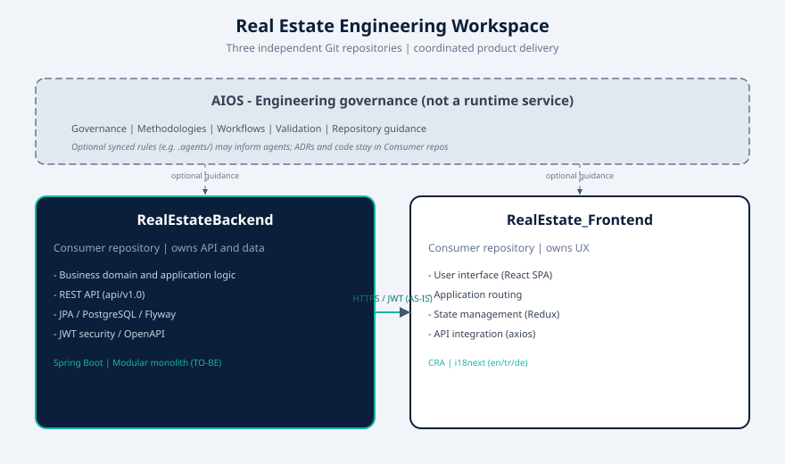
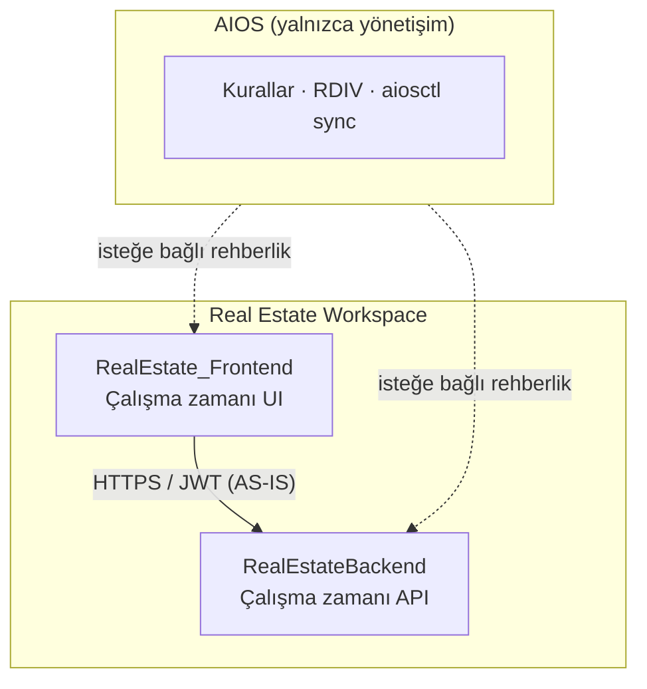
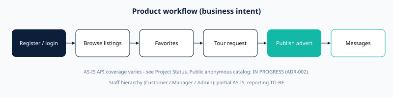
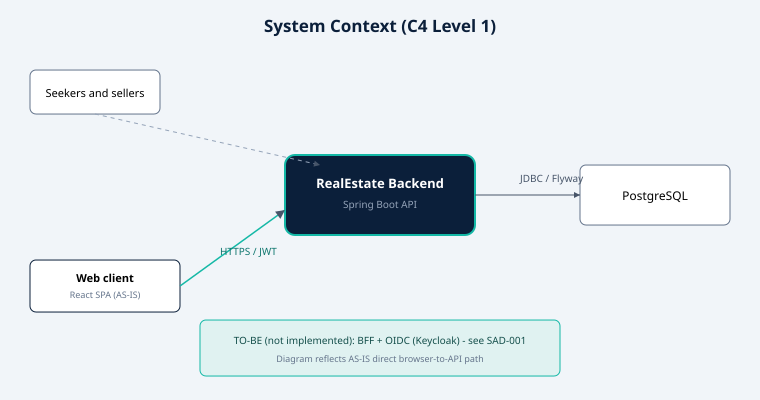
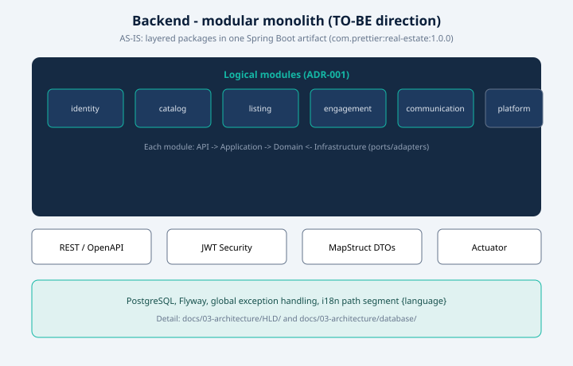
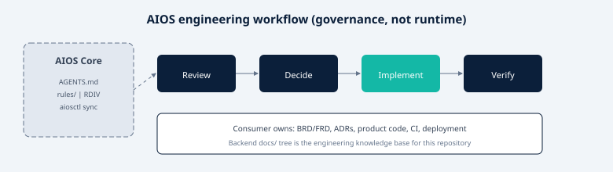
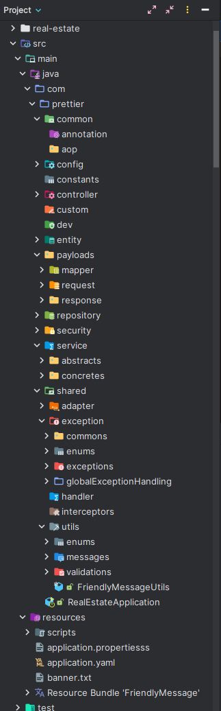

  

  <strong>Prettier Homes</strong> — belgelenmiş, modernizasyona hazır bir Spring Boot API ile desteklenen B2C emlak pazar yeri.

  
  

  
  
  

  
  
  
  
  

---

## İçindekiler

- [Ürün özeti](#ürün-özeti)
- [Workspace mimarisi](#workspace-mimarisi)
- [Ürün yetenekleri](#ürün-yetenekleri)
- [Mimari](#mimari)
- [Teknoloji yığını](#teknoloji-yığını)
- [AIOS ile mühendislik](#aios-ile-mühendislik)
- [Dokümantasyon](#dokümantasyon)
- [Başlangıç](#başlangıç)
- [Proje durumu](#proje-durumu)
- [API gezgini (Swagger)](#api-gezgini-swagger)
- [Katkıda bulunma](#katkıda-bulunma)

---

## Ürün özeti

**Prettier Homes / RealEstate**, konut arayanları satıcı ve kiracılarla buluşturur. Müşteriler ilan yayınlar ve yönetir; personel rolleri (Customer, Manager, Admin) moderasyon ve operasyonu destekler; arayanlar gezinir, favoriler, tur talebi ve iletişim kanallarını kullanır.

| Kitle | Değer |
|-------|--------|
| Konut arayanlar | Keşif, favoriler, etkileşim |
| Müşteriler / acenteler | Kayıt, ilanlar, mesajlaşma |
| Mühendislik ekipleri | Sürümlü API, `docs/` altında yönetişim |
| Öğrenenler | `docs/07-education/` altında EN/TR müfredat |

Bu depo ürünün **backend API ve kalıcılık** tarafıdır. React web istemcisi ayrı bir Frontend deposundadır. Mühendislik yöntemleri [AIOS](https://github.com/fdeniz07/AIOS) ile uyumlu olabilir; ürün kararları ve ADR’ler bu repoda kalır.

---

## Workspace mimarisi

Real Estate programı **üç bağımsız Git deposundan** oluşur. Backend ve Frontend **consumer (tüketici)** kod depolarıdır. **AIOS bir çalışma zamanı servisi değildir** — paylaşılan mühendislik yönetişimi sağlar; ADR’ler, backlog ve uygulama her consumer repoda kalır.

  

| Depo | Rol | Sahiplik |
|------|-----|----------|
| [RealEstateBackend](https://github.com/fdeniz07/RealEstateBackend) | API ve veri | REST API, PostgreSQL, güvenlik, `docs/` |
| [RealEstate_Frontend](https://github.com/fdeniz07/RealEstate_Frontend) | Web UX | React SPA, routing, Redux, i18n |
| [AIOS](https://github.com/fdeniz07/AIOS) | Mühendislik çerçevesi | AGENTS.md, `rules/`, RDIV — ürünle **deploy edilmez** |

---

## Ürün yetenekleri

Yetenekler kanıt sınıfına göre işaretlenir: **AS-IS** (kodda doğrulanmış), **IN PROGRESS** (devam eden), **TO-BE** (onaylı hedef), **PLANNED** (yol haritası).

| Yetenek | Durum | Not |
|---------|--------|-----|
| Kayıt ve JWT giriş | **AS-IS** | `POST /api/v1.0/auth/{language}/signUp`, `login` |
| Kullanıcı ve admin yönetimi | **AS-IS** | Users, admins, roles |
| Coğrafya (ülke, şehir, ilçe) | **AS-IS** | CRUD API’leri |
| Kategoriler (özellikler) | **AS-IS** | `CategoryController` üzerinde CRUD ve property uçları |
| İlan tipleri (advert types) | **stub / boşluk** | `AdvertTypeController` var; **0** HTTP eşlemesi (envanter) |
| İlan CRUD | **AS-IS** | Yaşam döngüsü; onay kuralları FRD’de |
| İletişim mesajları ve uygulama içi mesajlaşma | **AS-IS** | Posta kutusu modeli |
| Favoriler | **AS-IS** (kısmi) | Bazı uçlar yorum satırı / FRD boşlukları |
| Çok dilli API yolları (`{language}`) | **AS-IS** | FE i18n + backend path segmenti |
| **Herkese açık katalog** (ADR-002) | **IN PROGRESS** | Tasarım onaylı; Java uçları tam değil |
| Çok dilli ilan içeriği (DEC-007) | **IN PROGRESS** | Registry + `AdvertTranslation` yol haritasında |
| Tur talebi API | **TO-BE / boşluk** | Controller var, **0** eşlenmiş metot (envanter) |
| Görsel yükleme / sunum | **TO-BE / boşluk** | Controller stub |
| Yönetici raporlama (LEGACY) | **PLANNED** | BRD’de; AS-IS değil |
| Redis, RabbitMQ, Elasticsearch | **PLANNED** | Eski README niyeti; `pom.xml`’de yok |

  

---

## Mimari

### Sistem bağlamı

  

Ayrıntılı anlatım: [docs/03-architecture/SAD/SAD-001-system-context.md](docs/03-architecture/SAD/SAD-001-system-context.md). Eş SVG (eski palet): [docs/assets/diagrams/c4-context.svg](docs/assets/diagrams/c4-context.svg).

### Backend (modüler monolit yönü)

Onaylı stil: **tek Spring Boot deployable**, **modül bazlı paketleme** ve clean/hexagonal katmanlara evrim ([ADR-001](docs/03-architecture/ADR/ADR-001-modular-monolith.md)).

  

| Konu | Belge |
|------|--------|
| Konteynerler ve modüller | [HLD-001-containers.md](docs/03-architecture/HLD/HLD-001-containers.md) |
| Clean architecture katmanları | [HLD-002-clean-architecture.md](docs/03-architecture/HLD/HLD-002-clean-architecture.md) |
| Domain sınırları | [DOMAIN-OVERVIEW.md](docs/03-architecture/domain/DOMAIN-OVERVIEW.md) |
| REST kuralları ve sürümleme | [API-ARCHITECTURE.md](docs/03-architecture/api/API-ARCHITECTURE.md) |
| Güvenlik (JWT; yetkilendirme kısmi AS-IS) | [SECURITY-ARCHITECTURE.md](docs/03-architecture/security/SECURITY-ARCHITECTURE.md) — sahiplik bazlı RBAC **TO-BE**, AS-IS’te operasyonel değil |
| Kalıcılık ve Flyway | [PERSISTENCE-ARCHITECTURE.md](docs/03-architecture/database/PERSISTENCE-ARCHITECTURE.md) |

**AS-IS notu:** Kod hâlâ ağırlıklı olarak **katmanlı** (`controller` / `service` / `entity`); modül paketleri **TO-BE**.

### Herkese açık ve özel veri (onaylı sınır)

  

Bkz. [ADR-002-public-read-api.md](docs/03-architecture/ADR/ADR-002-public-read-api.md) · [ADR-002-public-read-api-TR.md](docs/03-architecture/ADR/ADR-002-public-read-api-TR.md).

---

## Teknoloji yığını

Aşağıdaki sürümler **bu repodan doğrulanmıştır** (`pom.xml`, `compose.yaml`, CI). Eski README’de Spring Boot 3.0 yazıyordu — **güncel değil**; bkz. [TECHNOLOGY_BASELINE.md](docs/05-infrastructure/TECHNOLOGY_BASELINE.md).

### Backend (AS-IS)

| Bileşen | Sürüm / not |
|---------|-------------|
| Java | 17 |
| Spring Boot | **4.1.2** (parent BOM) |
| PostgreSQL | Runtime sürücü; CI Postgres **16** |
| Flyway | Etkin; classpath migrasyonları |
| JWT (jjwt) | 0.12.7 |
| springdoc OpenAPI | 3.2.0 |
| MapStruct | 1.6.3 |
| Lombok, Validation, Actuator | Spring Boot starter’ları |
| Derleme | Maven (`mvnw` mevcut) |

### Frontend (salt okunur referans)

| Bileşen | Sürüm / not |
|---------|-------------|
| React | 18.2 |
| Derleme | Create React App (`react-scripts` 5.0.1) |
| UI | Ant Design 5, Bootstrap 5 |
| State | Redux Toolkit |
| HTTP | axios |
| i18n | i18next; en / tr / de |

Ayrıntı: [FRONTEND-ARCHITECTURE.md](docs/03-architecture/frontend/FRONTEND-ARCHITECTURE.md).

### Çalışma zamanında yok (TO-BE / planlı)

Nesne depolama (S3/MinIO), Redis önbellek, Testcontainers kütüphanesi, uygulama Docker imajı — `docs/03-architecture/` altında belgelenmiş, **`pom.xml`’de yok**. Entegrasyon testleri AS-IS **harici PostgreSQL** kullanır (Docker Compose veya CI servisi); gömülü Testcontainers değil.

---

## AIOS ile mühendislik

[AIOS](https://github.com/fdeniz07/AIOS) (**Artificial Intelligence Operating System**), açık kaynak bir **depo odaklı AI mühendislik çerçevesidir**. Kodlama ajanlarının kalıcı kurallar, RDIV (Review → Decide → Implement → Verify) ve insan onay kapılarını izlemesine yardımcı olur.

| Kavram | Bu workspace için anlamı |
|--------|--------------------------|
| **Consumer sahipliği** | BRD, FRD, ADR ve Java/React kodu Backend / Frontend repolarında |
| **AIOS Core** | AIOS deposundaki genel yönetişim — üretimde mikroservis değil |
| **Benimseme** | İsteğe bağlı `aiosctl` ile `.agents/` senkronu; bu Backend deposu `.agents/` klasörünü zorunlu kılmaz |
| **Öncelik** | Ürün ADR’leri (L2), bu ürün için genel AIOS varsayılanlarının üzerindedir |

  

Backend dokümantasyonu, AIOS’u değiştirmeden [DOCUMENTATION_GUIDE.md](docs/00-governance/DOCUMENTATION_GUIDE.md) ile uyumlu kanıt disiplinine referans verir.

---

## Dokümantasyon

Ana giriş: **[docs/README.md](docs/README.md)** — yönetişim, gereksinimler, mimari, geliştirme, altyapı, operasyon, eğitim ve yol haritası.

| Alan | Giriş |
|------|--------|
| İş gereksinimleri | [BRD-EN.md](docs/01-business/BRD/BRD-EN.md) · [BRD-TR.md](docs/01-business/BRD/BRD-TR.md) |
| Fonksiyonel gereksinimler | [FRD-EN.md](docs/02-requirements/FRD/FRD-EN.md) · [FRD-TR.md](docs/02-requirements/FRD/FRD-TR.md) |
| NFR kataloğu | [NFR-CATALOGUE.md](docs/02-requirements/NFR/NFR-CATALOGUE.md) |
| Çözüm mimarisi | [SAD-001-system-context.md](docs/03-architecture/SAD/SAD-001-system-context.md) |
| ADR’ler | [ADR-001](docs/03-architecture/ADR/ADR-001-modular-monolith.md) · [ADR-002](docs/03-architecture/ADR/ADR-002-public-read-api.md) · [ADR-003](docs/03-architecture/ADR/ADR-003-auth-token-bff-reconciliation.md) |
| API envanteri (AS-IS) | [API-INVENTORY.md](docs/03-architecture/api/API-INVENTORY.md) |
| Güvenlik | [SECURITY-ARCHITECTURE.md](docs/03-architecture/security/SECURITY-ARCHITECTURE.md) |
| Veritabanı | [PERSISTENCE-ARCHITECTURE.md](docs/03-architecture/database/PERSISTENCE-ARCHITECTURE.md) · [ERD-AS-IS.md](docs/03-architecture/database/ERD-AS-IS.md) |
| Geliştirme | [DEVELOPMENT_GUIDE.md](docs/04-development/DEVELOPMENT_GUIDE.md) · [LOCAL_ENV.md](docs/04-development/LOCAL_ENV.md) |
| Altyapı | [TECHNOLOGY_BASELINE.md](docs/05-infrastructure/TECHNOLOGY_BASELINE.md) · [DEPLOYMENT.md](docs/05-infrastructure/DEPLOYMENT.md) |
| Operasyon | [RUNBOOK.md](docs/06-operations/RUNBOOK.md) |
| Yol haritası | [ROADMAP.md](docs/08-project-management/ROADMAP.md) · [TRACEABILITY_MATRIX.md](docs/00-governance/TRACEABILITY_MATRIX.md) |

---

## Başlangıç

**Gereksinimler:** JDK **17**, Maven veya Maven Wrapper (`mvnw` / Windows’ta `mvnw.cmd`), Docker (yerel PostgreSQL için `compose.yaml`).

1. Bu repoyu **klonlayın** ve ortam şablonunu kopyalayın:
   - `.env.example` → `.env` — gizli anahtarları commit etmeyin.
2. **PostgreSQL’i başlatın:**
   - `docker compose up -d` (port **5433** ve veritabanı adları için [LOCAL_ENV.md](docs/04-development/LOCAL_ENV.md)).
3. Maven öncesi **Spring değişkenlerini export edin** (Compose, `mvn`’e enjekte etmez):
   - `SPRING_PROFILES_ACTIVE=localhost`
   - `SPRING_DATASOURCE_URL=jdbc:postgresql://127.0.0.1:5433/real_estate_db`
   - `SPRING_DATASOURCE_USERNAME` / `SPRING_DATASOURCE_PASSWORD`
   - `JWT_SECRET` (base64, ≥ 32 bayt) — [LOCAL_ENV.md](docs/04-development/LOCAL_ENV.md)
4. **API’yi çalıştırın:**
   - `./mvnw spring-boot:run` (Unix/macOS) veya `mvnw.cmd spring-boot:run` (Windows)
5. **OpenAPI UI:** `http://localhost:8080/swagger-ui/index.html` (uygulama çalışırken).
6. **Testler:** `test` profili ve `real_estate_test_db` — CI sözleşmesi `.github/workflows/backend-ci.yml`.

**Frontend (ayrı depo):** [RealEstate_Frontend](https://github.com/fdeniz07/RealEstate_Frontend) içindeki `Frontend/` klasöründe bağımlılıklar; varsayılan geliştirme adresi `http://localhost:3000`; yerel API yönlendirmesi için `Frontend/setupProxy.js`.

---

## Proje durumu

| İz | Durum | Referans |
|----|--------|----------|
| Dokümantasyon temeli | Teslim (taslak) | `docs/` v0.1–0.2 |
| Backend API (LEGACY parite) | **AS-IS**, bilinen boşluklarla | [API-INVENTORY.md](docs/03-architecture/api/API-INVENTORY.md) |
| Ürün **M1** çok dilli katalog | **IN PROGRESS** | [ROADMAP.md](docs/08-project-management/ROADMAP.md), ADR-002 |
| Modüler paket yapısı | **TO-BE** | ADR-001, HLD-002 |
| BFF + Keycloak OIDC | **TO-BE** (uygulanmadı) | SAD-001, ADR-003 |
| Entegrasyon testleri | **AS-IS** (PostgreSQL) · hedefler **IN PROGRESS** | `PostgresIntegrationTestSupport` ve ilgili testler mevcut; kapsam/hedefler [TESTING-ARCHITECTURE.md](docs/03-architecture/testing/TESTING-ARCHITECTURE.md) — `pom.xml`’de Testcontainers yok |
| Mesaj kuyruğu / Redis / arama | **PLANNED** | ROADMAP, NFR |

---

## API gezgini (Swagger)

Doğrulanmış UI ekran görüntüleri (yerel varlıklar — stok görsel değil):

| Alan | Ekran görüntüsü |
|------|-----------------|
| Altyapı özeti |  |
| Kimlik doğrulama ve kullanıcılar |  |
| İlanlar, favoriler, iletişim |  |
| Coğrafya |  |
| Admin |  |
| Mesajlar |  |

Tarihsel rol hiyerarşisi (LEGACY poster): [roles-hierarchy-legarcy.jpg](docs/assets/architecture/roles-hierarchy-legarcy.jpg).

---

## Katkıda bulunma

1. **Doğru depoyu seçin** — API değişiklikleri burada; UI Frontend’de; AIOS yalnızca paylaşılan yönetişim için.
2. Dokümanlarda **kanıt etiketlerine** uyun (AS-IS vs TO-BE) — hayali özellikleri canlı gibi yazmayın.
3. **ADR’lere saygı** — özellikle herkese açık okuma için [ADR-002](docs/03-architecture/ADR/ADR-002-public-read-api.md).
4. PR öncesi `test` profili ve belgelenmiş JDBC URL’leri ile testleri çalıştırın.
5. `.env`, JWT sırları veya üretim kimlik bilgilerini **commit etmeyin**.

Kod standartları: [CODING_STANDARDS.md](docs/04-development/CODING_STANDARDS.md) · [CODE_REVIEW_GUIDE.md](docs/04-development/CODE_REVIEW_GUIDE.md).

---

  Backend consumer deposu · Ürün ADR ve kodu burada · AIOS çalışma zamanı değil, mühendisliği bilgilendirir

