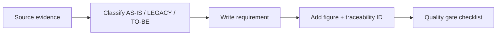

# Documentation Guide

## 1. Scope

This guide governs all artifacts under `Backend/docs/`. It aligns with the RealEstate master execution prompt v1.0 and AIOS-style evidence discipline without modifying AIOS itself.

## 2. Principles

1. **Evidence first** — Every significant claim links to `SOURCE_REGISTER.md` or code references.
2. **No silent conflict resolution** — LEGACY vs AS-IS gaps are explicit.
3. **Bilingual parity** — EN/TR pairs share the same technical depth (BRD, FRD, education).
4. **Visual richness** — Each major document includes multiple purposeful figures (Mermaid, tables, diagrams, reused screenshots).
5. **Draft by default** — Architecture and TO-BE requirements stay `draft` until human approval.

## 3. Metadata block

Use YAML front matter on every significant document (see hub `README.md` example). Required fields: `document_id`, `title`, `version`, `status`, `language`, `owner`, dates, `source_references` where applicable.

### Status values

| Status | Meaning |
|--------|---------|
| draft | Initial or evolving content |
| in-review | Ready for stakeholder review |
| approved | Formally accepted |
| deprecated | Superseded; keep for history |

## 4. Visual standard

Each figure must include:

- **Figure ID** (e.g. `RE-FIG-ARCH-003`)
- **Title**
- **Caption**
- **Explanation** (1–3 sentences)
- **Source reference** (if derived from legacy material or screenshot)

Preferred formats: Mermaid in Markdown, SVG under `assets/diagrams/`, copied screenshots under `assets/screenshots/`.

**Figure RE-FIG-GOV-001** — Documentation authoring flow (process standard).

## 5. Requirement ID prefixes

| Prefix | Use |
|--------|-----|
| BR | Business requirement |
| FR | Functional requirement |
| NFR | Non-functional requirement |
| UC | Use case |
| API | API requirement |
| ADR | Architecture decision |
| TEST | Test case |
| TASK | Implementation task |
| INT | Integration requirement |

## 6. Security in documentation

- Never paste production secrets, JWT secrets, or real passwords from `application.yaml`.
- Reference configuration **keys** only; use placeholders in examples.

## 7. Quality gate (per document)

- [ ] Technical claims trace to source
- [ ] EN/TR parity where paired
- [ ] At least two explanatory visuals per major doc
- [ ] Terminology matches glossaries
- [ ] Internal links resolve within `docs/`
- [ ] TO-BE clearly labeled

## 8. Change history

| Version | Date | Summary |
|---------|------|---------|
| 0.1.0 | 2026-11-13 | Initial guide |
