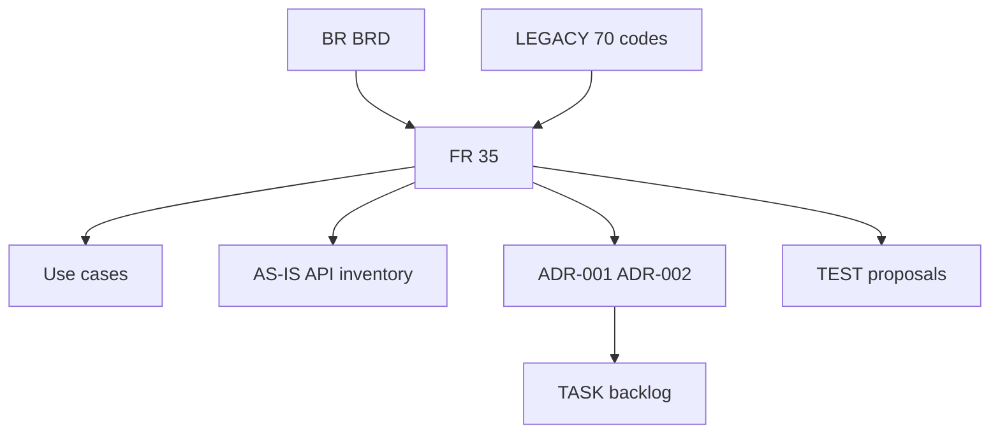

# Requirements Traceability Matrix (v0.2.0)

Corrected in **TASK-008**. Mapping matrix: [LEGACY_API_TO_FR_MATRIX.md](../02-requirements/FRD/LEGACY_API_TO_FR_MATRIX.md).

## Coverage summary (verified)

| Layer | Count | Source |
|-------|------:|--------|
| Business requirements (BRD) | **18** | BR-001 … BR-018 (v0.2.0) |
| Functional requirements | **35** | [FRD-EN.md](../02-requirements/FRD/FRD-EN.md) |
| LEGACY API codes | **70** | SRC-008-PDF |
| Architecture decisions (draft files) | **2** | ADR-001, ADR-002 |
| Documented use cases | 2 | UC-TOUR-01, [UC-ADV-01](../02-requirements/use-cases/UC-ADV-01.md) |
| Proposed test IDs | 35+ | Referenced in FRD; not executed |

**Figure RE-FIG-TRACE-002** — Traceability chain (corrected counts).

## Example — Anonymous catalog browse (LEGACY vs AS-IS)

| BR | FR | UC | LEGACY | AS-IS API | ADR | TEST | TASK | Status |
|----|----|----|--------|-----------|-----|------|------|--------|
| BR-011 | FR-ADV-001 | UC-ADV-01 | A01, A07, C01 (pp. 25–31) | `GET .../adverts/...` (JWT) | ADR-002 (draft) | TEST-SEC-01 | TASK-010 | LEGACY / **conflict** |
| BR-003 | FR-ADV-002 | UC-ADV-01 | A10 (p. 34) | `POST .../add` | ADR-001 | TEST-ADV-02 | TASK-015 | Partial AS-IS |
| BR-004 | FR-TOUR-001 | UC-TOUR-01 | S05 (p. 69) | No mapping | ADR-001 | TEST-TOUR-01 | TASK-002 | LEGACY gap |

**Figure RE-FIG-TRACE-001** — Corrected browse vs tour traces (no phantom ADRs).

## Example — Role hierarchy (corrected BR mapping)

| BR | FR | UC | Notes |
|----|----|----|-------|
| BR-002 | FR-ADM-001, FR-ADM-002 | — | Role/user governance; **not** FR-AUTH-001 |
| BR-002 | FR-ADV-001 | UC-ADV-01 | Anonymous permissions per PDF matrix |

## ADR references (actual documents only)

| ADR | Topic | Linked FR |
|-----|-------|-----------|
| ADR-001 | Modular monolith | All implementation TASKs |
| ADR-002 | Public read API (draft) | FR-ADV-001, FR-GEO-001, FR-CNT-001 |

**Removed:** phantom ADR-003/ADR-004 from v0.1.0 matrix.

## TASK identifier alignment

| TASK | FR / LEGACY | Purpose |
|------|-------------|---------|
| TASK-002 | FR-TOUR-* | Tour REST |
| TASK-003 | FR-FAV-001 | Favorites |
| TASK-004 | FR-MED-001, FR-CAT-002 | Image / advert type |
| TASK-005 | FR-ADM-*, NFR-SEC | RBAC |
| TASK-010 | FR-ADV-001 | Public read / ADR-002 |
| TASK-011–020 | See [TODO.md](../08-project-management/TODO.md) | PDF parity backlog |

## Change history

| Version | Date | Summary |
|---------|------|---------|
| 0.1.0 | 2026-11-13 | Initial (incorrect counts) |
| 0.2.0 | 2026-11-13 | TASK-008 correction |
