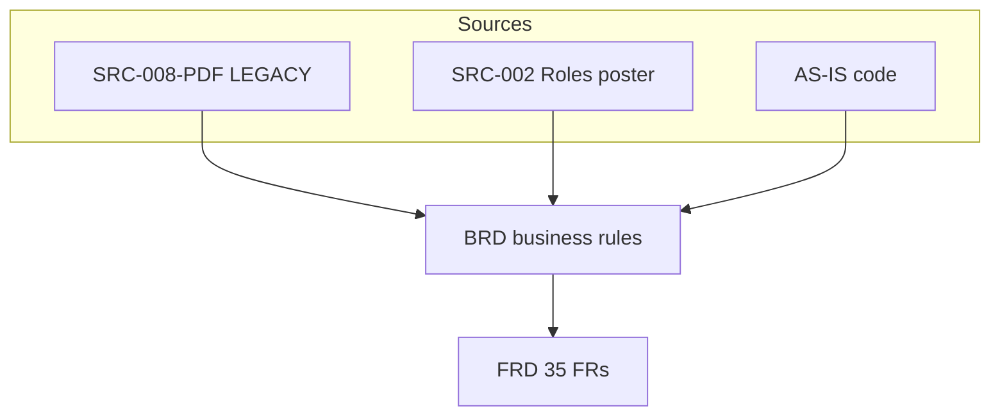
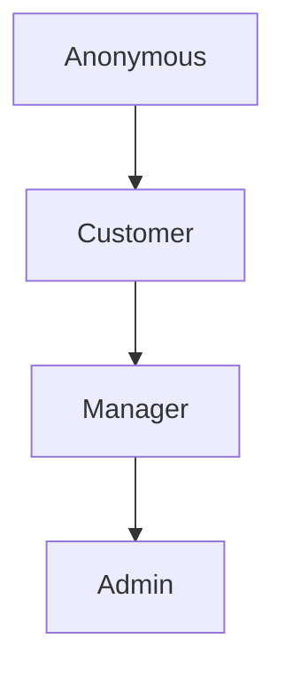
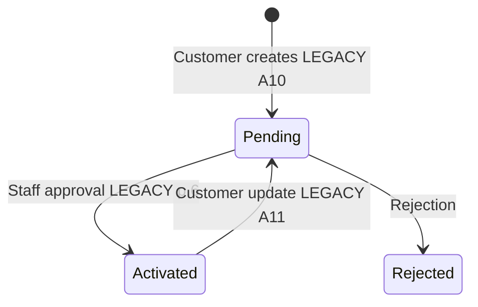
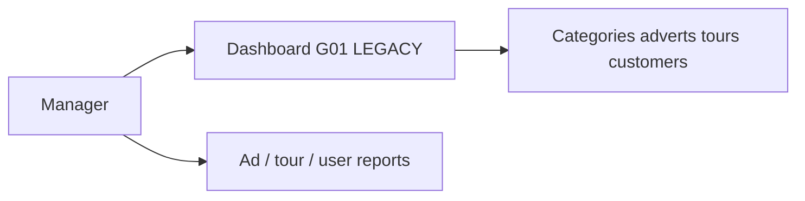
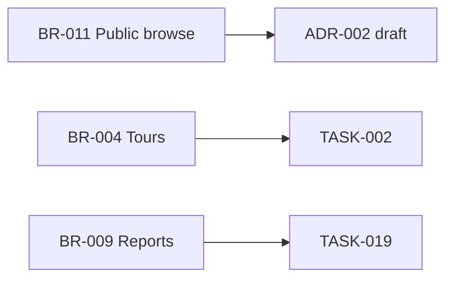

# Business Requirements Document (BRD) — v0.2.0

**Evidence classes:** **LEGACY** (2023 PDF / poster), **AS-IS** (verified code), **TO-BE** (proposed), **TBD** (unresolved).

Functional detail: [FRD-EN.md](../../02-requirements/FRD/FRD-EN.md). LEGACY catalogue: [LEGACY-REQUIREMENTS-ANALYSIS.md](../source-analysis/LEGACY-REQUIREMENTS-ANALYSIS.md).

---

## 1. Executive summary

Prettier Homes / **RealEstate** is a B2C property marketplace: sellers and renters publish listings; seekers browse, favorite, request tours, and contact the business.

**TASK-009 sync:** Business intent from **SRC-008-PDF** (103 pp., 70 LEGACY API *codes*) and **SRC-002** is reconciled with **AS-IS** backend and **35** functional requirements (TASK-008). This BRD states **what the business needs**; it does **not** specify HTTP paths or payloads (see FRD).

**Figure RE-FIG-BRD-003** — Business documentation lineage (v0.2.0).

---

## 2. Business background

| Source | Contribution |
|--------|----------------|
| SRC-008-PDF p. 3 | Marketplace abstraction; tours; advert logging |
| SRC-008-PDF p. 4 | Cross-cutting business-technical policies (auth token, validation, slugs) — summarized as constraints, not API |
| SRC-002 | Hierarchical role poster (Anonymous → Admin) |
| SRC-001 | Current stack description (education/portfolio context) |
| TASK-007/008 | Verified gap analysis |

PDF metadata title “OFFER MANAGEMENT PROJECT” is a **historical artifact**; content describes real estate (SRC-008-PDF).

---

## 3. Business objectives

| ID | Objective | Evidence | Class |
|----|-----------|----------|-------|
| BO-01 | Connect buyers/renters with sellers | PDF p. 3 | LEGACY |
| BO-02 | Enable registration, login, profile | PDF p. 12; poster | LEGACY + partial AS-IS |
| BO-03 | Support staff hierarchy (Customer, Manager, Admin) | PDF p. 12; SRC-002 | LEGACY + partial AS-IS |
| BO-04 | Listing discovery, publish, lifecycle with approval | PDF pp. 3, 6 | LEGACY + partial AS-IS |
| BO-05 | Tours and contact as engagement channels | PDF p. 3; poster | LEGACY; tours **TBD** AS-IS |
| BO-06 | Operational reporting for managers | PDF pp. 88–93 | LEGACY; AS-IS **missing** |
| BO-07 | Multi-language product experience | AS-IS `{language}`; FE i18n | AS-IS + TO-BE |
| BO-08 | Maintainable modernization (DDD/modular monolith) | Program | TO-BE |

---

## 4. Business scope

### In scope (intent)

- Identity: registration, login, profile, password recovery (**LEGACY** F03–F04)
- Listings: search, detail, create/update, moderation states
- Catalog: categories, advert types, geography
- Engagement: favorites, tour requests, contact messages
- Communication: internal mailbox (**AS-IS**; **not** in PDF)
- Media: property images (**LEGACY**; REST **TBD**)
- Reporting dashboards (**LEGACY** G01–G05)
- Activity logging on adverts (**LEGACY** p. 3, 20)

### Out of scope

- Payments, mortgages, MLS syndication
- Native mobile apps (unless future decision)
- Microservices without ADR (ADR-001 draft: modular monolith)

---

## 5. Stakeholders and actors

| Stakeholder | Primary actor | Interest |
|-------------|---------------|----------|
| Property seeker | Anonymous / Customer | Browse, favorite, tour, contact |
| Property owner | Customer | Publish and manage listings |
| Operations staff | Manager | Catalog, customers, messages, reports |
| Platform owner | Admin | Users, roles, full operations |
| Engineering | — | Traceable legacy vs current behavior |
| Learners | — | Documentation-led curriculum |

---

## 6. Roles and capabilities (business view)

### 6.1 LEGACY hierarchy (SRC-002 + PDF p. 12)

| Role | Business capabilities (summary) | PDF / poster |
|------|----------------------------------|--------------|
| **Anonymous** | Search listings, view details, register, contact form | Poster; PDF **ANONYMOUS +** on many reads |
| **Customer** | LEGACY Anonymous + login, profile, own listings, favorites, tours | p. 12 |
| **Manager** | Customer ops + catalog, customers, messages, reports (not Admin/Manager user admin) | p. 12; F11 scope **TBD** verify |
| **Admin** | All activities including Manager/Admin user governance | p. 12 |

**Figure RE-FIG-BRD-001** — LEGACY role inheritance (SRC-002, PDF p. 12).

See [ROLE_PERMISSION_MATRIX.md](../role-permission-matrix/ROLE_PERMISSION_MATRIX.md) and `../../assets/architecture/roles-hierarchy-legarcy.jpg`.

### 6.2 AS-IS note

Persisted roles: `ADMIN`, `MANAGER`, `CUSTOMER`, `PERSONAL` (test). **Anonymous** is not a stored role. JWT applies to most API calls today — **conflicts** with LEGACY public browse (BR-011, ADR-002 draft).

---

## 7. Business processes

### 7.1 Listing lifecycle

| Stage | LEGACY (PDF p. 6) | AS-IS | Related FR |
|-------|-------------------|-------|------------|
| Create | Customer submits advert | Implemented (auth required) | FR-ADV-002 |
| Pending | Status 0 Pending | `AdvertStatus.PENDING` | FR-ADV-002 |
| Activated | Manager/Admin approves | **TBD** workflow | FR-ADV-002 |
| Rejected | Status 2 Rejected | Enum exists; flow **TBD** | FR-ADV-002 |
| Customer edit | Resets to Pending (A11) | **TBD** rule in code | FR-ADV-002 |

**Figure RE-FIG-BRD-004** — Advert status business states (LEGACY).

Detail: [LISTING_LIFECYCLE.md](../business-processes/LISTING_LIFECYCLE.md).

### 7.2 Tour request (appointment)

| Step | LEGACY | AS-IS |
|------|--------|-------|
| Guest requests tour on advert | PDF p. 3; S05 | Entity exists; REST **missing** |
| Owner approves/declines | S08, S09 | **TBD** |
| Guest cancels | S07 | **TBD** |

**Related FR:** FR-TOUR-001, FR-TOUR-002. **Use case:** [UC-TOUR-01.md](../../02-requirements/use-cases/UC-TOUR-01.md).

### 7.3 Favorites

Customer toggles favorites on listings (poster; PDF K03). AS-IS implementation **partial** (FR-FAV-001).

### 7.4 Communication

- **Contact messages** (public/manager): PDF J01–J02 — FR-CNT-001
- **Internal mailbox**: AS-IS only — FR-MSG-001 (not in PDF)

### 7.5 Reporting (Manager/Admin)

LEGACY business dashboards: counts and filtered reports (PDF p. 89–93, G01–G05). **No AS-IS** reporting API verified — FR-RPT-001 … FR-RPT-005.

**Figure RE-FIG-BRD-005** — Reporting intent (LEGACY; response shape TBD p. 89 template residue).

### 7.6 Localization (business)

| Concern | LEGACY PDF | AS-IS product |
|---------|------------|---------------|
| UI languages | Not specified | EN/TR/DE on frontend (SRC-012) |
| API messages | Not specified | `{language}` path segment |
| Listing content language | Single fields in PDF entities | **TBD** content model |

**Related FR:** FR-I18N-001. **BR:** BR-001.

---

## 8. Business rules catalogue

Rules derived from PDF and poster; **not invented** beyond sources.

| ID | Rule | Source (page) | Class | Related FR |
|----|------|---------------|-------|------------|
| BRL-001 | Listing requires title, price, location, type, geography | p. 6 | LEGACY | FR-ADV-002 |
| BRL-002 | Advert status Pending / Activated / Rejected | p. 6 | LEGACY | FR-ADV-002 |
| BRL-003 | Customer advert update resets approval to Pending | p. 35 (A11) | LEGACY | FR-ADV-002 |
| BRL-004 | Built-in records cannot be updated/deleted via API | p. 4 | LEGACY | FR-CAT-001, FR-ADV-002 |
| BRL-005 | Tour status lifecycle Pending/Approved/Declined/Canceled | p. 14 | LEGACY | FR-TOUR-002 |
| BRL-006 | Default role Customer on self-registration | p. 77 (F02) | LEGACY | FR-AUTH-001 |
| BRL-007 | Password complexity on registration | p. 77 | LEGACY | FR-AUTH-001; verify **TBD** |
| BRL-008 | Forgot-password must not reveal unknown email | p. 78 | LEGACY | FR-AUTH-003 |
| BRL-009 | Advert-related actions logged | p. 3, 20 | LEGACY | FR-LOG-001 |
| BRL-010 | Slug used for public identity of listing | p. 4 | LEGACY | FR-ADV-008 |
| BRL-011 | Popularity considers views and tour volume | p. 28 (A04) | LEGACY | FR-ADV-005 |
| BRL-012 | Manager may only manage Customer users (not Mgr/Admin) | p. 86–87 (F11) | LEGACY | FR-ADM-001; **TBD** AS-IS |

---

## 9. Business constraints

| ID | Constraint | Class |
|----|------------|-------|
| BC-01 | PostgreSQL as system of record | LEGACY p. 4; AS-IS |
| BC-02 | Token-based authentication for protected operations | LEGACY p. 4; AS-IS JWT |
| BC-03 | JSON interchange format | LEGACY p. 4 |
| BC-04 | Reference geography seeded; LEGACY specified **read-only** public API (p. 4) — **diverges** from AS-IS admin CRUD | LEGACY vs AS-IS |
| BC-05 | No schema/code changes during documentation tranche | Process |
| BC-06 | Java 17 / Spring Boot 3.0 until approved stack migration | AS-IS |

---

## 10. Assumptions

| ID | Assumption | Status |
|----|------------|--------|
| BA-01 | Product may restore LEGACY anonymous catalog access via **ADR-002** (draft, not approved) | TBD |
| BA-02 | JWT remains primary auth until OAuth2/OIDC (TO-BE) | AS-IS |
| BA-03 | Modular monolith target (ADR-001 draft) | TO-BE |
| BA-04 | Internal messaging remains in product though absent from PDF | AS-IS product decision **TBD** formal sign-off |

---

## 11. Dependencies

- PostgreSQL
- Email provider for password reset and notifications (LEGACY F03 — **TBD** AS-IS)
- React web client (partial — SRC-012)
- LEGACY analysis and FR matrix for implementation planning

---

## 12. Success criteria

| ID | Criterion | v0.2.0 status |
|----|-----------|---------------|
| SC-01 | BR linked to FR IDs | **Met** (this revision) |
| SC-02 | LEGACY PDF rules traceable with page refs | **Met** via BRL-* |
| SC-03 | LEGACY vs AS-IS conflicts explicit | **Met** (BR-011, matrix) |
| SC-04 | BRD EN/TR structural parity | **Met** (TASK-009) |
| SC-05 | Approved product decisions for public read & tours | **Not met** — TBD |

---

## 13. Risks (business)

| Risk | Impact | Mitigation |
|------|--------|------------|
| Anonymous browse blocked | Poor seeker UX; LEGACY mismatch | ADR-002 decision (TASK-001) |
| Tour/favorite/report gaps | Core poster promises unmet | M1 tasks in [TODO.md](../../08-project-management/TODO.md) |
| RBAC not enforced | Wrong users perform staff actions | TASK-005 |
| PDF vs poster vs code role drift | Wrong authorization design | ROLE_PERMISSION_MATRIX + this BRD |

Full register: [RISKS.md](../../08-project-management/RISKS.md).

---

## 14. Business requirements catalogue

**Count: 18** business requirements (`BR-001` … `BR-018`). API details intentionally in FRD only.

| ID | Business requirement | Class | Related FR | LEGACY source |
|----|----------------------|-------|------------|---------------|
| **BR-001** | Platform supports localized UX and API messaging | AS-IS partial | FR-I18N-001 | AS-IS; PDF silent |
| **BR-002** | Role hierarchy governs staff vs customer capabilities | LEGACY / gap | FR-ADM-001, FR-ADM-002 | SRC-002; p. 12 |
| **BR-003** | Customers publish and manage own property listings | Partial AS-IS | FR-ADV-002, FR-ADV-006 | p. 3, 12 |
| **BR-004** | Users request and track property tours | LEGACY / TBD | FR-TOUR-001, FR-TOUR-002 | p. 3, 14 |
| **BR-005** | Staff maintain catalog, geography, categories, advert types | Partial | FR-CAT-001, FR-CAT-002, FR-GEO-001, FR-GEO-002 | p. 4, 12 |
| **BR-006** | Users send contact inquiries; staff manage communication | Partial | FR-CNT-001, FR-MSG-001 | J01–J02; poster |
| **BR-007** | Users maintain favorites across listings | LEGACY / partial | FR-FAV-001 | poster; K01–K06 |
| **BR-008** | Admins (and managers per policy) govern users and roles | Partial AS-IS | FR-ADM-001, FR-ADM-002 | poster; F09–F12 |
| **BR-009** | Managers access operational reports and statistics | LEGACY / missing | FR-RPT-001 … FR-RPT-005 | G01–G05 |
| **BR-010** | Platform evolvable toward Clean/DDD modular monolith | TO-BE | — | ADR-001 |
| **BR-011** | Visitors browse catalog without login (listings & reference data) | LEGACY / **conflict** | FR-ADV-001, FR-GEO-001, FR-CNT-001 | A01, U01–U03; poster |
| **BR-012** | Consistent Prettier Homes brand experience | LEGACY | — | SRC-009, SRC-010 |
| **BR-013** | Listings pass staff approval before broad publication | LEGACY | FR-ADV-002 | p. 6 |
| **BR-014** | Advert lifecycle events are auditable in business logs | LEGACY | FR-LOG-001 | p. 3, 20 |
| **BR-015** | Users recover access via secure password reset | LEGACY / missing | FR-AUTH-003, FR-AUTH-004 | F03–F04 |
| **BR-016** | Listings include managed image media | LEGACY / missing | FR-MED-001 | I01–I04 |
| **BR-017** | Seekers discover listings via search, aggregates, popularity | LEGACY / partial | FR-ADV-003, FR-ADV-004, FR-ADV-005 | A01–A04 |
| **BR-018** | Seekers open listing detail via stable public identifiers (slug) | LEGACY / missing | FR-ADV-008 | p. 4, A07 |

**Figure RE-FIG-BRD-006** — Open business decisions (TBD implementation).

---

## 15. Traceability

| Document | Role |
|----------|------|
| [TRACEABILITY_MATRIX.md](../../00-governance/TRACEABILITY_MATRIX.md) | BR → FR → TASK |
| [LEGACY_API_TO_FR_MATRIX.md](../../02-requirements/FRD/LEGACY_API_TO_FR_MATRIX.md) | 70 codes → FR |
| [SOURCE_REGISTER.md](../../00-governance/SOURCE_REGISTER.md) | Evidence IDs |

---

## 16. Change history

| Version | Date | Summary |
|---------|------|---------|
| 0.1.0 | 2026-11-13 | Initial BRD |
| 0.2.0 | 2026-11-13 | TASK-009 sync with PDF/FRD v0.2.0; 18 BRs; BRL rules; processes |
