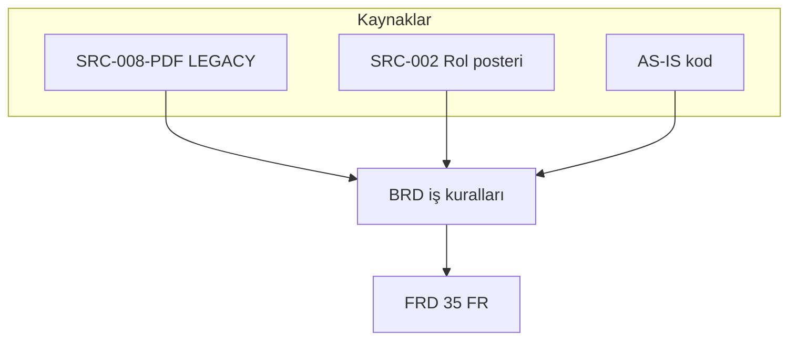
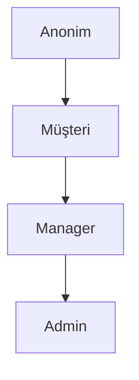
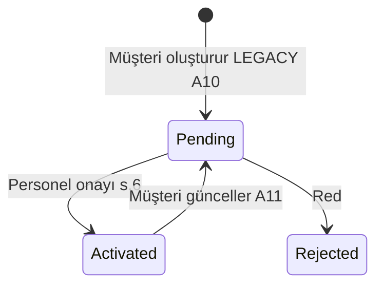
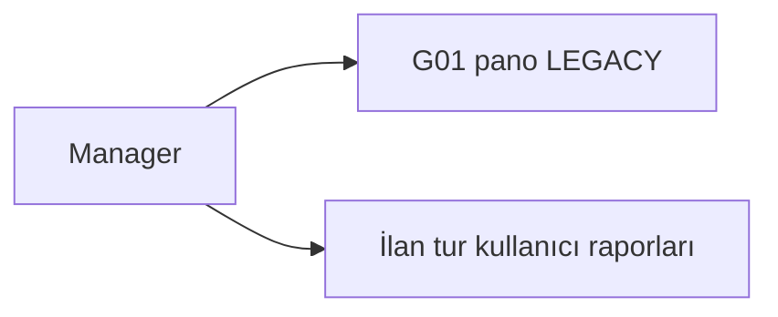
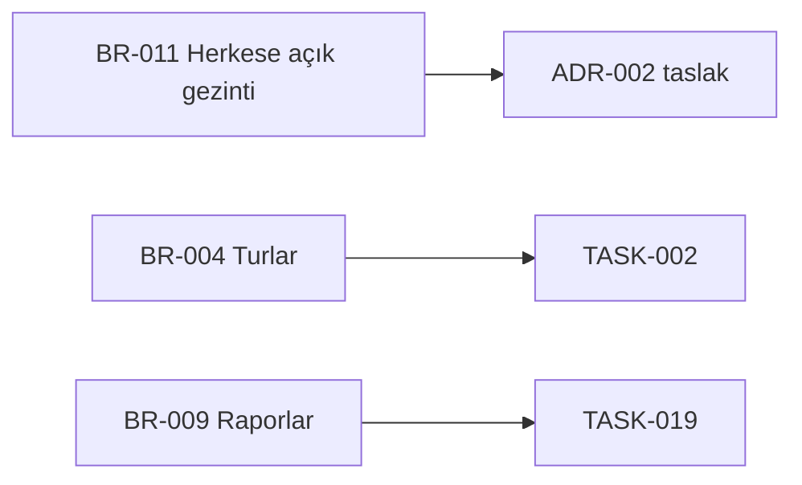

# İş Gereksinimleri Dokümanı (BRD) — v0.2.0

**Kanıt sınıfları:** **LEGACY** (2023 PDF / poster), **AS-IS** (doğrulanmış kod), **TO-BE** (öneri), **TBD** (çözülmemiş).

Fonksiyonel detay: [FRD-TR.md](../../02-requirements/FRD/FRD-TR.md). LEGACY kataloğu: [LEGACY-REQUIREMENTS-ANALYSIS.md](../source-analysis/LEGACY-REQUIREMENTS-ANALYSIS.md).

---

## 1. Yönetici özeti

Prettier Homes / **RealEstate**, B2C gayrimenkul pazarıdır: satıcı/kiraya veren ilan yayınlar; arayanlar gezer, favoriler, tur talebi ve iletişim kullanır.

**TASK-009 senkronu:** **SRC-008-PDF** (103 sayfa, 70 LEGACY API *kodu*) ve **SRC-002** iş niyeti, **AS-IS** backend ve **35** fonksiyonel gereksinimle (TASK-008) uzlaştırılmıştır. Bu BRD **iş ihtiyacını** anlatır; HTTP yolu veya gövde tanımı içermez (bkz. FRD).

**Şekil RE-FIG-BRD-003-TR** — İş dokümantasyonu soyutlaması (v0.2.0).

---

## 2. İş arka planı

| Kaynak | Katkı |
|--------|-------|
| SRC-008-PDF s. 3 | Pazar yeri özeti; turlar; ilan günlüğü |
| SRC-008-PDF s. 4 | Çapraz kesit politikalar (token, validasyon, slug) — kısıt olarak özet |
| SRC-002 | Hiyerarşik roller (Anonim → Admin) |
| SRC-001 | Mevcut yığın (eğitim/portföy bağlamı) |
| TASK-007/008 | Doğrulanmış boşluk analizi |

PDF metadata başlığı “OFFER MANAGEMENT PROJECT” **tarihsel** bir artefakttır; içerik gayrimenkuldür.

---

## 3. İş hedefleri

| ID | Hedef | Kanıt | Sınıf |
|----|-------|-------|-------|
| BO-01 | Alıcı/kiracı ile satıcıyı buluşturmak | s. 3 | LEGACY |
| BO-02 | Kayıt, giriş, profil | s. 12; poster | LEGACY + kısmi AS-IS |
| BO-03 | Customer / Manager / Admin hiyerarşisi | s. 12; SRC-002 | LEGACY + kısmi AS-IS |
| BO-04 | İlan keşfi, yayın, onay döngüsü | s. 3, 6 | LEGACY + kısmi AS-IS |
| BO-05 | Tur ve iletişim kanalları | s. 3; poster | LEGACY; tur AS-IS **TBD** |
| BO-06 | Yönetim raporları | s. 88–93 | LEGACY; AS-IS **yok** |
| BO-07 | Çok dilli ürün deneyimi | AS-IS `{language}`; FE i18n | AS-IS + TO-BE |
| BO-08 | Sürdürülebilir modernizasyon | Program | TO-BE |

---

## 4. İş kapsamı

### Kapsam dahili

- Kimlik: kayıt, giriş, profil, şifre kurtarma (**LEGACY** F03–F04)
- İlanlar: arama, detay, CRUD, durumlar
- Katalog: kategori, ilan tipi, coğrafya
- Etkileşim: favori, tur, iletişim
- İletişim: dahili mesaj kutusu (**AS-IS**; PDF’de **yok**)
- Medya: ilan görselleri (**LEGACY**; REST **TBD**)
- Rapor panoları (**LEGACY** G01–G05)
- İlan aktivite günlüğü (**LEGACY** s. 3, 20)

### Kapsam dışı

- Ödeme, mortgage, MLS
- Native mobil (gelecek karar)
- Onaysız mikroservis bölünmesi (ADR-001: modular monolith taslağı)

---

## 5. Paydaşlar ve aktörler

| Paydaş | Aktör | İlgi |
|--------|-------|------|
| İlan arayan | Anonim / Müşteri | Gezinme, favori, tur, iletişim |
| Mülk sahibi | Müşteri | İlan yayını ve yönetimi |
| Operasyon | Manager | Katalog, müşteri, mesaj, rapor |
| Platform | Admin | Kullanıcı/rol yönetimi |
| Mühendislik | — | LEGACY vs AS-IS izlenebilirlik |
| Öğrenenler | — | Dokümantasyon müfredatı |

---

## 6. Roller ve yetenekler (iş görünümü)

### 6.1 LEGACY hiyerarşi (SRC-002 + PDF s. 12)

| Rol | İş yetenekleri | Kaynak |
|-----|----------------|--------|
| **Anonim** | Arama, detay, üyelik, iletişim | Poster; PDF’de birçok okuma için **ANONYMOUS +** |
| **Müşteri** | Anonim + giriş, profil, ilan, favori, tur | s. 12 |
| **Manager** | Müşteri operasyonu + katalog; Manager/Admin kullanıcı yönetimi **hariç** | s. 12; F11 kapsamı **TBD** |
| **Admin** | Tüm aktiviteler + Manager/Admin kullanıcı yönetimi | s. 12 |

**Şekil RE-FIG-BRD-001-TR** — LEGACY rol kalıtımı.

Bkz. [ROLE_PERMISSION_MATRIX.md](../role-permission-matrix/ROLE_PERMISSION_MATRIX.md).

### 6.2 AS-IS notu

Kalıcı roller: `ADMIN`, `MANAGER`, `CUSTOMER`, `PERSONAL` (test). **Anonim** kayıtlı rol değildir. Çoğu çağrıda JWT — **LEGACY** herkese açık gezinti ile çelişir (BR-011, ADR-002 taslağı).

---

## 7. İş süreçleri

### 7.1 İlan yaşam döngüsü

| Aşama | LEGACY (s. 6) | AS-IS | FR |
|-------|---------------|-------|-----|
| Oluşturma | Müşteri ilan gönderir | Var (JWT) | FR-ADV-002 |
| Beklemede | Durum 0 | `PENDING` | FR-ADV-002 |
| Aktif | Personel onayı | Akış **TBD** | FR-ADV-002 |
| Red | Durum 2 | Enum var; akış **TBD** | FR-ADV-002 |
| Müşteri güncelleme | Pending’e reset (A11) | Kural **TBD** | FR-ADV-002 |

**Şekil RE-FIG-BRD-004-TR** — İlan durumları (LEGACY).

### 7.2 Tur talebi

| Adım | LEGACY | AS-IS |
|------|--------|-------|
| Misafir tur ister | s. 3; S05 | Varlık var; REST **yok** |
| Sahip onay/red | S08, S09 | **TBD** |
| Misafir iptal | S07 | **TBD** |

**FR:** FR-TOUR-001, FR-TOUR-002. **UC:** [UC-TOUR-01.md](../../02-requirements/use-cases/UC-TOUR-01.md).

### 7.3 Favoriler

Poster; PDF K03. AS-IS **kısmi** (FR-FAV-001).

### 7.4 İletişim

- **İletişim mesajları:** J01–J02 — FR-CNT-001
- **Dahili mesaj:** AS-IS — FR-MSG-001 (PDF’de yok)

### 7.5 Raporlama

LEGACY panolar (s. 89–93, G01–G05). AS-IS API **doğrulanmadı** — FR-RPT-001 … FR-RPT-005.

**Şekil RE-FIG-BRD-005-TR** — Raporlama niyeti (LEGACY).

### 7.6 Yerelleştirme (iş)

| Konu | LEGACY PDF | AS-IS |
|------|------------|-------|
| UI dilleri | Belirtilmemiş | EN/TR/DE (SRC-012) |
| API mesajları | Belirtilmemiş | `{language}` yolu |
| İlan içerik dili | Tek alanlar | **TBD** |

**FR:** FR-I18N-001. **BR:** BR-001.

---

## 8. İş kuralları kataloğu

| ID | Kural | Kaynak (sayfa) | Sınıf | FR |
|----|-------|----------------|-------|-----|
| BRL-001 | Başlık, fiyat, konum, tip, coğrafya zorunlu | s. 6 | LEGACY | FR-ADV-002 |
| BRL-002 | Pending / Activated / Rejected | s. 6 | LEGACY | FR-ADV-002 |
| BRL-003 | Müşteri güncelleme → Pending | s. 35 | LEGACY | FR-ADV-002 |
| BRL-004 | built_in kayıtlar API ile değiştirilemez | s. 4 | LEGACY | FR-CAT-001, FR-ADV-002 |
| BRL-005 | Tur durum yaşam döngüsü | s. 14 | LEGACY | FR-TOUR-002 |
| BRL-006 | Kayıtta varsayılan Customer | s. 77 | LEGACY | FR-AUTH-001 |
| BRL-007 | Şifre karmaşıklığı | s. 77 | LEGACY | FR-AUTH-001; **TBD** |
| BRL-008 | Şifre sıfırlamada e-posta ifşası yok | s. 78 | LEGACY | FR-AUTH-003 |
| BRL-009 | İlan aktiviteleri loglanır | s. 3, 20 | LEGACY | FR-LOG-001 |
| BRL-010 | Slug kamusal tanımlayıcı | s. 4 | LEGACY | FR-ADV-008 |
| BRL-011 | Popülerlik görüntüleme + tur sayısı | s. 28 | LEGACY | FR-ADV-005 |
| BRL-012 | Manager yalnızca Customer kullanıcı yönetir | s. 86–87 | LEGACY | FR-ADM-001; **TBD** |

---

## 9. İş kısıtları

| ID | Kısıt | Sınıf |
|----|-------|-------|
| BC-01 | PostgreSQL | LEGACY s. 4; AS-IS |
| BC-02 | Token ile kimlik doğrulama | LEGACY s. 4; JWT |
| BC-03 | JSON formatı | LEGACY s. 4 |
| BC-04 | Coğrafya LEGACY’de salt okunur; AS-IS’te tam CRUD | LEGACY vs AS-IS |
| BC-05 | Dokümantasyon fazında şema/kod değişikliği yok | Süreç |
| BC-06 | Java 17 / Boot 3.0 onaylı migrasyon öncesi | AS-IS |

---

## 10. Varsayımlar

| ID | Varsayım | Durum |
|----|----------|-------|
| BA-01 | Anonim katalog ADR-002 ile geri gelebilir (taslak, onaylı değil) | TBD |
| BA-02 | JWT birincil auth (OAuth2 TO-BE) | AS-IS |
| BA-03 | Modular monolith (ADR-001 taslağı) | TO-BE |
| BA-04 | PDF’de olmayan dahili mesaj üründe kalır | AS-IS; formal onay **TBD** |

---

## 11. Bağımlılıklar

- PostgreSQL
- E-posta (F03 — AS-IS **TBD**)
- React istemci (kısmi)
- LEGACY analiz ve FR matrisi

---

## 12. Başarı ölçütleri

| ID | Ölçüt | v0.2.0 |
|----|-------|--------|
| SC-01 | BR ↔ FR bağlantısı | **Karşılandı** |
| SC-02 | BRL kurallarında sayfa referansı | **Karşılandı** |
| SC-03 | Çelişkiler açık | **Karşılandı** |
| SC-04 | BRD EN/TR yapı paritesi | **Karşılandı** |
| SC-05 | Herkese açık okuma & tur kararları | **Karşılanmadı** — TBD |

---

## 13. Riskler

| Risk | Etki | Önlem |
|------|------|-------|
| Anonim gezinti engeli | UX / LEGACY uyumsuzluğu | ADR-002, TASK-001 |
| Tur/favori/rapor boşlukları | Poster vaadi eksik | TODO M1 |
| RBAC zayıf | Yetki ihlali | TASK-005 |

Tam liste: [RISKS.md](../../08-project-management/RISKS.md).

---

## 14. İş gereksinimleri kataloğu

**Adet: 18** (`BR-001` … `BR-018`). API detayı yalnızca FRD’de.

| ID | Gereksinim | Sınıf | İlgili FR | LEGACY kaynak |
|----|------------|-------|-----------|---------------|
| **BR-001** | Yerelleştirilmiş UX ve API mesajları | AS-IS kısmi | FR-I18N-001 | AS-IS |
| **BR-002** | Rol hiyerarşisi | LEGACY / boşluk | FR-ADM-001, FR-ADM-002 | SRC-002; s. 12 |
| **BR-003** | Müşteri ilan yayını ve yönetimi | Kısmi AS-IS | FR-ADV-002, FR-ADV-006 | s. 3, 12 |
| **BR-004** | Tur talep ve takibi | LEGACY / TBD | FR-TOUR-001, FR-TOUR-002 | s. 3, 14 |
| **BR-005** | Katalog ve coğrafya yönetimi | Kısmi | FR-CAT-*, FR-GEO-* | s. 4, 12 |
| **BR-006** | İletişim ve mesajlaşma | Kısmi | FR-CNT-001, FR-MSG-001 | J01–J02 |
| **BR-007** | Favoriler | LEGACY / kısmi | FR-FAV-001 | K01–K06 |
| **BR-008** | Kullanıcı ve rol yönetimi | Kısmi AS-IS | FR-ADM-001, FR-ADM-002 | F09–F12 |
| **BR-009** | Operasyon raporları | LEGACY / eksik | FR-RPT-001 … 005 | G01–G05 |
| **BR-010** | Clean/DDD evrimi | TO-BE | — | ADR-001 |
| **BR-011** | Girişsiz katalog gezintisi | LEGACY / **çelişki** | FR-ADV-001, FR-GEO-001, FR-CNT-001 | A01; poster |
| **BR-012** | Prettier Homes markası | LEGACY | — | SRC-009/010 |
| **BR-013** | Yayın öncesi personel onayı | LEGACY | FR-ADV-002 | s. 6 |
| **BR-014** | İlan aktivite denetim izi | LEGACY | FR-LOG-001 | s. 3, 20 |
| **BR-015** | Güvenli şifre sıfırlama | LEGACY / eksik | FR-AUTH-003, FR-AUTH-004 | F03–F04 |
| **BR-016** | İlan görsel yönetimi | LEGACY / eksik | FR-MED-001 | I01–I04 |
| **BR-017** | Arama, özet, popülerlik keşfi | LEGACY / kısmi | FR-ADV-003 … 005 | A01–A04 |
| **BR-018** | Slug ile kamusal ilan detayı | LEGACY / eksik | FR-ADV-008 | s. 4, A07 |

**Şekil RE-FIG-BRD-006-TR** — Açık ürün kararları.

---

## 15. İzlenebilirlik

| Belge | Rol |
|-------|-----|
| [TRACEABILITY_MATRIX.md](../../00-governance/TRACEABILITY_MATRIX.md) | BR → FR → TASK |
| [LEGACY_API_TO_FR_MATRIX.md](../../02-requirements/FRD/LEGACY_API_TO_FR_MATRIX.md) | 70 kod |
| [SOURCE_REGISTER.md](../../00-governance/SOURCE_REGISTER.md) | Kanıt |

---

## 16. Değişiklik geçmişi

| Sürüm | Tarih | Özet |
|-------|-------|------|
| 0.1.0 | 2026-11-13 | İlk BRD |
| 0.2.0 | 2026-11-13 | TASK-009 PDF/FRD v0.2.0 senkronu |
