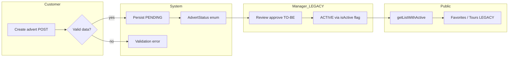

# Listing Lifecycle (BPMN-style)

**Figure RE-FIG-PROC-001** — Listing lifecycle aligned to `Advert` + `AdvertStatus` (AS-IS) with LEGACY moderation (**TBD**).

| Step | AS-IS | Source |
|------|-------|--------|
| Create | `POST /api/v1.0/adverts/{language}/add` | SRC-005 |
| Status field | `AdvertStatus.PENDING` default | SRC-016 |
| Active filter | `getListWithActive` | SRC-005 |
| Manager approval workflow | Not verified | TBD |
