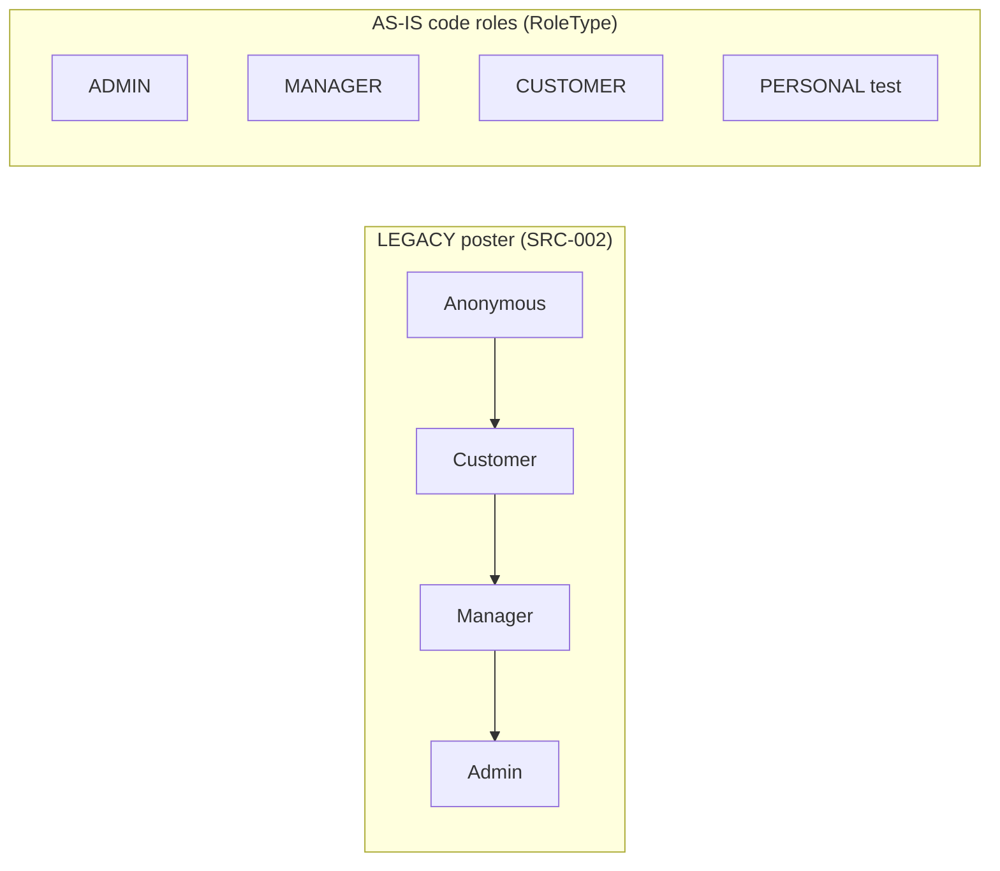

# Role and Permission Matrix

## 1. Role model overview

**Figure RE-FIG-RPM-001** — LEGACY hierarchical roles vs AS-IS enum (note: **PERSONAL** not on poster).

Legacy reference image: `assets/architecture/roles-hierarchy-legarcy.jpg`.

## 2. Capability matrix

Legend: ✅ LEGACY intent | ⚠️ AS-IS partial | ❌ Not verified | 🔒 JWT required (AS-IS default for most APIs)

| Capability | Anonymous (LEGACY) | Customer | Manager | Admin | AS-IS notes |
|------------|---------------------|----------|---------|-------|-------------|
| Search/browse listings | ✅ | ✅ | ✅ | ✅ | ⚠️ `GET adverts/*` exists but **🔒 JWT**; conflicts LEGACY (BR-011, PDF A01 p. 25) |
| View listing detail | ✅ | ✅ | ✅ | ✅ | Same as above |
| Register (sign up) | ✅ | — | — | — | AS-IS: `POST .../auth/{lang}/signUp` public |
| Login | — | ✅ | ✅ | ✅ | AS-IS: public |
| Manage own profile | — | ✅ | ✅ | ✅ | `UserController` update endpoints **🔒** |
| Post listing | — | ✅ | ✅ | ✅ | `POST adverts/add` **🔒** |
| Manage own listings | — | ✅ | ✅ | ✅ | PUT/DELETE adverts **🔒** |
| Favorites | — | ✅ | ✅ | ✅ | ⚠️ Customer add/remove **commented out**; admin GET only |
| Tour/appointment request | — | ✅ | ✅ | ✅ | ❌ REST not exposed (`TourRequestController` empty) |
| Category/type/location CRUD | — | — | ✅ | ✅ | Endpoints exist **🔒**; `@PreAuthorize` **commented out** |
| Contact message submit | ✅ | ✅ | ✅ | ✅ | POST `contact-messages/.../add` **🔒** (whitelist typo `contact-Messages` unlikely to match) |
| In-app messaging | — | — | ✅ | ✅ | `MessageController` full CRUD **🔒** |
| User/role administration | — | — | partial | ✅ | `AdminController`, `RoleController` **🔒** |
| Reports | — | — | ✅ LEGACY | ✅ | ❌ No dedicated reporting API found |
| Manage Manager/Admin users | — | — | — | ✅ LEGACY | Partial via `AdminController` |

## 3. Authorization mechanism (AS-IS)

| Mechanism | Status |
|-----------|--------|
| URL-level `permitAll` for auth signup/login | AS-IS |
| Method-level `@PreAuthorize` | Commented out in `CategoryController` (SRC-005) |
| Role checks in service layer | **TBD** — requires deeper service review |

## 4. TO-BE direction (not approved)

- Enforce role-based access at application layer (hexagonal ports).
- Align public read endpoints with LEGACY Anonymous capabilities.
- Remove or isolate `PERSONAL` test role from production policy.

## 5. Change history

| Version | Date | Summary |
|---------|------|---------|
| 0.1.0 | 2026-11-13 | Initial matrix with LEGACY vs AS-IS gaps |
| 0.2.0 | 2026-11-13 | TASK-009 BRD sync; PDF page refs; BR-011 |
