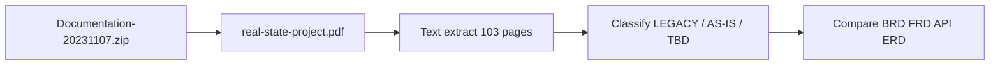
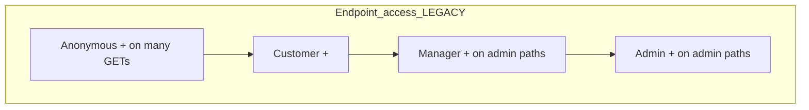
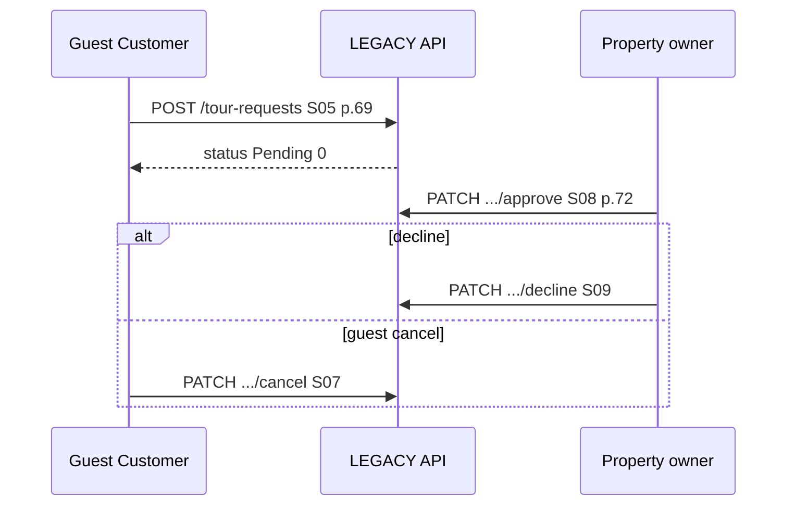
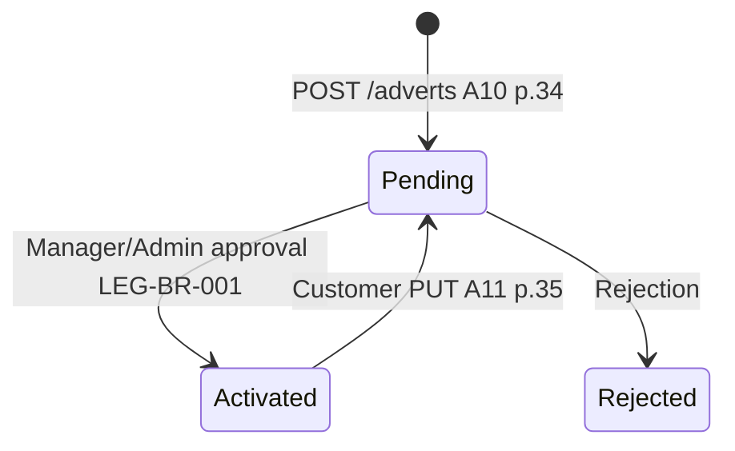
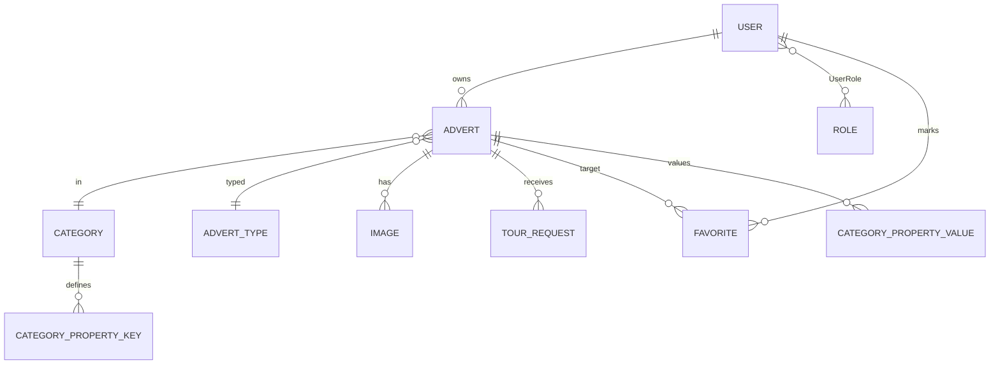
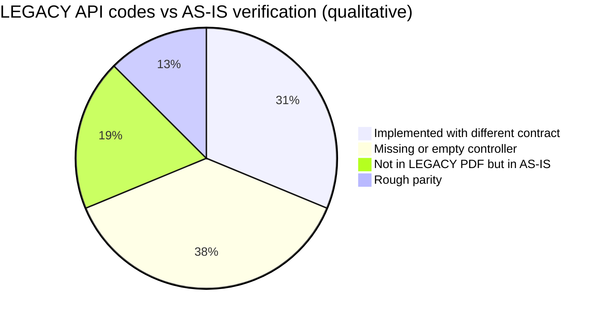

# LEGACY Requirements Analysis — `real-state-project.pdf`

> **Warning:** This report describes **historical (2023) specification evidence**. It is **not** the current system contract. AS-IS behavior must be verified in source code ([API-INVENTORY.md](../../03-architecture/api/API-INVENTORY.md)).

---

## 1. Source metadata

| Field | Value | Evidence |
|-------|-------|----------|
| **Archive** | `files/Documentation-20231107.zip` | Verified on disk; **not modified** |
| **PDF filename** | `real-state-project.pdf` | Inside archive |
| **File size** | 847 550 bytes | Filesystem |
| **Page count** | **103** | pypdf / PyMuPDF extraction |
| **PDF metadata title** | `OFFER MANAGEMENT PROJECT` | PowerPoint export artifact; content is Real Estate |
| **Author** | Ziya Sarı | PDF metadata |
| **Creator / Producer** | Microsoft® PowerPoint® 2019 | PDF metadata |
| **CreationDate** | `2023-11-06T12:39:10+01:00` | PDF metadata |
| **Extracted text** | ~31 214 characters | Full-document OCR/text extract |
| **Embedded raster images** | 2 (pages **1**, **23**) | PyMuPDF image blocks |
| **Extraction task** | TASK-007 | 2026-11-13 |
| **Source ID** | SRC-008 (archive), **SRC-008-PDF** (this analysis) | [SOURCE_REGISTER.md](../../00-governance/SOURCE_REGISTER.md) |

**Figure LEG-FIG-001** — Extraction pipeline (TASK-007).

---

## 2. Executive summary

The 2023 PDF is a **slide-deck specification** (PowerPoint → PDF) covering:

1. **Business narrative** (marketplace for sell/rent, tours, logging) — pp. **3–4**
2. **Cross-cutting technical rules** (JWT, PostgreSQL, JSON, slugs, audit timestamps) — p. **4**
3. **Entity data dictionary** (14 logical tables) — pp. **6–21**
4. **REST API catalogue** with **70 coded requirements** (`A01`…`K06`, `F01`…`F12`, etc.) — pp. **25–103**
5. **Relational diagram reference** (visual on p. **23**; text on p. **22** only says “Click to see…”)

**Not covered in PDF:** internal **Message** mailbox API (present in AS-IS code), explicit **Role** CRUD API, **Log** read API, **i18n / `{language}` path** pattern used in current backend.

**AS-IS backend** uses **`api/v1.0/.../{language}/...`** and **JWT for most calls**; LEGACY spec uses **root paths** (`/adverts`, `/login`) and marks **Anonymous (+)** on most read endpoints — **major auth/routing gap**.

**Internal PDF inconsistency:** Report dashboard sample (p. **89**) mentions `brands`, `products`, `offers` while requirements list adverts/tour requests — likely **template residue** (classify **TBD** for report shape).

---

## 3. Historical business objectives

| ID | Objective | Pages | Class |
|----|-----------|-------|-------|
| LEG-BIZ-001 | Connect sellers/renters with buyers/renters | 3 | LEGACY |
| LEG-BIZ-002 | Visitors register, browse, submit tour requests, publish adverts | 3 | LEGACY |
| LEG-BIZ-003 | Tour request routed to owner; owner accept/reject | 3 | LEGACY |
| LEG-BIZ-004 | Log all advert-related activities | 3, 20 | LEGACY |
| LEG-BIZ-005 | Administrative approval workflow for adverts (Pending/Activated/Rejected) | 6 | LEGACY |

---

## 4. Stakeholder and role model

### 4.1 PDF role definitions (p. 12)

| Role | LEGACY capabilities (summary) | Page |
|------|------------------------------|------|
| **Customer** | Register, login, search, details, profile, tour requests, own adverts/favorites | 12 |
| **Manager** | All customer activities except manager/admin user governance | 12 |
| **Admin** | Manage all activities | 12 |

**Anonymous** is not a stored role but appears as **ANONYMOUS** column on endpoint permission tables (pp. **25+**).

### 4.2 Comparison with SRC-002 (`Roles.JPG`)

| Aspect | PDF (p. 12) | Roles.JPG | AS-IS code |
|--------|-------------|-----------|------------|
| Hierarchy | admin, Manager, Customer text | Anonymous→Customer→Manager→Admin poster | `RoleType` + **PERSONAL** test enum |
| Manager vs Admin user mgmt | Implied in endpoint `+` matrix | Explicit on poster | `AdminController` partial |

### 4.3 LEGACY role–permission matrix (conceptual)

**Figure LEG-FIG-002** — LEGACY permission model derived from endpoint tables (pp. 25–103). **Not AS-IS** (JWT required for most reads today).

---

## 5. Functional requirement catalogue

### 5.1 Cross-cutting (Common) — p. 4

| ID | Requirement | Page | Class |
|----|-------------|------|-------|
| LEG-COM-001 | Token-based API authentication | 4 | LEGACY → partial **AS-IS** (JWT) |
| LEG-COM-002 | PostgreSQL persistence | 4 | **AS-IS** |
| LEG-COM-003 | Validate endpoint parameters (types, lengths) | 4 | **AS-IS** partial (Bean Validation) |
| LEG-COM-004 | JSON responses | 4 | **AS-IS** |
| LEG-COM-005 | `built_in` DB-only; false on create; exclude from updates | 4 | **TBD** service rules |
| LEG-COM-006 | Slug = URL-encoded title; FE uses slug instead of id | 4 | **AS-IS** partial (`Advert.slug`); slug routing **TBD** |
| LEG-COM-007 | `create_at` / `update_at` on create/update | 4 | **AS-IS** via `BaseEntity` patterns **TBD** audit |
| LEG-COM-008 | Admin user auto-created at build time | 4 | **TBD** verify seed |
| LEG-COM-009 | Country/city/district **GET only**; seed at build | 4 | **LEGACY** vs **AS-IS CRUD** on geo controllers |

### 5.2 Advert & search (A01–A13)

| Code | Summary | Page | Anonymous per PDF |
|------|---------|------|-------------------|
| A01 | Paged search `GET /adverts` with filters | 25 | Yes |
| A02 | Adverts grouped by city | 26 | Yes |
| A03 | Adverts grouped by category (note: path typo `/adverts/types` on p. 27) | 27 | Yes |
| A04 | Popular adverts formula PP=3×TROA+TVOA | 28 | Yes |
| A05–A06 | User/admin advert lists | 29–30 | Customer/Manager+ |
| A07 | Detail by **slug** | 31 | Yes |
| A08–A13 | Auth/admin CRUD, status reset on customer update | 32–37 | Mixed |

### 5.3 Other functional domains

| Domain | Codes | Pages | AS-IS summary |
|--------|-------|-------|---------------|
| Images | I01–I04 | 39–42 | **TBD** — `ImageController` empty |
| Categories | C01–C10 | 44–53 | Partial — different paths & language |
| Advert types | T01–T05 | 55–59 | **TBD** — controller empty |
| Address | U01–U03 | 61–63 | Partial — LEGACY GET-only vs CRUD |
| Tour requests | S01–S10 | 65–74 | **TBD** — controller empty |
| Users/auth | F01–F12 | 76–87 | Partial — `/auth/{lang}` not `/login` |
| Reports | G01–G05 | 89–93 | **Missing** in AS-IS |
| Contact | J01–J02 | 95–96 | Partial |
| Favorites | K01–K06 | 98–103 | Partial |

**Total coded API requirements extracted:** **70** (pages **25–103**).

---

## 6. Non-functional requirements (LEGACY)

| ID | Topic | Page | Class | AS-IS note |
|----|-------|------|-------|------------|
| LEG-NFR-001 | PostgreSQL | 4 | LEGACY | AS-IS |
| LEG-NFR-002 | Token authentication | 4 | LEGACY | JWT AS-IS |
| LEG-NFR-003 | Input validation | 4 | LEGACY | Partial |
| LEG-NFR-004 | JSON API format | 4 | LEGACY | AS-IS |
| LEG-NFR-005 | Cascading delete rules (adverts, users) | 37, 83, 87 | LEGACY | **TBD** verify |
| LEG-NFR-006 | Popularity ranking algorithm | 28 | LEGACY | Not in AS-IS |
| LEG-NFR-007 | Password complexity on register | 77 | LEGACY | **TBD** validate in `AuthManager` |
| LEG-NFR-008 | Forgot-password must not reveal email existence | 78 | LEGACY | **Not found** in code grep |
| LEG-NFR-009 | Advert activities logging | 3, 20 | LEGACY | `Log` entity; API **TBD** |

No explicit performance, availability, or WCAG NFRs in PDF — **gap**.

---

## 7. Business rules

| ID | Rule | Page(s) | Class |
|----|------|---------|-------|
| LEG-BR-001 | Advert status 0=Pending, 1=Activated, 2=Rejected | 6 | LEGACY / partial AS-IS enum |
| LEG-BR-002 | Customer update resets status to Pending | 35 | LEGACY |
| LEG-BR-003 | `built_in` records cannot update/delete | 4, 35–37 | LEGACY |
| LEG-BR-004 | Tour status 0–3 Pending/Approved/Declined/Canceled | 14 | LEGACY |
| LEG-BR-005 | Owner approves/declines tour; guest can cancel | 14, 72–73 | LEGACY |
| LEG-BR-006 | Default Customer role on register | 77 | LEGACY **TBD** |
| LEG-BR-007 | Manager may only manage Customer users (not Manager/Admin) | 86–87 | LEGACY **TBD** |
| LEG-BR-008 | Category delete blocked if adverts exist | 49 | LEGACY **TBD** |
| LEG-BR-009 | Favorite toggle add/remove by advert id | 100 | LEGACY |

---

## 8. Use cases and workflows

### 8.1 Tour request workflow (LEGACY)

**Figure LEG-FIG-003** — LEGACY tour lifecycle (pages 14, 69–74). **AS-IS:** no REST mappings.

### 8.2 Advert publication (LEGACY)

**Figure LEG-FIG-004** — LEGACY advert status (page 6).

### 8.3 User registration (LEGACY F02, p. 77)

Phone format `(XXX) XXX-XXXX`, password rules (8+ chars, letter, number, special). Email validation. Returns user + default Customer role.

---

## 9. Historical data model

Entities documented pp. **6–21**: Advert, Category, CategoryPropertyKey, CategoryPropertyValue, Favorite, User, Role, UserRole, TourRequest, Image, AdvertType, Country, City, District, Log, Contact.

**Figure LEG-FIG-005** — LEGACY logical model (synthesis from pp. 6–21). Compare [ERD-AS-IS.md](../../03-architecture/database/ERD-AS-IS.md).

### Notable field-level LEGACY vs AS-IS

| Entity | LEGACY (PDF) | AS-IS note |
|--------|--------------|------------|
| Advert | `location` Google embed; `status` int | `location` string; `AdvertStatus` enum |
| Image | `data Oid` in DB | **TBD** mapping strategy |
| Category | `icon`, `seq`, `slug`, `built_in` | **AS-IS** fields present in `Category.java` |
| User | `reset_password_code` | **TBD** forgot/reset flow |
| Log | action codes CREATED, TOUR_* etc. | Entity exists; REST **TBD** |

**Page 23:** “Click to see the database diagram” — diagram is **visual only** (large image block); not textually parsed. Reuse: reference p. **23** in future ERD doc; do not redraw verbatim.

---

## 10. API catalogue (LEGACY)

**Path convention:** LEGACY uses **no** `api/v1.0` prefix and **no** `{language}` segment. AS-IS uses `api/v1.0/adverts/{language}/...` etc.

### 10.1 Complete endpoint index (70 requirements)

| Page | Code | Method | LEGACY path |
|------|------|--------|-------------|
| 25 | A01 | GET | `/adverts` |
| 26 | A02 | GET | `/adverts/cities` |
| 27 | A03 | GET | `/adverts/categories` |
| 28 | A04 | GET | `/adverts/popular/:amount` |
| 29 | A05 | GET | `/adverts/auth` |
| 30 | A06 | GET | `/adverts/admin` |
| 31 | A07 | GET | `/adverts/:slug` |
| 32 | A08 | GET | `/adverts/:id/auth` |
| 33 | A09 | GET | `/adverts/:id/admin` |
| 34 | A10 | POST | `/adverts` |
| 35 | A11 | PUT | `/adverts/auth/:id` |
| 36 | A12 | PUT | `/adverts/admin/:id` |
| 37 | A13 | DELETE | `/adverts/admin/:id` |
| 39 | I01 | GET | `/images/:imageId` |
| 40 | I02 | POST | `/images/:advertId` |
| 41 | I03 | DELETE | `/images/:image_ids` |
| 42 | I04 | PUT | `/images/:imageId` |
| 44 | C01 | GET | `/categories` |
| 45 | C02 | GET | `/categories/admin` |
| 46 | C03 | GET | `/categories/:id` |
| 47 | C04 | POST | `/categories` |
| 48 | C05 | PUT | `/categories/:id` |
| 49 | C06 | DELETE | `/categories/:id` |
| 50 | C07 | GET | `/categories/:id/properties` |
| 51 | C08 | POST | `/categories/:id/properties` |
| 52 | C09 | PUT | `/categories/properties/:id` |
| 53 | C10 | DELETE | `/categories/properties/:id` |
| 55 | T01 | GET | `/advert-types` |
| 56 | T02 | GET | `/advert-types/:id` |
| 57 | T03 | POST | `/advert-types` |
| 58 | T04 | PUT | `/advert-types/:id` |
| 59 | T05 | DELETE | `/advert-types/:id` |
| 61 | U01 | GET | `/countries` |
| 62 | U02 | GET | `/cities` |
| 63 | U03 | GET | `/districts` |
| 65 | S01 | GET | `/tour-requests/auth` |
| 66 | S02 | GET | `/tour-requests/admin` |
| 67 | S03 | GET | `/tour-requests/:id/auth` |
| 68 | S04 | GET | `/tour-requests/:id/admin` |
| 69 | S05 | POST | `/tour-requests` |
| 70 | S06 | PUT | `/tour-requests/:id/auth` |
| 71 | S07 | PATCH | `/tour-requests/:id/cancel` (PDF spacing typo) |
| 72 | S08 | PATCH | `/tour-requests/:id/approve` |
| 73 | S09 | PATCH | `/tour-requests/:id/decline` |
| 74 | S10 | DELETE | `/tour-requests/:id` |
| 76 | F01 | POST | `/login` |
| 77 | F02 | POST | `/register` |
| 78 | F03 | POST | `/forgot-password` |
| 79 | F04 | POST | `/reset-password` |
| 80 | F05 | GET | `/users/auth` |
| 81 | F06 | PUT | `/users/auth` |
| 82 | F07 | PATCH | `/users/auth` |
| 83 | F08 | DELETE | `/users/auth` |
| 84 | F09 | GET | `/users/admin` |
| 85 | F10 | GET | `/users/:id/admin` |
| 86 | F11 | PUT | `/users/:id/admin` |
| 87 | F12 | DELETE | `/users/:id/admin` |
| 89 | G01 | GET | `/report` |
| 90 | G02 | GET | `/report/adverts` |
| 91 | G03 | GET | `/report/most-popular-properties` |
| 92 | G04 | GET | `/report/users` |
| 93 | G05 | GET | `/report/tour-requests` |
| 95 | J01 | GET | `/contact-messages` |
| 96 | J02 | POST | `/contact-messages` |
| 98 | K01 | GET | `/favorites/auth` |
| 99 | K02 | GET | `/favorites/admin/id` |
| 100 | K03 | POST | `/favorites/:id/auth` |
| 101 | K04 | DELETE | `/favorites/auth` |
| 102 | K05 | DELETE | `/favorites/admin` |
| 103 | K06 | DELETE | `/favorites/:id/amin` (PDF typo **amin**) |

### 10.2 LEGACY → AS-IS coverage summary

**Figure LEG-FIG-006** — High-level gap visualization (not metric-exact; see discrepancy table).

| Bucket | Count | Examples |
|--------|-------|----------|
| LEGACY endpoint **no AS-IS equivalent** | ~25+ | G01–G05, F03–F04, A02–A04, S01–S10 |
| AS-IS feature **absent from PDF** | ≥1 domain | `MessageController` (mailbox) |
| Contract drift (path/auth) | Widespread | `/login` vs `/api/v1.0/auth/{lang}/login` |

---

## 11. Security requirements (LEGACY)

| ID | Requirement | Page | Class | AS-IS |
|----|-------------|------|-------|-------|
| LEG-SEC-001 | Token-based auth | 4, 76 | LEGACY | JWT |
| LEG-SEC-002 | Anonymous read for listings/categories/etc. | 25+ | LEGACY | **Conflict** — JWT on most GETs |
| LEG-SEC-003 | Register password complexity | 77 | LEGACY | TBD |
| LEG-SEC-004 | Forgot-password anti-enumeration | 78 | LEGACY | Not found |
| LEG-SEC-005 | Manager vs Admin user mutation scope | 86–87 | LEGACY | TBD `@PreAuthorize` |

---

## 12. Localization requirements

PDF contains **no** explicit multi-language API strategy, `Accept-Language`, or `{language}` path parameter.

- Mixed TR/EN examples (e.g. city “İstanbul”, category examples) — **content**, not i18n spec.
- **AS-IS** uses `{language}` on controllers — **current feature absent from LEGACY PDF**.

**Class:** TO-BE product decision documented in [I18N_STRATEGY.md](../../04-development/I18N_STRATEGY.md); not LEGACY-validated.

---

## 13. Embedded visual inventory

| Fig ID | Page | Type | Description | Reuse recommendation |
|--------|------|------|-------------|----------------------|
| LEG-VIS-001 | 1 | Image block | Title slide graphic | Brand context only |
| LEG-VIS-002 | 23 | Image block | Database ER diagram (raster) | Cite as SRC-008-PDF p.23; redraw as Mermaid in ERD-LEGACY **TBD** |
| LEG-VIS-003 | 6–21 | Tables | Entity field grids | Already captured textually |
| LEG-VIS-004 | 25–103 | Tables | Endpoint + role matrix columns | Map to [ROLE_PERMISSION_MATRIX.md](../role-permission-matrix/ROLE_PERMISSION_MATRIX.md) |

**SRC-002** (`Roles.JPG`) is **not inside PDF**; complementary LEGACY role poster.

---

## 14. BRD / FRD comparison

| Topic | LEGACY (PDF) | Current BRD/FRD | Gap |
|-------|--------------|-----------------|-----|
| Anonymous browse | Explicit on endpoints | FR-ADV-001 documented conflict | Aligned after TASK-007 |
| Tour REST | S01–S10 detailed | FR-TOUR-001 TBD | FRD under-spec vs PDF |
| Reports | G01–G05 | FR-RPT-001 LEGACY TBD | BRD did not list 5 report types |
| Popular formula | A04 p.28 | FR-ADV-003 TBD | Missing in FRD |
| Forgot password | F03–F04 | Not in FRD | **New FR candidates** |
| Geo CRUD | U01–U03 GET only | FR-GEO-001 AS-IS CRUD | **Contradiction** |
| Messaging | Not in PDF | FR-MSG-001 AS-IS | **AS-IS-only feature** |
| FR count | 70 API codes + entities | 18 FR summaries | FRD needs expansion from PDF |

[FRD-TR.md](../../02-requirements/FRD/FRD-TR.md) defers detail to EN — still **not PDF-aligned**.

---

## 15. Current-code discrepancies (selected)

| ID | LEGACY (page) | AS-IS | Severity |
|----|---------------|-------|----------|
| DISC-001 | Anonymous `GET /adverts` A01 p.25 | JWT required | High |
| DISC-002 | 10 tour endpoints S01–S10 | Empty `TourRequestController` | High |
| DISC-003 | 5 report endpoints G01–G05 | No `/report` in codebase | High |
| DISC-004 | 5 advert-type endpoints T01–T05 | Empty `AdvertTypeController` | High |
| DISC-005 | 4 image endpoints I01–I04 | Empty `ImageController` | High |
| DISC-006 | Country/city/district GET-only p.4 | Full CRUD controllers | Medium |
| DISC-007 | `/login` F01 p.76 | `/api/v1.0/auth/{lang}/login` | Medium (contract) |
| DISC-008 | Message APIs absent | Rich `MessageController` | Medium (scope creep vs spec) |
| DISC-009 | Slug detail A07 p.31 | No slug GET verified in inventory | Medium |
| DISC-010 | PDF title “OFFER MANAGEMENT” | Real Estate project | Low (metadata) |

---

## 16. Unsupported assumptions (prior docs)

Until this extraction, the following were **assumed or incomplete**:

| Assumption | Status after TASK-007 |
|------------|----------------------|
| PDF content unknown | **Resolved** — 103 pages extracted |
| Moderation workflow detail | **Supported** LEG-BR-001 (p. 6) |
| Report requirements | **Supported** G01–G05 (pp. 89–93) — **missing from FRD** |
| Popularity algorithm | **Supported** A04 (p. 28) — **missing from FRD** |
| Exact tour state machine | **Supported** pp. 14, 69–74 |
| Internal messaging in original spec | **Falsified** — not in PDF |
| i18n path param in original spec | **Falsified** — AS-IS addition |

---

## 17. Missing information

| Item | Status |
|------|--------|
| UI page map / wireframes | Not in PDF (see SRC-009 Design zip) |
| Non-HTTP integrations (email SMTP details) | Mentioned F03 p.78 only |
| Log **read** API | Log entity p.20; no endpoint section |
| Role entity **management** API | Not in PDF; AS-IS has `RoleController` |
| Vector export of ER diagram p.23 | Raster only; manual tracing **TBD** |
| Validation of PDF typos (S03 path shows `/advert-types/23/auth` p.67) | Record as LEGACY defect |

---

## 18. Recommendations

1. **Map each LEGACY code (A01–K06, F01–F12, G01–G05)** to FR IDs in a traceability pass — do not rewrite BRD yet.
2. **Expand FRD-EN** with PDF-backed acceptance criteria (page citation per FR).
3. **Produce FRD-TR full parity** after EN stabilizes.
4. **Decide product policy:** adopt LEGACY anonymous reads vs keep JWT-only (ADR-002).
5. **Prioritize implementation gap:** S*, T*, I*, G* codes before cosmetic path renames.
6. **Extract ER diagram** from p.23 into `ERD-LEGACY.md` (manual, cite LEG-VIS-002).
7. **Fix governance:** update [TRACEABILITY_MATRIX.md](../../00-governance/TRACEABILITY_MATRIX.md) counts; link LEG-* IDs.
8. **Investigate SRC-009** for UI flows referenced implicitly in PDF.

---

## 19. Complete page-reference index

| Pages | Content type |
|-------|----------------|
| 1–2 | Title / section headers |
| 3 | Business abstraction |
| 4 | Common technical rules |
| 5 | Entities section header |
| 6–21 | Entity definitions + Log code list |
| 22–23 | Relations + DB diagram image |
| 24–37 | ADVERT endpoints A01–A13 |
| 38–42 | IMAGES I01–I04 |
| 43–53 | CATEGORIES C01–C10 |
| 54–59 | ADVERT TYPES T01–T05 |
| 60–63 | ADDRESS U01–U03 |
| 64–74 | TOUR REQUESTS S01–S10 |
| 75–87 | USERS F01–F12 |
| 88–93 | REPORTS G01–G05 |
| 94–96 | CONTACT J01–J02 |
| 97–103 | FAVORITES K01–K06 |

---

## Related internal links

- [BRD-EN.md](../BRD/BRD-EN.md) · [BRD-TR.md](../BRD/BRD-TR.md)
- [FRD-EN.md](../../02-requirements/FRD/FRD-EN.md) · [FRD-TR.md](../../02-requirements/FRD/FRD-TR.md)
- [ROLE_PERMISSION_MATRIX.md](../role-permission-matrix/ROLE_PERMISSION_MATRIX.md)
- [API-INVENTORY.md](../../03-architecture/api/API-INVENTORY.md)
- [ERD-AS-IS.md](../../03-architecture/database/ERD-AS-IS.md)
- [TRACEABILITY_MATRIX.md](../../00-governance/TRACEABILITY_MATRIX.md)
- [SOURCE_REGISTER.md](../../00-governance/SOURCE_REGISTER.md)

---

## Change history

| Version | Date | Summary |
|---------|------|---------|
| 0.1.0 | 2026-11-13 | Full PDF extraction TASK-007; 103 pages; 70 API codes |
