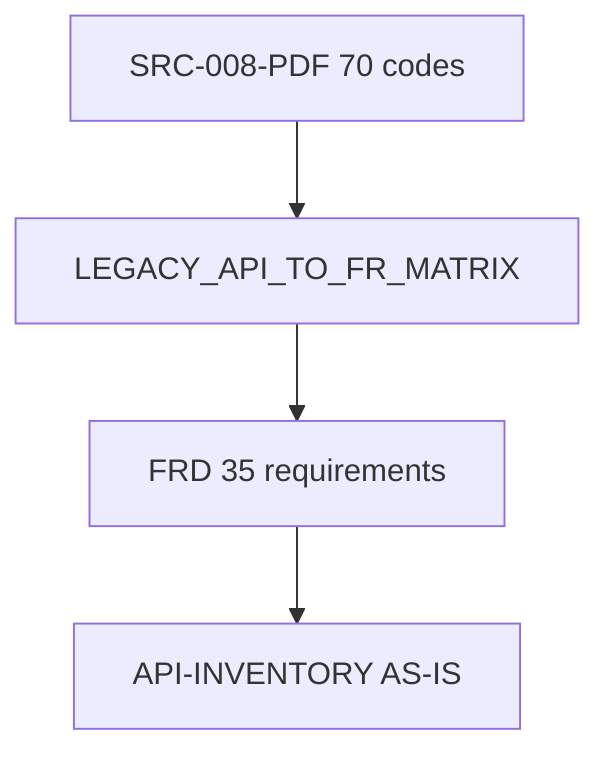

# Functional Requirements Document (v0.2.0)

TASK-008 reconciliation: **35** functional requirements mapped to **70** LEGACY API codes.

**Figure FRD-FIG-001** — Reconciliation architecture (v0.2.0).

## Requirement index

| FR ID | Name | Classification |
|-------|------|----------------|
| FR-AUTH-001 | User registration | LEGACY |
| FR-AUTH-002 | User login (JWT) | AS-IS |
| FR-AUTH-003 | Forgot password | LEGACY |
| FR-AUTH-004 | Reset password | LEGACY |
| FR-USER-001 | Profile read/update | Partial |
| FR-USER-002 | Password change & self-delete | LEGACY/partial |
| FR-ADM-001 | Admin user management | Partial |
| FR-ADM-002 | Role CRUD | AS-IS |
| FR-ADV-001 | Public catalog access policy | LEGACY conflict |
| FR-ADV-002 | Advert create update delete | Partial |
| FR-ADV-003 | Advert search with filters | LEGACY |
| FR-ADV-004 | Advert aggregations by city/category | LEGACY |
| FR-ADV-005 | Popular adverts ranking | LEGACY |
| FR-ADV-006 | Authenticated user advert list | LEGACY |
| FR-ADV-007 | Admin advert list | LEGACY |
| FR-ADV-008 | Advert detail by slug | LEGACY |
| FR-ADV-009 | Advert detail for owner | LEGACY |
| FR-ADV-010 | Advert detail for admin | LEGACY |
| FR-CAT-001 | Category and property keys | Partial |
| FR-CAT-002 | Advert type catalogue | LEGACY |
| FR-GEO-001 | Reference geography read | LEGACY |
| FR-GEO-002 | Geography admin CRUD (AS-IS extension) | AS-IS |
| FR-TOUR-001 | Tour request CRUD & lists | LEGACY |
| FR-TOUR-002 | Tour approve decline cancel | LEGACY |
| FR-FAV-001 | Favorites management | LEGACY/partial |
| FR-CNT-001 | Contact messages | Partial |
| FR-MED-001 | Property images | LEGACY |
| FR-RPT-001 | Operations dashboard | LEGACY |
| FR-RPT-002 | Advert report | LEGACY |
| FR-RPT-003 | Popular properties report | LEGACY |
| FR-RPT-004 | Users by role report | LEGACY |
| FR-RPT-005 | Tour request report | LEGACY |
| FR-MSG-001 | Internal mailbox | AS-IS |
| FR-I18N-001 | Language in API paths | AS-IS |
| FR-LOG-001 | Advert activity logging | LEGACY |

## Detailed requirements

### FR-AUTH-001 — User registration

| Attribute | Value |
|-----------|-------|
| **Classification** | LEGACY |
| **Actor** | Anonymous |
| **Legacy API IDs** | F02 |
| **PDF pages** | 77 |
| **Implementation status** | AuthController signUp |
| **Related entities** | User, Role |
| **Related tests** | TEST-AUTH-02 (proposed in TEST_STRATEGY) |
| **Task** | TASK-none |
| **Business rationale** | Aligns marketplace listing and engagement per SRC-008-PDF; see [LEGACY_API_TO_FR_MATRIX.md](LEGACY_API_TO_FR_MATRIX.md). |
| **Preconditions** | Valid payload; auth per AS-IS JWT unless ADR-002 approved. |
| **Main flow** | User or system invokes mapped LEGACY endpoint behavior; AS-IS uses `api/v1.0/{language}/...` where implemented. |
| **Alternative flows** | Paging/filter variants per PDF query params (LEGACY). |
| **Exception flows** | Validation errors via `GlobalExceptionHandler`; 401 if JWT required. |
| **Business rules** | See LEGACY analysis §7; built_in and status rules where applicable. |
| **Acceptance criteria** | Behavior matches row in matrix for this FR; no undocumented endpoints. |

### FR-AUTH-002 — User login (JWT)

| Attribute | Value |
|-----------|-------|
| **Classification** | AS-IS |
| **Actor** | Anonymous |
| **Legacy API IDs** | F01 |
| **PDF pages** | 76 |
| **Implementation status** | AuthController login |
| **Related entities** | User |
| **Related tests** | TEST-AUTH-01 (proposed in TEST_STRATEGY) |
| **Task** | - |
| **Business rationale** | Aligns marketplace listing and engagement per SRC-008-PDF; see [LEGACY_API_TO_FR_MATRIX.md](LEGACY_API_TO_FR_MATRIX.md). |
| **Preconditions** | Valid payload; auth per AS-IS JWT unless ADR-002 approved. |
| **Main flow** | User or system invokes mapped LEGACY endpoint behavior; AS-IS uses `api/v1.0/{language}/...` where implemented. |
| **Alternative flows** | Paging/filter variants per PDF query params (LEGACY). |
| **Exception flows** | Validation errors via `GlobalExceptionHandler`; 401 if JWT required. |
| **Business rules** | See LEGACY analysis §7; built_in and status rules where applicable. |
| **Acceptance criteria** | Behavior matches row in matrix for this FR; no undocumented endpoints. |

### FR-AUTH-003 — Forgot password

| Attribute | Value |
|-----------|-------|
| **Classification** | LEGACY |
| **Actor** | Anonymous |
| **Legacy API IDs** | F03 |
| **PDF pages** | 78 |
| **Implementation status** | Not implemented |
| **Related entities** | User |
| **Related tests** | TEST-AUTH-03 (proposed in TEST_STRATEGY) |
| **Task** | TASK-017 |
| **Business rationale** | Aligns marketplace listing and engagement per SRC-008-PDF; see [LEGACY_API_TO_FR_MATRIX.md](LEGACY_API_TO_FR_MATRIX.md). |
| **Preconditions** | Valid payload; auth per AS-IS JWT unless ADR-002 approved. |
| **Main flow** | User or system invokes mapped LEGACY endpoint behavior; AS-IS uses `api/v1.0/{language}/...` where implemented. |
| **Alternative flows** | Paging/filter variants per PDF query params (LEGACY). |
| **Exception flows** | Validation errors via `GlobalExceptionHandler`; 401 if JWT required. |
| **Business rules** | See LEGACY analysis §7; built_in and status rules where applicable. |
| **Acceptance criteria** | Behavior matches row in matrix for this FR; no undocumented endpoints. |

### FR-AUTH-004 — Reset password

| Attribute | Value |
|-----------|-------|
| **Classification** | LEGACY |
| **Actor** | Anonymous |
| **Legacy API IDs** | F04 |
| **PDF pages** | 79 |
| **Implementation status** | Not implemented |
| **Related entities** | User |
| **Related tests** | TEST-AUTH-04 (proposed in TEST_STRATEGY) |
| **Task** | TASK-017 |
| **Business rationale** | Aligns marketplace listing and engagement per SRC-008-PDF; see [LEGACY_API_TO_FR_MATRIX.md](LEGACY_API_TO_FR_MATRIX.md). |
| **Preconditions** | Valid payload; auth per AS-IS JWT unless ADR-002 approved. |
| **Main flow** | User or system invokes mapped LEGACY endpoint behavior; AS-IS uses `api/v1.0/{language}/...` where implemented. |
| **Alternative flows** | Paging/filter variants per PDF query params (LEGACY). |
| **Exception flows** | Validation errors via `GlobalExceptionHandler`; 401 if JWT required. |
| **Business rules** | See LEGACY analysis §7; built_in and status rules where applicable. |
| **Acceptance criteria** | Behavior matches row in matrix for this FR; no undocumented endpoints. |

### FR-USER-001 — Profile read/update

| Attribute | Value |
|-----------|-------|
| **Classification** | Partial |
| **Actor** | Customer+ |
| **Legacy API IDs** | F05,F06 |
| **PDF pages** | 80-81 |
| **Implementation status** | UserController |
| **Related entities** | User |
| **Related tests** | TEST-USER-01 (proposed in TEST_STRATEGY) |
| **Task** | - |
| **Business rationale** | Aligns marketplace listing and engagement per SRC-008-PDF; see [LEGACY_API_TO_FR_MATRIX.md](LEGACY_API_TO_FR_MATRIX.md). |
| **Preconditions** | Valid payload; auth per AS-IS JWT unless ADR-002 approved. |
| **Main flow** | User or system invokes mapped LEGACY endpoint behavior; AS-IS uses `api/v1.0/{language}/...` where implemented. |
| **Alternative flows** | Paging/filter variants per PDF query params (LEGACY). |
| **Exception flows** | Validation errors via `GlobalExceptionHandler`; 401 if JWT required. |
| **Business rules** | See LEGACY analysis §7; built_in and status rules where applicable. |
| **Acceptance criteria** | Behavior matches row in matrix for this FR; no undocumented endpoints. |

### FR-USER-002 — Password change & self-delete

| Attribute | Value |
|-----------|-------|
| **Classification** | LEGACY/partial |
| **Actor** | Customer+ |
| **Legacy API IDs** | F07,F08 |
| **PDF pages** | 82-83 |
| **Implementation status** | Partial |
| **Related entities** | User |
| **Related tests** | TEST-USER-02 (proposed in TEST_STRATEGY) |
| **Task** | TASK-018 |
| **Business rationale** | Aligns marketplace listing and engagement per SRC-008-PDF; see [LEGACY_API_TO_FR_MATRIX.md](LEGACY_API_TO_FR_MATRIX.md). |
| **Preconditions** | Valid payload; auth per AS-IS JWT unless ADR-002 approved. |
| **Main flow** | User or system invokes mapped LEGACY endpoint behavior; AS-IS uses `api/v1.0/{language}/...` where implemented. |
| **Alternative flows** | Paging/filter variants per PDF query params (LEGACY). |
| **Exception flows** | Validation errors via `GlobalExceptionHandler`; 401 if JWT required. |
| **Business rules** | See LEGACY analysis §7; built_in and status rules where applicable. |
| **Acceptance criteria** | Behavior matches row in matrix for this FR; no undocumented endpoints. |

### FR-ADM-001 — Admin user management

| Attribute | Value |
|-----------|-------|
| **Classification** | Partial |
| **Actor** | Manager/Admin |
| **Legacy API IDs** | F09-F12 |
| **PDF pages** | 84-87 |
| **Implementation status** | AdminController |
| **Related entities** | User |
| **Related tests** | TEST-ADM-01 (proposed in TEST_STRATEGY) |
| **Task** | TASK-005 |
| **Business rationale** | Aligns marketplace listing and engagement per SRC-008-PDF; see [LEGACY_API_TO_FR_MATRIX.md](LEGACY_API_TO_FR_MATRIX.md). |
| **Preconditions** | Valid payload; auth per AS-IS JWT unless ADR-002 approved. |
| **Main flow** | User or system invokes mapped LEGACY endpoint behavior; AS-IS uses `api/v1.0/{language}/...` where implemented. |
| **Alternative flows** | Paging/filter variants per PDF query params (LEGACY). |
| **Exception flows** | Validation errors via `GlobalExceptionHandler`; 401 if JWT required. |
| **Business rules** | See LEGACY analysis §7; built_in and status rules where applicable. |
| **Acceptance criteria** | Behavior matches row in matrix for this FR; no undocumented endpoints. |

### FR-ADM-002 — Role CRUD

| Attribute | Value |
|-----------|-------|
| **Classification** | AS-IS |
| **Actor** | Admin |
| **Legacy API IDs** | — |
| **PDF pages** | — |
| **Implementation status** | RoleController |
| **Related entities** | Role |
| **Related tests** | TEST-ADM-02 (proposed in TEST_STRATEGY) |
| **Task** | TASK-005 |
| **Business rationale** | Aligns marketplace listing and engagement per SRC-008-PDF; see [LEGACY_API_TO_FR_MATRIX.md](LEGACY_API_TO_FR_MATRIX.md). |
| **Preconditions** | Valid payload; auth per AS-IS JWT unless ADR-002 approved. |
| **Main flow** | User or system invokes mapped LEGACY endpoint behavior; AS-IS uses `api/v1.0/{language}/...` where implemented. |
| **Alternative flows** | Paging/filter variants per PDF query params (LEGACY). |
| **Exception flows** | Validation errors via `GlobalExceptionHandler`; 401 if JWT required. |
| **Business rules** | See LEGACY analysis §7; built_in and status rules where applicable. |
| **Acceptance criteria** | Behavior matches row in matrix for this FR; no undocumented endpoints. |

### FR-ADV-001 — Public catalog access policy

| Attribute | Value |
|-----------|-------|
| **Classification** | LEGACY conflict |
| **Actor** | Anonymous |
| **Legacy API IDs** | A01,A07,C01,T01,U01-U03 |
| **PDF pages** | 25-63 |
| **Implementation status** | JWT on most GET |
| **Related entities** | Advert |
| **Related tests** | TEST-SEC-01 (proposed in TEST_STRATEGY) |
| **Task** | TASK-010 |
| **Business rationale** | Aligns marketplace listing and engagement per SRC-008-PDF; see [LEGACY_API_TO_FR_MATRIX.md](LEGACY_API_TO_FR_MATRIX.md). |
| **Preconditions** | Valid payload; auth per AS-IS JWT unless ADR-002 approved. |
| **Main flow** | User or system invokes mapped LEGACY endpoint behavior; AS-IS uses `api/v1.0/{language}/...` where implemented. |
| **Alternative flows** | Paging/filter variants per PDF query params (LEGACY). |
| **Exception flows** | Validation errors via `GlobalExceptionHandler`; 401 if JWT required. |
| **Business rules** | See LEGACY analysis §7; built_in and status rules where applicable. |
| **Acceptance criteria** | Behavior matches row in matrix for this FR; no undocumented endpoints. |

### FR-ADV-002 — Advert create update delete

| Attribute | Value |
|-----------|-------|
| **Classification** | Partial |
| **Actor** | Customer+ |
| **Legacy API IDs** | A10-A13 |
| **PDF pages** | 34-37 |
| **Implementation status** | AdvertController |
| **Related entities** | Advert |
| **Related tests** | TEST-ADV-02 (proposed in TEST_STRATEGY) |
| **Task** | TASK-015 |
| **Business rationale** | Aligns marketplace listing and engagement per SRC-008-PDF; see [LEGACY_API_TO_FR_MATRIX.md](LEGACY_API_TO_FR_MATRIX.md). |
| **Preconditions** | Valid payload; auth per AS-IS JWT unless ADR-002 approved. |
| **Main flow** | User or system invokes mapped LEGACY endpoint behavior; AS-IS uses `api/v1.0/{language}/...` where implemented. |
| **Alternative flows** | Paging/filter variants per PDF query params (LEGACY). |
| **Exception flows** | Validation errors via `GlobalExceptionHandler`; 401 if JWT required. |
| **Business rules** | See LEGACY analysis §7; built_in and status rules where applicable. |
| **Acceptance criteria** | Behavior matches row in matrix for this FR; no undocumented endpoints. |

### FR-ADV-003 — Advert search with filters

| Attribute | Value |
|-----------|-------|
| **Classification** | LEGACY |
| **Actor** | Anonymous |
| **Legacy API IDs** | A01 |
| **PDF pages** | 25 |
| **Implementation status** | getAll limited |
| **Related entities** | Advert |
| **Related tests** | TEST-ADV-03 (proposed in TEST_STRATEGY) |
| **Task** | TASK-011 |
| **Business rationale** | Aligns marketplace listing and engagement per SRC-008-PDF; see [LEGACY_API_TO_FR_MATRIX.md](LEGACY_API_TO_FR_MATRIX.md). |
| **Preconditions** | Valid payload; auth per AS-IS JWT unless ADR-002 approved. |
| **Main flow** | User or system invokes mapped LEGACY endpoint behavior; AS-IS uses `api/v1.0/{language}/...` where implemented. |
| **Alternative flows** | Paging/filter variants per PDF query params (LEGACY). |
| **Exception flows** | Validation errors via `GlobalExceptionHandler`; 401 if JWT required. |
| **Business rules** | See LEGACY analysis §7; built_in and status rules where applicable. |
| **Acceptance criteria** | Behavior matches row in matrix for this FR; no undocumented endpoints. |

### FR-ADV-004 — Advert aggregations by city/category

| Attribute | Value |
|-----------|-------|
| **Classification** | LEGACY |
| **Actor** | Anonymous |
| **Legacy API IDs** | A02,A03 |
| **PDF pages** | 26-27 |
| **Implementation status** | Missing |
| **Related entities** | Advert |
| **Related tests** | TEST-ADV-04 (proposed in TEST_STRATEGY) |
| **Task** | TASK-011 |
| **Business rationale** | Aligns marketplace listing and engagement per SRC-008-PDF; see [LEGACY_API_TO_FR_MATRIX.md](LEGACY_API_TO_FR_MATRIX.md). |
| **Preconditions** | Valid payload; auth per AS-IS JWT unless ADR-002 approved. |
| **Main flow** | User or system invokes mapped LEGACY endpoint behavior; AS-IS uses `api/v1.0/{language}/...` where implemented. |
| **Alternative flows** | Paging/filter variants per PDF query params (LEGACY). |
| **Exception flows** | Validation errors via `GlobalExceptionHandler`; 401 if JWT required. |
| **Business rules** | See LEGACY analysis §7; built_in and status rules where applicable. |
| **Acceptance criteria** | Behavior matches row in matrix for this FR; no undocumented endpoints. |

### FR-ADV-005 — Popular adverts ranking

| Attribute | Value |
|-----------|-------|
| **Classification** | LEGACY |
| **Actor** | Anonymous |
| **Legacy API IDs** | A04 |
| **PDF pages** | 28 |
| **Implementation status** | Missing |
| **Related entities** | Advert |
| **Related tests** | TEST-ADV-05 (proposed in TEST_STRATEGY) |
| **Task** | TASK-012 |
| **Business rationale** | Aligns marketplace listing and engagement per SRC-008-PDF; see [LEGACY_API_TO_FR_MATRIX.md](LEGACY_API_TO_FR_MATRIX.md). |
| **Preconditions** | Valid payload; auth per AS-IS JWT unless ADR-002 approved. |
| **Main flow** | User or system invokes mapped LEGACY endpoint behavior; AS-IS uses `api/v1.0/{language}/...` where implemented. |
| **Alternative flows** | Paging/filter variants per PDF query params (LEGACY). |
| **Exception flows** | Validation errors via `GlobalExceptionHandler`; 401 if JWT required. |
| **Business rules** | See LEGACY analysis §7; built_in and status rules where applicable. |
| **Acceptance criteria** | Behavior matches row in matrix for this FR; no undocumented endpoints. |

### FR-ADV-006 — Authenticated user advert list

| Attribute | Value |
|-----------|-------|
| **Classification** | LEGACY |
| **Actor** | Customer |
| **Legacy API IDs** | A05 |
| **PDF pages** | 29 |
| **Implementation status** | Partial |
| **Related entities** | Advert |
| **Related tests** | TEST-ADV-06 (proposed in TEST_STRATEGY) |
| **Task** | TASK-013 |
| **Business rationale** | Aligns marketplace listing and engagement per SRC-008-PDF; see [LEGACY_API_TO_FR_MATRIX.md](LEGACY_API_TO_FR_MATRIX.md). |
| **Preconditions** | Valid payload; auth per AS-IS JWT unless ADR-002 approved. |
| **Main flow** | User or system invokes mapped LEGACY endpoint behavior; AS-IS uses `api/v1.0/{language}/...` where implemented. |
| **Alternative flows** | Paging/filter variants per PDF query params (LEGACY). |
| **Exception flows** | Validation errors via `GlobalExceptionHandler`; 401 if JWT required. |
| **Business rules** | See LEGACY analysis §7; built_in and status rules where applicable. |
| **Acceptance criteria** | Behavior matches row in matrix for this FR; no undocumented endpoints. |

### FR-ADV-007 — Admin advert list

| Attribute | Value |
|-----------|-------|
| **Classification** | LEGACY |
| **Actor** | Manager/Admin |
| **Legacy API IDs** | A06 |
| **PDF pages** | 30 |
| **Implementation status** | Partial |
| **Related entities** | Advert |
| **Related tests** | TEST-ADV-07 (proposed in TEST_STRATEGY) |
| **Task** | TASK-013 |
| **Business rationale** | Aligns marketplace listing and engagement per SRC-008-PDF; see [LEGACY_API_TO_FR_MATRIX.md](LEGACY_API_TO_FR_MATRIX.md). |
| **Preconditions** | Valid payload; auth per AS-IS JWT unless ADR-002 approved. |
| **Main flow** | User or system invokes mapped LEGACY endpoint behavior; AS-IS uses `api/v1.0/{language}/...` where implemented. |
| **Alternative flows** | Paging/filter variants per PDF query params (LEGACY). |
| **Exception flows** | Validation errors via `GlobalExceptionHandler`; 401 if JWT required. |
| **Business rules** | See LEGACY analysis §7; built_in and status rules where applicable. |
| **Acceptance criteria** | Behavior matches row in matrix for this FR; no undocumented endpoints. |

### FR-ADV-008 — Advert detail by slug

| Attribute | Value |
|-----------|-------|
| **Classification** | LEGACY |
| **Actor** | Anonymous |
| **Legacy API IDs** | A07 |
| **PDF pages** | 31 |
| **Implementation status** | Missing |
| **Related entities** | Advert |
| **Related tests** | TEST-ADV-08 (proposed in TEST_STRATEGY) |
| **Task** | TASK-014 |
| **Business rationale** | Aligns marketplace listing and engagement per SRC-008-PDF; see [LEGACY_API_TO_FR_MATRIX.md](LEGACY_API_TO_FR_MATRIX.md). |
| **Preconditions** | Valid payload; auth per AS-IS JWT unless ADR-002 approved. |
| **Main flow** | User or system invokes mapped LEGACY endpoint behavior; AS-IS uses `api/v1.0/{language}/...` where implemented. |
| **Alternative flows** | Paging/filter variants per PDF query params (LEGACY). |
| **Exception flows** | Validation errors via `GlobalExceptionHandler`; 401 if JWT required. |
| **Business rules** | See LEGACY analysis §7; built_in and status rules where applicable. |
| **Acceptance criteria** | Behavior matches row in matrix for this FR; no undocumented endpoints. |

### FR-ADV-009 — Advert detail for owner

| Attribute | Value |
|-----------|-------|
| **Classification** | LEGACY |
| **Actor** | Customer |
| **Legacy API IDs** | A08 |
| **PDF pages** | 32 |
| **Implementation status** | TBD |
| **Related entities** | Advert |
| **Related tests** | TEST-ADV-09 (proposed in TEST_STRATEGY) |
| **Task** | TASK-013 |
| **Business rationale** | Aligns marketplace listing and engagement per SRC-008-PDF; see [LEGACY_API_TO_FR_MATRIX.md](LEGACY_API_TO_FR_MATRIX.md). |
| **Preconditions** | Valid payload; auth per AS-IS JWT unless ADR-002 approved. |
| **Main flow** | User or system invokes mapped LEGACY endpoint behavior; AS-IS uses `api/v1.0/{language}/...` where implemented. |
| **Alternative flows** | Paging/filter variants per PDF query params (LEGACY). |
| **Exception flows** | Validation errors via `GlobalExceptionHandler`; 401 if JWT required. |
| **Business rules** | See LEGACY analysis §7; built_in and status rules where applicable. |
| **Acceptance criteria** | Behavior matches row in matrix for this FR; no undocumented endpoints. |

### FR-ADV-010 — Advert detail for admin

| Attribute | Value |
|-----------|-------|
| **Classification** | LEGACY |
| **Actor** | Manager/Admin |
| **Legacy API IDs** | A09 |
| **PDF pages** | 33 |
| **Implementation status** | Partial |
| **Related entities** | Advert |
| **Related tests** | TEST-ADV-10 (proposed in TEST_STRATEGY) |
| **Task** | TASK-013 |
| **Business rationale** | Aligns marketplace listing and engagement per SRC-008-PDF; see [LEGACY_API_TO_FR_MATRIX.md](LEGACY_API_TO_FR_MATRIX.md). |
| **Preconditions** | Valid payload; auth per AS-IS JWT unless ADR-002 approved. |
| **Main flow** | User or system invokes mapped LEGACY endpoint behavior; AS-IS uses `api/v1.0/{language}/...` where implemented. |
| **Alternative flows** | Paging/filter variants per PDF query params (LEGACY). |
| **Exception flows** | Validation errors via `GlobalExceptionHandler`; 401 if JWT required. |
| **Business rules** | See LEGACY analysis §7; built_in and status rules where applicable. |
| **Acceptance criteria** | Behavior matches row in matrix for this FR; no undocumented endpoints. |

### FR-CAT-001 — Category and property keys

| Attribute | Value |
|-----------|-------|
| **Classification** | Partial |
| **Actor** | Mixed |
| **Legacy API IDs** | C01-C10 |
| **PDF pages** | 44-53 |
| **Implementation status** | CategoryController |
| **Related entities** | Category |
| **Related tests** | TEST-CAT-01 (proposed in TEST_STRATEGY) |
| **Task** | - |
| **Business rationale** | Aligns marketplace listing and engagement per SRC-008-PDF; see [LEGACY_API_TO_FR_MATRIX.md](LEGACY_API_TO_FR_MATRIX.md). |
| **Preconditions** | Valid payload; auth per AS-IS JWT unless ADR-002 approved. |
| **Main flow** | User or system invokes mapped LEGACY endpoint behavior; AS-IS uses `api/v1.0/{language}/...` where implemented. |
| **Alternative flows** | Paging/filter variants per PDF query params (LEGACY). |
| **Exception flows** | Validation errors via `GlobalExceptionHandler`; 401 if JWT required. |
| **Business rules** | See LEGACY analysis §7; built_in and status rules where applicable. |
| **Acceptance criteria** | Behavior matches row in matrix for this FR; no undocumented endpoints. |

### FR-CAT-002 — Advert type catalogue

| Attribute | Value |
|-----------|-------|
| **Classification** | LEGACY |
| **Actor** | Mixed |
| **Legacy API IDs** | T01-T05 |
| **PDF pages** | 55-59 |
| **Implementation status** | Empty controller |
| **Related entities** | AdvertType |
| **Related tests** | TEST-CAT-02 (proposed in TEST_STRATEGY) |
| **Task** | TASK-004 |
| **Business rationale** | Aligns marketplace listing and engagement per SRC-008-PDF; see [LEGACY_API_TO_FR_MATRIX.md](LEGACY_API_TO_FR_MATRIX.md). |
| **Preconditions** | Valid payload; auth per AS-IS JWT unless ADR-002 approved. |
| **Main flow** | User or system invokes mapped LEGACY endpoint behavior; AS-IS uses `api/v1.0/{language}/...` where implemented. |
| **Alternative flows** | Paging/filter variants per PDF query params (LEGACY). |
| **Exception flows** | Validation errors via `GlobalExceptionHandler`; 401 if JWT required. |
| **Business rules** | See LEGACY analysis §7; built_in and status rules where applicable. |
| **Acceptance criteria** | Behavior matches row in matrix for this FR; no undocumented endpoints. |

### FR-GEO-001 — Reference geography read

| Attribute | Value |
|-----------|-------|
| **Classification** | LEGACY |
| **Actor** | Anonymous |
| **Legacy API IDs** | U01-U03 |
| **PDF pages** | 61-63 |
| **Implementation status** | GET exists; JWT |
| **Related entities** | Country,City,District |
| **Related tests** | TEST-GEO-01 (proposed in TEST_STRATEGY) |
| **Task** | TASK-010 |
| **Business rationale** | Aligns marketplace listing and engagement per SRC-008-PDF; see [LEGACY_API_TO_FR_MATRIX.md](LEGACY_API_TO_FR_MATRIX.md). |
| **Preconditions** | Valid payload; auth per AS-IS JWT unless ADR-002 approved. |
| **Main flow** | User or system invokes mapped LEGACY endpoint behavior; AS-IS uses `api/v1.0/{language}/...` where implemented. |
| **Alternative flows** | Paging/filter variants per PDF query params (LEGACY). |
| **Exception flows** | Validation errors via `GlobalExceptionHandler`; 401 if JWT required. |
| **Business rules** | See LEGACY analysis §7; built_in and status rules where applicable. |
| **Acceptance criteria** | Behavior matches row in matrix for this FR; no undocumented endpoints. |

### FR-GEO-002 — Geography admin CRUD (AS-IS extension)

| Attribute | Value |
|-----------|-------|
| **Classification** | AS-IS |
| **Actor** | Manager/Admin |
| **Legacy API IDs** | — |
| **PDF pages** | 4 |
| **Implementation status** | Country/City/District CRUD |
| **Related entities** | Country,City,District |
| **Related tests** | TEST-GEO-02 (proposed in TEST_STRATEGY) |
| **Task** | TASK-016 |
| **Business rationale** | Aligns marketplace listing and engagement per SRC-008-PDF; see [LEGACY_API_TO_FR_MATRIX.md](LEGACY_API_TO_FR_MATRIX.md). |
| **Preconditions** | Valid payload; auth per AS-IS JWT unless ADR-002 approved. |
| **Main flow** | User or system invokes mapped LEGACY endpoint behavior; AS-IS uses `api/v1.0/{language}/...` where implemented. |
| **Alternative flows** | Paging/filter variants per PDF query params (LEGACY). |
| **Exception flows** | Validation errors via `GlobalExceptionHandler`; 401 if JWT required. |
| **Business rules** | See LEGACY analysis §7; built_in and status rules where applicable. |
| **Acceptance criteria** | Behavior matches row in matrix for this FR; no undocumented endpoints. |

### FR-TOUR-001 — Tour request CRUD & lists

| Attribute | Value |
|-----------|-------|
| **Classification** | LEGACY |
| **Actor** | Customer+ |
| **Legacy API IDs** | S01-S06,S10 |
| **PDF pages** | 65-74 |
| **Implementation status** | Empty controller |
| **Related entities** | TourRequest |
| **Related tests** | TEST-TOUR-01 (proposed in TEST_STRATEGY) |
| **Task** | TASK-002 |
| **Business rationale** | Aligns marketplace listing and engagement per SRC-008-PDF; see [LEGACY_API_TO_FR_MATRIX.md](LEGACY_API_TO_FR_MATRIX.md). |
| **Preconditions** | Valid payload; auth per AS-IS JWT unless ADR-002 approved. |
| **Main flow** | User or system invokes mapped LEGACY endpoint behavior; AS-IS uses `api/v1.0/{language}/...` where implemented. |
| **Alternative flows** | Paging/filter variants per PDF query params (LEGACY). |
| **Exception flows** | Validation errors via `GlobalExceptionHandler`; 401 if JWT required. |
| **Business rules** | See LEGACY analysis §7; built_in and status rules where applicable. |
| **Acceptance criteria** | Behavior matches row in matrix for this FR; no undocumented endpoints. |

### FR-TOUR-002 — Tour approve decline cancel

| Attribute | Value |
|-----------|-------|
| **Classification** | LEGACY |
| **Actor** | Owner/Manager |
| **Legacy API IDs** | S07-S09 |
| **PDF pages** | 71-73 |
| **Implementation status** | Missing |
| **Related entities** | TourRequest |
| **Related tests** | TEST-TOUR-02 (proposed in TEST_STRATEGY) |
| **Task** | TASK-002 |
| **Business rationale** | Aligns marketplace listing and engagement per SRC-008-PDF; see [LEGACY_API_TO_FR_MATRIX.md](LEGACY_API_TO_FR_MATRIX.md). |
| **Preconditions** | Valid payload; auth per AS-IS JWT unless ADR-002 approved. |
| **Main flow** | User or system invokes mapped LEGACY endpoint behavior; AS-IS uses `api/v1.0/{language}/...` where implemented. |
| **Alternative flows** | Paging/filter variants per PDF query params (LEGACY). |
| **Exception flows** | Validation errors via `GlobalExceptionHandler`; 401 if JWT required. |
| **Business rules** | See LEGACY analysis §7; built_in and status rules where applicable. |
| **Acceptance criteria** | Behavior matches row in matrix for this FR; no undocumented endpoints. |

### FR-FAV-001 — Favorites management

| Attribute | Value |
|-----------|-------|
| **Classification** | LEGACY/partial |
| **Actor** | Customer+ |
| **Legacy API IDs** | K01-K06 |
| **PDF pages** | 98-103 |
| **Implementation status** | FavoriteController partial |
| **Related entities** | Favorite |
| **Related tests** | TEST-FAV-01 (proposed in TEST_STRATEGY) |
| **Task** | TASK-003 |
| **Business rationale** | Aligns marketplace listing and engagement per SRC-008-PDF; see [LEGACY_API_TO_FR_MATRIX.md](LEGACY_API_TO_FR_MATRIX.md). |
| **Preconditions** | Valid payload; auth per AS-IS JWT unless ADR-002 approved. |
| **Main flow** | User or system invokes mapped LEGACY endpoint behavior; AS-IS uses `api/v1.0/{language}/...` where implemented. |
| **Alternative flows** | Paging/filter variants per PDF query params (LEGACY). |
| **Exception flows** | Validation errors via `GlobalExceptionHandler`; 401 if JWT required. |
| **Business rules** | See LEGACY analysis §7; built_in and status rules where applicable. |
| **Acceptance criteria** | Behavior matches row in matrix for this FR; no undocumented endpoints. |

### FR-CNT-001 — Contact messages

| Attribute | Value |
|-----------|-------|
| **Classification** | Partial |
| **Actor** | Anonymous/Mgr |
| **Legacy API IDs** | J01,J02 |
| **PDF pages** | 95-96 |
| **Implementation status** | ContactController |
| **Related entities** | Contact |
| **Related tests** | TEST-CNT-01 (proposed in TEST_STRATEGY) |
| **Task** | TASK-010 |
| **Business rationale** | Aligns marketplace listing and engagement per SRC-008-PDF; see [LEGACY_API_TO_FR_MATRIX.md](LEGACY_API_TO_FR_MATRIX.md). |
| **Preconditions** | Valid payload; auth per AS-IS JWT unless ADR-002 approved. |
| **Main flow** | User or system invokes mapped LEGACY endpoint behavior; AS-IS uses `api/v1.0/{language}/...` where implemented. |
| **Alternative flows** | Paging/filter variants per PDF query params (LEGACY). |
| **Exception flows** | Validation errors via `GlobalExceptionHandler`; 401 if JWT required. |
| **Business rules** | See LEGACY analysis §7; built_in and status rules where applicable. |
| **Acceptance criteria** | Behavior matches row in matrix for this FR; no undocumented endpoints. |

### FR-MED-001 — Property images

| Attribute | Value |
|-----------|-------|
| **Classification** | LEGACY |
| **Actor** | Mixed |
| **Legacy API IDs** | I01-I04 |
| **PDF pages** | 39-42 |
| **Implementation status** | ImageController empty |
| **Related entities** | Image |
| **Related tests** | TEST-MED-01 (proposed in TEST_STRATEGY) |
| **Task** | TASK-004 |
| **Business rationale** | Aligns marketplace listing and engagement per SRC-008-PDF; see [LEGACY_API_TO_FR_MATRIX.md](LEGACY_API_TO_FR_MATRIX.md). |
| **Preconditions** | Valid payload; auth per AS-IS JWT unless ADR-002 approved. |
| **Main flow** | User or system invokes mapped LEGACY endpoint behavior; AS-IS uses `api/v1.0/{language}/...` where implemented. |
| **Alternative flows** | Paging/filter variants per PDF query params (LEGACY). |
| **Exception flows** | Validation errors via `GlobalExceptionHandler`; 401 if JWT required. |
| **Business rules** | See LEGACY analysis §7; built_in and status rules where applicable. |
| **Acceptance criteria** | Behavior matches row in matrix for this FR; no undocumented endpoints. |

### FR-RPT-001 — Operations dashboard

| Attribute | Value |
|-----------|-------|
| **Classification** | LEGACY |
| **Actor** | Manager/Admin |
| **Legacy API IDs** | G01 |
| **PDF pages** | 89 |
| **Implementation status** | Missing |
| **Related entities** | — |
| **Related tests** | TEST-RPT-01 (proposed in TEST_STRATEGY) |
| **Task** | TASK-019 |
| **Business rationale** | Aligns marketplace listing and engagement per SRC-008-PDF; see [LEGACY_API_TO_FR_MATRIX.md](LEGACY_API_TO_FR_MATRIX.md). |
| **Preconditions** | Valid payload; auth per AS-IS JWT unless ADR-002 approved. |
| **Main flow** | User or system invokes mapped LEGACY endpoint behavior; AS-IS uses `api/v1.0/{language}/...` where implemented. |
| **Alternative flows** | Paging/filter variants per PDF query params (LEGACY). |
| **Exception flows** | Validation errors via `GlobalExceptionHandler`; 401 if JWT required. |
| **Business rules** | See LEGACY analysis §7; built_in and status rules where applicable. |
| **Acceptance criteria** | Behavior matches row in matrix for this FR; no undocumented endpoints. |

### FR-RPT-002 — Advert report

| Attribute | Value |
|-----------|-------|
| **Classification** | LEGACY |
| **Actor** | Manager/Admin |
| **Legacy API IDs** | G02 |
| **PDF pages** | 90 |
| **Implementation status** | Missing |
| **Related entities** | Advert |
| **Related tests** | TEST-RPT-02 (proposed in TEST_STRATEGY) |
| **Task** | TASK-019 |
| **Business rationale** | Aligns marketplace listing and engagement per SRC-008-PDF; see [LEGACY_API_TO_FR_MATRIX.md](LEGACY_API_TO_FR_MATRIX.md). |
| **Preconditions** | Valid payload; auth per AS-IS JWT unless ADR-002 approved. |
| **Main flow** | User or system invokes mapped LEGACY endpoint behavior; AS-IS uses `api/v1.0/{language}/...` where implemented. |
| **Alternative flows** | Paging/filter variants per PDF query params (LEGACY). |
| **Exception flows** | Validation errors via `GlobalExceptionHandler`; 401 if JWT required. |
| **Business rules** | See LEGACY analysis §7; built_in and status rules where applicable. |
| **Acceptance criteria** | Behavior matches row in matrix for this FR; no undocumented endpoints. |

### FR-RPT-003 — Popular properties report

| Attribute | Value |
|-----------|-------|
| **Classification** | LEGACY |
| **Actor** | Manager/Admin |
| **Legacy API IDs** | G03 |
| **PDF pages** | 91 |
| **Implementation status** | Missing |
| **Related entities** | Advert |
| **Related tests** | TEST-RPT-03 (proposed in TEST_STRATEGY) |
| **Task** | TASK-019 |
| **Business rationale** | Aligns marketplace listing and engagement per SRC-008-PDF; see [LEGACY_API_TO_FR_MATRIX.md](LEGACY_API_TO_FR_MATRIX.md). |
| **Preconditions** | Valid payload; auth per AS-IS JWT unless ADR-002 approved. |
| **Main flow** | User or system invokes mapped LEGACY endpoint behavior; AS-IS uses `api/v1.0/{language}/...` where implemented. |
| **Alternative flows** | Paging/filter variants per PDF query params (LEGACY). |
| **Exception flows** | Validation errors via `GlobalExceptionHandler`; 401 if JWT required. |
| **Business rules** | See LEGACY analysis §7; built_in and status rules where applicable. |
| **Acceptance criteria** | Behavior matches row in matrix for this FR; no undocumented endpoints. |

### FR-RPT-004 — Users by role report

| Attribute | Value |
|-----------|-------|
| **Classification** | LEGACY |
| **Actor** | Manager/Admin |
| **Legacy API IDs** | G04 |
| **PDF pages** | 92 |
| **Implementation status** | Missing |
| **Related entities** | User |
| **Related tests** | TEST-RPT-04 (proposed in TEST_STRATEGY) |
| **Task** | TASK-019 |
| **Business rationale** | Aligns marketplace listing and engagement per SRC-008-PDF; see [LEGACY_API_TO_FR_MATRIX.md](LEGACY_API_TO_FR_MATRIX.md). |
| **Preconditions** | Valid payload; auth per AS-IS JWT unless ADR-002 approved. |
| **Main flow** | User or system invokes mapped LEGACY endpoint behavior; AS-IS uses `api/v1.0/{language}/...` where implemented. |
| **Alternative flows** | Paging/filter variants per PDF query params (LEGACY). |
| **Exception flows** | Validation errors via `GlobalExceptionHandler`; 401 if JWT required. |
| **Business rules** | See LEGACY analysis §7; built_in and status rules where applicable. |
| **Acceptance criteria** | Behavior matches row in matrix for this FR; no undocumented endpoints. |

### FR-RPT-005 — Tour request report

| Attribute | Value |
|-----------|-------|
| **Classification** | LEGACY |
| **Actor** | Manager/Admin |
| **Legacy API IDs** | G05 |
| **PDF pages** | 93 |
| **Implementation status** | Missing |
| **Related entities** | TourRequest |
| **Related tests** | TEST-RPT-05 (proposed in TEST_STRATEGY) |
| **Task** | TASK-019 |
| **Business rationale** | Aligns marketplace listing and engagement per SRC-008-PDF; see [LEGACY_API_TO_FR_MATRIX.md](LEGACY_API_TO_FR_MATRIX.md). |
| **Preconditions** | Valid payload; auth per AS-IS JWT unless ADR-002 approved. |
| **Main flow** | User or system invokes mapped LEGACY endpoint behavior; AS-IS uses `api/v1.0/{language}/...` where implemented. |
| **Alternative flows** | Paging/filter variants per PDF query params (LEGACY). |
| **Exception flows** | Validation errors via `GlobalExceptionHandler`; 401 if JWT required. |
| **Business rules** | See LEGACY analysis §7; built_in and status rules where applicable. |
| **Acceptance criteria** | Behavior matches row in matrix for this FR; no undocumented endpoints. |

### FR-MSG-001 — Internal mailbox

| Attribute | Value |
|-----------|-------|
| **Classification** | AS-IS |
| **Actor** | Authenticated |
| **Legacy API IDs** | — |
| **PDF pages** | — |
| **Implementation status** | MessageController |
| **Related entities** | Message |
| **Related tests** | TEST-MSG-01 (proposed in TEST_STRATEGY) |
| **Task** | - |
| **Business rationale** | Aligns marketplace listing and engagement per SRC-008-PDF; see [LEGACY_API_TO_FR_MATRIX.md](LEGACY_API_TO_FR_MATRIX.md). |
| **Preconditions** | Valid payload; auth per AS-IS JWT unless ADR-002 approved. |
| **Main flow** | User or system invokes mapped LEGACY endpoint behavior; AS-IS uses `api/v1.0/{language}/...` where implemented. |
| **Alternative flows** | Paging/filter variants per PDF query params (LEGACY). |
| **Exception flows** | Validation errors via `GlobalExceptionHandler`; 401 if JWT required. |
| **Business rules** | See LEGACY analysis §7; built_in and status rules where applicable. |
| **Acceptance criteria** | Behavior matches row in matrix for this FR; no undocumented endpoints. |

### FR-I18N-001 — Language in API paths

| Attribute | Value |
|-----------|-------|
| **Classification** | AS-IS |
| **Actor** | All |
| **Legacy API IDs** | — |
| **PDF pages** | — |
| **Implementation status** | Path {language} |
| **Related entities** | Language |
| **Related tests** | TEST-I18N-01 (proposed in TEST_STRATEGY) |
| **Task** | - |
| **Business rationale** | Aligns marketplace listing and engagement per SRC-008-PDF; see [LEGACY_API_TO_FR_MATRIX.md](LEGACY_API_TO_FR_MATRIX.md). |
| **Preconditions** | Valid payload; auth per AS-IS JWT unless ADR-002 approved. |
| **Main flow** | User or system invokes mapped LEGACY endpoint behavior; AS-IS uses `api/v1.0/{language}/...` where implemented. |
| **Alternative flows** | Paging/filter variants per PDF query params (LEGACY). |
| **Exception flows** | Validation errors via `GlobalExceptionHandler`; 401 if JWT required. |
| **Business rules** | See LEGACY analysis §7; built_in and status rules where applicable. |
| **Acceptance criteria** | Behavior matches row in matrix for this FR; no undocumented endpoints. |

### FR-LOG-001 — Advert activity logging

| Attribute | Value |
|-----------|-------|
| **Classification** | LEGACY |
| **Actor** | System |
| **Legacy API IDs** | — |
| **PDF pages** | 20 |
| **Implementation status** | Log entity; no REST |
| **Related entities** | Log |
| **Related tests** | TEST-LOG-01 (proposed in TEST_STRATEGY) |
| **Task** | TASK-020 |
| **Business rationale** | Aligns marketplace listing and engagement per SRC-008-PDF; see [LEGACY_API_TO_FR_MATRIX.md](LEGACY_API_TO_FR_MATRIX.md). |
| **Preconditions** | Valid payload; auth per AS-IS JWT unless ADR-002 approved. |
| **Main flow** | User or system invokes mapped LEGACY endpoint behavior; AS-IS uses `api/v1.0/{language}/...` where implemented. |
| **Alternative flows** | Paging/filter variants per PDF query params (LEGACY). |
| **Exception flows** | Validation errors via `GlobalExceptionHandler`; 401 if JWT required. |
| **Business rules** | See LEGACY analysis §7; built_in and status rules where applicable. |
| **Acceptance criteria** | Behavior matches row in matrix for this FR; no undocumented endpoints. |

## Change history

| Version | Date | Summary |
|---------|------|--------|
| 0.2.0 | 2026-11-13 | TASK-008 expansion |
