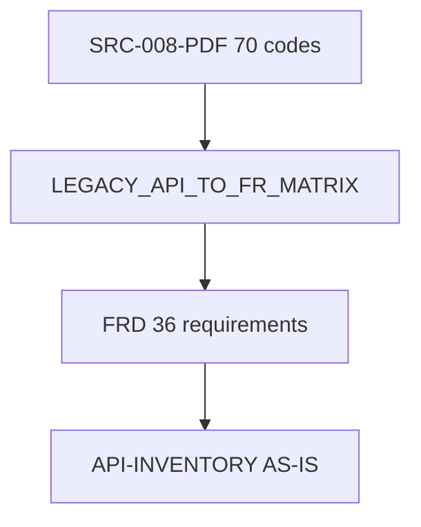

# Fonksiyonel Gereksinimler Dokümanı (v0.2.0)

TASK-008 reconciliation: **36** functional requirements (**35** LEGACY-mapped + **1** product/TO-BE); **70** LEGACY API codes.

**Figure FRD-FIG-001** — Reconciliation architecture (v0.2.0).

## Requirement index

| FR ID | Ad | Classification |
|-------|------|----------------|
| FR-AUTH-001 | Kullanıcı kaydı | LEGACY |
| FR-AUTH-002 | Giriş (JWT) | AS-IS |
| FR-AUTH-003 | Şifremi unuttum | LEGACY |
| FR-AUTH-004 | Şifre sıfırlama | LEGACY |
| FR-USER-001 | Profil okuma/güncelleme | Partial |
| FR-USER-002 | Şifre değişimi ve hesap silme | LEGACY/partial |
| FR-ADM-001 | Kullanıcı yönetimi | Partial |
| FR-ADM-002 | Rol CRUD | AS-IS |
| FR-ADV-001 | Herkese açık katalog erişimi | LEGACY conflict |
| FR-ADV-002 | İlan oluştur/güncelle/sil | Partial |
| FR-ADV-003 | İlan arama ve filtreleme | LEGACY |
| FR-ADV-004 | Şehir/kategori özetleri | LEGACY |
| FR-ADV-005 | Popüler ilanlar | LEGACY |
| FR-ADV-006 | Kullanıcının ilan listesi | LEGACY |
| FR-ADV-007 | Yönetim ilan listesi | LEGACY |
| FR-ADV-008 | Slug ile ilan detayı | LEGACY |
| FR-ADV-009 | Sahip ilan detayı | LEGACY |
| FR-ADV-010 | Admin ilan detayı | LEGACY |
| FR-CAT-001 | Kategori ve özellik anahtarları | Partial |
| FR-CAT-002 | İlan tipi kataloğu | LEGACY |
| FR-GEO-001 | Coğrafi referans okuma | LEGACY |
| FR-GEO-002 | Coğrafi veri yönetimi (AS-IS) | AS-IS |
| FR-TOUR-001 | Tur talebi CRUD | LEGACY |
| FR-TOUR-002 | Tur onay/red/iptal | LEGACY |
| FR-FAV-001 | Favoriler | LEGACY/partial |
| FR-FOLLOW-001 | İlan takibi (Following) | Product / TO-BE |
| FR-CNT-001 | İletişim mesajları | Partial |
| FR-MED-001 | İlan görselleri | LEGACY |
| FR-RPT-001 | Operasyon panosu | LEGACY |
| FR-RPT-002 | İlan raporu | LEGACY |
| FR-RPT-003 | Popüler mülk raporu | LEGACY |
| FR-RPT-004 | Rol bazlı kullanıcı raporu | LEGACY |
| FR-RPT-005 | Tur talebi raporu | LEGACY |
| FR-MSG-001 | Dahili mesaj kutusu | AS-IS |
| FR-I18N-001 | API dil segmenti | AS-IS |
| FR-LOG-001 | İlan aktivite günlüğü | LEGACY |

## Detailed requirements

### FR-AUTH-001 — Kullanıcı kaydı

| Attribute | Value |
|-----------|-------|
| **Classification** | LEGACY |
| **Actor** | Anonymous |
| **Legacy API IDs** | F02 |
| **PDF pages** | 77 |
| **Implementation status** | AuthController signUp |
| **Related entities** | User, Role |
| **Related tests** | TEST-AUTH-02 (proposed in TEST_STRATEGY) |
| **Task** | TASK-none |
| **İş gerekçesi** | Aligns marketplace listing and engagement per SRC-008-PDF; see [LEGACY_API_TO_FR_MATRIX.md](LEGACY_API_TO_FR_MATRIX.md). |
| **Preconditions** | Valid payload; auth per AS-IS JWT unless ADR-002 approved. |
| **Ana akış** | User or system invokes mapped LEGACY endpoint behavior; AS-IS uses `api/v1.0/{language}/...` where implemented. |
| **Alternative flows** | Paging/filter variants per PDF query params (LEGACY). |
| **Exception flows** | Validation errors via `GlobalExceptionHandler`; 401 if JWT required. |
| **Business rules** | See LEGACY analysis §7; built_in and status rules where applicable. |
| **Acceptance criteria** | Behavior matches row in matrix for this FR; no undocumented endpoints. |

### FR-AUTH-002 — Giriş (JWT)

| Attribute | Value |
|-----------|-------|
| **Classification** | AS-IS |
| **Actor** | Anonymous |
| **Legacy API IDs** | F01 |
| **PDF pages** | 76 |
| **Implementation status** | AuthController login |
| **Related entities** | User |
| **Related tests** | TEST-AUTH-01 (proposed in TEST_STRATEGY) |
| **Task** | - |
| **İş gerekçesi** | Aligns marketplace listing and engagement per SRC-008-PDF; see [LEGACY_API_TO_FR_MATRIX.md](LEGACY_API_TO_FR_MATRIX.md). |
| **Preconditions** | Valid payload; auth per AS-IS JWT unless ADR-002 approved. |
| **Ana akış** | User or system invokes mapped LEGACY endpoint behavior; AS-IS uses `api/v1.0/{language}/...` where implemented. |
| **Alternative flows** | Paging/filter variants per PDF query params (LEGACY). |
| **Exception flows** | Validation errors via `GlobalExceptionHandler`; 401 if JWT required. |
| **Business rules** | See LEGACY analysis §7; built_in and status rules where applicable. |
| **Acceptance criteria** | Behavior matches row in matrix for this FR; no undocumented endpoints. |

### FR-AUTH-003 — Şifremi unuttum

| Attribute | Value |
|-----------|-------|
| **Classification** | LEGACY |
| **Actor** | Anonymous |
| **Legacy API IDs** | F03 |
| **PDF pages** | 78 |
| **Implementation status** | Not implemented |
| **Related entities** | User |
| **Related tests** | TEST-AUTH-03 (proposed in TEST_STRATEGY) |
| **Task** | TASK-017 |
| **İş gerekçesi** | Aligns marketplace listing and engagement per SRC-008-PDF; see [LEGACY_API_TO_FR_MATRIX.md](LEGACY_API_TO_FR_MATRIX.md). |
| **Preconditions** | Valid payload; auth per AS-IS JWT unless ADR-002 approved. |
| **Ana akış** | User or system invokes mapped LEGACY endpoint behavior; AS-IS uses `api/v1.0/{language}/...` where implemented. |
| **Alternative flows** | Paging/filter variants per PDF query params (LEGACY). |
| **Exception flows** | Validation errors via `GlobalExceptionHandler`; 401 if JWT required. |
| **Business rules** | See LEGACY analysis §7; built_in and status rules where applicable. |
| **Acceptance criteria** | Behavior matches row in matrix for this FR; no undocumented endpoints. |

### FR-AUTH-004 — Şifre sıfırlama

| Attribute | Value |
|-----------|-------|
| **Classification** | LEGACY |
| **Actor** | Anonymous |
| **Legacy API IDs** | F04 |
| **PDF pages** | 79 |
| **Implementation status** | Not implemented |
| **Related entities** | User |
| **Related tests** | TEST-AUTH-04 (proposed in TEST_STRATEGY) |
| **Task** | TASK-017 |
| **İş gerekçesi** | Aligns marketplace listing and engagement per SRC-008-PDF; see [LEGACY_API_TO_FR_MATRIX.md](LEGACY_API_TO_FR_MATRIX.md). |
| **Preconditions** | Valid payload; auth per AS-IS JWT unless ADR-002 approved. |
| **Ana akış** | User or system invokes mapped LEGACY endpoint behavior; AS-IS uses `api/v1.0/{language}/...` where implemented. |
| **Alternative flows** | Paging/filter variants per PDF query params (LEGACY). |
| **Exception flows** | Validation errors via `GlobalExceptionHandler`; 401 if JWT required. |
| **Business rules** | See LEGACY analysis §7; built_in and status rules where applicable. |
| **Acceptance criteria** | Behavior matches row in matrix for this FR; no undocumented endpoints. |

### FR-USER-001 — Profil okuma/güncelleme

| Attribute | Value |
|-----------|-------|
| **Classification** | Partial |
| **Actor** | Customer+ |
| **Legacy API IDs** | F05,F06 |
| **PDF pages** | 80-81 |
| **Implementation status** | UserController |
| **Related entities** | User |
| **Related tests** | TEST-USER-01 (proposed in TEST_STRATEGY) |
| **Task** | - |
| **İş gerekçesi** | Aligns marketplace listing and engagement per SRC-008-PDF; see [LEGACY_API_TO_FR_MATRIX.md](LEGACY_API_TO_FR_MATRIX.md). |
| **Preconditions** | Valid payload; auth per AS-IS JWT unless ADR-002 approved. |
| **Ana akış** | User or system invokes mapped LEGACY endpoint behavior; AS-IS uses `api/v1.0/{language}/...` where implemented. |
| **Alternative flows** | Paging/filter variants per PDF query params (LEGACY). |
| **Exception flows** | Validation errors via `GlobalExceptionHandler`; 401 if JWT required. |
| **Business rules** | See LEGACY analysis §7; built_in and status rules where applicable. |
| **Acceptance criteria** | Behavior matches row in matrix for this FR; no undocumented endpoints. |

### FR-USER-002 — Şifre değişimi ve hesap silme

| Attribute | Value |
|-----------|-------|
| **Classification** | LEGACY/partial |
| **Actor** | Customer+ |
| **Legacy API IDs** | F07,F08 |
| **PDF pages** | 82-83 |
| **Implementation status** | Partial |
| **Related entities** | User |
| **Related tests** | TEST-USER-02 (proposed in TEST_STRATEGY) |
| **Task** | TASK-018 |
| **İş gerekçesi** | Aligns marketplace listing and engagement per SRC-008-PDF; see [LEGACY_API_TO_FR_MATRIX.md](LEGACY_API_TO_FR_MATRIX.md). |
| **Preconditions** | Valid payload; auth per AS-IS JWT unless ADR-002 approved. |
| **Ana akış** | User or system invokes mapped LEGACY endpoint behavior; AS-IS uses `api/v1.0/{language}/...` where implemented. |
| **Alternative flows** | Paging/filter variants per PDF query params (LEGACY). |
| **Exception flows** | Validation errors via `GlobalExceptionHandler`; 401 if JWT required. |
| **Business rules** | See LEGACY analysis §7; built_in and status rules where applicable. |
| **Acceptance criteria** | Behavior matches row in matrix for this FR; no undocumented endpoints. |

### FR-ADM-001 — Kullanıcı yönetimi

| Attribute | Value |
|-----------|-------|
| **Classification** | Partial |
| **Actor** | Manager/Admin |
| **Legacy API IDs** | F09-F12 |
| **PDF pages** | 84-87 |
| **Implementation status** | AdminController |
| **Related entities** | User |
| **Related tests** | TEST-ADM-01 (proposed in TEST_STRATEGY) |
| **Task** | TASK-005 |
| **İş gerekçesi** | Aligns marketplace listing and engagement per SRC-008-PDF; see [LEGACY_API_TO_FR_MATRIX.md](LEGACY_API_TO_FR_MATRIX.md). |
| **Preconditions** | Valid payload; auth per AS-IS JWT unless ADR-002 approved. |
| **Ana akış** | User or system invokes mapped LEGACY endpoint behavior; AS-IS uses `api/v1.0/{language}/...` where implemented. |
| **Alternative flows** | Paging/filter variants per PDF query params (LEGACY). |
| **Exception flows** | Validation errors via `GlobalExceptionHandler`; 401 if JWT required. |
| **Business rules** | See LEGACY analysis §7; built_in and status rules where applicable. |
| **Acceptance criteria** | Behavior matches row in matrix for this FR; no undocumented endpoints. |

### FR-ADM-002 — Rol CRUD

| Attribute | Value |
|-----------|-------|
| **Classification** | AS-IS |
| **Actor** | Admin |
| **Legacy API IDs** | — |
| **PDF pages** | — |
| **Implementation status** | RoleController |
| **Related entities** | Role |
| **Related tests** | TEST-ADM-02 (proposed in TEST_STRATEGY) |
| **Task** | TASK-005 |
| **İş gerekçesi** | Aligns marketplace listing and engagement per SRC-008-PDF; see [LEGACY_API_TO_FR_MATRIX.md](LEGACY_API_TO_FR_MATRIX.md). |
| **Preconditions** | Valid payload; auth per AS-IS JWT unless ADR-002 approved. |
| **Ana akış** | User or system invokes mapped LEGACY endpoint behavior; AS-IS uses `api/v1.0/{language}/...` where implemented. |
| **Alternative flows** | Paging/filter variants per PDF query params (LEGACY). |
| **Exception flows** | Validation errors via `GlobalExceptionHandler`; 401 if JWT required. |
| **Business rules** | See LEGACY analysis §7; built_in and status rules where applicable. |
| **Acceptance criteria** | Behavior matches row in matrix for this FR; no undocumented endpoints. |

### FR-ADV-001 — Herkese açık katalog erişimi

| Attribute | Value |
|-----------|-------|
| **Classification** | LEGACY conflict |
| **Actor** | Anonymous |
| **Legacy API IDs** | A01,A07,C01,T01,U01-U03 |
| **PDF pages** | 25-63 |
| **Implementation status** | JWT on most GET |
| **Related entities** | Advert |
| **Related tests** | TEST-SEC-01 (proposed in TEST_STRATEGY) |
| **Task** | TASK-010 |
| **İş gerekçesi** | Aligns marketplace listing and engagement per SRC-008-PDF; see [LEGACY_API_TO_FR_MATRIX.md](LEGACY_API_TO_FR_MATRIX.md). |
| **Preconditions** | Valid payload; auth per AS-IS JWT unless ADR-002 approved. |
| **Ana akış** | User or system invokes mapped LEGACY endpoint behavior; AS-IS uses `api/v1.0/{language}/...` where implemented. |
| **Alternative flows** | Paging/filter variants per PDF query params (LEGACY). |
| **Exception flows** | Validation errors via `GlobalExceptionHandler`; 401 if JWT required. |
| **Business rules** | See LEGACY analysis §7; built_in and status rules where applicable. |
| **Acceptance criteria** | Behavior matches row in matrix for this FR; no undocumented endpoints. |

### FR-ADV-002 — İlan oluştur/güncelle/sil

| Attribute | Value |
|-----------|-------|
| **Classification** | Partial |
| **Actor** | Customer+ |
| **Legacy API IDs** | A10-A13 |
| **PDF pages** | 34-37 |
| **Implementation status** | AdvertController |
| **Related entities** | Advert |
| **Related tests** | TEST-ADV-02 (proposed in TEST_STRATEGY) |
| **Task** | TASK-015 |
| **İş gerekçesi** | Aligns marketplace listing and engagement per SRC-008-PDF; see [LEGACY_API_TO_FR_MATRIX.md](LEGACY_API_TO_FR_MATRIX.md). |
| **Preconditions** | Valid payload; auth per AS-IS JWT unless ADR-002 approved. |
| **Ana akış** | User or system invokes mapped LEGACY endpoint behavior; AS-IS uses `api/v1.0/{language}/...` where implemented. |
| **Alternative flows** | Paging/filter variants per PDF query params (LEGACY). |
| **Exception flows** | Validation errors via `GlobalExceptionHandler`; 401 if JWT required. |
| **Business rules** | See LEGACY analysis §7; built_in and status rules where applicable. |
| **Acceptance criteria** | Behavior matches row in matrix for this FR; no undocumented endpoints. |

### FR-ADV-003 — İlan arama ve filtreleme

| Attribute | Value |
|-----------|-------|
| **Classification** | LEGACY |
| **Actor** | Anonymous |
| **Legacy API IDs** | A01 |
| **PDF pages** | 25 |
| **Implementation status** | getAll limited |
| **Related entities** | Advert |
| **Related tests** | TEST-ADV-03 (proposed in TEST_STRATEGY) |
| **Task** | TASK-011 |
| **İş gerekçesi** | Aligns marketplace listing and engagement per SRC-008-PDF; see [LEGACY_API_TO_FR_MATRIX.md](LEGACY_API_TO_FR_MATRIX.md). |
| **Preconditions** | Valid payload; auth per AS-IS JWT unless ADR-002 approved. |
| **Ana akış** | User or system invokes mapped LEGACY endpoint behavior; AS-IS uses `api/v1.0/{language}/...` where implemented. |
| **Alternative flows** | Paging/filter variants per PDF query params (LEGACY). |
| **Exception flows** | Validation errors via `GlobalExceptionHandler`; 401 if JWT required. |
| **Business rules** | See LEGACY analysis §7; built_in and status rules where applicable. |
| **Acceptance criteria** | Behavior matches row in matrix for this FR; no undocumented endpoints. |

### FR-ADV-004 — Şehir/kategori özetleri

| Attribute | Value |
|-----------|-------|
| **Classification** | LEGACY |
| **Actor** | Anonymous |
| **Legacy API IDs** | A02,A03 |
| **PDF pages** | 26-27 |
| **Implementation status** | Missing |
| **Related entities** | Advert |
| **Related tests** | TEST-ADV-04 (proposed in TEST_STRATEGY) |
| **Task** | TASK-011 |
| **İş gerekçesi** | Aligns marketplace listing and engagement per SRC-008-PDF; see [LEGACY_API_TO_FR_MATRIX.md](LEGACY_API_TO_FR_MATRIX.md). |
| **Preconditions** | Valid payload; auth per AS-IS JWT unless ADR-002 approved. |
| **Ana akış** | User or system invokes mapped LEGACY endpoint behavior; AS-IS uses `api/v1.0/{language}/...` where implemented. |
| **Alternative flows** | Paging/filter variants per PDF query params (LEGACY). |
| **Exception flows** | Validation errors via `GlobalExceptionHandler`; 401 if JWT required. |
| **Business rules** | See LEGACY analysis §7; built_in and status rules where applicable. |
| **Acceptance criteria** | Behavior matches row in matrix for this FR; no undocumented endpoints. |

### FR-ADV-005 — Popüler ilanlar

| Attribute | Value |
|-----------|-------|
| **Classification** | LEGACY |
| **Actor** | Anonymous |
| **Legacy API IDs** | A04 |
| **PDF pages** | 28 |
| **Implementation status** | Missing |
| **Related entities** | Advert |
| **Related tests** | TEST-ADV-05 (proposed in TEST_STRATEGY) |
| **Task** | TASK-012 |
| **İş gerekçesi** | Aligns marketplace listing and engagement per SRC-008-PDF; see [LEGACY_API_TO_FR_MATRIX.md](LEGACY_API_TO_FR_MATRIX.md). |
| **Preconditions** | Valid payload; auth per AS-IS JWT unless ADR-002 approved. |
| **Ana akış** | User or system invokes mapped LEGACY endpoint behavior; AS-IS uses `api/v1.0/{language}/...` where implemented. |
| **Alternative flows** | Paging/filter variants per PDF query params (LEGACY). |
| **Exception flows** | Validation errors via `GlobalExceptionHandler`; 401 if JWT required. |
| **Business rules** | See LEGACY analysis §7; built_in and status rules where applicable. |
| **Acceptance criteria** | Behavior matches row in matrix for this FR; no undocumented endpoints. |

### FR-ADV-006 — Kullanıcının ilan listesi

| Attribute | Value |
|-----------|-------|
| **Classification** | LEGACY |
| **Actor** | Customer |
| **Legacy API IDs** | A05 |
| **PDF pages** | 29 |
| **Implementation status** | Partial |
| **Related entities** | Advert |
| **Related tests** | TEST-ADV-06 (proposed in TEST_STRATEGY) |
| **Task** | TASK-013 |
| **İş gerekçesi** | Aligns marketplace listing and engagement per SRC-008-PDF; see [LEGACY_API_TO_FR_MATRIX.md](LEGACY_API_TO_FR_MATRIX.md). |
| **Preconditions** | Valid payload; auth per AS-IS JWT unless ADR-002 approved. |
| **Ana akış** | User or system invokes mapped LEGACY endpoint behavior; AS-IS uses `api/v1.0/{language}/...` where implemented. |
| **Alternative flows** | Paging/filter variants per PDF query params (LEGACY). |
| **Exception flows** | Validation errors via `GlobalExceptionHandler`; 401 if JWT required. |
| **Business rules** | See LEGACY analysis §7; built_in and status rules where applicable. |
| **Acceptance criteria** | Behavior matches row in matrix for this FR; no undocumented endpoints. |

### FR-ADV-007 — Yönetim ilan listesi

| Attribute | Value |
|-----------|-------|
| **Classification** | LEGACY |
| **Actor** | Manager/Admin |
| **Legacy API IDs** | A06 |
| **PDF pages** | 30 |
| **Implementation status** | Partial |
| **Related entities** | Advert |
| **Related tests** | TEST-ADV-07 (proposed in TEST_STRATEGY) |
| **Task** | TASK-013 |
| **İş gerekçesi** | Aligns marketplace listing and engagement per SRC-008-PDF; see [LEGACY_API_TO_FR_MATRIX.md](LEGACY_API_TO_FR_MATRIX.md). |
| **Preconditions** | Valid payload; auth per AS-IS JWT unless ADR-002 approved. |
| **Ana akış** | User or system invokes mapped LEGACY endpoint behavior; AS-IS uses `api/v1.0/{language}/...` where implemented. |
| **Alternative flows** | Paging/filter variants per PDF query params (LEGACY). |
| **Exception flows** | Validation errors via `GlobalExceptionHandler`; 401 if JWT required. |
| **Business rules** | See LEGACY analysis §7; built_in and status rules where applicable. |
| **Acceptance criteria** | Behavior matches row in matrix for this FR; no undocumented endpoints. |

### FR-ADV-008 — Slug ile ilan detayı

| Attribute | Value |
|-----------|-------|
| **Classification** | LEGACY |
| **Actor** | Anonymous |
| **Legacy API IDs** | A07 |
| **PDF pages** | 31 |
| **Implementation status** | Missing |
| **Related entities** | Advert |
| **Related tests** | TEST-ADV-08 (proposed in TEST_STRATEGY) |
| **Task** | TASK-014 |
| **İş gerekçesi** | Aligns marketplace listing and engagement per SRC-008-PDF; see [LEGACY_API_TO_FR_MATRIX.md](LEGACY_API_TO_FR_MATRIX.md). |
| **Preconditions** | Valid payload; auth per AS-IS JWT unless ADR-002 approved. |
| **Ana akış** | User or system invokes mapped LEGACY endpoint behavior; AS-IS uses `api/v1.0/{language}/...` where implemented. |
| **Alternative flows** | Paging/filter variants per PDF query params (LEGACY). |
| **Exception flows** | Validation errors via `GlobalExceptionHandler`; 401 if JWT required. |
| **Business rules** | See LEGACY analysis §7; built_in and status rules where applicable. |
| **Acceptance criteria** | Behavior matches row in matrix for this FR; no undocumented endpoints. |

### FR-ADV-009 — Sahip ilan detayı

| Attribute | Value |
|-----------|-------|
| **Classification** | LEGACY |
| **Actor** | Customer |
| **Legacy API IDs** | A08 |
| **PDF pages** | 32 |
| **Implementation status** | TBD |
| **Related entities** | Advert |
| **Related tests** | TEST-ADV-09 (proposed in TEST_STRATEGY) |
| **Task** | TASK-013 |
| **İş gerekçesi** | Aligns marketplace listing and engagement per SRC-008-PDF; see [LEGACY_API_TO_FR_MATRIX.md](LEGACY_API_TO_FR_MATRIX.md). |
| **Preconditions** | Valid payload; auth per AS-IS JWT unless ADR-002 approved. |
| **Ana akış** | User or system invokes mapped LEGACY endpoint behavior; AS-IS uses `api/v1.0/{language}/...` where implemented. |
| **Alternative flows** | Paging/filter variants per PDF query params (LEGACY). |
| **Exception flows** | Validation errors via `GlobalExceptionHandler`; 401 if JWT required. |
| **Business rules** | See LEGACY analysis §7; built_in and status rules where applicable. |
| **Acceptance criteria** | Behavior matches row in matrix for this FR; no undocumented endpoints. |

### FR-ADV-010 — Admin ilan detayı

| Attribute | Value |
|-----------|-------|
| **Classification** | LEGACY |
| **Actor** | Manager/Admin |
| **Legacy API IDs** | A09 |
| **PDF pages** | 33 |
| **Implementation status** | Partial |
| **Related entities** | Advert |
| **Related tests** | TEST-ADV-10 (proposed in TEST_STRATEGY) |
| **Task** | TASK-013 |
| **İş gerekçesi** | Aligns marketplace listing and engagement per SRC-008-PDF; see [LEGACY_API_TO_FR_MATRIX.md](LEGACY_API_TO_FR_MATRIX.md). |
| **Preconditions** | Valid payload; auth per AS-IS JWT unless ADR-002 approved. |
| **Ana akış** | User or system invokes mapped LEGACY endpoint behavior; AS-IS uses `api/v1.0/{language}/...` where implemented. |
| **Alternative flows** | Paging/filter variants per PDF query params (LEGACY). |
| **Exception flows** | Validation errors via `GlobalExceptionHandler`; 401 if JWT required. |
| **Business rules** | See LEGACY analysis §7; built_in and status rules where applicable. |
| **Acceptance criteria** | Behavior matches row in matrix for this FR; no undocumented endpoints. |

### FR-CAT-001 — Kategori ve özellik anahtarları

| Attribute | Value |
|-----------|-------|
| **Classification** | Partial |
| **Actor** | Mixed |
| **Legacy API IDs** | C01-C10 |
| **PDF pages** | 44-53 |
| **Implementation status** | CategoryController |
| **Related entities** | Category |
| **Related tests** | TEST-CAT-01 (proposed in TEST_STRATEGY) |
| **Task** | - |
| **İş gerekçesi** | Aligns marketplace listing and engagement per SRC-008-PDF; see [LEGACY_API_TO_FR_MATRIX.md](LEGACY_API_TO_FR_MATRIX.md). |
| **Preconditions** | Valid payload; auth per AS-IS JWT unless ADR-002 approved. |
| **Ana akış** | User or system invokes mapped LEGACY endpoint behavior; AS-IS uses `api/v1.0/{language}/...` where implemented. |
| **Alternative flows** | Paging/filter variants per PDF query params (LEGACY). |
| **Exception flows** | Validation errors via `GlobalExceptionHandler`; 401 if JWT required. |
| **Business rules** | See LEGACY analysis §7; built_in and status rules where applicable. |
| **Acceptance criteria** | Behavior matches row in matrix for this FR; no undocumented endpoints. |

### FR-CAT-002 — İlan tipi kataloğu

| Attribute | Value |
|-----------|-------|
| **Classification** | LEGACY |
| **Actor** | Mixed |
| **Legacy API IDs** | T01-T05 |
| **PDF pages** | 55-59 |
| **Implementation status** | Empty controller |
| **Related entities** | AdvertType |
| **Related tests** | TEST-CAT-02 (proposed in TEST_STRATEGY) |
| **Task** | TASK-004 |
| **İş gerekçesi** | Aligns marketplace listing and engagement per SRC-008-PDF; see [LEGACY_API_TO_FR_MATRIX.md](LEGACY_API_TO_FR_MATRIX.md). |
| **Preconditions** | Valid payload; auth per AS-IS JWT unless ADR-002 approved. |
| **Ana akış** | User or system invokes mapped LEGACY endpoint behavior; AS-IS uses `api/v1.0/{language}/...` where implemented. |
| **Alternative flows** | Paging/filter variants per PDF query params (LEGACY). |
| **Exception flows** | Validation errors via `GlobalExceptionHandler`; 401 if JWT required. |
| **Business rules** | See LEGACY analysis §7; built_in and status rules where applicable. |
| **Acceptance criteria** | Behavior matches row in matrix for this FR; no undocumented endpoints. |

### FR-GEO-001 — Coğrafi referans okuma

| Attribute | Value |
|-----------|-------|
| **Classification** | LEGACY |
| **Actor** | Anonymous |
| **Legacy API IDs** | U01-U03 |
| **PDF pages** | 61-63 |
| **Implementation status** | GET exists; JWT |
| **Related entities** | Country,City,District |
| **Related tests** | TEST-GEO-01 (proposed in TEST_STRATEGY) |
| **Task** | TASK-010 |
| **İş gerekçesi** | Aligns marketplace listing and engagement per SRC-008-PDF; see [LEGACY_API_TO_FR_MATRIX.md](LEGACY_API_TO_FR_MATRIX.md). |
| **Preconditions** | Valid payload; auth per AS-IS JWT unless ADR-002 approved. |
| **Ana akış** | User or system invokes mapped LEGACY endpoint behavior; AS-IS uses `api/v1.0/{language}/...` where implemented. |
| **Alternative flows** | Paging/filter variants per PDF query params (LEGACY). |
| **Exception flows** | Validation errors via `GlobalExceptionHandler`; 401 if JWT required. |
| **Business rules** | See LEGACY analysis §7; built_in and status rules where applicable. |
| **Acceptance criteria** | Behavior matches row in matrix for this FR; no undocumented endpoints. |

### FR-GEO-002 — Coğrafi veri yönetimi (AS-IS)

| Attribute | Value |
|-----------|-------|
| **Classification** | AS-IS |
| **Actor** | Manager/Admin |
| **Legacy API IDs** | — |
| **PDF pages** | 4 |
| **Implementation status** | Country/City/District CRUD |
| **Related entities** | Country,City,District |
| **Related tests** | TEST-GEO-02 (proposed in TEST_STRATEGY) |
| **Task** | TASK-016 |
| **İş gerekçesi** | Aligns marketplace listing and engagement per SRC-008-PDF; see [LEGACY_API_TO_FR_MATRIX.md](LEGACY_API_TO_FR_MATRIX.md). |
| **Preconditions** | Valid payload; auth per AS-IS JWT unless ADR-002 approved. |
| **Ana akış** | User or system invokes mapped LEGACY endpoint behavior; AS-IS uses `api/v1.0/{language}/...` where implemented. |
| **Alternative flows** | Paging/filter variants per PDF query params (LEGACY). |
| **Exception flows** | Validation errors via `GlobalExceptionHandler`; 401 if JWT required. |
| **Business rules** | See LEGACY analysis §7; built_in and status rules where applicable. |
| **Acceptance criteria** | Behavior matches row in matrix for this FR; no undocumented endpoints. |

### FR-TOUR-001 — Tur talebi CRUD

| Attribute | Value |
|-----------|-------|
| **Classification** | LEGACY |
| **Actor** | Customer+ |
| **Legacy API IDs** | S01-S06,S10 |
| **PDF pages** | 65-74 |
| **Implementation status** | Empty controller |
| **Related entities** | TourRequest |
| **Related tests** | TEST-TOUR-01 (proposed in TEST_STRATEGY) |
| **Task** | TASK-002 |
| **İş gerekçesi** | Aligns marketplace listing and engagement per SRC-008-PDF; see [LEGACY_API_TO_FR_MATRIX.md](LEGACY_API_TO_FR_MATRIX.md). |
| **Preconditions** | Valid payload; auth per AS-IS JWT unless ADR-002 approved. |
| **Ana akış** | User or system invokes mapped LEGACY endpoint behavior; AS-IS uses `api/v1.0/{language}/...` where implemented. |
| **Alternative flows** | Paging/filter variants per PDF query params (LEGACY). |
| **Exception flows** | Validation errors via `GlobalExceptionHandler`; 401 if JWT required. |
| **Business rules** | See LEGACY analysis §7; built_in and status rules where applicable. |
| **Acceptance criteria** | Behavior matches row in matrix for this FR; no undocumented endpoints. |

### FR-TOUR-002 — Tur onay/red/iptal

| Attribute | Value |
|-----------|-------|
| **Classification** | LEGACY |
| **Actor** | Owner/Manager |
| **Legacy API IDs** | S07-S09 |
| **PDF pages** | 71-73 |
| **Implementation status** | Missing |
| **Related entities** | TourRequest |
| **Related tests** | TEST-TOUR-02 (proposed in TEST_STRATEGY) |
| **Task** | TASK-002 |
| **İş gerekçesi** | Aligns marketplace listing and engagement per SRC-008-PDF; see [LEGACY_API_TO_FR_MATRIX.md](LEGACY_API_TO_FR_MATRIX.md). |
| **Preconditions** | Valid payload; auth per AS-IS JWT unless ADR-002 approved. |
| **Ana akış** | User or system invokes mapped LEGACY endpoint behavior; AS-IS uses `api/v1.0/{language}/...` where implemented. |
| **Alternative flows** | Paging/filter variants per PDF query params (LEGACY). |
| **Exception flows** | Validation errors via `GlobalExceptionHandler`; 401 if JWT required. |
| **Business rules** | See LEGACY analysis §7; built_in and status rules where applicable. |
| **Acceptance criteria** | Behavior matches row in matrix for this FR; no undocumented endpoints. |

### FR-FAV-001 — Favoriler

| Attribute | Value |
|-----------|-------|
| **Classification** | LEGACY/partial |
| **Actor** | Customer+ |
| **Legacy API IDs** | K01-K06 |
| **PDF pages** | 98-103 |
| **Implementation status** | FavoriteController kısmi — D-06 ürün kurallarının **tamamını** karşıladığı **iddia edilmez** |
| **Related product decision** | **D-06** — [PRODUCT_DECISIONS.md](../../08-project-management/PRODUCT_DECISIONS.md) §11 |
| **Related entities** | Favorite |
| **Related tests** | TEST-FAV-01 (proposed in TEST_STRATEGY) |
| **Task** | TASK-003 |
| **Release scope** | D-06 tam davranış: Post-M1 / Release TBD; TASK-003 LEGACY API parity için ayrı |
| **İş gerekçesi** | SRC-008-PDF / [LEGACY_API_TO_FR_MATRIX.md](LEGACY_API_TO_FR_MATRIX.md). **D-06:** Favorite, Following'den bağımsız. |
| **Preconditions** | Valid payload; auth per AS-IS JWT unless ADR-002 approved. |
| **Ana akış** | LEGACY uç davranışı; AS-IS `api/v1.0/{language}/...` (uygulandığı yerde). |
| **Alternative flows** | PDF sayfalama/filtre varyantları (LEGACY). |
| **Exception flows** | `GlobalExceptionHandler`; JWT gerekirse 401. |
| **Business rules** | LEGACY: analysis §7. **D-06 (sahip onaylı):** Favorite, Following'den **bağımsız**; Following önkoşul **değil**; unfollow Favorite **silmez**; inactive/soft-deleted ilanda Favorite ilişkisi **korunur** (ilişki kalıcılığı — ilanın UI'da görünür/erişilebilir olduğu **anlamına gelmez**; D-06 OQ-4). |
| **Open matters (D-06)** | OQ-1 eligibility; OQ-2 hard-delete; OQ-3 bildirimler (D-06 dışı); OQ-4 UI. |
| **Acceptance criteria** | Matriste uygulanan LEGACY satırları; D-06 kapsamındaki sürümlerde D-06 kuralları — mevcut kısmi AS-IS ile **kanıtlanmış sayılmaz**. |

### FR-FOLLOW-001 — İlan takibi (Following)

| Attribute | Value |
|-----------|-------|
| **Classification** | Product / TO-BE |
| **Release scope** | Post-M1 / Release TBD |
| **Related product decision** | **D-06** — [PRODUCT_DECISIONS.md](../../08-project-management/PRODUCT_DECISIONS.md) §11 |
| **Actor** | Customer+ (rol matrisi DEC-002 ile **TBD**) |
| **Legacy API IDs** | — (repoda LEGACY eşlemesi yok) |
| **PDF pages** | — |
| **Implementation status** | **Uygulanmadı** — AS-IS'te `Following` yok |
| **Related entities** | Following (şemada yok) |
| **Related tests** | — |
| **Task** | — (beklemede; Post-M1) |
| **İş gerekçesi** | Proje Sahibi onaylı engagement; Favorite'dan bağımsız (**D-06**). |
| **Preconditions** | Kimlik doğrulamalı kullanıcı; ilan referansı. **Takip uygunluğu çözülmedi (D-06 OQ-1).** |
| **Ana akış** | Kullanıcı ilanı **takip eder**; **takibi bırakır**; takip edilen ilanları **listeler**. |
| **Alternative flows** | — |
| **Exception flows** | Uygulama ile tanımlanacak; AS-IS JWT. |
| **Business rules** | **D-06:** Following Favorite'dan **bağımsız**; Favorite **gerekmez**; unfollow Favorite **etkilemez**; inactive/soft-deleted ilanda ilişki **korunur** (yalnız kalıcılık — UI OQ-4). **Açık:** hard-delete (OQ-2); bildirimler D-06 **dışı** (OQ-3). |
| **Open matters (D-06)** | OQ-1, OQ-2, OQ-3, OQ-4. |
| **Acceptance criteria** | Uygulama planlandığında tanımlanacak; **D-06** onaylı kurallara uygun olmalı. |

### FR-CNT-001 — İletişim mesajları

| Attribute | Value |
|-----------|-------|
| **Classification** | Partial |
| **Actor** | Anonymous/Mgr |
| **Legacy API IDs** | J01,J02 |
| **PDF pages** | 95-96 |
| **Implementation status** | ContactController |
| **Related entities** | Contact |
| **Related tests** | TEST-CNT-01 (proposed in TEST_STRATEGY) |
| **Task** | TASK-010 |
| **İş gerekçesi** | Aligns marketplace listing and engagement per SRC-008-PDF; see [LEGACY_API_TO_FR_MATRIX.md](LEGACY_API_TO_FR_MATRIX.md). |
| **Preconditions** | Valid payload; auth per AS-IS JWT unless ADR-002 approved. |
| **Ana akış** | User or system invokes mapped LEGACY endpoint behavior; AS-IS uses `api/v1.0/{language}/...` where implemented. |
| **Alternative flows** | Paging/filter variants per PDF query params (LEGACY). |
| **Exception flows** | Validation errors via `GlobalExceptionHandler`; 401 if JWT required. |
| **Business rules** | See LEGACY analysis §7; built_in and status rules where applicable. |
| **Acceptance criteria** | Behavior matches row in matrix for this FR; no undocumented endpoints. |

### FR-MED-001 — İlan görselleri

| Attribute | Value |
|-----------|-------|
| **Classification** | LEGACY |
| **Actor** | Mixed |
| **Legacy API IDs** | I01-I04 |
| **PDF pages** | 39-42 |
| **Implementation status** | ImageController empty |
| **Related entities** | Image |
| **Related tests** | TEST-MED-01 (proposed in TEST_STRATEGY) |
| **Task** | TASK-004 |
| **İş gerekçesi** | Aligns marketplace listing and engagement per SRC-008-PDF; see [LEGACY_API_TO_FR_MATRIX.md](LEGACY_API_TO_FR_MATRIX.md). |
| **Preconditions** | Valid payload; auth per AS-IS JWT unless ADR-002 approved. |
| **Ana akış** | User or system invokes mapped LEGACY endpoint behavior; AS-IS uses `api/v1.0/{language}/...` where implemented. |
| **Alternative flows** | Paging/filter variants per PDF query params (LEGACY). |
| **Exception flows** | Validation errors via `GlobalExceptionHandler`; 401 if JWT required. |
| **Business rules** | See LEGACY analysis §7; built_in and status rules where applicable. |
| **Acceptance criteria** | Behavior matches row in matrix for this FR; no undocumented endpoints. |

### FR-RPT-001 — Operasyon panosu

| Attribute | Value |
|-----------|-------|
| **Classification** | LEGACY |
| **Actor** | Manager/Admin |
| **Legacy API IDs** | G01 |
| **PDF pages** | 89 |
| **Implementation status** | Missing |
| **Related entities** | — |
| **Related tests** | TEST-RPT-01 (proposed in TEST_STRATEGY) |
| **Task** | TASK-019 |
| **İş gerekçesi** | Aligns marketplace listing and engagement per SRC-008-PDF; see [LEGACY_API_TO_FR_MATRIX.md](LEGACY_API_TO_FR_MATRIX.md). |
| **Preconditions** | Valid payload; auth per AS-IS JWT unless ADR-002 approved. |
| **Ana akış** | User or system invokes mapped LEGACY endpoint behavior; AS-IS uses `api/v1.0/{language}/...` where implemented. |
| **Alternative flows** | Paging/filter variants per PDF query params (LEGACY). |
| **Exception flows** | Validation errors via `GlobalExceptionHandler`; 401 if JWT required. |
| **Business rules** | See LEGACY analysis §7; built_in and status rules where applicable. |
| **Acceptance criteria** | Behavior matches row in matrix for this FR; no undocumented endpoints. |

### FR-RPT-002 — İlan raporu

| Attribute | Value |
|-----------|-------|
| **Classification** | LEGACY |
| **Actor** | Manager/Admin |
| **Legacy API IDs** | G02 |
| **PDF pages** | 90 |
| **Implementation status** | Missing |
| **Related entities** | Advert |
| **Related tests** | TEST-RPT-02 (proposed in TEST_STRATEGY) |
| **Task** | TASK-019 |
| **İş gerekçesi** | Aligns marketplace listing and engagement per SRC-008-PDF; see [LEGACY_API_TO_FR_MATRIX.md](LEGACY_API_TO_FR_MATRIX.md). |
| **Preconditions** | Valid payload; auth per AS-IS JWT unless ADR-002 approved. |
| **Ana akış** | User or system invokes mapped LEGACY endpoint behavior; AS-IS uses `api/v1.0/{language}/...` where implemented. |
| **Alternative flows** | Paging/filter variants per PDF query params (LEGACY). |
| **Exception flows** | Validation errors via `GlobalExceptionHandler`; 401 if JWT required. |
| **Business rules** | See LEGACY analysis §7; built_in and status rules where applicable. |
| **Acceptance criteria** | Behavior matches row in matrix for this FR; no undocumented endpoints. |

### FR-RPT-003 — Popüler mülk raporu

| Attribute | Value |
|-----------|-------|
| **Classification** | LEGACY |
| **Actor** | Manager/Admin |
| **Legacy API IDs** | G03 |
| **PDF pages** | 91 |
| **Implementation status** | Missing |
| **Related entities** | Advert |
| **Related tests** | TEST-RPT-03 (proposed in TEST_STRATEGY) |
| **Task** | TASK-019 |
| **İş gerekçesi** | Aligns marketplace listing and engagement per SRC-008-PDF; see [LEGACY_API_TO_FR_MATRIX.md](LEGACY_API_TO_FR_MATRIX.md). |
| **Preconditions** | Valid payload; auth per AS-IS JWT unless ADR-002 approved. |
| **Ana akış** | User or system invokes mapped LEGACY endpoint behavior; AS-IS uses `api/v1.0/{language}/...` where implemented. |
| **Alternative flows** | Paging/filter variants per PDF query params (LEGACY). |
| **Exception flows** | Validation errors via `GlobalExceptionHandler`; 401 if JWT required. |
| **Business rules** | See LEGACY analysis §7; built_in and status rules where applicable. |
| **Acceptance criteria** | Behavior matches row in matrix for this FR; no undocumented endpoints. |

### FR-RPT-004 — Rol bazlı kullanıcı raporu

| Attribute | Value |
|-----------|-------|
| **Classification** | LEGACY |
| **Actor** | Manager/Admin |
| **Legacy API IDs** | G04 |
| **PDF pages** | 92 |
| **Implementation status** | Missing |
| **Related entities** | User |
| **Related tests** | TEST-RPT-04 (proposed in TEST_STRATEGY) |
| **Task** | TASK-019 |
| **İş gerekçesi** | Aligns marketplace listing and engagement per SRC-008-PDF; see [LEGACY_API_TO_FR_MATRIX.md](LEGACY_API_TO_FR_MATRIX.md). |
| **Preconditions** | Valid payload; auth per AS-IS JWT unless ADR-002 approved. |
| **Ana akış** | User or system invokes mapped LEGACY endpoint behavior; AS-IS uses `api/v1.0/{language}/...` where implemented. |
| **Alternative flows** | Paging/filter variants per PDF query params (LEGACY). |
| **Exception flows** | Validation errors via `GlobalExceptionHandler`; 401 if JWT required. |
| **Business rules** | See LEGACY analysis §7; built_in and status rules where applicable. |
| **Acceptance criteria** | Behavior matches row in matrix for this FR; no undocumented endpoints. |

### FR-RPT-005 — Tur talebi raporu

| Attribute | Value |
|-----------|-------|
| **Classification** | LEGACY |
| **Actor** | Manager/Admin |
| **Legacy API IDs** | G05 |
| **PDF pages** | 93 |
| **Implementation status** | Missing |
| **Related entities** | TourRequest |
| **Related tests** | TEST-RPT-05 (proposed in TEST_STRATEGY) |
| **Task** | TASK-019 |
| **İş gerekçesi** | Aligns marketplace listing and engagement per SRC-008-PDF; see [LEGACY_API_TO_FR_MATRIX.md](LEGACY_API_TO_FR_MATRIX.md). |
| **Preconditions** | Valid payload; auth per AS-IS JWT unless ADR-002 approved. |
| **Ana akış** | User or system invokes mapped LEGACY endpoint behavior; AS-IS uses `api/v1.0/{language}/...` where implemented. |
| **Alternative flows** | Paging/filter variants per PDF query params (LEGACY). |
| **Exception flows** | Validation errors via `GlobalExceptionHandler`; 401 if JWT required. |
| **Business rules** | See LEGACY analysis §7; built_in and status rules where applicable. |
| **Acceptance criteria** | Behavior matches row in matrix for this FR; no undocumented endpoints. |

### FR-MSG-001 — Dahili mesaj kutusu

| Attribute | Value |
|-----------|-------|
| **Classification** | AS-IS |
| **Actor** | Authenticated |
| **Legacy API IDs** | — |
| **PDF pages** | — |
| **Implementation status** | MessageController |
| **Related entities** | Message |
| **Related tests** | TEST-MSG-01 (proposed in TEST_STRATEGY) |
| **Task** | - |
| **İş gerekçesi** | Aligns marketplace listing and engagement per SRC-008-PDF; see [LEGACY_API_TO_FR_MATRIX.md](LEGACY_API_TO_FR_MATRIX.md). |
| **Preconditions** | Valid payload; auth per AS-IS JWT unless ADR-002 approved. |
| **Ana akış** | User or system invokes mapped LEGACY endpoint behavior; AS-IS uses `api/v1.0/{language}/...` where implemented. |
| **Alternative flows** | Paging/filter variants per PDF query params (LEGACY). |
| **Exception flows** | Validation errors via `GlobalExceptionHandler`; 401 if JWT required. |
| **Business rules** | See LEGACY analysis §7; built_in and status rules where applicable. |
| **Acceptance criteria** | Behavior matches row in matrix for this FR; no undocumented endpoints. |

### FR-I18N-001 — API dil segmenti

| Attribute | Value |
|-----------|-------|
| **Classification** | AS-IS |
| **Actor** | All |
| **Legacy API IDs** | — |
| **PDF pages** | — |
| **Implementation status** | Path {language} |
| **Related entities** | Language |
| **Related tests** | TEST-I18N-01 (proposed in TEST_STRATEGY) |
| **Task** | - |
| **İş gerekçesi** | Aligns marketplace listing and engagement per SRC-008-PDF; see [LEGACY_API_TO_FR_MATRIX.md](LEGACY_API_TO_FR_MATRIX.md). |
| **Preconditions** | Valid payload; auth per AS-IS JWT unless ADR-002 approved. |
| **Ana akış** | User or system invokes mapped LEGACY endpoint behavior; AS-IS uses `api/v1.0/{language}/...` where implemented. |
| **Alternative flows** | Paging/filter variants per PDF query params (LEGACY). |
| **Exception flows** | Validation errors via `GlobalExceptionHandler`; 401 if JWT required. |
| **Business rules** | See LEGACY analysis §7; built_in and status rules where applicable. |
| **Acceptance criteria** | Behavior matches row in matrix for this FR; no undocumented endpoints. |

### FR-LOG-001 — İlan aktivite günlüğü

| Attribute | Value |
|-----------|-------|
| **Classification** | LEGACY |
| **Actor** | System |
| **Legacy API IDs** | — |
| **PDF pages** | 20 |
| **Implementation status** | Log entity; no REST |
| **Related entities** | Log |
| **Related tests** | TEST-LOG-01 (proposed in TEST_STRATEGY) |
| **Task** | TASK-020 |
| **İş gerekçesi** | Aligns marketplace listing and engagement per SRC-008-PDF; see [LEGACY_API_TO_FR_MATRIX.md](LEGACY_API_TO_FR_MATRIX.md). |
| **Preconditions** | Valid payload; auth per AS-IS JWT unless ADR-002 approved. |
| **Ana akış** | User or system invokes mapped LEGACY endpoint behavior; AS-IS uses `api/v1.0/{language}/...` where implemented. |
| **Alternative flows** | Paging/filter variants per PDF query params (LEGACY). |
| **Exception flows** | Validation errors via `GlobalExceptionHandler`; 401 if JWT required. |
| **Business rules** | See LEGACY analysis §7; built_in and status rules where applicable. |
| **Acceptance criteria** | Behavior matches row in matrix for this FR; no undocumented endpoints. |

## Change history

| Version | Date | Summary |
|---------|------|--------|
| 0.2.0 | 2026-11-13 | TASK-008 expansion |
| 0.2.1 | 2026-11-18 | **D-06:** FR-FAV-001 ürün kuralları; **FR-FOLLOW-001** (Product / TO-BE, Post-M1) |
