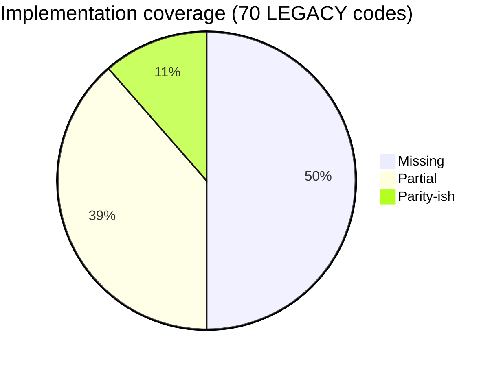
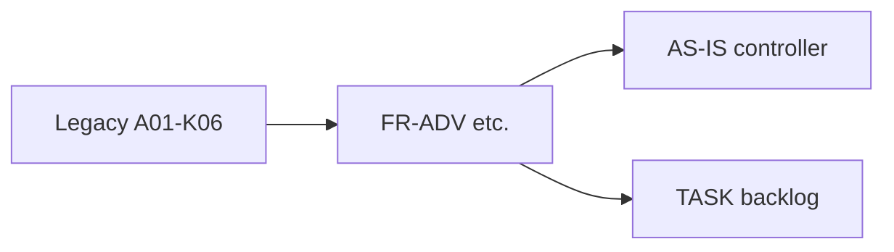

# LEGACY API → FR Mapping Matrix (TASK-008)

Authoritative LEGACY catalogue: [LEGACY-REQUIREMENTS-ANALYSIS.md](../../01-business/source-analysis/LEGACY-REQUIREMENTS-ANALYSIS.md). AS-IS verification: [API-INVENTORY.md](../../03-architecture/api/API-INVENTORY.md).

## Summary statistics

| Metric | Count |
|--------|------:|
| Legacy API codes | **70** |
| Distinct FR IDs | **35** |
| Status **Missing** (no AS-IS equivalent) | **35** |
| Status **Partial** / path drift | **27** |
| Status **Implemented** (behavior present, contract differs) | **8** |

**Figure MAP-FIG-001** — Coverage snapshot (manual verification against controllers; not a runtime metric).

**Figure MAP-FIG-002** — Reconciliation flow (v0.2.0).

## Functional area breakdown

| Area | Codes | FR group |
|------|-------|----------|
| Adverts | A01–A13 | FR-ADV-001 … FR-ADV-010 |
| Images | I01–I04 | FR-MED-001 |
| Categories | C01–C10 | FR-CAT-001 |
| Advert types | T01–T05 | FR-CAT-002 |
| Geography | U01–U03 | FR-GEO-001, FR-GEO-002 |
| Tour requests | S01–S10 | FR-TOUR-001, FR-TOUR-002 |
| Auth | F01–F04 | FR-AUTH-001 … FR-AUTH-004 |
| Users | F05–F08 | FR-USER-001, FR-USER-002 |
| User admin | F09–F12 | FR-ADM-001 |
| Reports | G01–G05 | FR-RPT-001 … FR-RPT-005 |
| Contact | J01–J02 | FR-CNT-001 |
| Favorites | K01–K06 | FR-FAV-001 |

## Full mapping (70 rows)

| Legacy ID | PDF p. | Method | LEGACY endpoint | Actor | LEGACY + | FR ID | AS-IS implementation | Status | Discrepancy | Task |
|-----------|--------|--------|-----------------|-------|----------|-------|------------------------|--------|-------------|------|
| A01 | 25 | GET | `/adverts` | Anonymous | + | FR-ADV-003 | `GET .../adverts/{lang}/getAll` | Partial | JWT; filters/paging differ | TASK-010 |
| A02 | 26 | GET | `/adverts/cities` | Anonymous | + | FR-ADV-004 | Not found | Missing | City aggregation | TASK-011 |
| A03 | 27 | GET | `/adverts/categories` | Anonymous | + | FR-ADV-004 | Not found | Missing | PDF path typo | TASK-011 |
| A04 | 28 | GET | `/adverts/popular/:amount` | Anonymous | + | FR-ADV-005 | Not found | Missing | PP formula | TASK-012 |
| A05 | 29 | GET | `/adverts/auth` | Customer | + | FR-ADV-006 | User-scoped lists TBD | Partial | Path model | TASK-013 |
| A06 | 30 | GET | `/adverts/admin` | Mgr/Admin | + + | FR-ADV-007 | `getAll` / admin usage | Partial | Admin filters | TASK-013 |
| A07 | 31 | GET | `/adverts/:slug` | Anonymous | + | FR-ADV-008 | No slug GET | Missing | Slug detail | TASK-014 |
| A08 | 32 | GET | `/adverts/:id/auth` | Customer | + | FR-ADV-009 | User advert GET TBD | TBD | | TASK-013 |
| A09 | 33 | GET | `/adverts/:id/admin` | Mgr/Admin | + + | FR-ADV-010 | No admin-by-id | Partial | | TASK-013 |
| A10 | 34 | POST | `/adverts` | Customer | + | FR-ADV-002 | `POST .../add` | Implemented | `api/v1.0` + language | — |
| A11 | 35 | PUT | `/adverts/auth/:id` | Customer | + | FR-ADV-002 | `PUT .../update/{id}` | Partial | Pending reset rule | TASK-015 |
| A12 | 36 | PUT | `/adverts/admin/:id` | Mgr/Admin | + + | FR-ADV-002 | Same update endpoint | Partial | RBAC | TASK-005 |
| A13 | 37 | DELETE | `/adverts/admin/:id` | Mgr/Admin | + + | FR-ADV-002 | `DELETE .../delete/{id}` | Partial | Cascade delete | TASK-015 |
| I01 | 39 | GET | `/images/:imageId` | Anonymous | + | FR-MED-001 | `ImageController` empty | Missing | | TASK-004 |
| I02 | 40 | POST | `/images/:advertId` | Mgr/Admin | +++ | FR-MED-001 | Empty | Missing | Multipart | TASK-004 |
| I03 | 41 | DELETE | `/images/:image_ids` | Mgr/Admin | +++ | FR-MED-001 | Empty | Missing | | TASK-004 |
| I04 | 42 | PUT | `/images/:imageId` | Mgr/Admin | +++ | FR-MED-001 | Empty | Missing | Featured image | TASK-004 |
| C01 | 44 | GET | `/categories` | Anonymous | + | FR-CAT-001 | `GET .../categories` | Partial | JWT + language | TASK-010 |
| C02 | 45 | GET | `/categories/admin` | Mgr/Admin | ++ | FR-CAT-001 | `.../categories/admin` | Partial | | — |
| C03 | 46 | GET | `/categories/:id` | Anonymous | + | FR-CAT-001 | `GET .../get/{id}` | Partial | | — |
| C04 | 47 | POST | `/categories` | Mgr/Admin | ++ | FR-CAT-001 | `POST .../add` | Partial | | — |
| C05 | 48 | PUT | `/categories/:id` | Mgr/Admin | ++ | FR-CAT-001 | `PUT .../update/{id}` | Partial | built_in | — |
| C06 | 49 | DELETE | `/categories/:id` | Mgr/Admin | ++ | FR-CAT-001 | `DELETE .../delete/{id}` | Partial | FK guard | — |
| C07 | 50 | GET | `/categories/:id/properties` | Mgr/Admin | ++ | FR-CAT-001 | properties GET | Implemented | | — |
| C08 | 51 | POST | `/categories/:id/properties` | Mgr/Admin | ++ | FR-CAT-001 | properties POST | Implemented | | — |
| C09 | 52 | PUT | `/categories/properties/:id` | Mgr/Admin | ++ | FR-CAT-001 | properties PUT | Partial | | — |
| C10 | 53 | DELETE | `/categories/properties/:id` | Mgr/Admin | ++ | FR-CAT-001 | properties DELETE | Implemented | | — |
| T01 | 55 | GET | `/advert-types` | Anonymous | + | FR-CAT-002 | Empty controller | Missing | | TASK-004 |
| T02 | 56 | GET | `/advert-types/:id` | Mgr/Admin | ++ | FR-CAT-002 | Missing | Missing | | TASK-004 |
| T03 | 57 | POST | `/advert-types` | Mgr/Admin | ++ | FR-CAT-002 | Missing | Missing | | TASK-004 |
| T04 | 58 | PUT | `/advert-types/:id` | Mgr/Admin | ++ | FR-CAT-002 | Missing | Missing | | TASK-004 |
| T05 | 59 | DELETE | `/advert-types/:id` | Mgr/Admin | ++ | FR-CAT-002 | Missing | Missing | | TASK-004 |
| U01 | 61 | GET | `/countries` | Anonymous | + | FR-GEO-001 | Country CRUD | Divergent | LEGACY GET-only | TASK-016 |
| U02 | 62 | GET | `/cities` | Anonymous | + | FR-GEO-001 | City CRUD | Divergent | | TASK-016 |
| U03 | 63 | GET | `/districts` | Anonymous | + | FR-GEO-001 | District CRUD | Divergent | | TASK-016 |
| S01 | 65 | GET | `/tour-requests/auth` | Customer | + | FR-TOUR-001 | Empty | Missing | | TASK-002 |
| S02 | 66 | GET | `/tour-requests/admin` | Mgr/Admin | ++ | FR-TOUR-001 | Empty | Missing | | TASK-002 |
| S03 | 67 | GET | `/tour-requests/:id/auth` | Customer | + | FR-TOUR-001 | Empty | Missing | PDF typo | TASK-002 |
| S04 | 68 | GET | `/tour-requests/:id/admin` | Mgr/Admin | ++ | FR-TOUR-001 | Empty | Missing | | TASK-002 |
| S05 | 69 | POST | `/tour-requests` | Customer | + | FR-TOUR-001 | Empty | Missing | | TASK-002 |
| S06 | 70 | PUT | `/tour-requests/:id/auth` | Customer | + | FR-TOUR-001 | Empty | Missing | | TASK-002 |
| S07 | 71 | PATCH | `/tour-requests/:id/cancel` | Customer | + | FR-TOUR-002 | Empty | Missing | | TASK-002 |
| S08 | 72 | PATCH | `/tour-requests/:id/approve` | Owner/Mgr | + | FR-TOUR-002 | Empty | Missing | | TASK-002 |
| S09 | 73 | PATCH | `/tour-requests/:id/decline` | Owner/Mgr | + | FR-TOUR-002 | Empty | Missing | | TASK-002 |
| S10 | 74 | DELETE | `/tour-requests/:id` | Mgr/Admin | ++ | FR-TOUR-001 | Empty | Missing | | TASK-002 |
| F01 | 76 | POST | `/login` | Anonymous | + | FR-AUTH-002 | `auth/.../login` | Implemented | Path | — |
| F02 | 77 | POST | `/register` | Anonymous | + | FR-AUTH-001 | `auth/.../signUp` | Implemented | Password rules TBD | — |
| F03 | 78 | POST | `/forgot-password` | Anonymous | + | FR-AUTH-003 | Not found | Missing | | TASK-017 |
| F04 | 79 | POST | `/reset-password` | Anonymous | + | FR-AUTH-004 | Not found | Missing | | TASK-017 |
| F05 | 80 | GET | `/users/auth` | Auth user | +++ | FR-USER-001 | `UserController` GET | Partial | | — |
| F06 | 81 | PUT | `/users/auth` | Auth user | +++ | FR-USER-001 | PUT update | Partial | | — |
| F07 | 82 | PATCH | `/users/auth` | Auth user | +++ | FR-USER-002 | No PATCH | Missing | Password change | TASK-018 |
| F08 | 83 | DELETE | `/users/auth` | Auth user | + | FR-USER-002 | DELETE user | Partial | Cascade | TASK-018 |
| F09 | 84 | GET | `/users/admin` | Mgr/Admin | ++ | FR-ADM-001 | `AdminController` lists | Partial | Search | — |
| F10 | 85 | GET | `/users/:id/admin` | Mgr/Admin | ++ | FR-ADM-001 | getUser | Partial | Nested data | — |
| F11 | 86 | PUT | `/users/:id/admin` | Mgr/Admin | ++ | FR-ADM-001 | change role/status | Partial | Manager scope | TASK-005 |
| F12 | 87 | DELETE | `/users/:id/admin` | Mgr/Admin | ++ | FR-ADM-001 | delete user | Partial | Scope | TASK-005 |
| G01 | 89 | GET | `/report` | Mgr/Admin | ++ | FR-RPT-001 | Not found | Missing | Dashboard | TASK-019 |
| G02 | 90 | GET | `/report/adverts` | Mgr/Admin | ++ | FR-RPT-002 | Not found | Missing | | TASK-019 |
| G03 | 91 | GET | `/report/most-popular-properties` | Mgr/Admin | ++ | FR-RPT-003 | Not found | Missing | | TASK-019 |
| G04 | 92 | GET | `/report/users` | Mgr/Admin | ++ | FR-RPT-004 | Not found | Missing | | TASK-019 |
| G05 | 93 | GET | `/report/tour-requests` | Mgr/Admin | ++ | FR-RPT-005 | Not found | Missing | | TASK-019 |
| J01 | 95 | GET | `/contact-messages` | Mgr/Admin | ++ | FR-CNT-001 | GET contacts | Partial | JWT | — |
| J02 | 96 | POST | `/contact-messages` | Anonymous | + | FR-CNT-001 | POST add | Partial | JWT vs LEGACY | TASK-010 |
| K01 | 98 | GET | `/favorites/auth` | Customer | + | FR-FAV-001 | Commented out | Missing | | TASK-003 |
| K02 | 99 | GET | `/favorites/admin/id` | Mgr/Admin | ++ | FR-FAV-001 | `GET /admin/{id}` | Partial | Path | TASK-003 |
| K03 | 100 | POST | `/favorites/:id/auth` | Customer | + | FR-FAV-001 | Commented | Missing | Toggle | TASK-003 |
| K04 | 101 | DELETE | `/favorites/auth` | Customer | + | FR-FAV-001 | Missing | Missing | | TASK-003 |
| K05 | 102 | DELETE | `/favorites/admin` | Mgr/Admin | ++ | FR-FAV-001 | `DELETE ad` | Partial | | TASK-003 |
| K06 | 103 | DELETE | `/favorites/:id/amin` | Mgr/Admin | ++ | FR-FAV-001 | `DELETE /{id}` | Partial | PDF typo | TASK-003 |

### AS-IS capabilities without LEGACY code

| Domain | AS-IS | FR ID | Note |
|--------|-------|-------|------|
| Internal messaging | `MessageController` | FR-MSG-001 | Not in PDF |
| Role CRUD | `RoleController` | FR-ADM-002 | Not in PDF |

## Change history

| Version | Date | Summary |
|---------|------|---------|
| 0.2.0 | 2026-11-13 | TASK-008 — 70-code reconciliation |
