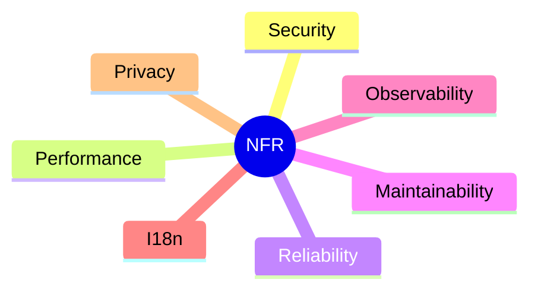

# NFR Catalogue

Measurable targets without evidence are labeled **TO-BE**.

**Figure RE-FIG-NFR-001** — NFR domains.

| ID | Category | Requirement | Acceptance / metric | Class |
|----|----------|-------------|---------------------|-------|
| NFR-SEC-001 | Security | APIs use JWT stateless auth | All non-whitelist calls 401 without token | AS-IS |
| NFR-SEC-001a | Security | **TO-BE:** Resource Server validates Keycloak JWT (`iss`, `exp`, signature, `aud` per client config) | Reject unverifiable tokens | TO-BE |
| NFR-SEC-002 | Security | CSRF disabled for stateless API | Documented trade-off; SPA clients | AS-IS |
| NFR-SEC-002a | Security | **TO-BE:** Cookie session BFF routes protected against CSRF (SameSite + token/origin policy **TBD**) | Mutating BFF routes | TO-BE PROPOSED |
| NFR-SEC-003 | Security | CORS wide open `*` | **TO-BE**: explicit trusted origins; production **not** `*` | AS-IS config |
| NFR-SEC-003a | Security | **TO-BE:** Same-origin browser→BFF avoids broad CORS; direct browser→API requires allow-list | Per environment | TO-BE |
| NFR-SEC-004 | Security | No secrets in documentation | Redacted examples only | Process |
| NFR-SEC-004a | Security | **TO-BE:** No Keycloak/client secrets in frontend; BFF holds confidential client creds | Config outside repo | TO-BE |
| NFR-SEC-005 | Security | Role-based authorization | **AS-IS gap** — partial method security; DEC-002 business matrix **not approved** | Gap |
| NFR-SEC-005a | Security | **TO-BE:** Explicit Keycloak claim → `CUSTOMER`/`MANAGER`/`ADMIN` mapping; no `ROLE_ROLE_` double prefix | Consistent `@PreAuthorize` | TO-BE |
| NFR-SEC-006 | Security | **TO-BE:** Refresh/access tokens not in browser JS storage (BFF PROPOSED) | HttpOnly opaque session cookie only | TO-BE PROPOSED |
| NFR-SEC-007 | Security | Resource ownership in owning module application layer | Listing/engagement/communication policies | TO-BE |
| NFR-PERF-001 | Performance | API response time | **TO-BE**: p95 &lt; 500ms on catalog read (TBD baseline) | TO-BE |
| NFR-CACHE-001 | Performance | Application cache via Spring Cache + Redis (cache-aside) | Measure-first; PG authoritative; [CACHING-PERFORMANCE-ARCHITECTURE.md](../../03-architecture/performance/CACHING-PERFORMANCE-ARCHITECTURE.md) | TO-BE |
| NFR-CACHE-002 | Performance | No default cache of user-specific or authz outcomes | Security review before exceptions | APPROVED policy |
| NFR-PERF-002 | Performance | Public catalog IP rate limit before prod | ADR-002; Redis+Bucket4j **preferred** TO-BE; not mandatory | TO-BE |
| NFR-SCAL-001 | Scalability | Vertical scale modular monolith | **TO-BE**: stateless instances behind LB | TO-BE |
| NFR-AVAIL-001 | Availability | Service uptime | **TO-BE**: 99.5% single-region (proposal) | TO-BE |
| NFR-REL-001 | Reliability | PostgreSQL ACID persistence | JPA transactions default | AS-IS |
| NFR-MAINT-001 | Maintainability | Documented architecture & ADRs | This docs tree | AS-IS deliverable |
| NFR-TEST-001 | Testability | Automated regression | [TESTING-ARCHITECTURE.md](../../03-architecture/testing/TESTING-ARCHITECTURE.md) — 18 test classes; CI Surefire | Partial |
| NFR-TEST-002 | Testability | Module boundary tests (ArchUnit) | **PROPOSED** — not in pom | TO-BE |
| NFR-TEST-003 | Testability | ADR-002 public read security tests | **FUTURE** | TO-BE |
| NFR-OBS-001 | Observability | Actuator on classpath | Exposure config **TBD**; [OBSERVABILITY-RELIABILITY-ARCHITECTURE.md](../../03-architecture/operations/OBSERVABILITY-RELIABILITY-ARCHITECTURE.md) | Partial |
| NFR-OBS-002 | Observability | Structured logging | **TO-BE**: JSON logs + correlation ID | TO-BE |
| NFR-OBS-003 | Observability | Metrics export (Prometheus) | **FUTURE** — not in `pom.xml` | FUTURE |
| NFR-A11Y-001 | Accessibility | WCAG **2.2 AA** for web | [FRONTEND-ARCHITECTURE.md](../../03-architecture/frontend/FRONTEND-ARCHITECTURE.md) §11 — verification **TBD** | TO-BE |
| NFR-USE-001 | Usability | Consistent error messages | `GlobalExceptionHandler`, `FriendlyMessage` | AS-IS |
| NFR-USE-001a | Usability | **TO-BE:** RFC 9457 Problem Details + stable `applicationCode` | [ERROR_HANDLING.md](../../04-development/ERROR_HANDLING.md) | TO-BE |
| NFR-API-001 | API | REST `/api/v1/` conventions; no JPA on wire | [API-ARCHITECTURE.md](../../03-architecture/api/API-ARCHITECTURE.md) | TO-BE |
| NFR-API-002 | API | OpenAPI 3 via springdoc; generated spec | AS-IS dependency; strict contract CI **FUTURE** | Partial |
| NFR-I18N-001 | I18n | DE/EN/TR; default **de** (APPROVED target) | [I18N-L10N-ARCHITECTURE.md](../../03-architecture/i18n/I18N-L10N-ARCHITECTURE.md) | TO-BE / partial AS-IS |
| NFR-I18N-002 | I18n | BCP 47 + Language Registry | M1 snapshot implemented; routes **TBD** | Partial |
| NFR-I18N-003 | I18n | Stable error codes independent of translated text | `FriendlyMessageCodes` AS-IS | AS-IS |
| NFR-I18N-004 | I18n | Public content 404 without language fallback | DEC-007 / ADR-002 | APPROVED |
| NFR-DI-001 | Data integrity | FK relations on adverts | JPA mappings on `Advert` | AS-IS |
| NFR-PRIV-001 | Privacy | PII in user profile | Minimize exposure in DTOs **TBD** review | TBD |
| NFR-BAK-001 | Backup | DB backup/restore | **TO-BE** — no scripts AS-IS; [OBSERVABILITY-RELIABILITY-ARCHITECTURE.md](../../03-architecture/operations/OBSERVABILITY-RELIABILITY-ARCHITECTURE.md) §9 | TO-BE |
| NFR-DR-001 | Disaster recovery | RPO/RTO | **TBD** in repo — candidates not approved | TBD |
| NFR-DEP-001 | Deployment | Modular monolith JAR; Postgres Compose AS-IS | [INFRASTRUCTURE-DEPLOYMENT-ARCHITECTURE.md](../../03-architecture/infrastructure/INFRASTRUCTURE-DEPLOYMENT-ARCHITECTURE.md) — app container **FUTURE** | Partial |
| NFR-DEP-002 | Deployment | CI pipeline | GitHub Actions test-only; no CD | Partial AS-IS |
| NFR-COMP-001 | Compatibility | Java 17 + Boot 3.0 | `pom.xml` | AS-IS |
| NFR-COMP-002 | Compatibility | Target Java 25 + Boot 4.x | See TECHNOLOGY_BASELINE | TO-BE |

## Change history

| Version | Date | Summary |
|---------|------|---------|
| 0.1.0 | 2026-11-13 | Initial NFR table |
| 0.2.0 | 2026-11-18 | Security NFRs for Resource Server, CSRF/CORS boundaries, tokens, module authorization |
| 0.2.1 | 2026-11-18 | API conventions and RFC 9457 error NFRs (Group 5) |
| 0.2.2 | 2026-11-18 | Cache and rate-limit NFRs (Group 7) |
| 0.2.3 | 2026-11-18 | i18n architecture NFRs (Group 8) |
| 0.2.4 | 2026-11-18 | Testing architecture NFRs (Group 9) |
| 0.2.5 | 2026-11-18 | Deployment / CI NFRs (Group 10) |
| 0.2.6 | 2026-11-18 | Observability / DR NFRs (Group 11) |
| 0.2.7 | 2026-11-18 | NFR-A11Y-001 → FRONTEND-ARCHITECTURE (Group 12) |
