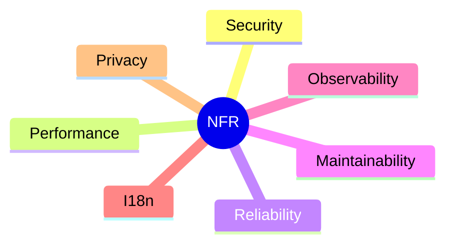

# NFR Catalogue

Measurable targets without evidence are labeled **TO-BE**.

**Figure RE-FIG-NFR-001** — NFR domains.

| ID | Category | Requirement | Acceptance / metric | Class |
|----|----------|-------------|---------------------|-------|
| NFR-SEC-001 | Security | APIs use JWT stateless auth | All non-whitelist calls 401 without token | AS-IS |
| NFR-SEC-002 | Security | CSRF disabled for stateless API | Documented trade-off; SPA clients | AS-IS |
| NFR-SEC-003 | Security | CORS wide open `*` | **TO-BE**: restrict origins per environment | AS-IS config |
| NFR-SEC-004 | Security | No secrets in documentation | Redacted examples only | Process |
| NFR-SEC-005 | Security | Role-based authorization | **TBD** — method security largely off | Gap |
| NFR-PERF-001 | Performance | API response time | **TO-BE**: p95 &lt; 500ms on catalog read (TBD baseline) | TO-BE |
| NFR-SCAL-001 | Scalability | Vertical scale modular monolith | **TO-BE**: stateless instances behind LB | TO-BE |
| NFR-AVAIL-001 | Availability | Service uptime | **TO-BE**: 99.5% single-region (proposal) | TO-BE |
| NFR-REL-001 | Reliability | PostgreSQL ACID persistence | JPA transactions default | AS-IS |
| NFR-MAINT-001 | Maintainability | Documented architecture & ADRs | This docs tree | AS-IS deliverable |
| NFR-TEST-001 | Testability | Automated regression | **AS-IS**: context test only — gap | AS-IS |
| NFR-OBS-001 | Observability | Actuator on classpath | Exposure config **TBD** | Partial |
| NFR-OBS-002 | Observability | Structured logging | **TO-BE**: JSON logs + correlation ID | TO-BE |
| NFR-A11Y-001 | Accessibility | WCAG for web | Frontend **TBD** | TO-BE |
| NFR-USE-001 | Usability | Consistent error messages | `GlobalExceptionHandler`, `FriendlyMessage` | AS-IS |
| NFR-I18N-001 | I18n | EN/TR API messages | Language path + message bundles | AS-IS partial |
| NFR-I18N-002 | I18n | DE product language | FE locales exist; API **TBD** | Partial |
| NFR-DI-001 | Data integrity | FK relations on adverts | JPA mappings on `Advert` | AS-IS |
| NFR-PRIV-001 | Privacy | PII in user profile | Minimize exposure in DTOs **TBD** review | TBD |
| NFR-BAK-001 | Backup | DB backup/restore | **TO-BE** procedures | TO-BE |
| NFR-DEP-001 | Deployment | Containerized deploy | README lists Docker as planned | LEGACY plan |
| NFR-COMP-001 | Compatibility | Java 17 + Boot 3.0 | `pom.xml` | AS-IS |
| NFR-COMP-002 | Compatibility | Target Java 25 + Boot 4.x | See TECHNOLOGY_BASELINE | TO-BE |
