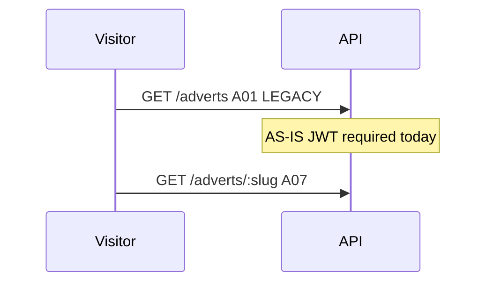

# UC-ADV-01 — Browse and search property listings

| Field | Value |
|-------|-------|
| **Actors** | Anonymous (LEGACY), Customer |
| **Preconditions** | LEGACY: no auth; AS-IS: JWT **TBD** policy (ADR-002) |
| **Main flow** | Search listings → view summary → open detail (slug LEGACY A07) |
| **Related FR** | FR-ADV-001, FR-ADV-003, FR-ADV-008 |
| **LEGACY codes** | A01, A07 (pp. 25, 31) |
| **Traceability** | [TRACEABILITY_MATRIX.md](../../00-governance/TRACEABILITY_MATRIX.md) |

**Figure UC-ADV-01-FIG** — Browse flow (LEGACY contract).
