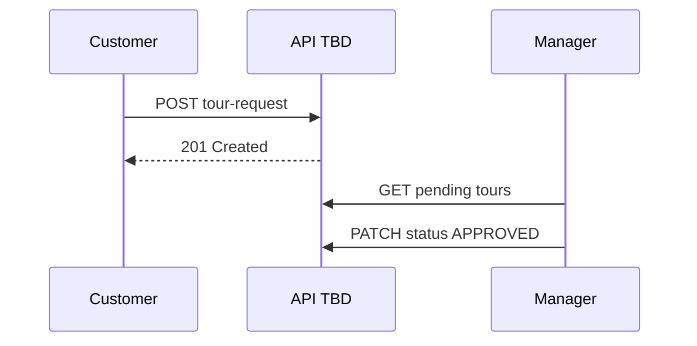

# UC-TOUR-01 — Request property tour

| Field | Value |
|-------|-------|
| **Actors** | Customer (primary), Manager (LEGACY) |
| **Preconditions** | User authenticated (AS-IS); active advert exists |
| **Main success** | Customer submits tour request → Manager sees queue → status updated |
| **Classification** | LEGACY flow; API **TBD** |
| **Related FR** | FR-TOUR-001 |
| **Traceability** | [TRACEABILITY_MATRIX.md](../../00-governance/TRACEABILITY_MATRIX.md) |

**Figure RE-FIG-UC-TOUR-01** — Target use case (TO-BE completion).
