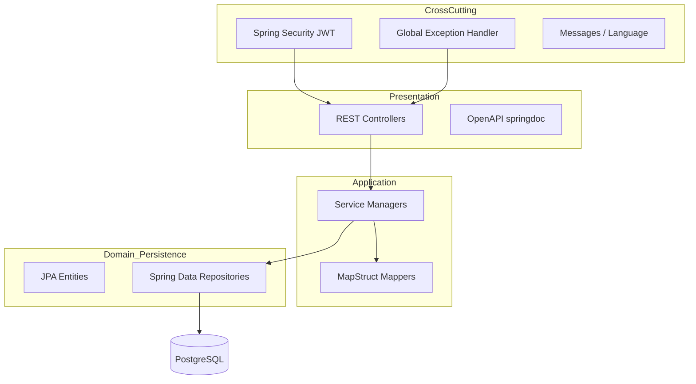
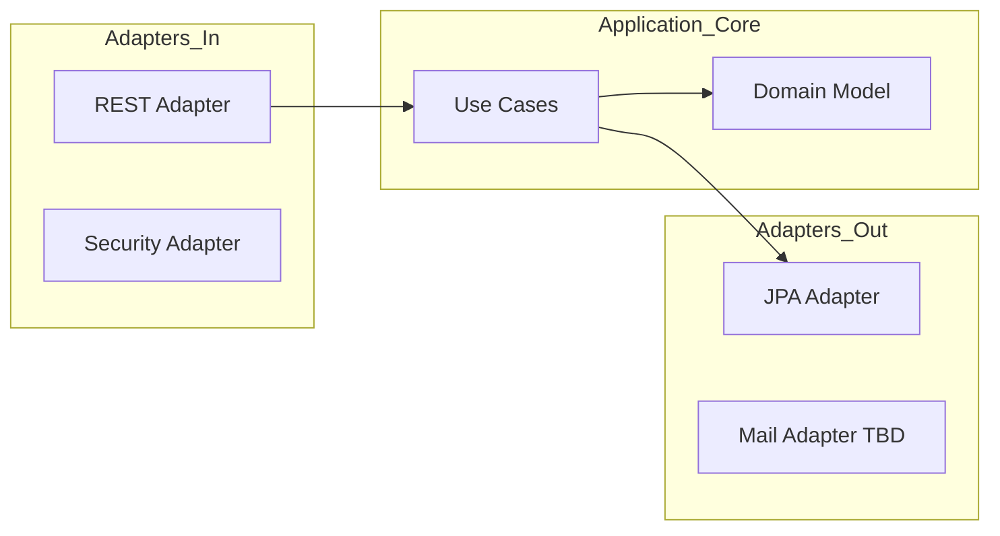

# HLD — Container Architecture

## AS-IS (layered monolith)

**Figure RE-FIG-HLD-001** — AS-IS logical containers inside single deployable.

**Figure RE-FIG-HLD-002** — Historical infrastructure diagram from project README (AS-IS reference).

## TO-BE — Hexagonal / Clean (proposal)

**Figure RE-FIG-HLD-003** — Target dependency inversion (TO-BE draft).

Dependency rules: [HLD-002-clean-architecture.md](HLD-002-clean-architecture.md).

## Modular monolith modules (proposal)

| Module | Responsibility |
|--------|----------------|
| `identity` | Auth, users, roles |
| `catalog` | Geo, categories, advert types |
| `listing` | Adverts, images, favorites |
| `engagement` | Tours, contact, messages |
| `platform` | Logging, config, i18n |

Inter-module: in-process calls via application services; **no circular deps** (TO-BE ADR-002).
