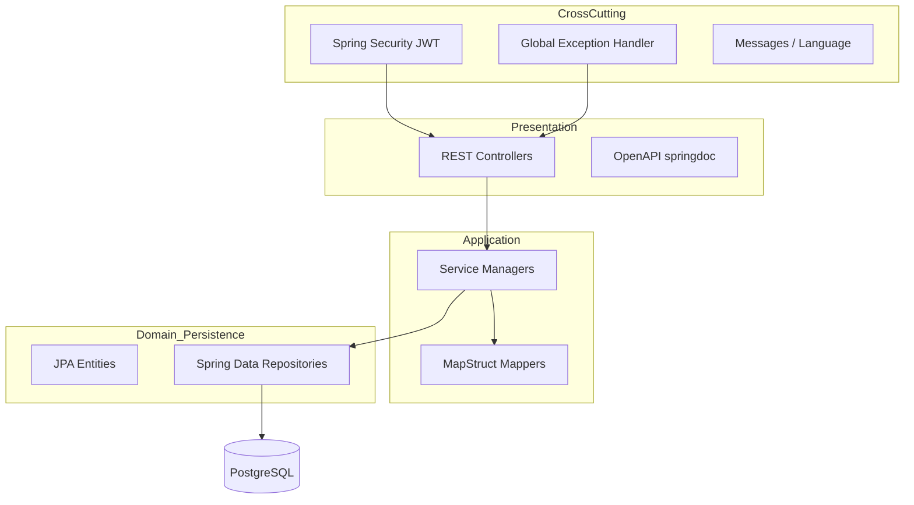
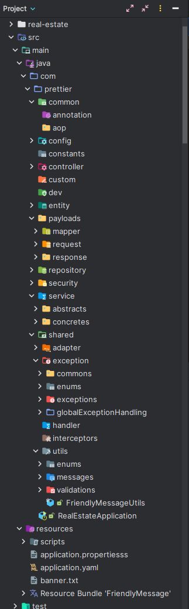
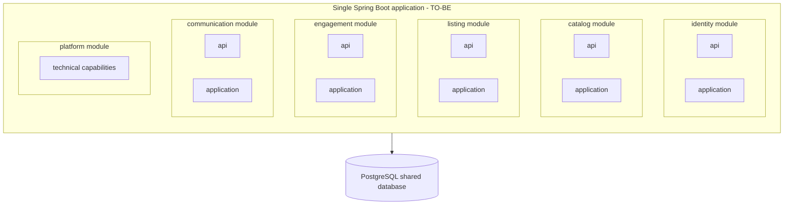
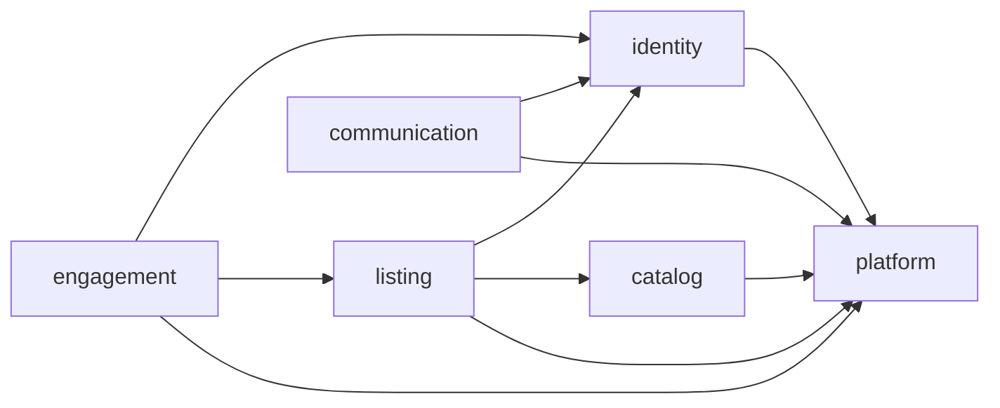
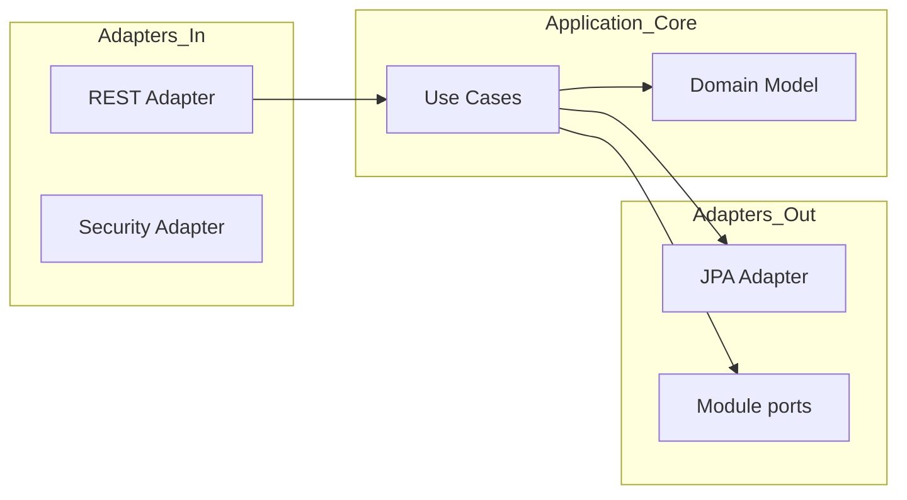

# HLD — Container Architecture

**Physical deployment / CI / Docker:** [INFRASTRUCTURE-DEPLOYMENT-ARCHITECTURE.md](../infrastructure/INFRASTRUCTURE-DEPLOYMENT-ARCHITECTURE.md).

## AS-IS (layered monolith)

**Figure RE-FIG-HLD-001** — AS-IS logical layering inside a single deployable (not modular packages).

**Caption:** Historical package-by-layer structure in one JVM.

**Explanation:** Controllers and `*Manager` services share one classpath; persistence entities are used across business areas without module fences.

**Figure RE-FIG-HLD-002** — Historical infrastructure diagram from project README (AS-IS reference).

## TO-BE — Modular monolith (one deployable)

**Approved:** One Spring Boot application, one Maven artifact — **not** six separate services.

**Figure RE-FIG-HLD-005** — Logical module boundaries inside one backend container.

**Caption:** Six modules coexist in one process; PostgreSQL is shared infrastructure.

**Explanation:** The diagram shows **ownership boundaries**, not network boundaries. Inter-module calls are in-process ports/adapters unless a **FUTURE** outbox/broker is introduced (see [HLD-003-event-driven-architecture.md](HLD-003-event-driven-architecture.md)).

### Initial modules (approved responsibilities)

| Module | Responsibility |
|--------|----------------|
| `identity` | User identity, profiles, application roles and identity-related capabilities |
| `catalog` | Reference data, categories, classifications, geo reference data |
| `listing` | Advertisements, listing lifecycle, property values (`category_property_values`) |
| `engagement` | Favorites, following, user interactions |
| `communication` | Conversations, messages, communication capabilities |
| `platform` | Minimal shared **technical** infrastructure (i18n registry, API errors, etc.) |

**Future (not initial):** `notification`, `subscription`, `ai`, `partner`, `audit` — see [ADR-001-modular-monolith.md](../ADR/ADR-001-modular-monolith.md).

### Approved module dependencies (technical)

**Figure RE-FIG-HLD-006** — Approved module dependency direction (ports, not JPA).

**Caption:** Arrows are allowed consumer → provider relationships implemented via ports.

**Explanation:** No arrow from catalog to listing or identity to engagement “back” — **no circular** module dependencies.

| Consumer | Provider | Port |
|----------|----------|------|
| listing | identity | `IdentityPort` |
| listing | catalog | `CatalogPort` |
| engagement | identity | `IdentityPort` |
| engagement | listing | `ListingQueryPort` |
| communication | identity | `IdentityPort` |
| business modules | platform | technical APIs only |

## TO-BE — Hexagonal view (per module)

**Figure RE-FIG-HLD-003** — Target dependency inversion within each module (TO-BE).

Dependency rules and layers: [HLD-002-clean-architecture.md](HLD-002-clean-architecture.md).

## Change history

| Version | Date | Summary |
|---------|------|---------|
| 0.1.0 | 2026-11-13 | AS-IS layering; draft five-module table |
| 0.2.0 | 2026-11-18 | Six-module modular monolith container; dependency diagram; listing/engagement split corrected |
| 0.2.1 | 2026-11-18 | Link INFRASTRUCTURE-DEPLOYMENT-ARCHITECTURE (Group 10) |