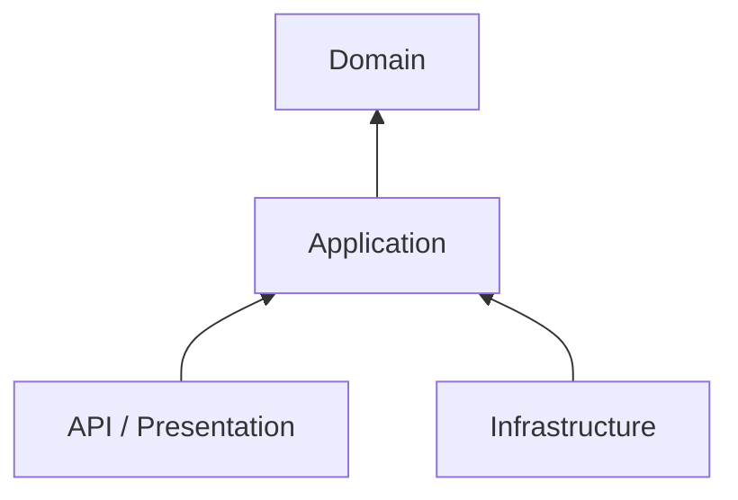

# Clean and Hexagonal Architecture (TO-BE)

## Layer responsibilities

| Layer | Responsibility | AS-IS location |
|-------|----------------|----------------|
| Domain | Entities, invariants, domain services | `entity.*` (anemic today) |
| Application | Use cases, orchestration | `service.concretes.*` |
| Infrastructure | JPA, security, external IO | `repository`, `security` |
| API | REST, DTOs | `controller`, `payloads` |

## Dependency rule

**Figure RE-FIG-HLD-004** — Allowed dependencies (inward only).

## Ports and adapters (examples)

| Port | Adapter (current) |
|------|-------------------|
| `AdvertRepository` port | Spring Data repository |
| `MailNotification` port | **Missing** |
| `TokenService` port | `JWTUtils` |

## Anti-pattern noted AS-IS

Controllers → concrete managers directly; entities contain JPA annotations (acceptable transitional state).

## Shared kernel policy (TO-BE)

Shared: `Money`, `LocalizedText`, `UserId` value objects — **TBD** extraction.
