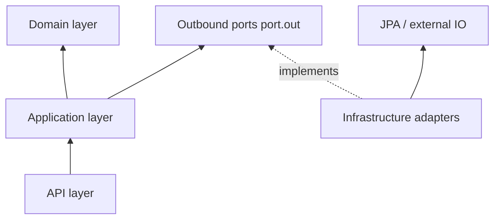
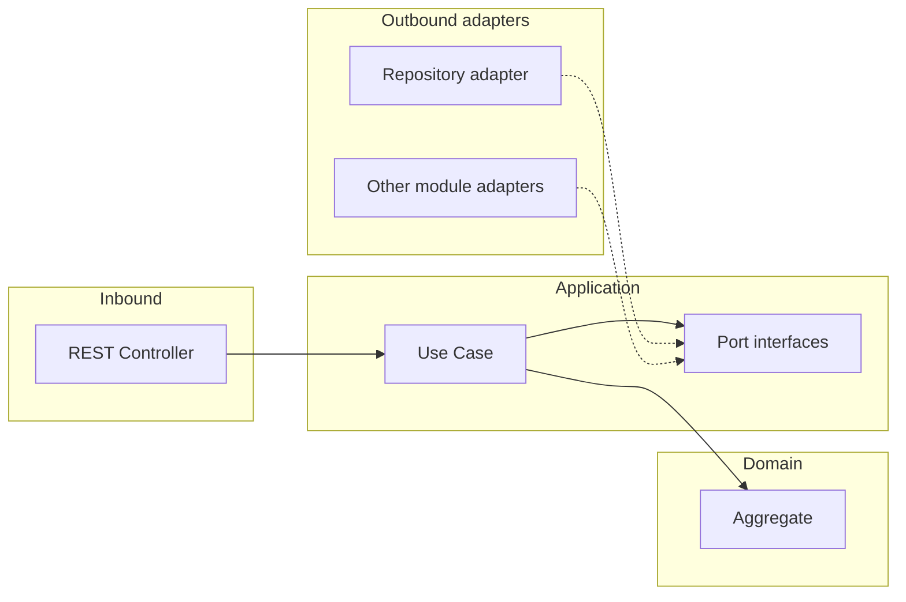

# Clean and Hexagonal Architecture (TO-BE)

Layering applies **per module** in the modular monolith. Package layout is **package-by-feature** under module roots (for example `com.prettier.listing.application`).

**Approved modules (initial):** `identity`, `catalog`, `listing`, `engagement`, `communication`, `platform`. Module list and dependency rules: [ADR-001-modular-monolith.md](../ADR/ADR-001-modular-monolith.md). Container view: [HLD-001-containers.md](HLD-001-containers.md).

Related: [HLD-003-event-driven-architecture.md](HLD-003-event-driven-architecture.md) (domain events, application events, outbox, transaction ordering). **Database, Flyway, aggregates, lifecycle, indexing:** [../database/PERSISTENCE-ARCHITECTURE.md](../database/PERSISTENCE-ARCHITECTURE.md). **REST conventions, validation, errors:** [../api/API-ARCHITECTURE.md](../api/API-ARCHITECTURE.md). **Object storage ports/adapters:** [../storage/FILE-STORAGE-ARCHITECTURE.md](../storage/FILE-STORAGE-ARCHITECTURE.md). **Caching (Redis + Spring Cache):** [../performance/CACHING-PERFORMANCE-ARCHITECTURE.md](../performance/CACHING-PERFORMANCE-ARCHITECTURE.md). **i18n / Language Registry:** [../i18n/I18N-L10N-ARCHITECTURE.md](../i18n/I18N-L10N-ARCHITECTURE.md). **Testing & module boundaries:** [../testing/TESTING-ARCHITECTURE.md](../testing/TESTING-ARCHITECTURE.md).

## Four layers per module (approved)

Each business module uses the same **logical** layers:

| Package segment (TO-BE) | Layer | Responsibility |
|-------------------------|-------|----------------|
| `…module.api` | **API** | REST controllers; request/response DTOs; **API MapStruct mappers**; HTTP concerns |
| `…module.application` | **Application** | Application services / use cases; commands & queries; **outbound ports** (`application.port.out`); auth/validation orchestration; **transaction boundaries** |
| `…module.domain` | **Domain** | Aggregates, entities, value objects, domain services, domain events, invariants — **no Spring, JPA, or HTTP types** |
| `…module.infrastructure` | **Infrastructure** | JPA entities, Spring Data repos, **persistence mappers**, repository adapters, external technical adapters |

**platform** module: primarily **application/infrastructure** for cross-cutting technical services; it must **not** own business rules of other modules.

## Layer responsibilities

| Layer | Responsibility | AS-IS location (transitional) |
|-------|----------------|------------------------------|
| Domain | Entities, invariants, domain services; **no Spring transaction APIs** | `entity.*` (anemic today) |
| Application | Use cases, orchestration, **transaction boundaries**, event publication orchestration | `service.concretes.*` |
| Infrastructure | Persistence **adapters** (implement repository ports), security adapters, messaging adapters | `repository`, `security` |
| API | REST, DTOs | `controller`, `payloads` |

**Important:** The Application layer **depends on repository ports** (interfaces defined in application or domain), not on Spring Data JPA types. **AS-IS** often injects `JpaRepository` implementations directly into managers — **TO-BE** replaces that with port + adapter without implying Application → Spring Data as a permanent rule.

## Dependency rule (Clean + Hexagonal)

**Figure RE-FIG-HLD-004** — Allowed dependencies (inward only).

**Caption:** Application depends on abstractions; infrastructure implements ports and persistence.

**Explanation:** **Application does not depend on Spring Data JPA or concrete repository adapters.** API calls application services only. Domain never depends on Spring or JPA.

**Figure RE-FIG-HLD-007** — Inbound HTTP and outbound ports per module.

**Caption:** Hexagonal view: ports are owned by the consuming module's application layer.

**Explanation:** Listing's `CatalogPort` is defined in **listing.application**; **catalog.infrastructure** provides the adapter.

## Application Service and transaction ownership (approved)

| Rule | Detail |
|------|--------|
| **Who owns `@Transactional`** | **Application Services** (use-case entry points) |
| **Domain** | No `@Transactional`, no `TransactionTemplate`, no awareness of commit/rollback |
| **Repository adapters** | Perform save/load; **do not** define use-case transaction boundaries |
| **Read-only** | Use `@Transactional(readOnly = true)` on read use cases that need a consistent persistence context or avoid accidental flushes |
| **Scope** | Prefer **one module per transaction**; avoid spanning multiple modules in one transaction unless explicitly justified |

**AS-IS:** Few managers declare `@Transactional` explicitly (example: listing create path on `AdvertManager.add` — WIP). Most operations rely on default persistence behavior — **TO-BE** converges on explicit application-layer boundaries.

### Spring proxy / self-invocation (TO-BE)

`@Transactional` and `@TransactionalEventListener` are applied via Spring AOP proxies. Methods called via `this` inside the same class **do not** start a new transactional boundary unless the call is routed through the Spring bean proxy (separate collaborator bean, self-injection, or `TransactionTemplate` — team convention **TBD**).

## Module boundaries and approved dependencies

Cross-module calls use **module APIs / ports** only (see ADR-001). **No** cross-module JPA entity imports or foreign repositories.

| Consumer module | Provider module | Outbound port (consumer-owned) |
|-----------------|-----------------|--------------------------------|
| listing | identity | `IdentityPort` |
| listing | catalog | `CatalogPort` |
| engagement | identity | `IdentityPort` |
| engagement | listing | `ListingQueryPort` |
| communication | identity | `IdentityPort` |
| business modules | platform | technical capabilities (i18n, shared error model) |

**Data ownership (approved):** `category_property_values` belongs to **listing** (references catalog property definitions via ID).

## Repository contracts (approved)

| Rule | Detail |
|------|--------|
| Contract location | `application/port/out` in the **consuming** module (or owning module for its aggregate) |
| Spring Data interfaces | `infrastructure` only |
| Adapter | Infrastructure class **implements** the application port |
| Design unit | Ports align with **aggregates and use cases**, not one port per table by default |

**Anti-patterns:** Business-facing repository interfaces defined only in infrastructure; application services injecting `JpaRepository` directly (**AS-IS** transitional).

## MapStruct — API vs persistence mappers (approved)

Use **MapStruct** for two separate responsibilities:

| Mapper type | Location | Maps | Must not |
|-------------|----------|------|----------|
| **API mapper** | `api` | Request DTO → Application command; Application result → Response DTO | Contain business rules; expose JPA entities on API |
| **Persistence mapper** | `infrastructure` | Domain model ↔ JPA entity | Leak into API or domain |

**Rules:** API DTOs do not enter **domain**. JPA entities do not appear in **API** responses (TO-BE). No extra mapping layers without a concrete need.

**AS-IS:** `payloads.mapper.*` often maps DTO ↔ JPA entity directly — **TO-BE** split per module.

## Ports and adapters (examples)

| Port | Adapter (AS-IS transitional) | Adapter (TO-BE) |
|------|------------------------------|-----------------|
| `AdvertRepository` (listing port.out) | Spring Data `AdvertRepository` injected into manager | `JpaAdvertRepositoryAdapter` in listing.infrastructure |
| `CatalogPort` | **Missing** — direct catalog repos in listing | catalog.infrastructure adapter |
| `IdentityPort` | **Missing** — `UserService` + `User` entity | identity.infrastructure adapter |
| `ListingQueryPort` | **Missing** | listing.application API for engagement |
| `MailNotification` port | **Missing** | SMTP adapter (**FUTURE** module notification) |
| `TokenService` port | `JWTUtils` | identity or platform security adapter |

## Event publication and handling (approved)

| Concern | Owner |
|---------|--------|
| **Domain Event** definition | Publishing module domain/application API |
| **Raise / record** occurrence | Application Service after domain rules (or aggregate records facts — **TO-BE** maturity) |
| **In-process delivery** | Spring Application Events (**not durable**) |
| **Handler implementation** | **Consuming module** Application layer |
| **After commit** | `@TransactionalEventListener(phase = AFTER_COMMIT)` when handlers must read committed DB state — see [HLD-003](HLD-003-event-driven-architecture.md) |
| **Durable delivery** | **FUTURE** Transactional Outbox — **not implemented** |

Application Services publish integration-facing application events or delegate to an event publisher port; they do **not** require consumers to use the publisher's JPA entities.

## Anti-patterns noted AS-IS

- Controllers → concrete managers directly; entities contain JPA annotations (acceptable transitional state).
- Cross-module **direct** repository and entity injection (for example listing loading `Category`, `User` via foreign module repos).
- Treating Spring Application Events as durable messaging.

## Shared kernel policy (TO-BE)

Shared: `Money`, `LocalizedText`, `UserId` value objects — **TBD** extraction. Event **contracts** may live in a minimal `platform.events` or per-module API package — **TBD** (see HLD-003).

## Application vs infrastructure relationship (summary)

| Concern | Application layer | Infrastructure layer |
|---------|-------------------|----------------------|
| Use case flow | Owns orchestration | Invoked via port interfaces |
| Transactions | `@Transactional` on application services | No use-case transaction boundary |
| Persistence | Calls `port.out` repositories | JPA, Spring Data, persistence MapStruct |
| Other modules | Calls `IdentityPort`, `CatalogPort`, … | Adapter beans wire to provider module |
| HTTP | Not present | Not present (API layer owns HTTP) |

## Change history

| Version | Date | Summary |
|---------|------|---------|
| 0.1.0 | 2026-11-13 | Initial layer sketch |
| 0.2.0 | 2026-11-18 | Application transaction ownership; ports vs JPA; events; links HLD-003 |
| 0.3.0 | 2026-11-18 | Four layers; module deps; repository ports; API vs persistence mappers; hexagonal diagram |