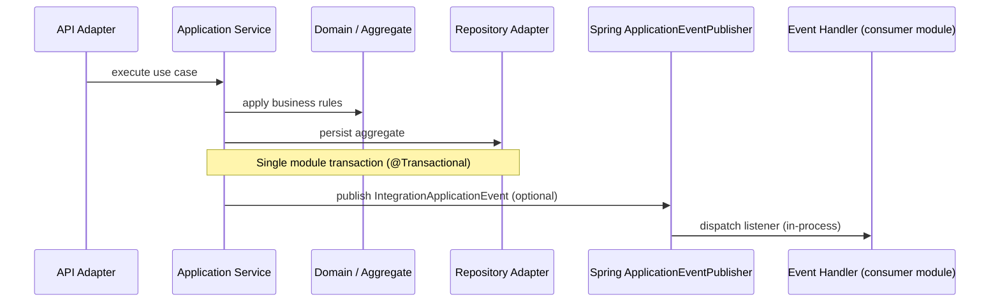
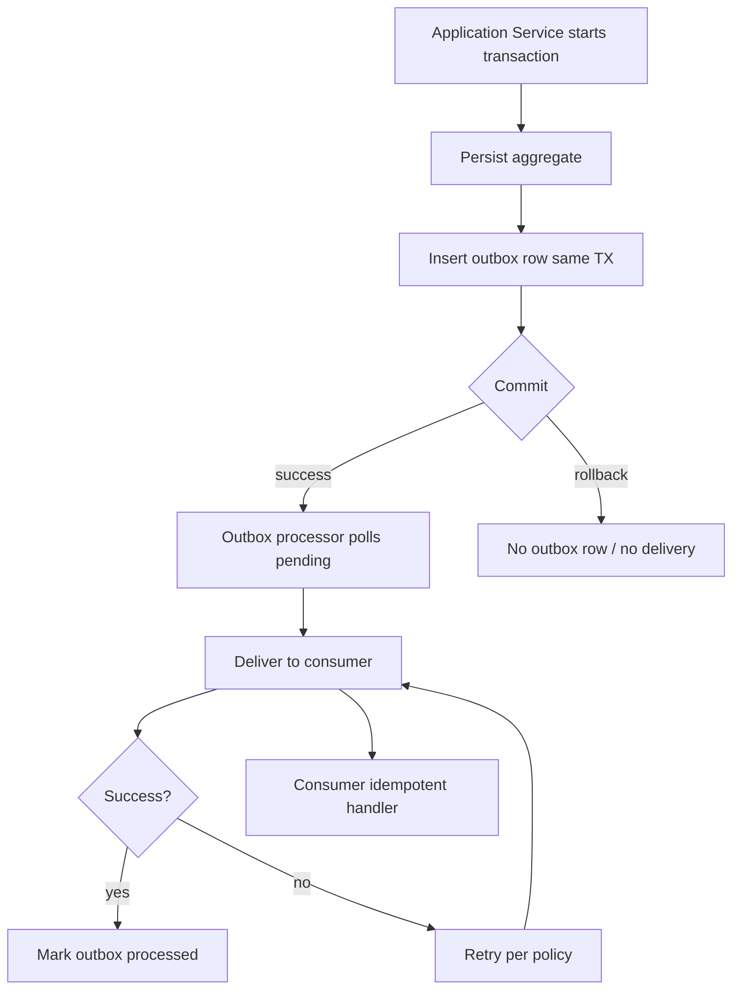

# HLD-003 — Event-Driven Architecture (In-Process and Future Outbox)

## Purpose and scope

This document describes **approved architectural direction** for how modules communicate through **domain events**, how events are delivered **in-process** via **Spring Application Events**, and when **Transactional Outbox** becomes appropriate. It complements [HLD-002-clean-architecture.md](HLD-002-clean-architecture.md) (layers, transactions) and [../domain/DOMAIN-OVERVIEW.md](../domain/DOMAIN-OVERVIEW.md) (domain event catalogue).

**In scope:** event contracts, handler placement, transaction ordering, `AFTER_COMMIT` semantics, future outbox and broker principles.

**Out of scope:** Kafka/RabbitMQ implementation (not part of initial architecture); exact outbox table DDL (TBD at introduction). **Testing event handlers and transaction timing:** [TESTING-ARCHITECTURE.md](../testing/TESTING-ARCHITECTURE.md).

**Label legend:** **AS-IS** = verified today; **TO-BE** = target modular monolith; **FUTURE** = capability planned, not built; **TBD** = undecided detail.

---

## 1. Initial in-process event architecture (TO-BE)

| Mechanism | Role | Durability |
|-----------|------|------------|
| **Domain Event** | Business-meaningful occurrence in a module's domain | Defined by publishing module; immutable contract |
| **Spring Application Event** | In-JVM delivery from publisher to listeners | **Not durable** — synchronous by default; lost if process crashes before handlers run |
| **Module port call** | Synchronous query/command across modules | Same transaction only when explicitly designed (avoid large cross-module transactions) |

**Figure RE-FIG-HLD-003-001** — Typical in-process flow: application service owns the transaction; domain stays free of Spring APIs; handlers run in the consumer module's application layer.

**Caption:** Synchronous application events are an initial delivery mechanism, not a replacement for durable messaging.

**Explanation:** Cross-module reactions (for example engagement or notification) subscribe via handlers. The publishing module exposes an explicit event contract; it does not expose JPA entities or repositories to consumers.

---

## 2. Event contract ownership

| Rule | Statement |
|------|-----------|
| Ownership | The **publishing module** owns the **event contract** (type, payload fields, version policy). |
| Broker independence | Contracts are defined without Kafka/Rabbit-specific types; future brokers map from the same contract. |
| Cross-module | Consumers depend on the **contract** (shared API jar or `platform.events` package policy — **TBD** packaging), not on the publisher's domain entities. |
| Naming | Past-tense domain language (`AdvertSubmitted`, not `SubmitAdvert`). |

**AS-IS:** No domain event types or modular event packages exist. **AS-IS** platform use of Spring events: `ApplicationReadyEvent` for Language Registry startup (see [../domain/LANGUAGE-REGISTRY-M1-IMPLEMENTATION-STATUS.md](../domain/LANGUAGE-REGISTRY-M1-IMPLEMENTATION-STATUS.md)).

---

## 3. Event handler placement

| Layer | Responsibility |
|-------|----------------|
| **API** | HTTP only; does not listen for domain events |
| **Application (consumer module)** | **Event handlers** — react to another module's contract; orchestrate local use cases |
| **Domain (consumer module)** | Invariants for the consumer's own aggregate |
| **Infrastructure** | Persistence, outbound adapters; **no** use-case `@Transactional` boundary |

Handlers **belong to the consuming module's Application layer**. A handler must not inject another module's JPA repository or entity.

---

## 4. Transaction and event ordering

### 4.1 Application Service ownership (approved)

- **Application Services** (use-case orchestrators) define **transaction boundaries** with Spring `@Transactional`.
- **Domain models** do not reference Spring transaction APIs.
- **Repository adapters** persist state but do **not** own use-case transaction scope.

### 4.2 Read operations

- Read-only use cases use `@Transactional(readOnly = true)` where they participate in a persistence context (for example snapshot loaders). See Language Registry: `LanguageRegistrySnapshotLoader` — **AS-IS** (`@Transactional(readOnly = true)` in [LANGUAGE-REGISTRY-M1-IMPLEMENTATION-STATUS.md](../domain/LANGUAGE-REGISTRY-M1-IMPLEMENTATION-STATUS.md) §3.4).

### 4.3 Publishing inside a transaction

| Publish moment | Consumer sees | Risk |
|----------------|---------------|------|
| Before commit | Uncommitted data if handler reads DB | Rollback leaves inconsistent side effects |
| After commit (`@TransactionalEventListener(phase = AFTER_COMMIT)`) | Committed data only | **Not durable** — crash after commit, before handler |
| Outbox insert **same transaction** as aggregate | Row visible after commit | **FUTURE** — durable pending delivery |

**Approved:** Prefer **AFTER_COMMIT** (or outbox) for handlers that read database state written in the same use case. **AFTER_COMMIT is not a replacement for Outbox** when reliable, durable delivery is required.

### 4.4 Cross-module transactions (approved constraint)

Avoid unnecessarily large transactions spanning multiple modules. Prefer: **one module commits** → event or port → **consumer module** starts its own transaction.

### 4.5 Self-invocation and Spring proxies (TO-BE)

`@Transactional` and `@TransactionalEventListener` apply through Spring proxies. **Self-invocation** on `this` bypasses the proxy unless refactored (separate bean, self-injection, or programmatic `TransactionTemplate` — **TBD** team standard).

**AS-IS note:** Explicit `@Transactional` on application services is rare today (for example `AdvertManager.add` — WIP listing path); most managers rely on implicit read-only or no boundary — **TO-BE** alignment expected module-by-module.

---

## 5. `AFTER_COMMIT` behavior (TO-BE / partial AS-IS pattern)

**Use when:** A listener must read committed writes from the same use case (for example **FUTURE** Language Registry `reloadSnapshot()` after admin `UPDATE languages` — described in [LANGUAGE-REGISTRY-DESIGN.md](../domain/LANGUAGE-REGISTRY-DESIGN.md) §7.3; **TO-BE** Redis cache eviction after writes — [CACHING-PERFORMANCE-ARCHITECTURE.md](../performance/CACHING-PERFORMANCE-ARCHITECTURE.md) §6).

**Limitations:**

1. In-process only — no cross-JVM guarantee.
2. Not persisted — process death can skip delivery.
3. Duplicate invocations are possible if the listener is retried manually — design for idempotency when moving to outbox.

**Language Registry AS-IS (preserved facts):**

- Startup: `ApplicationReadyEvent` → `LanguageRegistryInitializer` → `reloadSnapshot()` (not `AFTER_COMMIT`; startup ordering is Flyway then ready event).
- State: `AtomicReference<LanguageRegistrySnapshot>` on `LanguageRegistryServiceImpl`.
- Loader: `@Transactional(readOnly = true)`.
- **M1:** no runtime admin updates; snapshot reload after DB commit applies when runtime updates are introduced.

---

## 6. Transactional Outbox pattern (FUTURE — not implemented)

**Status:** **FUTURE** architectural capability. **No outbox table, processor, or broker integration exists AS-IS.**

### 6.1 Why outbox

Spring Application Events satisfy **synchronous, in-process** reactions. When the product requires **reliable, durable** delivery (email, notification module, AI job handoff, multi-instance consumers), the **Transactional Outbox** stores the event in the **same database transaction** as the business write, then a **background processor** delivers it.

**Not in initial architecture:** Kafka and RabbitMQ. Contracts remain broker-independent so a transport can be added later without rewriting domain meaning.

### 6.2 Future flow (approved target)

**Figure RE-FIG-HLD-003-002** — Transactional Outbox — future durable delivery path.

**Caption:** Aggregate and outbox row commit atomically; delivery happens after commit via a processor.

**Explanation:** The outbox provides **reliable persistence and retry** of *intent to deliver*. It does **not** guarantee exactly-once end-to-end semantics.

### 6.3 Step-by-step (FUTURE)

1. Application Service starts a transaction.
2. Aggregate state is persisted.
3. Outbox event row is inserted in the **same** transaction.
4. Both changes commit atomically.
5. A background processor reads **pending** outbox rows.
6. The event is delivered to its consumer (in-process handler first; broker bridge **FUTURE**).
7. Failures are retried according to policy (backoff, dead-letter — **TBD**).
8. Consumers process **idempotently** (duplicate delivery possible).

### 6.4 Delivery semantics (approved)

| Guarantee | Supported? |
|-----------|------------|
| Atomic write + outbox record | Yes (same DB transaction) |
| At-least-once delivery to consumer | Target with retries |
| Exactly-once end-to-end | **No** — consumers must be idempotent |
| Ordering across aggregates | **TBD** per use case |

---

## 7. Idempotency, retries, failure handling, versioning (FUTURE / TBD)

| Topic | Direction |
|-------|-----------|
| **Idempotency** | Required for outbox consumers; use business key + event id deduplication table or natural idempotency in handler |
| **Retries** | Processor policy; distinguish transient (DB, SMTP) vs poison messages |
| **Failure** | Dead-letter or manual replay — **TBD** operations runbook |
| **Event versioning** | Contract version field; consumers tolerate unknown fields; breaking changes require new event type or version bump — **TBD** governance |

---

## 8. Future broker integration principles (FUTURE)

1. **No broker in initial architecture** — in-process first.
2. Outbox processor may later **publish** to Kafka/RabbitMQ; domain contracts unchanged.
3. **Saga** and distributed transactions are **not** a default tool; introduce only for genuinely distributed workflows with explicit product approval.
4. Module extraction: outbox enables another service to poll or subscribe without sharing JPA entities.

---

## 9. AS-IS / TO-BE / FUTURE summary

| Capability | Status |
|------------|--------|
| Domain event types in code | **TO-BE** (names in DOMAIN-OVERVIEW only) |
| Spring `ApplicationEventPublisher` for domain integration | **TO-BE** |
| `ApplicationReadyEvent` (Language Registry) | **AS-IS** |
| `@TransactionalEventListener(AFTER_COMMIT)` for registry reload | **TO-BE** (design in LANGUAGE-REGISTRY-DESIGN §7.3; M1 no runtime updates) |
| Transactional Outbox table + processor | **FUTURE** |
| Kafka / RabbitMQ | **FUTURE** / excluded from initial architecture |
| Idempotent outbox consumers | **FUTURE** requirement when outbox ships |

---

## 10. Related documents

| Document | Link |
|----------|------|
| Layers and transactions | [HLD-002-clean-architecture.md](HLD-002-clean-architecture.md) |
| Domain event examples | [../domain/DOMAIN-OVERVIEW.md](../domain/DOMAIN-OVERVIEW.md) |
| Language Registry runtime | [../domain/LANGUAGE-REGISTRY-M1-IMPLEMENTATION-STATUS.md](../domain/LANGUAGE-REGISTRY-M1-IMPLEMENTATION-STATUS.md) |
| Modular monolith | [../ADR/ADR-001-modular-monolith.md](../ADR/ADR-001-modular-monolith.md) |

## Change history

| Version | Date | Summary |
|---------|------|---------|
| 0.1.0 | 2026-11-18 | Initial event/outbox/transaction integration HLD |