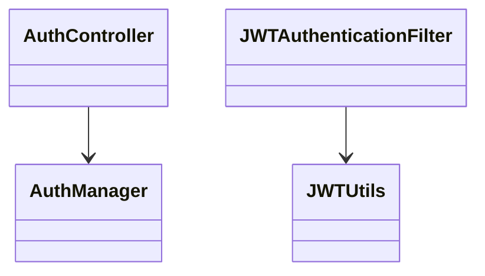

# LLD — Authentication Module (proposal)

Components: `AuthController`, `AuthManager`, `JWTUtils`, `JWTAuthenticationFilter`, `UserDetailsServiceImpl`.

TO-BE: extract `AuthenticateUserUseCase` port; domain `Credentials` VO.

**Figure RE-FIG-LLD-001** — AS-IS auth components.
