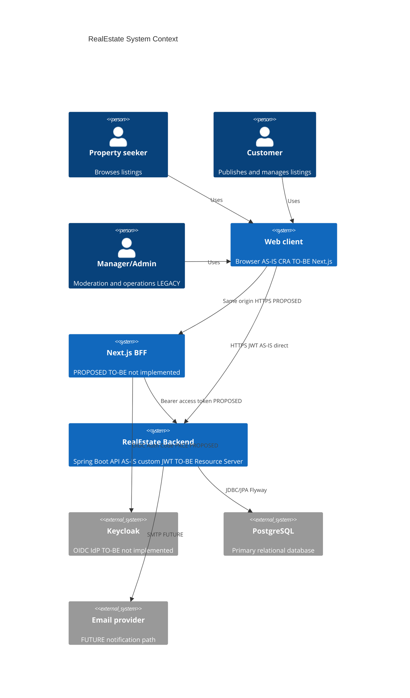

# Solution Architecture — System Context

C4 **Level 1** shows **external actors and systems** around the RealEstate backend. **Internal module structure** (six logical modules in one deployable) is documented in [HLD-001-containers.md](../HLD/HLD-001-containers.md) — not duplicated here as a dependency graph. **Deployment / environments:** [INFRASTRUCTURE-DEPLOYMENT-ARCHITECTURE.md](../infrastructure/INFRASTRUCTURE-DEPLOYMENT-ARCHITECTURE.md). **Web client detail:** [FRONTEND-ARCHITECTURE.md](../frontend/FRONTEND-ARCHITECTURE.md).

Architecture style (TO-BE direction): **modular monolith** — one Spring Boot application, one Maven artifact ([ADR-001-modular-monolith.md](../ADR/ADR-001-modular-monolith.md)).

## C4 Context diagram

**Figure RE-FIG-SAD-001** — C4 context (external boundary).

**Caption:** Shows AS-IS browser-to-API path and **PROPOSED** BFF + Keycloak (not implemented).

**Explanation:** Internal authorization details belong in [SECURITY-ARCHITECTURE.md](../security/SECURITY-ARCHITECTURE.md), not this diagram.

SVG companion: [../../assets/diagrams/c4-context.svg](../../assets/diagrams/c4-context.svg) (may predate TO-BE wording).

## System boundary summary

| Inside RealEstate Backend (one process) | Outside |
|---------------------------------------|---------|
| REST API, security, business modules (**TO-BE** six modules) | React SPA |
| Shared PostgreSQL connection | Email/SMS providers (**FUTURE**) |
| Language registry, exception handling (**platform**) | Kafka/RabbitMQ (**not** initial architecture) |

**AS-IS:** Code is package-by-layer, not yet package-by-module; behavior matches a **layered monolith** inside the same system boundary.

## Container view (internal — reference)

Logical containers and modules: [HLD-001-containers.md](../HLD/HLD-001-containers.md).

Clean/hexagonal layers per module: [HLD-002-clean-architecture.md](../HLD/HLD-002-clean-architecture.md).

## Integration boundaries (future)

Catalogued in [INTEGRATIONS.md](../../05-infrastructure/INTEGRATIONS.md). Future modules (`notification`, `ai`, …) appear there as **FUTURE**, not as separate deployables in M1.

## Change history

| Version | Date | Summary |
|---------|------|---------|
| 0.1.0 | 2026-11-13 | Initial C4 context |
| 0.2.0 | 2026-11-18 | Modular monolith terminology; internal modules deferred to HLD-001 |
| 0.2.1 | 2026-11-18 | Keycloak and Next.js BFF as PROPOSED external systems; AS-IS direct API path retained |
| 0.2.2 | 2026-11-18 | Link INFRASTRUCTURE-DEPLOYMENT-ARCHITECTURE (Group 10) |