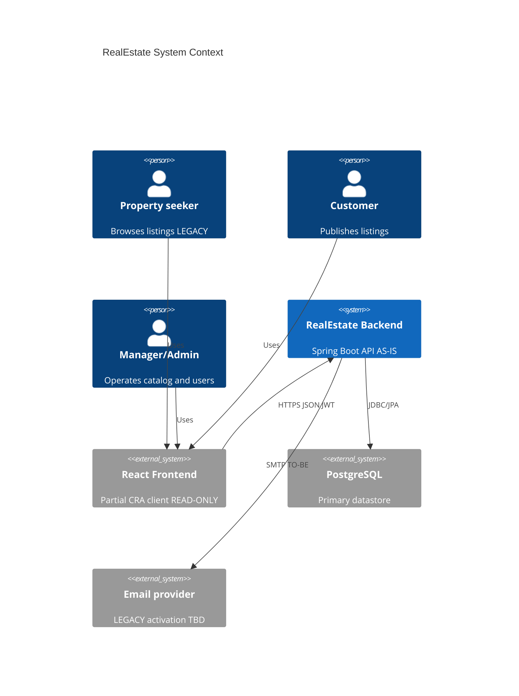

# Solution Architecture — System Context

## C4 Context diagram

**Figure RE-FIG-SAD-001** — C4 context (draft).

SVG companion: [../../assets/diagrams/c4-context.svg](../../assets/diagrams/c4-context.svg).

## Container view (summary)

See [HLD-001-containers.md](../HLD/HLD-001-containers.md).

## Integration boundaries (future)

Catalogued in [INTEGRATIONS.md](../../05-infrastructure/INTEGRATIONS.md).
