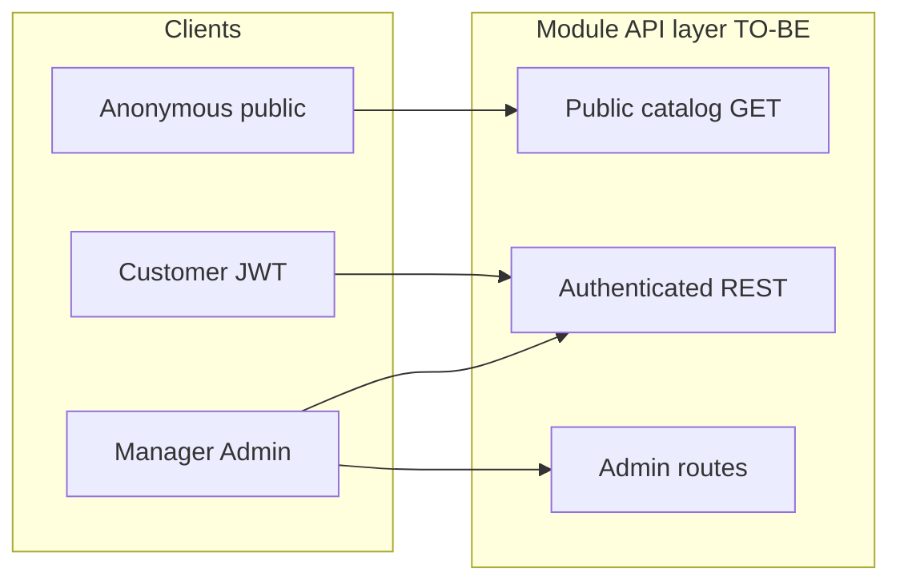

# REST API Architecture

**Canonical** API design reference. Related:

| Concern | Document |
|---------|----------|
| AS-IS endpoint list | [API-INVENTORY.md](API-INVENTORY.md) |
| Public catalog (approved product) | [ADR-002-public-read-api.md](../ADR/ADR-002-public-read-api.md), [PUBLIC-CATALOG-API-DESIGN.md](PUBLIC-CATALOG-API-DESIGN.md) |
| Layers / DTO mapping | [HLD-002-clean-architecture.md](../HLD/HLD-002-clean-architecture.md) |
| Security / roles | [SECURITY-ARCHITECTURE.md](../security/SECURITY-ARCHITECTURE.md) |
| Errors (detail) | [ERROR_HANDLING.md](../../04-development/ERROR_HANDLING.md) |
| Versioning policy | [API_VERSIONING.md](../../04-development/API_VERSIONING.md) |
| Pagination (persistence) | [PERSISTENCE-ARCHITECTURE.md](../database/PERSISTENCE-ARCHITECTURE.md) §9 |
| Uploads, public/private files | [FILE-STORAGE-ARCHITECTURE.md](../storage/FILE-STORAGE-ARCHITECTURE.md) |
| Performance / server-side cache | [CACHING-PERFORMANCE-ARCHITECTURE.md](../performance/CACHING-PERFORMANCE-ARCHITECTURE.md) |
| i18n / content vs message language | [I18N-L10N-ARCHITECTURE.md](../i18n/I18N-L10N-ARCHITECTURE.md), [I18N_STRATEGY.md](../../04-development/I18N_STRATEGY.md) |
| API / contract testing | [TESTING-ARCHITECTURE.md](../testing/TESTING-ARCHITECTURE.md) §7 |
| Web client integration | [FRONTEND-ARCHITECTURE.md](../frontend/FRONTEND-ARCHITECTURE.md) §5 |

**Labels:** AS-IS, **APPROVED**, TO-BE, FUTURE, TBD.

---

## 1. REST API standards (APPROVED)

| Rule | Detail |
|------|--------|
| Style | **REST** primary external API; **GraphQL not** in initial architecture |
| Base path | **APPROVED target:** `/api/v1/` — **AS-IS prefix:** `/api/v1.0/` (all controllers today) |
| Resources | Plural, resource-oriented names (`adverts`, `users`) |
| HTTP verbs | Semantic GET/POST/PUT/PATCH/DELETE |
| Status codes | Meaningful HTTP status (no **200** for failed operations — TO-BE enforced everywhere) |
| Exposure | External REST ≠ internal module ports; **no** domain/JPA on wire |
| Versioning | See [API_VERSIONING.md](../../04-development/API_VERSIONING.md) |

### Conventions (TO-BE; AS-IS largely follows)

| Topic | Convention |
|-------|------------|
| Path pattern | `/api/v1/{module-resource}/...` — language segment `{language}` **AS-IS** on many routes |
| Nested resources | Prefer shallow nesting; deep graphs via IDs + separate GET |
| Create | `POST` → `201 Created` where appropriate |
| Read | `GET` → `200` / `404` |
| Update | `PUT`/`PATCH` → `200` |
| Delete | `DELETE` → `200` or `204` (module policy) |
| Filter/sort | Query params; **whitelist** sort fields |
| Pagination | `Pageable` default; cursor when justified — [PUBLIC-CATALOG-API-DESIGN.md](PUBLIC-CATALOG-API-DESIGN.md) for public M1 |

**Figure RE-FIG-API-ARCH-001** — Client surfaces vs API classes (logical).

**Caption:** Public access only on ADR-002 whitelist — not all GETs.

**Explanation:** DEC-002 business permissions **not approved**; staff/customer split is **technical** layering only until PO approves matrix.

---

## 2. API DTO and application model separation (APPROVED)

| Concept | Layer | Maps via |
|---------|-------|----------|
| API Request DTO | `module.api` | API MapStruct → **Application Command** |
| API Response DTO | `module.api` | Application Result → API MapStruct |
| Application Command / Result | `application` | — |
| Domain model | `domain` | No API/JPA |
| JPA entity | `infrastructure` | Persistence MapStruct only |

**Rules:** No business rules in mappers; DTOs **not** shared as cross-module domain models.

**AS-IS gaps:**

- `AdvertResponse` embeds JPA-related types (`Country`, `Category`, …) — **TO-BE** public/admin DTOs per ADR-002.
- `AdvertCreateRequest` (ID fields) closer to TO-BE; success envelope `InternalApiResponse` — **not** RFC 9457.

---

## 3. Public, customer, manager and admin boundaries

### Public (product **approved** — ADR-002)

Anonymous **GET** only on defined routes (P1 catalog, P2 slug detail, public images). Visibility **V3** (**approved**):

`AdvertStatus.ACTIVATED` **∧** `isActive = true` **∧** `deleted = false` (+ DEC-007 published translation rules).

**Do not** broaden whitelist or change ADR-002 status in this document.

**Rate limiting:** Product-approved before production (IP-based). Server-side cache and rate-limit Redis usage are **separate** concerns — [CACHING-PERFORMANCE-ARCHITECTURE.md](../performance/CACHING-PERFORMANCE-ARCHITECTURE.md). **AS-IS:** not implemented.

### Authenticated tiers (TO-BE architecture; matrix **DEC-002 not approved**)

| Surface | Purpose |
|---------|---------|
| Customer | Owned resources (e.g. advert create — B2.1.1 AS-IS `CUSTOMER` only; see SECURITY-ARCHITECTURE §5.7) |
| Manager / Admin | Staff operations — **LEGACY** matrix vs code **gaps** |
| Admin | `AdminController` user admin |

**Authorization:** Controller coarse (`@PreAuthorize`, security matchers); Application resource ownership; Domain invariants — [SECURITY-ARCHITECTURE.md](../security/SECURITY-ARCHITECTURE.md).

---

## 4. Validation architecture (APPROVED)

| Layer | Responsibility |
|-------|----------------|
| **API** | `@Valid`, Bean Validation (size, format, `@NotNull`, `@Positive`) — e.g. `AdvertCreateRequest` |
| **Application** | Use-case rules, existence via **ports**, authorization, cross-module checks |
| **Domain** | Invariants, state transitions — no Spring/HTTP |

**Passing Bean Validation ≠ business validity** (e.g. inactive category rejected in `AdvertManager` — application layer).

---

## 5. Error handling — target RFC 9457 (APPROVED TO-BE)

Target: **[RFC 9457](https://www.rfc-editor.org/rfc/rfc9457)** Problem Details (`application/problem+json`).

| Field | Use |
|-------|-----|
| `type` | URI identifying problem type |
| `title` | Short summary |
| `status` | HTTP status |
| `detail` | Human-readable detail |
| `instance` | Request URI or correlation |

Extensions (TO-BE): stable **`applicationCode`** (from `FriendlyMessageCodes` numbering), **`traceId`**, field errors map.

**Categories:** 400 validation, 401 authn, 403 authz, 404 not found, 409 conflict (optimistic lock TO-BE), 422 business rule (**TBD** standardization), 500 safe generic.

**AS-IS:** Mixed envelopes — see [ERROR_HANDLING.md](../../04-development/ERROR_HANDLING.md).

---

## 6. Global exception handling (TO-BE)

| Role | Owner |
|------|--------|
| `GlobalExceptionHandler` (or module advice) | Maps exceptions → HTTP + Problem Details |
| Module application exceptions | Defined in **owning module** — not dumped in global `shared` for convenience |
| Domain exceptions | No `HttpStatus` imports |

**AS-IS:** `GlobalExceptionHandler` in `shared`; many handlers return `InternalApiResponse`; validation uses `ApiErrorResponse` + `validationErrors` map.

---

## 7. Pagination, filtering, sorting (APPROVED)

- **Pageable** standard; **cursor/keyset** when justified ([PERSISTENCE-ARCHITECTURE.md](../database/PERSISTENCE-ARCHITECTURE.md)).
- Bounded `size`; whitelisted `sort`; validated filters.
- Public catalog: offset pages M1 — **canonical** [PUBLIC-CATALOG-API-DESIGN.md](PUBLIC-CATALOG-API-DESIGN.md) §3.

**AS-IS:** `AdvertController` `page`, `size`, `sort`, `type` query params; `findAll` / `findAllActive` without full V3 predicate.

---

## 8. OpenAPI and API contract (APPROVED direction)

| Item | Status |
|------|--------|
| OpenAPI **3.x** | TO-BE contract |
| springdoc / Swagger UI | **AS-IS** on classpath (`OpenAPIConfig`) |
| Generation | **Backend-generated** from controllers — **not** strict OpenAPI-first |
| Auth schemes | Document JWT / future Bearer (Resource Server) |
| Errors | Include Problem Details schemas **TO-BE** |
| TypeScript types from OpenAPI | **FUTURE** |
| CI contract validation | **FUTURE** |
| Prod doc exposure | Restrict actuator/swagger **TO-BE** |

**Inventory:** [API-INVENTORY.md](API-INVENTORY.md) is **manual AS-IS**; may drift from live OpenAPI.

---

## 9. API versioning (APPROVED)

- Initial version segment: **`v1`** (target); **AS-IS** `v1.0`.
- Additive changes preferred within version.
- `/api/v2/` only with real breaking need — [API_VERSIONING.md](../../04-development/API_VERSIONING.md).

## Change history

| Version | Date | Summary |
|---------|------|---------|
| 0.1.0 | 2026-11-18 | Initial API architecture (Group 5) |
| 0.1.1 | 2026-11-18 | Link FILE-STORAGE-ARCHITECTURE (uploads/public files) |
| 0.1.2 | 2026-11-18 | Link CACHING-PERFORMANCE-ARCHITECTURE |
| 0.1.3 | 2026-11-18 | Link I18N-L10N-ARCHITECTURE (Group 8) |
| 0.1.4 | 2026-11-18 | Link TESTING-ARCHITECTURE (Group 9) |
| 0.1.5 | 2026-11-18 | Cross-reference FRONTEND-ARCHITECTURE (Group 12) |
| 0.1.6 | 2026-11-26 | B2.1.1: AS-IS CUSTOMER-only `POST …/adverts/{language}/add`; see SECURITY-ARCHITECTURE §5.7 (does not complete DEC-002 / broader RBAC) |
