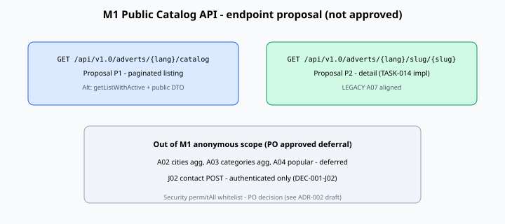
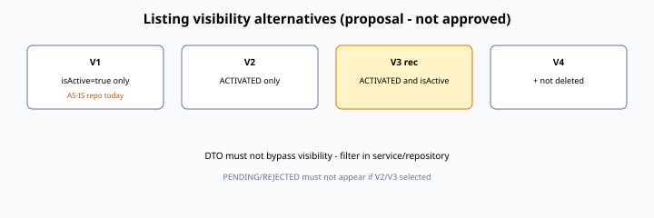
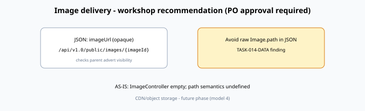
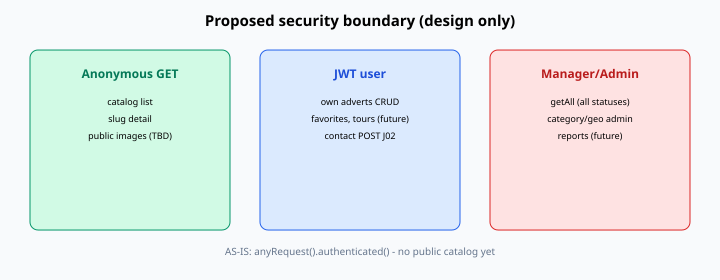
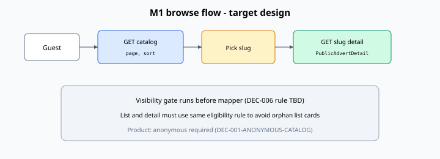

# M1 Herkese Acik Katalog API Tasarimi (TASK-015)

**Durum:** Uygulamaya hazir **oneri** - **PO onayli degil**. **ADR-002** **taslak**.

English: [PUBLIC-CATALOG-API-DESIGN.md](PUBLIC-CATALOG-API-DESIGN.md).

## 1. Amac ve kapsam

Anonim M1 **ilan listesi** ve **ilan detayi** icin tutarli **hedef API sozlesmesi**; girdiler: DEC-001-ANONYMOUS-CATALOG (**onayli**), TASK-013/013-A erisim incelemesi, TASK-014-DATA DTO kaniti, ADR-002 taslak.

Onayli kararlar degismez: **DEC-001-J02**, **DEC-001-M1-A02-A04**, **DEC-001-ANONYMOUS-CATALOG** (uygulama/DTO/whitelist onayi degil).

---

## 2. Uctan uca genel bakis

| ID | Metot | Yol | Kimlik dogrulama (hedef) |
|----|-------|-----|--------------------------|
| **P1** | GET | `/api/v1.0/adverts/{language}/catalog` | Anonim (`permitAll` **oneri**) |
| **P2** | GET | `/api/v1.0/adverts/{language}/slug/{slug}` | Anonim (**TASK-014** uygulama) |

**Alternatif P1b:** mevcut `getListWithActive` + public DTO (daha fazla isim kiriligi).

M1 anonim disi: `getAll`, yazma, A02-A04.

---

## 3. Liste sozlesmesi (P1)

`page`, `size`, `sort`, `type` - `getListWithActive` ile ayni; yanit `Page<PublicAdvertListItem>`; bos sayfa `200` + `content: []`.

---

## 4. Detay sozlesmesi (P2)

`slug` yolu; bulunamazsa `404`; slug benzersizligi DB'de dogrulanmadi - §8.

---

## 5. Public DTO stratejisi

| Secenek | Tasarim karari |
|---------|----------------|
| A `AdvertResponse` | Anonim icin **red** |
| B `PublicAdvert*` + ic DTO | **Onerilen** |
| C Okuma modeli | Performans gerekirse |

**Onerilen alanlar:** `slug`, `title`, `price`, `location`, geo/category/type ref, `featuredImage`; detayda `desc`, `images`, istege bagli `propertyValues`. **Asla:** `isActive`, audit, `user`, entity graflari.

### JSON ornekleri (oneri)

Liste ve detay ornekleri EN belgedeki (§5.5) yapi ile aynidir: `slug`, `title`, `price`, geo/category ref, `featuredImage` / `images` icinde `imageUrl` (ham `path` yok).

---

## 6. Gorunurluk (DTO'dan ayri)

| Secenek | Kural |
|---------|--------|
| V1 | yalnizca `isActive=true` (AS-IS) |
| V2 | `ACTIVATED` |
| V3 **oneri** | `ACTIVATED` + `isActive` + `deleted=false` |
| V4 | V3 + zamanlama (M1 disi) |

Liste ve detay **ayni** filtreyi kullanmali. **DEC-006** acik.

---

## 7. Gorsel dagitim

**Oneri:** Model 2 - `GET /api/v1.0/public/images/{imageId}`; JSON'da `imageUrl`, ham `path` yok.

---

## 8. Slug ve tanimlayicilar

Slug zorunlu alan; benzersizlik oneri uygulamada; public JSON'da varsayilan **id yok**; `viewCount` **CONDITIONAL** (detay).

---

## 9. Guvenlik siniri

Minimum whitelist: P1, P2, (istege bagli) public images. J02 POST authenticated. A02-A04 M1 disi.

---

## 10. Frontend (salt okunur)

Yerel ilan API baglantisi yok; `baseUrl` harici; kirilma riski dusuk - bu oneriye gore entegrasyon. Router: `/:slug`.

---

## 11. Akis

---

## 12. Oneri ozeti (baglayici degil)

P1+P2, DTO B, gorunurluk V3 (PO), gorsel model 2, slug-oncelikli.

---

## 13. Acik PO kararlari

Calisma sayfasi §DEC-001-PUBLIC-CATALOG-API.

---

## 14. Bagimliliklar

TASK-001, TASK-014, DEC-006, TASK-004 (gorseller).

---

## 15. Degisiklik gecmisi

| Surum | Tarih | Ozet |
|-------|-------|------|
| 0.1.0 | 2026-11-13 | TASK-015 ilk tasarim onerisi |
