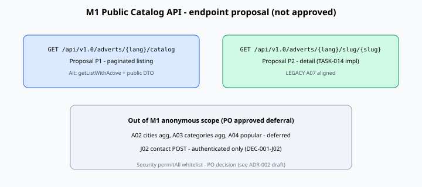
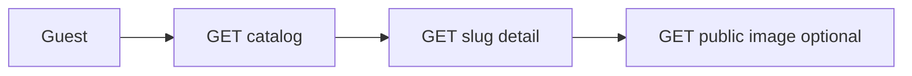
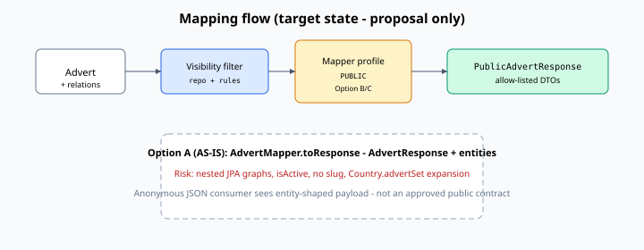
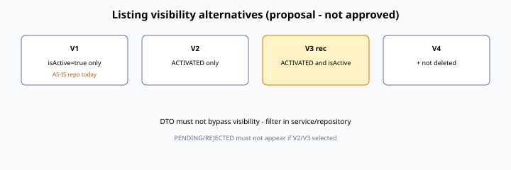
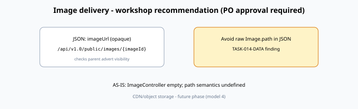
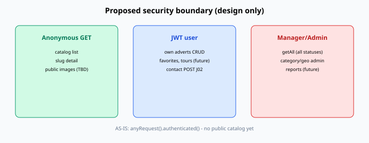
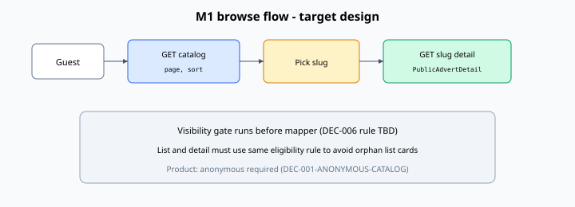

# M1 Public Catalog API Design (TASK-015)

**Status:** Implementation-ready **proposal** — **not** PO-approved. **ADR-002** remains **draft**.

Turkish: [PUBLIC-CATALOG-API-DESIGN-TR.md](PUBLIC-CATALOG-API-DESIGN-TR.md).

## 1. Purpose and scope

Define a coherent **target API contract** for anonymous M1 **property listing** and **property detail**, grounded in:

| Input | Role |
|-------|------|
| [DEC-001-ANONYMOUS-CATALOG](../08-project-management/PRODUCT_DECISIONS.md) | **Approved** product requirement (read-only, no auth) |
| [DEC-001-PUBLIC-CATALOG-ACCESS-REVIEW](../08-project-management/DEC-001-PUBLIC-CATALOG-ACCESS-REVIEW.md) | Access policy evidence |
| [DEC-001-PUBLIC-DATA-BOUNDARY-REVIEW](../08-project-management/DEC-001-PUBLIC-DATA-BOUNDARY-REVIEW.md) | DTO / field evidence (TASK-014-DATA) |
| [ADR-002](../ADR/ADR-002-public-read-api.md) | Draft architecture options |

| In scope | Out of scope |
|----------|--------------|
| Endpoint contracts, DTO shapes, visibility/image/slug **proposals** | Java implementation, `SecurityFilterChain` edits |
| Security boundary diagram | A02/A03/A04 anonymous access |
| Frontend compatibility notes (read-only) | Rate-limit numbers, ADR-002 approval |

### 1.1 Approved decisions (unchanged)

- **DEC-001-J02** — contact `POST .../contact-messages/{language}/add` **authenticated only**.
- **DEC-001-M1-A02-A04** — A02, A03, A04 **not M1**; deferred.
- **DEC-001-ANONYMOUS-CATALOG** — anonymous **listing + detail** required; does **not** approve whitelist, DTO, visibility, images, ADR-002.

---

## 2. Endpoint overview



**Figure RE-FIG-DEC-015-001** — Proposed M1 public read surface.



### 2.1 Path naming (AS-IS convention)

Verified: `@RequestMapping("api/v1.0/adverts")`, language path segment `Language` enum, existing list route `/{language}/getListWithActive` ([`AdvertController`](../../../src/main/java/com/prettier/controller/AdvertController.java)).

**Proposal P1 (preferred new public contract):**

| ID | Method | Path | Auth (target) |
|----|--------|------|-----------------|
| **P1** | GET | `/api/v1.0/adverts/{language}/catalog` | Anonymous (`permitAll` **proposal**) |
| **P2** | GET | `/api/v1.0/adverts/{language}/slug/{slug}` | Anonymous (**TASK-014** implementation) |

**Alternative P1b (compatibility):** keep path `/api/v1.0/adverts/{language}/getListWithActive` but change response type to `Page<PublicAdvertListItem>` and add security whitelist — higher coupling to admin-era name.

**Not proposed for M1 anonymous:** `getAll`, write verbs, A02–A04 aggregations, geo/category bulk anonymous (separate PO track in access review).

---

## 3. Endpoint contract — listing (P1)

| Aspect | Proposal |
|--------|----------|
| **HTTP** | GET |
| **Path** | `/api/v1.0/adverts/{language}/catalog` |
| **Authentication** | None (after security change — **not implemented**) |
| **Path params** | `language` — `EN`, `TR`, `DE` (existing `Language` enum; messages only today) |
| **Query params** | `page` (default `0`), `size` (default `10`, max **proposal** `50`), `sort` (default `title`), `type` (`asc`/`desc`, default `asc`) — mirrors `getListWithActive` |
| **Request body** | None |
| **Response** | `Page<PublicAdvertListItem>` (Spring Data page JSON) |
| **Pagination** | Offset pages; **no** cursor in M1 proposal |
| **Sort/filter** | M1: same as AS-IS paging only; **no** LEGACY A01 text/geo filters in M1 (future) |
| **Empty page** | `200` with `content: []`, `totalElements: 0` |
| **Errors** | `400` invalid sort field; `500` standard `FriendlyMessage` envelope where used elsewhere |

**Compatibility:** Authenticated clients may call the same endpoint (optional) or retain JWT-only admin list via `getAll` — PO may allow dual use of P1.

---

## 4. Endpoint contract — detail (P2)

| Aspect | Proposal |
|--------|----------|
| **HTTP** | GET |
| **Path** | `/api/v1.0/adverts/{language}/slug/{slug}` |
| **Authentication** | None (proposal) |
| **Path params** | `language`, `slug` (URL-encoded, 5–200 chars per entity) |
| **Query params** | Optional `incrementView` = `true` — **CONDITIONAL** (if PO wants public `viewCount`; implementation with DEC-006) |
| **Response** | `PublicAdvertDetail` (single object) |
| **Not found** | `404` + `FriendlyMessage` (`ADVERT_NOT_FOUND_EXCEPTION` pattern) |
| **Duplicate slug** | **Risk:** DB uniqueness not verified — see §9; proposal: `409` or first-match with monitoring — **PO policy** |

Implementation tracking: **TASK-014** (slug GET). This design does not duplicate that task.

---

## 5. Public DTO strategy

### 5.1 Options (evidence from TASK-014-DATA)

| Option | Verdict (design) |
|--------|------------------|
| **A — Reuse `AdvertResponse`** | **Reject** for anonymous — entity graphs, `isActive`, `Country.advertSet`, missing `slug` |
| **B — `PublicAdvertResponse` + nested DTOs** | **Recommended** for M1 |
| **C — Query read model** | **Defer** unless performance requires early projection |

 (TASK-014-DATA figure; target mapper unchanged)

### 5.2 Type catalog (proposal)

| Type | Use |
|------|-----|
| `PublicAdvertListItem` | Listing card |
| `PublicAdvertDetail` | Detail (extends or superset of list item) |
| `PublicGeoRef` | `{ "name": string }` only — **no** `plateNumber` unless PO approves |
| `PublicCategoryRef` | `title`, `slug`, `icon` — **exclude** `builtIn`, `seq`, `active` |
| `PublicAdvertTypeRef` | `title` only |
| `PublicImageRef` | `id`, `featured`, `imageUrl` — **not** raw `path` (§8) |
| `PublicPropertyValue` | `keyName`, `value` |

**No JPA types** in JSON. MapStruct profile `PUBLIC` or dedicated mapper bean.

### 5.3 Field policy — listing (`PublicAdvertListItem`)

| Field | Classification | In proposal JSON | Notes |
|-------|----------------|------------------|-------|
| `slug` | PUBLIC | Yes | Required for navigation to P2 |
| `title` | PUBLIC | Yes | |
| `price` | PUBLIC | Yes | |
| `location` | PUBLIC | Yes | |
| `shortDescription` | PUBLIC | Optional | Truncated `desc` — **CONDITIONAL** PO |
| `advertType` | PUBLIC | Yes | `PublicAdvertTypeRef` |
| `category` | PUBLIC | Yes | `PublicCategoryRef` |
| `country` / `city` / `district` | PUBLIC | Yes | `PublicGeoRef` |
| `featuredImage` | PUBLIC | Yes | Single `PublicImageRef` or null |
| `viewCount` | CONDITIONAL | **No** in list default | Include only if PO approves |
| `id` | CONDITIONAL | **No** default | Prefer slug-only URLs |
| `desc` (full) | PUBLIC | No on list | Detail only |
| `images[]` | PUBLIC | No on list | Detail gallery |
| `propertyValues[]` | CONDITIONAL | No on list | Detail |
| `isActive`, audit, status, user | INTERNAL/RESTRICTED | **Never** | |

### 5.4 Field policy — detail (`PublicAdvertDetail`)

Includes list fields plus:

| Field | Classification | Proposal |
|-------|----------------|----------|
| `desc` | PUBLIC | Yes |
| `images` | PUBLIC | Yes — ordered, `featured` first |
| `propertyValues` | CONDITIONAL | Yes if category uses CPV — `PublicPropertyValue[]` |
| `viewCount` | CONDITIONAL | Yes on detail only if PO approves |
| `id` | CONDITIONAL | Omit unless PO requires analytics |

### 5.5 JSON examples (proposal — not enforced)

**Listing page fragment:**

```json
{
  "content": [
    {
      "slug": "sunny-apartment-izmir",
      "title": "Sunny apartment Izmir",
      "price": 250000.0,
      "location": "Konak, Izmir",
      "advertType": { "title": "For Sale" },
      "category": { "title": "Residence", "slug": "residence", "icon": "residence.svg" },
      "country": { "name": "Turkey" },
      "city": { "name": "Izmir" },
      "district": { "name": "Konak" },
      "featuredImage": {
        "id": 42,
        "featured": true,
        "imageUrl": "/api/v1.0/public/images/42"
      }
    }
  ],
  "totalElements": 128,
  "totalPages": 13,
  "size": 10,
  "number": 0
}
```

**Detail:**

```json
{
  "slug": "sunny-apartment-izmir",
  "title": "Sunny apartment Izmir",
  "desc": "Full description text up to 300 characters.",
  "price": 250000.0,
  "location": "Konak, Izmir",
  "advertType": { "title": "For Sale" },
  "category": { "title": "Residence", "slug": "residence", "icon": "residence.svg" },
  "country": { "name": "Turkey" },
  "city": { "name": "Izmir" },
  "district": { "name": "Konak" },
  "images": [
    { "id": 42, "featured": true, "imageUrl": "/api/v1.0/public/images/42" },
    { "id": 43, "featured": false, "imageUrl": "/api/v1.0/public/images/43" }
  ],
  "propertyValues": [
    { "keyName": "Room count", "value": "3" },
    { "keyName": "Net area", "value": "95 m2" }
  ]
}
```

---

## 6. Visibility policy (separate from DTO)



**AS-IS:** `AdvertRepository.findAllActive` — `isActive = true` only; **no** `AdvertStatus` filter; soft-delete `deleted` not in query.

| Option | Rule | Consequence |
|--------|------|-------------|
| **V1** | `isActive = true` | PENDING/REJECTED may show if still active — **risk** |
| **V2** | `advertStatus = ACTIVATED` | Stricter; inactive flag may still hide |
| **V3 (recommended)** | `ACTIVATED` **and** `isActive` **and** `deleted = false` | Aligns with LEGACY public intent; needs repository change |
| **V4** | V3 + future scheduled publish | Out of M1 |

**List/detail consistency:** List and detail queries **must** use the **same** predicate. Otherwise a card may 404 on detail — unacceptable for M1 UX.

**DEC-006** unresolved — **no approval** in this document.

---

## 7. Image delivery (proposal)



| Model | M1 assessment |
|-------|---------------|
| 1 Direct `Image.path` in JSON | **Reject** — path semantics unknown; leakage risk (TASK-014-DATA) |
| 2 App `GET /api/v1.0/public/images/{imageId}` | **Recommend** — check parent advert visibility; stable URL |
| 3 JWT-only images | Conflicts with anonymous catalog |
| 4 CDN | Future; design `imageUrl` as absolute when PO adopts |

**AS-IS gaps:** `ImageController` empty; `ImageManager` stub; no orphan-image guard.

**PO approval required** for model and `permitAll` on image GET pattern.

---

## 8. Slug and identifier policy (proposal)

| Topic | Finding / proposal |
|-------|-------------------|
| Column | `Advert.slug` NOT NULL 5–200; generation TODO in source |
| Uniqueness | **Not** enforced in JPA — add DB unique index + service check (**implementation**) |
| Stability | Title change may change slug — document redirect policy **TBD** |
| Duplicate slug | Fail create/update at write; read returns **404** if 0 rows, **500**/monitor if >1 |
| Public `id` | **Omit** from default JSON — use `slug` (A07) |
| `viewCount` | **Detail-only**, optional query increment — **CONDITIONAL** |

---

## 9. Security boundary



| Zone | Operations |
|------|------------|
| **Anonymous read (proposal)** | P1 catalog, P2 slug detail, public image GET |
| **Authenticated user** | Advert CRUD, J02 contact POST, profile, favorites/tours (future) |
| **Manager/Admin** | `getAll`, admin categories, geo mutations, reports |

**Whitelist proposal (minimum):**

- `GET /api/v1.0/adverts/{language}/catalog`
- `GET /api/v1.0/adverts/{language}/slug/**`
- `GET /api/v1.0/public/images/**` (if model 2)

**Explicitly excluded:** contact POST (DEC-001-J02), `getAll`, writes, deferred A02–A04.

---

## 10. Frontend compatibility (read-only)

| Finding | Impact |
|---------|--------|
| No `fetch`/`axios` to local advert APIs in `Frontend/src` | Greenfield integration — **no** legacy field dependency |
| `config.api.baseUrl` → external URL | Must point to RealEstate backend before E2E |
| Sign-up uses hard-coded localhost auth | Unrelated to catalog |
| Expected consumer shape | React cards: `slug`, `title`, `price`, image URL, geo labels |

**Breaking change risk:** Low if FE built against this proposal. **High** if FE reused raw `AdvertResponse` shapes from Postman samples (nested entities).

**Adapter:** Map `PublicAdvertListItem` → presentational props; router `/{lang}/property/:slug`.

---

## 11. Request flow



---

## 12. Recommendations summary (non-binding)

| Topic | Recommendation |
|-------|----------------|
| Endpoints | **P1** `catalog` + **P2** `slug/{slug}` |
| DTO | **Option B** dedicated public types |
| Visibility | **V3** pending DEC-006 PO sign-off |
| Images | **Model 2** with `imageUrl` indirection |
| Identifiers | **Slug-first**; `viewCount` detail optional |
| Security | Minimal permitAll allow-list + service-layer visibility |

---

## 13. Open PO decisions (worksheet)

Use [PO_DECISION_WORKSHEET](../08-project-management/PO_DECISION_WORKSHEET.md) §**DEC-001-PUBLIC-CATALOG-API**.

1. Confirm path **P1** vs **P1b**.
2. Approve **PublicAdvert** DTO strategy (B).
3. Select visibility **V1–V4**.
4. Approve image **model 2** (or other).
5. Expose **`viewCount`** / internal **`id`**?
6. Include **`propertyValues`** on detail?
7. Whitelist + **ADR-002** / TASK-001 gate.

---

## 14. Implementation dependencies

| Task | Relationship |
|------|----------------|
| **TASK-001** | ADR-002 approval |
| **TASK-014** | P2 slug endpoint |
| **TASK-014-DATA** | DTO evidence (done) |
| **TASK-015** | This design (done) |
| **DEC-006** | Visibility rule |
| **TASK-004** | Images REST (if model 2) |

---

## 15. Change history

| Version | Date | Summary |
|---------|------|---------|
| 0.1.0 | 2026-11-13 | TASK-015 initial public catalog API design proposal |
