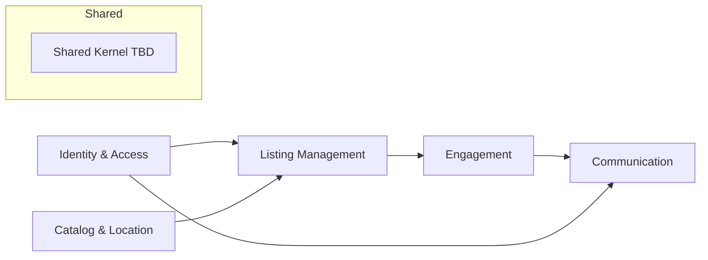

# Bounded Contexts (candidates)

**Figure RE-FIG-DDD-001** — Context map (draft).

| Context | Responsibility | Key aggregates (candidates) | Open questions |
|---------|----------------|----------------------------|----------------|
| Identity & Access | Users, roles, JWT | User, Role | OAuth2 migration |
| Catalog & Location | Countries, cities, categories | Country, Category | i18n of catalog labels |
| Listing | Adverts, types, images | Advert, AdvertType | Moderation workflow |
| Engagement | Favorites, tours | Favorite, TourRequest | Expose REST for tours |
| Communication | Messages, contact | Message, Contact | Anonymous contact policy |

Per-context detail: [domain/DOMAIN-OVERVIEW.md](../domain/DOMAIN-OVERVIEW.md).
