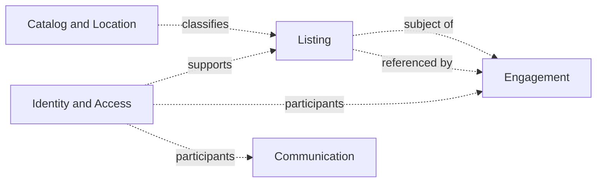
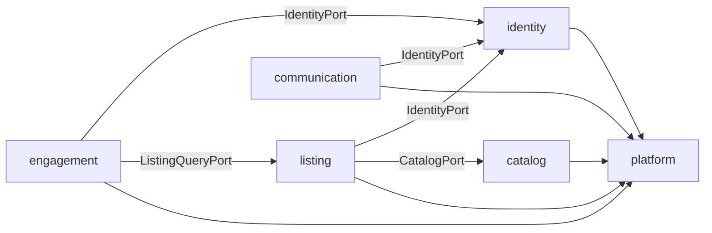

# Bounded Contexts and Module Boundaries

This document separates:

1. **Business bounded contexts** — ubiquitous language and aggregate ownership (DDD).
2. **Technical module boundaries** — deploy-time packages inside the modular monolith (ADR-001).
3. **Module dependency direction** — ports between modules (not the same as a context map arrow).

Modular monolith: [ADR-001-modular-monolith.md](../ADR/ADR-001-modular-monolith.md). Layers: [HLD-002-clean-architecture.md](../HLD/HLD-002-clean-architecture.md).

## Initial technical modules (approved — TO-BE)

| Module | Maps to context (primary) |
|--------|---------------------------|
| identity | Identity & Access |
| catalog | Catalog & Location |
| listing | Listing / Marketplace |
| engagement | Engagement |
| communication | Communication |
| platform | Technical (not a business bounded context) |

**Future modules (FUTURE — not initial):** `notification`, `subscription`, `ai`, `partner`, `audit`.

## Business context map (relationships in the problem domain)

**Figure RE-FIG-DDD-001** — Business bounded context relationships (conceptual).

**Caption:** Dotted links show domain collaboration, not Java package imports.

**Explanation:** Engagement interacts with listings and users in the business model; implementation uses **ports**, not shared entities.

## Technical module dependency map (approved)

**Figure RE-FIG-DDD-002** — Approved module dependency direction (TO-BE).

**Caption:** Solid arrows are allowed consumer → provider dependencies via ports.

**Explanation:** **No** catalog → listing, **no** identity → engagement reverse dependency. **No circular** module graph.

| Consumer | Provider | Port |
|----------|----------|------|
| listing | identity | `IdentityPort` |
| listing | catalog | `CatalogPort` |
| engagement | identity | `IdentityPort` |
| engagement | listing | `ListingQueryPort` |
| communication | identity | `IdentityPort` |
| business modules | platform | approved technical APIs |

Cross-module communication: explicit **ports**, **module APIs**, or approved **event contracts** ([HLD-003](../HLD/HLD-003-event-driven-architecture.md)). **Forbidden:** cross-module JPA entities and repositories.

## Context responsibilities (aligned with modules)

| Context / module | Business responsibility | Key aggregates (candidates) | Data ownership notes |
|------------------|-------------------------|----------------------------|----------------------|
| Identity | Users, profiles, application roles, auth capabilities | `User`, `Role` | `users`, `roles`, `user_roles` |
| Catalog | Reference data, geo, categories, property **definitions** | `Country`, `City`, `District`, `Category`, `CategoryPropertyKey`, `AdvertType` | Catalog tables; **not** advert property values |
| Listing | Adverts, lifecycle, images, **property values** | `Advert`, `Image`, `CategoryPropertyValue` | `adverts`, `images`, `category_property_values` |
| Engagement | Favorites, following, tours | `Favorite`, `TourRequest` | `favorites`, `tour_requests`; **Following** not in AS-IS code |
| Communication | Messages, contact | `Message`, `Contact` | `messages`, `contacts`, link tables |
| Platform | Minimal technical shared infrastructure | Language registry snapshot | `languages` (V3); not business aggregates |

**TBD:** `Log` / audit ownership — not assigned to platform as business module.

### AS-IS gaps (evidence)

| Area | AS-IS |
|------|-------|
| Package boundaries | Single `com.prettier.*` layer packages |
| Engagement REST | `TourRequestController` empty mappings (API inventory) |
| Favorite customer endpoints | Partial / commented (role matrix) |
| Cross-context JPA | Listing service loads catalog `User` entities directly (**TO-BE** remove) |

Per-context domain detail: [domain/DOMAIN-OVERVIEW.md](../domain/DOMAIN-OVERVIEW.md).

## Shared kernel

**platform** provides **technical** cross-cutting capabilities only. Do **not** use platform as a business catch-all. Shared value objects (`UserId`, `Money`, …) — extraction **TBD** (HLD-002).

## Change history

| Version | Date | Summary |
|---------|------|---------|
| 0.1.0 | 2026-11-13 | Five-context draft map |
| 0.2.0 | 2026-11-18 | Six modules; business vs technical diagrams; approved ports; listing owns property values |