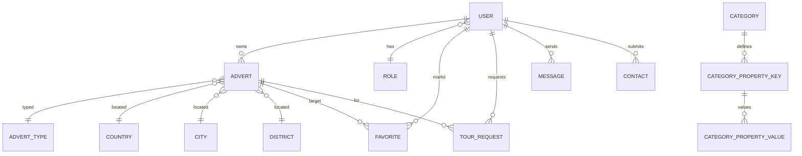

# Database — AS-IS ERD

**Persistence architecture (TO-BE):** [PERSISTENCE-ARCHITECTURE.md](PERSISTENCE-ARCHITECTURE.md). **Do not merge** with [ERD-LEGACY.md](ERD-LEGACY.md).

## Physical schema (AS-IS — verified)

| Aspect | State |
|--------|--------|
| Flyway | **Enabled** — `V1__baseline_schema.sql`, `V2__adverts_slug_unique.sql`, `V3__languages_registry.sql` |
| Hibernate | `ddl-auto: validate` (does not apply schema changes) |
| PostgreSQL schema | All tables in **`public`** |
| Historical note | V1 baseline replaced earlier Hibernate-only evolution |

**Figure RE-FIG-DB-001** — Logical ERD (JPA entity relationships).

**Caption:** Logical view; module ownership in TO-BE see persistence architecture.

**Explanation:** Cross-entity JPA links exist today; modular monolith TO-BE restricts **code** dependencies, not necessarily immediate FK removal.

## Integrity notes

| Topic | AS-IS |
|-------|-------|
| PK strategy | `BaseEntity` — `GenerationType.IDENTITY` |
| Soft delete | `BaseEntity.deleted` (`is_deleted`); usage **inconsistent** in services — **TBD** |
| Optimistic lock | **No** `@Version` |
| Indexes | V2 advert slug; full audit **TBD** |
| Transactions | Application `@Transactional` sparse — see HLD-002 |

## TO-BE pointers (not duplicating PERSISTENCE-ARCHITECTURE)

1. Module PostgreSQL schemas and immutable Flyway forward evolution.
2. Separate reference seeds (Flyway) from dev bootstrap (`DataInitializer`).
3. Domain/persistence split and repository ports.

## Search (FUTURE)

Localized content and FTS — PostgreSQL GIN **FUTURE**; Elasticsearch/OpenSearch **FUTURE** optional — see [PERSISTENCE-ARCHITECTURE.md](PERSISTENCE-ARCHITECTURE.md) §8.

## Change history

| Version | Date | Summary |
|---------|------|---------|
| 0.1.0 | 2026-11-13 | Initial ERD; outdated Flyway note |
| 0.2.0 | 2026-11-18 | Flyway V1–V3 AS-IS facts; link to persistence architecture |