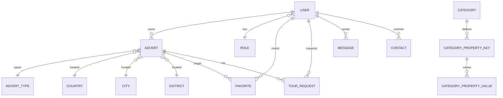

# Database — AS-IS ERD

Schema evolved via Hibernate `ddl-auto: update` (no Flyway in repo).

**Figure RE-FIG-DB-001** — Logical ERD (from entity relationships; physical columns TBD full audit).

## Integrity notes

| Topic | AS-IS |
|-------|-------|
| PK strategy | `BaseEntity` IDs (review for `@GeneratedValue`) |
| Soft delete | Patterns in services **TBD** |
| Indexes | **TBD** — no migration files |
| Transactions | Service-layer default Spring `@Transactional` usage **TBD** audit |

## TO-BE migration strategy (proposal)

1. Introduce Flyway baseline from live schema snapshot.
2. Freeze `ddl-auto` to `validate`.
3. Separate reference data seeds from tenant data.

## Search implications (TO-BE)

Localized `title`/`desc` columns — consider `tsvector` or external search (Elasticsearch LEGACY README plan).
