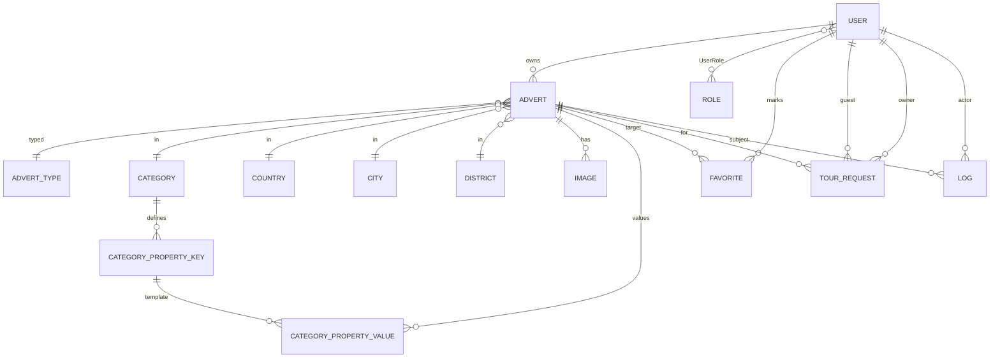
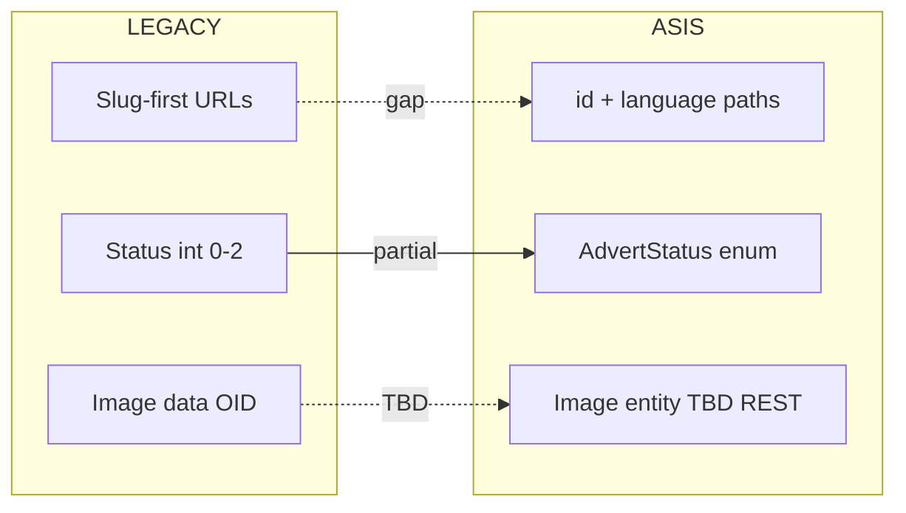

# ERD — LEGACY (2023 PDF)

Sources: entity tables pp. **6–21**; diagram image pp. **22–23** (raster; relationships partially **inferred**).

**Do not merge** with [ERD-AS-IS.md](ERD-AS-IS.md) — compare side by side.

## Explicit entities (text on PDF pages)

Advert, Category, CategoryPropertyKey, CategoryPropertyValue, Favorite, User, Role, UserRole, TourRequest, Image, AdvertType, Country, City, District, Log, Contact.

## LEGACY logical diagram (text + inference)

**Figure ERD-LEG-001** — LEGACY model (explicit FKs from pp. 6–21; UserRole M:N inferred).

## Explicit vs inferred

| Relationship | Evidence |
|--------------|----------|
| Advert → Country/City/District/AdvertType/Category/User | **Explicit** (p. 6) |
| CategoryPropertyValue → Advert + Key | **Explicit** (p. 9) |
| Favorite user/advert | **Explicit** (p. 10) |
| UserRole | **Explicit** (p. 13) |
| Tour owner/guest/advert | **Explicit** (p. 14) |
| Message entity | **Not in PDF** | AS-IS only |

## Uncertain / unreadable (p. 23 image)

- Cardinality on diagram image not machine-traced; use text tables as authority.
- **TBD:** re-digitize LEG-VIS-002 into editable SVG without copying slide pixels.

## LEGACY vs AS-IS comparison

**Figure ERD-LEG-002** — Model drift highlights.

| Aspect | LEGACY (PDF) | AS-IS (code) |
|--------|----------------|--------------|
| API i18n | Not specified | `{language}` path |
| Message | Absent | `Message` entity + controller |
| Geo CRUD | GET-only seed (p. 4) | Full CRUD controllers |
| Advert status | 0/1/2 int | `AdvertStatus` enum |
| Image storage | `data Oid` | **TBD** persistence review |

## Change history

| Version | Date | Summary |
|---------|------|---------|
| 0.2.0 | 2026-11-13 | TASK-008 LEGACY ERD |
