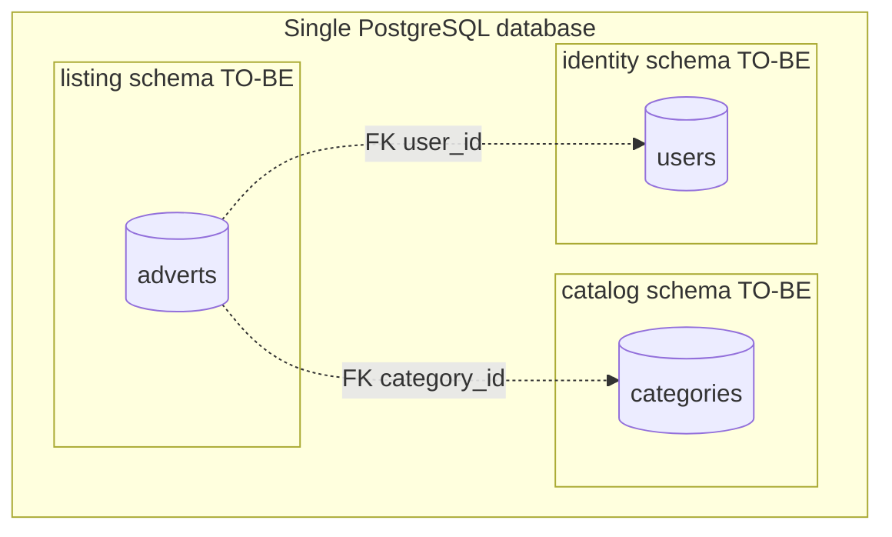
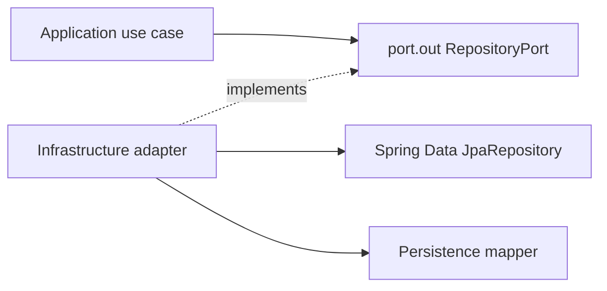

# Database & Persistence Architecture

**Canonical** reference for PostgreSQL ownership, Flyway, repositories, domain/persistence separation, aggregates, concurrency, lifecycle, indexing, and pagination. Related:

| Topic | Document |
|-------|----------|
| Module list & deps | [ADR-001-modular-monolith.md](../ADR/ADR-001-modular-monolith.md) |
| Layers, ports, mappers | [HLD-002-clean-architecture.md](../HLD/HLD-002-clean-architecture.md) |
| AS-IS logical ERD | [ERD-AS-IS.md](ERD-AS-IS.md) |
| LEGACY ERD | [ERD-LEGACY.md](ERD-LEGACY.md) |
| Bounded contexts | [BOUNDED-CONTEXT-MAP.md](../bounded-contexts/BOUNDED-CONTEXT-MAP.md) |
| Public catalog pagination | [PUBLIC-CATALOG-API-DESIGN.md](../api/PUBLIC-CATALOG-API-DESIGN.md) |
| Transactions & outbox | [HLD-003-event-driven-architecture.md](../HLD/HLD-003-event-driven-architecture.md) |
| File metadata vs object bytes | [FILE-STORAGE-ARCHITECTURE.md](../storage/FILE-STORAGE-ARCHITECTURE.md) |
| Cache (Redis disposable) | [CACHING-PERFORMANCE-ARCHITECTURE.md](../performance/CACHING-PERFORMANCE-ARCHITECTURE.md) |
| PostgreSQL integration testing | [TESTING-ARCHITECTURE.md](../testing/TESTING-ARCHITECTURE.md) §5, §11 |
| Flyway at deploy / startup | [INFRASTRUCTURE-DEPLOYMENT-ARCHITECTURE.md](../infrastructure/INFRASTRUCTURE-DEPLOYMENT-ARCHITECTURE.md) §9 |

**Labels:** **AS-IS** (verified); **APPROVED** (architecture programme); **TO-BE** (target); **FUTURE**; **TBD**.

---

## 1. Database and schema ownership (APPROVED)

| Rule | Statement |
|------|-----------|
| RDBMS | **PostgreSQL** — primary relational store (**source of truth**; Redis cache is disposable — see [CACHING-PERFORMANCE-ARCHITECTURE.md](../performance/CACHING-PERFORMANCE-ARCHITECTURE.md)) |
| Deployment | **One** database instance initially |
| Schemas | **One PostgreSQL schema per business module** (TO-BE physical layout) |
| Ownership | Each table has **exactly one** owning module |
| Distribution | Schema separation = **logical** ownership; application remains **one** deployable (not physically distributed) |

### AS-IS vs TO-BE

| Aspect | AS-IS | TO-BE |
|--------|-------|-------|
| Physical layout | All tables in **`public`** (`V1__baseline_schema.sql`, `V3__languages_registry.sql`) | Module schemas e.g. `identity`, `catalog`, `listing`, … |
| Cross-schema FK | FKs across tables in `public` | **May retain** cross-schema FKs initially where justified |
| Cross-module code | JPA entities/repos shared in `com.prettier.*` | **Forbidden:** cross-module JPA imports; use **ports** |

### Table → module ownership (TO-BE — approved)

Aligned with [BOUNDED-CONTEXT-MAP.md](../bounded-contexts/BOUNDED-CONTEXT-MAP.md):

| Schema (TO-BE) | Tables (current `public` names) |
|----------------|----------------------------------|
| **identity** | `users`, `roles`, `user_roles`, `social_media` |
| **catalog** | `countries`, `cities`, `districts`, `categories`, `category_property_keys`, `advert_types` |
| **listing** | `adverts`, `images`, `category_property_value` |
| **engagement** | `favorites`, `tour_requests` |
| **communication** | `messages`, `contacts`, `files` (AS-IS `AttachFile`), `messages_files`, `users_messages` |
| **platform** | `languages` |

**TBD:** `logs` — audit ownership unresolved (ADR-001).

**Cross-module references:** Use stable **IDs** in application contracts. DB FKs may remain during monolith phase; application modules must not navigate foreign **JPA graphs**.

**Figure RE-FIG-DB-PERS-001** — Logical schema ownership (one DB, multiple schemas).

**Caption:** FKs may exist; modules communicate in code via ports.

**Explanation:** Extraction to separate services later may relax FKs in favor of eventual consistency — **FUTURE**, not initial requirement.

---

## 2. Flyway migration strategy (APPROVED)

| Rule | Detail |
|------|--------|
| Tooling | **One** centrally managed Flyway configuration (Spring Boot) |
| File organization | Migrations grouped **by module** (folder or naming convention — **TBD** exact layout) |
| Versioning | **Globally unique**, monotonically increasing version numbers |
| Immutability | **`V1`, `V2`, `V3` are immutable** — never edit applied migrations |
| Direction | **Forward-only** evolution |
| Reference data | Production/reference seeds in version-controlled SQL where appropriate (e.g. `languages` in V3) |
| Dev/test data | **Separate** from production migration responsibility (`DataInitializer` AS-IS — not Flyway prod path) |
| Compatibility | **Expand–Contract** when multiple application versions share DB during rollout |

### AS-IS migrations (immutable)

| Version | File | Purpose |
|---------|------|---------|
| V1 | `src/main/resources/db/migration/V1__baseline_schema.sql` | Baseline `public` schema from historical entity model |
| V2 | `V2__adverts_slug_unique.sql` | Slug uniqueness constraint |
| V3 | `V3__languages_registry.sql` | Platform `languages` table + seed |

**AS-IS runtime:** `spring.jpa.hibernate.ddl-auto: validate`; `spring.flyway.enabled: true` (`application.yaml`).

### TO-BE conventions (TBD details)

| Topic | Direction |
|-------|-----------|
| Module folder | e.g. `db/migration/listing/V4__...` vs prefix `V4__listing__...` | **TBD** |
| New module schemas | `CREATE SCHEMA` in dedicated migration after governance approval | **TBD** |
| Index changes | **Only** via Flyway | APPROVED |

---

## 3. Repository port and adapter architecture (APPROVED)

Dependency direction (see HLD-002):

**Figure RE-FIG-DB-PERS-002** — Use case accesses persistence only through outbound port.

**Caption:** Application does not depend on Spring Data types.

**Explanation:** The adapter maps domain ↔ JPA and delegates to Spring Data inside infrastructure.

| Layer | Artifact |
|-------|----------|
| Application | `listing.application.port.out.AdvertRepositoryPort` (example) |
| Infrastructure | `AdvertJpaEntity`, `AdvertSpringDataRepository`, `AdvertRepositoryAdapter`, `AdvertPersistenceMapper` |

**Design:** Ports align with **aggregates and use cases**, not one port per table by default.

**AS-IS gap:** `*Manager` classes inject Spring Data repositories directly.

---

## 4. Domain model and persistence model separation (APPROVED)

| Model | Location | Rules |
|-------|----------|-------|
| **API DTO** | `api` | Request/response; API MapStruct |
| **Application command/result** | `application` | No JPA |
| **Domain model** | `domain` | **No JPA**; invariants here |
| **JPA entity** | `infrastructure` | Persistence MapStruct ↔ domain |

- **MapStruct** for API and persistence mapping (APPROVED).
- Mappers **must not** contain business rules.
- **Do not** expose JPA entities on REST (TO-BE; **AS-IS** partial violation in `AdvertResponse`).

---

## 5. Aggregate boundaries (APPROVED guidance)

Principles:

- Small aggregates, one **aggregate root** per aggregate.
- Invariants enforced **inside** the aggregate boundary.
- Other aggregates referenced by **identifier**, not navigable object graphs in domain code.
- Transaction boundaries align with **one aggregate** per use case when possible (HLD-003: avoid large cross-module transactions).

| Aggregate | Root | Owner module | Notes |
|-----------|------|--------------|-------|
| Advert | `Advert` | listing | May own **AdvertImage** metadata cluster, **CategoryPropertyValue** lifecycle where appropriate |
| Favorite | `Favorite` | engagement | **Independent** aggregate |
| Following | — | engagement | **Independent** when introduced — **not in AS-IS** schema |
| TourRequest | `TourRequest` | engagement | Independent; references `AdvertId`, `UserId` |
| User | `User` | identity | Profile/roles; credentials **TO-BE** Keycloak |
| Category | `Category` | catalog | Property **definitions** only |
| Conversation / Message | **TBD** | communication | **Unresolved** aggregate boundary — do not invent |

**Repository implication:** One primary repository port per aggregate root (listing port saves `Advert` cluster; separate ports for child entities only if access patterns require it — **TBD**).

**AS-IS:** JPA `Advert` embeds `@ManyToOne` to catalog/identity entities — transitional; **TO-BE** domain uses IDs.

---

## 6. Concurrency control (APPROVED)

| Strategy | Status |
|----------|--------|
| **Optimistic locking** (`@Version` on aggregate roots) | **TO-BE default** — **AS-IS:** no `@Version` on entities (verified) |
| Conflict handling | Controlled conflict → **HTTP 409 Conflict** (TO-BE) |
| Pessimistic locking | **Only** with demonstrated use case — **not** default |
| ETag / `If-Match` | **FUTURE** API enhancement — **not implemented** |

---

## 7. Data lifecycle and GDPR (APPROVED terminology)

| Term | Meaning |
|------|---------|
| **Archive** | Business record retained; no longer active in operations |
| **Soft delete** | `deleted` / logical flag; excluded from ordinary queries (`BaseEntity.deleted` AS-IS column `is_deleted`) |
| **Hard delete** | Physical `DELETE` — controlled, justified |
| **Anonymization** | Irreversible removal of identifying data where properly implemented |
| **Pseudonymization** | Reversible with separate key — **not** equivalent to anonymization |

Rules:

- Ordinary user deletion → generally **soft delete** where appropriate (**TO-BE** policy per module).
- Each module owns lifecycle of its tables.
- Related data (messages, tours, favorites) requires explicit cascade/archival rules — **TBD** (legal/PO).
- Object-storage bytes and PostgreSQL metadata must be reconciled on delete — **not** one atomic transaction; see [FILE-STORAGE-ARCHITECTURE.md](../storage/FILE-STORAGE-ARCHITECTURE.md) §9.
- Archived adverts must **not** automatically remain available for messaging/appointments (**TO-BE** product rules).
- Technical mechanisms **do not** by themselves prove legal GDPR compliance.

**AS-IS note:** `AdvertManager.delete` sets `isActive=false` only — differs from `BaseEntity.deleted`; consistency **TBD**.

---

## 8. Indexing and query performance (APPROVED strategy)

Query-driven indexing; all indexes via **Flyway**.

| Index type | Use when |
|----------|----------|
| B-tree | Equality, range, sort |
| GIN | JSONB, full-text, arrays (where justified) |
| GiST | Spatial/geometric (where justified) |
| PostGIS | Geographic capabilities — **FUTURE** if required |

| Practice | Direction |
|----------|-----------|
| Full-text | PostgreSQL FTS + GIN initially — **FUTURE** per feature |
| Analysis | `EXPLAIN ANALYZE` for plan review |
| ORM | Watch N+1; explicit fetch strategies in infrastructure |
| Search scale-out | **Elasticsearch / OpenSearch** — **FUTURE** only if PostgreSQL insufficient |

**AS-IS:** V2 slug index; broader index audit **TBD**.

---

## 9. Pagination (APPROVED hybrid)

| Mode | Use |
|------|-----|
| **Spring Data `Pageable`** | Standard list endpoints |
| **Cursor / keyset** | Large or high-volume endpoints when justified |
| Validation | Sort fields **whitelisted**; page/size bounds |

**M1 public catalog:** Offset pagination; no cursor in M1 proposal — [PUBLIC-CATALOG-API-DESIGN.md](../api/PUBLIC-CATALOG-API-DESIGN.md). Authenticated listings may adopt cursor later — **TBD**.

---

## 10. AS-IS summary

| Item | Fact |
|------|------|
| Flyway V1–V3 | Applied; immutable |
| Schema | `public` only |
| Domain/JPA split | **Not** implemented — shared JPA entities |
| `@Version` | **Not** present |
| Cross-module persistence | Direct repository injection **AS-IS** |

## Change history

| Version | Date | Summary |
|---------|------|---------|
| 0.1.0 | 2026-11-18 | Initial persistence architecture (Group 4) |
| 0.1.1 | 2026-11-18 | `files` → communication; link FILE-STORAGE; image metadata ownership |
| 0.1.2 | 2026-11-18 | PostgreSQL vs Redis cache cross-link (Group 7) |
| 0.1.3 | 2026-11-18 | Link TESTING-ARCHITECTURE (Group 9) |
| 0.1.4 | 2026-11-18 | Flyway deploy link INFRA (Group 10) |