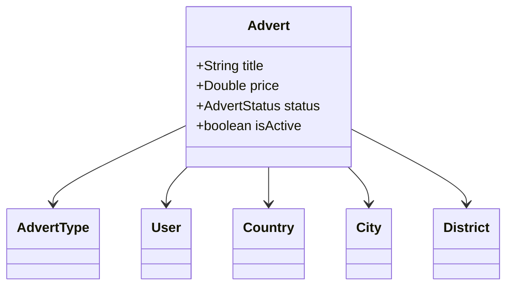
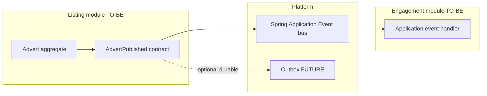

# Domain Model Overview

Event and transaction integration: [../HLD/HLD-003-event-driven-architecture.md](../HLD/HLD-003-event-driven-architecture.md). Application layer rules: [../HLD/HLD-002-clean-architecture.md](../HLD/HLD-002-clean-architecture.md). **Aggregates, persistence separation, lifecycle:** [../database/PERSISTENCE-ARCHITECTURE.md](../database/PERSISTENCE-ARCHITECTURE.md). **File/image storage (listing vs communication ownership):** [../storage/FILE-STORAGE-ARCHITECTURE.md](../storage/FILE-STORAGE-ARCHITECTURE.md). **i18n / registry / content translations:** [../i18n/I18N-L10N-ARCHITECTURE.md](../i18n/I18N-L10N-ARCHITECTURE.md).

## AS-IS entity catalogue (SRC-016)

`User`, `Role`, `Advert`, `AdvertType`, `Category`, `CategoryPropertyKey`, `CategoryPropertyValue`, `Country`, `City`, `District`, `Favorite`, `TourRequest`, `Contact`, `Message`, `Image`, `AttachFile`, `Social`, `Log`.

## Advert aggregate (candidate)

**Figure RE-FIG-DOM-001** — Advert associations (AS-IS JPA).

**Caption:** Physical JPA graph today; modular boundaries may use IDs and ports instead of cross-module entity navigation (TO-BE).

**Explanation:** Listing aggregate references catalog and identity data by FK in the database AS-IS; module code TO-BE should not treat foreign entities as owned aggregates.

## Value object candidates (TO-BE)

| VO | Replaces |
|----|----------|
| `Money` | `Double price` |
| `Slug` | `String slug` |
| `EmailAddress` | user email field |
| `LocaleCode` | path `{language}` |

## Aggregate roots (APPROVED guidance — TO-BE)

Full rules: [PERSISTENCE-ARCHITECTURE.md](../database/PERSISTENCE-ARCHITECTURE.md) §5.

| Aggregate root | Module | Independence |
|----------------|--------|--------------|
| `Advert` (+ owned images/property values where scoped) | listing | References catalog/identity by **ID** in domain (TO-BE) |
| `Favorite` | engagement | Independent |
| `Following` | engagement | Independent when introduced — **not AS-IS** |
| `TourRequest` | engagement | Independent |
| `User` / `Category` / … | respective modules | Own boundaries per BC map |
| Conversation / `Message` | communication | Aggregate split **TBD** |

**AS-IS:** JPA graph on `Advert` includes `@ManyToOne` entities — persistence coupling, not target domain shape.

## Domain events

### What a Domain Event represents (approved direction)

A **Domain Event** is a **business-level record** that something meaningful already happened in the domain (past tense, immutable fact). Examples: an advert became eligible for publication, a tour request was recorded. It is **not** a command, not a REST DTO, and not a JPA entity.

**TO-BE:** Domain models should express or record events without depending on Spring. **AS-IS:** No domain event types are implemented in application code; integration is not event-driven at the domain level today.

### Domain Event vs Spring Application Event

| Aspect | Domain Event | Spring Application Event |
|--------|--------------|---------------------------|
| Meaning | Ubiquitous language / module contract | Framework dispatch mechanism in the JVM |
| Ownership | Publishing **module** owns the contract | Infrastructure concern; payloads should wrap or map from domain events |
| Durability | Meaning is durable in the business; delivery may use outbox **FUTURE** | **Not durable** by default — synchronous, in-process |
| Coupling | Broker-independent contract | Spring-specific listener annotations (**TO-BE** at application/infrastructure edge only) |

Initial architecture uses **Spring Application Events** to **deliver** in-process reactions. When reliable delivery is required, **Transactional Outbox** (**FUTURE** — not implemented) persists the intent to deliver; see HLD-003.

### Module ownership of event contracts

- The module where the **business occurrence originates** owns the event type and payload schema.
- Consuming modules depend only on the **published contract**, not on the publisher's entities or repositories (approved modular rule).
- Versioning and idempotency policies apply when outbox delivery is introduced (**FUTURE**).

### Event handler responsibility

- Handlers live in the **consumer module's Application layer**.
- A handler orchestrates a local use case (for example create notification record, update read model).
- Handlers must support **idempotent** processing when **durable** delivery and retries exist (**FUTURE**).

### Example events (TO-BE — not implemented AS-IS)

These names illustrate target vocabulary. **They are not implemented** unless verified in code.

| Event (TO-BE) | Publishing module (candidate) | Typical consumers (candidate) | AS-IS trigger |
|---------------|------------------------------|------------------------------|---------------|
| `AdvertPublished` | listing | engagement, notification (**FUTURE**), public read projection | Moderation/activation flow **not implemented** |
| `TourRequestSubmitted` | engagement | communication, notification (**FUTURE**) | `TourRequestManager` stub — no publish |
| `ContactMessageReceived` | communication | notification (**FUTURE**), audit | Contact persist — no domain event |

**Related AS-IS (not domain events):** Language Registry startup uses Spring **`ApplicationReadyEvent`** (`LanguageRegistryInitializer`) — platform lifecycle, not a business domain event. Registry reload after admin DB updates is designed to use post-commit refresh (**TO-BE** per [LANGUAGE-REGISTRY-DESIGN.md](LANGUAGE-REGISTRY-DESIGN.md) §7.3); M1 has seed-only data.

**Figure RE-FIG-DOM-002** — Target relationship between domain event contracts, in-process bus, and future outbox.

**Caption:** Domain meaning is owned by the module; Spring delivers synchronously today; outbox is a future durability path.

**Explanation:** Kafka/RabbitMQ are excluded from the initial architecture; contracts stay transport-agnostic for later bridging.

## Domain events list (historical TO-BE bullet — superseded by table above)

The following remained from v0.1.0 as naming candidates only:

- `AdvertPublished`, `TourRequestSubmitted`, `ContactMessageReceived`

**Status:** **TO-BE** — not implemented AS-IS.

## Change history

| Version | Date | Summary |
|---------|------|---------|
| 0.1.0 | 2026-11-13 | Entity catalogue and VO candidates |
| 0.2.0 | 2026-11-18 | Domain events vs application events; ownership; handlers; examples labelled TO-BE |
| 0.2.1 | 2026-11-18 | Aggregate root table; link to persistence architecture |
| 0.2.2 | 2026-11-18 | Link FILE-STORAGE-ARCHITECTURE |
| 0.2.3 | 2026-11-18 | Link I18N-L10N-ARCHITECTURE (Group 8) |