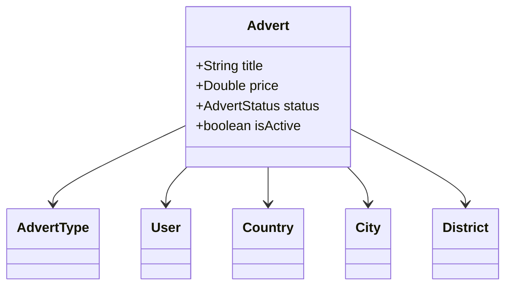

# Domain Model Overview

## AS-IS entity catalogue (SRC-016)

`User`, `Role`, `Advert`, `AdvertType`, `Category`, `CategoryPropertyKey`, `CategoryPropertyValue`, `Country`, `City`, `District`, `Favorite`, `TourRequest`, `Contact`, `Message`, `Image`, `AttachFile`, `Social`, `Log`.

## Advert aggregate (candidate)

**Figure RE-FIG-DOM-001** — Advert associations (AS-IS JPA).

## Value object candidates (TO-BE)

| VO | Replaces |
|----|----------|
| `Money` | `Double price` |
| `Slug` | `String slug` |
| `EmailAddress` | user email field |
| `LocaleCode` | path `{language}` |

## Domain events (TO-BE)

- `AdvertPublished`, `TourRequestSubmitted`, `ContactMessageReceived`

Not implemented AS-IS.
