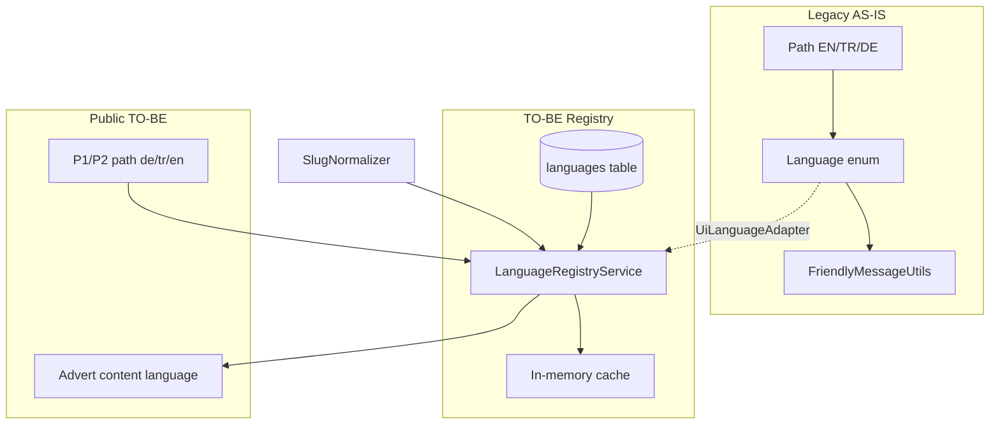

# Language Registry — Architecture Discovery & Design (ARCH-2)

Turkish summary: (optional follow-up `LANGUAGE-REGISTRY-DESIGN-TR.md`).

**Status:** **proposal** — design for Product Owner / engineering review. **Does not** implement code or authorize migration execution. **Does not** amend approved DEC-007 product rules; operational details marked **OPEN — PO DECISION REQUIRED** where noted.

**Authority:** [PRODUCT_DECISIONS.md](../../08-project-management/PRODUCT_DECISIONS.md) §8 (DEC-007), [ADR-002](../ADR/ADR-002-public-read-api.md) v0.6.0.

---

## 1. Executive summary

DEC-007 requires a **central, data-driven Language Registry** so `de`, `tr`, and `en` (and future tags such as `en-GB`) can be added **without** per-language schema columns or Java enum constants.

**AS-IS:** `com.prettier.shared.utils.enums.Language` (`EN`, `TR`, `DE`) is bound to almost every REST path as `{language}` and is used exclusively to resolve **friendly API messages** (`FriendlyMessageUtils` → `FriendlyMessage_*.properties`). It is **not** advert content language today.

**TO-BE (recommended):** PostgreSQL `languages` table (Flyway seed), `LanguageRegistryService` as the single validation/catalog API, Spring **in-memory** cache (no Redis in current stack), and a **compatibility adapter** keeping the enum for legacy management routes while **public P1/P2** resolve **advert content language** via registry codes (`de`/`tr`/`en`, lowercase ISO 639-1).

**Slug:** `SlugNormalizer` already uses lowercase string codes (`tr`/`de`); align capability checks with `is_content_supported` from the registry (future `en` support).

---

## 2. Current-state architecture findings (historical AS-IS — ARCH-2 baseline)

**Scope of this section:** Findings below reflect the repository and database **as verified when this design proposal was written** (2026-11-14). They are the **historical AS-IS baseline** for ARCH-2 discovery; they are **not** updated to describe the **current implemented** Language Registry or database layout.

**Current implementation (M1):** Flyway `V3__languages_registry.sql`, `languages` seed, and runtime registry code are recorded in [LANGUAGE-REGISTRY-M1-IMPLEMENTATION-STATUS.md](LANGUAGE-REGISTRY-M1-IMPLEMENTATION-STATUS.md). Legacy items in the table (for example enum-backed paths, no `languages` table in Flyway V1 only) may still apply to **unchanged** areas of the codebase until later migration tranches.

| Area | Finding (verified in repo at proposal time) |
|------|---------------------------|
| **Stack** | Spring Boot 3.0.0, Java 17, PostgreSQL, Flyway (`V1`, `V2`), Hibernate `validate` |
| **Language enum** | `src/main/java/com/prettier/shared/utils/enums/Language.java` — `EN`, `TR`, `DE` only |
| **Path pattern** | `api/v1.0/.../{language}/...` on controllers (Advert, Category, City, Country, District, Contact, Message, Role, Auth, Admin, User) |
| **Binding** | Spring default `String` → `Language` enum conversion (`valueOf`, **uppercase** path values `EN`/`TR`/`DE`) |
| **Friendly messages** | `FriendlyMessageUtils.getFriendlyMessage(Language, …)` → `ResourceBundle` `FriendlyMessage` + `Locale` from `language.name()` |
| **Bundles** | `FriendlyMessage_en.properties`, `FriendlyMessage_tr.properties` on disk; enum defines `DE` but **no** `FriendlyMessage_de.properties` found (DE messages may fall back / miss keys) |
| **Exceptions** | Domain exceptions carry `Language` for localized titles/descriptions in `GlobalExceptionHandler` |
| **Accept-Language** | `DelegatedAuthEntryPoint` — heuristic `tr`/`en` prefix for auth errors only; **not** used for catalog |
| **LocaleContextHolder** | Imported in some exception classes; **commented out** / unused for message resolution |
| **SlugNormalizer** | `SlugNormalizer.resolveContentLanguage(String)` — hardcoded `tr`/`de`; **not** registry-backed |
| **Caching** | **No** `spring-boot-starter-cache`, **no** `@Cacheable` usage in codebase |
| **DB languages** | **No** `languages` table in Flyway V1 |
| **Tests** | JUnit 5; `SlugNormalizerTest` only focused unit tests; `@SpringBootTest` context loads |

---

## 3. Existing `Language` enum usage inventory

### 3.1 Responsibilities (actual)

| Responsibility | Uses enum? | Evidence |
|----------------|------------|----------|
| Advert / domain content locale | **No** | `AdvertManager` passes `language` only into exceptions; no content selection |
| API success/error message locale | **Yes** | Controllers → services → `*Exception(language, …)` → `FriendlyMessageUtils` |
| Path segment validation | **Yes** | Invalid segment → Spring `400` conversion error (no custom handler verified) |
| Slug normalization language | **No** (separate strings) | `SlugNormalizer` uses `tr`/`de` lowercase |

### 3.2 Controllers with `@PathVariable("language") Language`

| Controller | Approx. endpoints |
|------------|-------------------|
| `AdvertController` | getAll, getListWithActive, add, update, delete |
| `CategoryController` | list, CRUD, property keys |
| `CityController`, `CountryController`, `DistrictController` | CRUD + list |
| `ContactController` | list, get, add |
| `MessageController` | mailbox lists, CRUD |
| `RoleController` | CRUD |
| `UserController`, `AdminController`, `AuthController` | auth/admin flows |

All **inherit the same** `{language}` semantics: **message bundle locale**, not DEC-007 content language.

### 3.3 Services

Every `*Manager` / `*Service` interface in `com.prettier.service` mirrors controller methods with a leading `Language language` parameter — **pass-through for exceptions and logging**, not persistence.

---

## 4. Proposed Language Registry data model

### 4.1 Table `languages` (recommended minimal model)

| Column | Type | Required | Purpose |
|--------|------|----------|---------|
| `code` | `varchar(35)` | **PK** | Canonical registry id (see §4.3 — **not** a claim of universal BCP 47 maximum length) |
| `parent_code` | `varchar(35)` NULL | Optional | Self-FK; **tag hierarchy only** (§4.5); **not** used for content fallback |
| `name` | `varchar(100)` | **Yes** | English display name (admin, logs) |
| `native_name` | `varchar(100)` | **Yes** | Endonym |
| `is_active` | `boolean` | **Yes** | Global enable; `false` = must not select for **new** operations |
| `is_ui_supported` | `boolean` | **Yes** | Allowed for friendly-message / legacy UI path resolution |
| `is_content_supported` | `boolean` | **Yes** | Allowed advert **content** language (translations, public P1/P2) |
| `is_translation_supported` | `boolean` | **M2 only (recommended)** | AI **target** language eligibility (§4.6); **omit from M1 Flyway** or add nullable default `false` unused |
| `text_direction` | `char(3)` | **Yes** | `LTR` / `RTL` (seed: all `LTR`) |
| `sort_order` | `smallint` | **Yes** | Stable listing order in pickers |
| `created_at` / `updated_at` | `timestamptz` | **Yes** | Audit (align `BaseEntity` conventions **or** lightweight columns only on this table) |

**Deferred (not M1):**

| Column | Reason |
|--------|--------|
| `fallback_code` | **Not in registry model** — content fallback is a **product behaviour**, forbidden for public advert reads (DEC-007). Any UI-only fallback policy is **OPEN — PO DECISION REQUIRED** and must **not** live on this table without explicit PO approval (§4.5). |

### 4.2 Constraints

- **PK:** `code`
- **FK:** `parent_code` → `languages(code)` ON DELETE RESTRICT (when used)
- **Unique:** implicit via PK
- **Check:** `text_direction IN ('LTR','RTL')`
- **No** per-language tables or columns elsewhere for adding `fr`, `ar`, etc.

### 4.3 BCP 47 — column length, canonicalization, validation, registry membership

Three **separate** steps (do not conflate):

| Stage | Purpose | Outcome on failure |
|-------|---------|-------------------|
| **A. Canonicalization** | Normalize user/path input | `InvalidLanguageCodeException` (400) — malformed input |
| **B. Syntactic validation** | Tag shape matches project BCP 47 subset | 400 — not a well-formed tag |
| **C. Registry lookup** | Row exists + `is_active` + capability flag | 404 (public content) or 400 (admin UI) — **supported registry language** |

**`varchar(35)` re-evaluation:** RFC 5646 tags are usually short; **35 characters is a project storage limit** for PK/FK stability (fits `de`, `zh-Hans-CN`, typical region variants). It is **not** a guarantee that every theoretically valid BCP 47 tag worldwide will fit. Tags longer than 35 are **rejected at registry insert** (admin/migration), not silently truncated. If a future PO-approved tag exceeds 35, a **one-time** `ALTER COLUMN` migration is acceptable (still not per-language schema).

**Canonicalization (stage A):**

1. Reject `null`.
2. **Trim** leading/trailing **ASCII whitespace** only (do not strip internal spaces — they make the tag invalid).
3. Split on `-`; lowercase **each subtag** with `Locale.ROOT` rules (`EN-GB` → `en-gb` stored/displayed as `en-gb`; project may display region uppercase in UI only — **DB stores lowercase canonical**).
4. Rejoin with `-`.

**Syntactic validation (stage B)** — M1 regex after canonicalization (no new library):

```text
^[a-z]{2,3}(-[a-z0-9]{2,8})*$
```

Length ≤ 35 after step A. This accepts `en-gb`, `de-at`, rejects empty and illegal characters.

**Registry membership (stage C):** Syntactically valid tags **not** in `languages` are **unsupported** (e.g. `fr` valid BCP shape but no row → not accepted). **No automatic mapping** from `en-gb` to `en` for public reads (DEC-007: **no public content fallback**). Request must match an **exact** registry `code` with `is_content_supported` and published translation.

**Regional tags vs base languages (illustrative, not M1 seed):**

| Registry `code` | `parent_code` | Meaning |
|-----------------|---------------|---------|
| `en` | `NULL` | Base English content language |
| `en-gb` | `en` | **Separate** registry entry if PO adds it; **own** translations and slugs; P2 `/en-gb/slug/...` does **not** serve `en` translation |
| `de` | `NULL` | Base German |
| `de-at` | `de` | Optional regional entry; **no** implicit fallback to `de` on public API |

`parent_code` supports **admin UX grouping** and future inheritance of **metadata** (display name templates). It does **not** authorize serving another language’s advert content.

### 4.4 Activation / deactivation (technical options — product policy OPEN)

**Approved (DEC-007):** Initial registry languages `de`, `tr`, `en`; public missing translation → **404**; **no** automatic public language fallback.

**`is_active = false` or capability flag false — engineering options (PO must pick for §8.6 #4):**

| Area | Option A | Option B | Option C |
|------|----------|----------|--------|
| **New manual translations** | Reject create (recommended default) | Allow draft only | — |
| **New publication** | Reject publish | — | — |
| **Existing published translations** | **Keep serving** on public reads until PO unpublishes | **404** all public reads immediately | Soft: 404 new requests; keep snapshot until unpublish |
| **Public read of deactivated code** | **404** (treat like missing translation per ADR-002) | Same as A | — |

This document **does not** select A/B/C for existing published content — **OPEN — PO DECISION REQUIRED** (PRODUCT_DECISIONS §8.6 #4).

| Flag | Technical effect (when PO policy allows) |
|------|----------------------------------------|
| `is_active = false` | `requireActive` fails for **all** contexts |
| `is_ui_supported = false` | Legacy friendly-message path rejects or uses **OPEN-ARCH-01** |
| `is_content_supported = false` | No new advert content / translations in that code; public P1/P2 **404** for that path |

### 4.5 `parent_code` vs content fallback (approved boundary)

| Mechanism | What it is | What it is **not** |
|-----------|------------|-------------------|
| **`parent_code`** | Optional **hierarchy** between registry rows (`en-gb` → `en`) | **Not** a runtime fallback for public advert JSON |
| **`fallback_code` (column)** | **Not recommended** in M1 | **Not** approved for public advert content (DEC-007 rejects silent fallback) |

**M1 necessity:** **`parent_code` column optional; seed with `NULL` for `de`/`tr`/`en` only.** Column documents future `en-gb` without regional tags in M1. **No engineering dependency** on `parent_code` in M1 code paths.

### 4.6 Translation and content capabilities (M1 smallest model)

| Capability flag | Meaning | M1 use |
|-----------------|--------|--------|
| **`is_content_supported`** | Advert **source language**; manual **AdvertTranslation** create/edit; **slug** language; **public P1/P2** content language; AI **source** language validation (M2) uses same flag | **Required** — `true` for `de`,`tr`,`en` |
| **`is_ui_supported`** | API **friendly messages** / legacy `EN` path adapter | **Required** |
| **`is_translation_supported`** | Eligible as **AI target** language for suggestion jobs (M2) | **Defer:** omit column in M1 **or** add `false` and ignore until M2 migration sets `true` when AI ships |

**Distinction (no automatic publish — approved M2 rule):**

- **Content creation (manual M1):** `is_content_supported` only.
- **AI source language:** Must be advert’s `source_language_code` with `is_content_supported` (M2).
- **AI target language:** `is_translation_supported` (M2 only); suggestions stay unpublished until owner approval.

**M1 `LanguageCapability` enum (service):** `UI_MESSAGE`, `ADVERT_CONTENT` only. Add `AI_TRANSLATION_TARGET` in M2 when column exists.

---

## 5. LanguageRegistryService contract (proposal — no source files)

Package proposal: `com.prettier.shared.i18n.registry` (or `com.prettier.catalog.language`).

```java
/** M1: UI_MESSAGE, ADVERT_CONTENT. M2: add AI_TRANSLATION_TARGET. */
public enum LanguageCapability {
    UI_MESSAGE,
    ADVERT_CONTENT,
    AI_TRANSLATION_TARGET  // M2 — gates AI suggestion target only
}

public record LanguageDescriptor(
    String code,
    String name,
    String nativeName,
    boolean active,
    boolean uiSupported,
    boolean contentSupported,
    boolean translationSupported, // absent or false in M1; M2 AI target eligibility
    String textDirection,
    int sortOrder,
    String parentCode
) {}

public interface LanguageRegistryService {

    /** Canonicalize and validate code; throws if malformed. */
    String canonicalizeCode(String rawCode);

    /** Resolve active language or throw LanguageNotSupportedException / InvalidLanguageCodeException. */
    LanguageDescriptor requireActive(String code, LanguageCapability context);

    Optional<LanguageDescriptor> findByCode(String code);

    boolean isActive(String code);

    boolean supports(String code, LanguageCapability context);

    List<LanguageDescriptor> listActive(LanguageCapability context);
}
```

**Supporting types (proposal):**

- `InvalidLanguageCodeException` — malformed tag (400).
- `UnsupportedLanguageException` — unknown or inactive for context (404 for public content; 400 for admin **OPEN** — PO).

---

## 6. Language code validation strategy

Maps to §4.3 stages **A → B → C**:

| Step | Stage | Rule |
|------|-------|------|
| 1 | A | Reject `null` / blank (after trim) |
| 2 | A | `canonicalizeCode` — per-subtag lowercase, rejoin |
| 3 | B | Regex + max length 35 |
| 4 | C | Load from registry snapshot (cache) |
| 5 | C | Check `is_active` + capability flag for context |
| 6 | C | Return `LanguageDescriptor` |

**Case:** Public URLs use **lowercase** `de`/`tr`/`en` (ADR-002). Legacy paths may still send `EN` — **adapter** maps `EN` → `en` for registry lookups **only in UI_MESSAGE context**.

**Unknown / inactive:**

- **Public advert content:** **404** (ADR-002) — do not leak “language exists but inactive”.
- **Authenticated management:** **400** with friendly message (preserve existing UX) — exact mapping **OPEN** for dual path era.

**Java `Locale`:** Use `Locale.forLanguageTag(code)` **only** for message bundles after mapping `en` → bundle `FriendlyMessage_en.properties` (fix legacy conflation of `EN` enum name vs `en` tag **during migration**, not in ARCH-2 code).

**SlugNormalizer:** Replace hardcoded `Set.of("tr","de")` with `registry.supports(code, ADVERT_CONTENT)`; keep transliteration rules in code per language **family** (separate **OPEN** whether `en` needs no-op mapping only).

---

## 7. Cache strategy (M1 — in-memory, no Redis)

| Topic | Recommendation |
|-------|------------------|
| **Technology** | `spring-boot-starter-cache` + `ConcurrentMapCacheManager`; **no Redis** |
| **Deployment assumption M1** | **Single application instance** (local Docker / one JVM). No cross-node coherence required. |

### 7.1 Loading

| Event | Behavior |
|-------|----------|
| **Application startup** | After Flyway, `@PostConstruct` or first `requireActive` loads **full table** into cache |
| **Cache miss** | M1: should not occur if snapshot loaded; optional fallback: single DB `findAll()` + repopulate snapshot |
| **Flyway-only seed change** | **Restart** application (documented ops procedure M1) |

### 7.2 Cache keys

| Key | Value |
|-----|--------|
| `languageRegistry::snapshot` | Immutable list/map of all `LanguageDescriptor` rows |
| Derived (in-memory, not separate cache region) | Indexes by `code` built from snapshot on load |

Capability-filtered lists (`listActive(ADVERT_CONTENT)`) are **computed from snapshot** in memory — no per-capability Redis keys.

### 7.3 Invalidation after registry update (M2 admin / future)

```text
BEGIN transaction
  UPDATE languages ...
COMMIT
→ LanguageRegistryAdminService.update(...)
  → on successful commit callback (or @TransactionalEventListener AFTER_COMMIT):
       languageRegistryService.reloadSnapshot()  // DB read + replace atomic reference
```

**Ordering rule:** Never update in-memory snapshot **before** DB commit. On rollback, cache unchanged.

M1 (seed-only): **no runtime updates**; `reloadSnapshot()` runs once at startup.

### 7.4 Multi-instance (future — document only)

| Concern | M1 | Future |
|---------|----|--------|
| Stale cache on instance B after admin update on A | N/A (single instance) | **OPEN — PO DECISION REQUIRED** among: rolling restart, TTL + short refresh, message bus evict, or accept rare staleness window |
| Redis | **Not used** | Revisit only if PO mandates hot reload multi-node without restart |

### 7.5 Testing

Unit-test `reloadSnapshot()` and capability filters with fixture rows; integration test: single startup load matches Flyway seed count **3**.

---

## 8. Backward compatibility and migration strategy



### Phased migration

| Phase | Action |
|-------|--------|
| **R1** | Flyway `languages` + seed `de`,`tr`,`en` |
| **R2** | `LanguageRegistryService` + repository; no controller changes |
| **R3** | `UiLanguageAdapter`: `Language` enum ↔ registry `code` for **UI_MESSAGE** only |
| **R4** | New public P1/P2 use `String` or dedicated `@ContentLanguage` resolved via registry |
| **R5** | `SlugNormalizer` + `AdvertTranslation` (ARCH-3+) use `ADVERT_CONTENT` |
| **R6** | Deprecate enum for **new** APIs; retain for legacy until route split **OPEN — PO DECISION REQUIRED** |

**Enum retention:** Keep `Language` enum **unchanged** through R1–R5; adapters map `EN→en`, `TR→tr`, `DE→de`.

**Deprecation:** `@Deprecated` on enum only after all paths use explicit context types (long horizon).

---

## 9. API behavior

| Concept | Source | Registry capability |
|---------|--------|---------------------|
| **UI language** | FE i18next; legacy path `EN`/`TR`/`DE` | `is_ui_supported` |
| **Advert content language** | Public P1/P2 `{language}` per ADR-002 v0.6.0 | `is_content_supported` |
| **AI source language** | `Advert.source_language_code` (TO-BE, M2) | `is_content_supported` |
| **AI target language** | User-selected targets (**M2**) | `is_translation_supported` / `AI_TRANSLATION_TARGET` |

**Public routes:** Validate content language → load **published** `AdvertTranslation` → **404** if missing (no fallback).

**Management routes (interim):** Keep `{language}` enum for **friendly messages**; **do not** infer advert content language from path.

**Future metadata endpoint (proposal):** `GET /api/v1.0/languages?capability=content` — authenticated or public **OPEN — PO DECISION REQUIRED**.

---

## 10. Initial seed data proposal (Flyway — not created in ARCH-2)

| code | parent_code | name | native_name | is_active | is_ui | is_content | text_direction | sort_order |
|------|-------------|------|-------------|-----------|-------|------------|----------------|------------|
| `de` | NULL | German | Deutsch | true | true | true | LTR | 10 |
| `tr` | NULL | Turkish | Türkçe | true | true | true | LTR | 20 |
| `en` | NULL | English | English | true | true | true | LTR | 30 |

(`is_translation_supported` **not** seeded in M1 — see §4.6.)

**Verified AS-IS mapping:** Enum `DE`/`TR`/`EN` ↔ registry `de`/`tr`/`en`. Frontend i18next uses same three codes (SRC-012 / I18N_STRATEGY).

**Proposed configuration beyond AS-IS:** separate capability flags (all `true` for M1); lowercase codes in new public URLs.

---

## 11. Alternatives and trade-offs

| Decision | Recommended | Alternative | Trade-off |
|----------|-------------|-------------|-----------|
| Storage | RDBMS table | YAML/config file | DB aligns with Flyway, admin UI later, no redeploy for new lang |
| PK | `code` string | Surrogate `id` + unique code | String PK simpler for FKs on `AdvertTranslation` |
| parent_code | Nullable M1 | Required hierarchy | YAGNI until regional tags shipped |
| fallback_code column | Omit M1 | Column present | Risk of accidental public fallback policy violation |
| Public invalid lang | 404 | 400 | ADR-002 / DEC-007: 404 for missing translation |
| Cache | Local ConcurrentMap | Redis | Matches single-instance; zero new deps |
| Enum removal | Late deprecation | Immediate delete | Breaks all controllers |

---

## 12. Decisions — approved baseline vs open items

### 12.1 Approved (DEC-007 / ARCH-1 — **not** open for re-litigation in this design)

| Topic | Authority |
|-------|-----------|
| Initial content languages `de`, `tr`, `en` | PRODUCT_DECISIONS §8.2 #1 |
| Language-scoped slug uniqueness | §8.2 #4 · ADR-002 v0.6.0 |
| Public missing/unpublished translation → **404** | §8.2 #5 · ADR-002 |
| **No** automatic public content language fallback | §8.2 #5 · I18N_STRATEGY v0.2 |
| Published translation preserved when source changes; outdated + approval for replacement | §8.2 #6 |
| Manual translation lifecycle **M1**; AI suggestions **M2**; AI never auto-published | §8.2 #8 · §8.3 |
| Registry extensibility without per-language DB columns | §8.2 #2 |
| UI language ≠ advert content language | §8.1 |

### 12.2 Open — PO decision required

From [PRODUCT_DECISIONS.md](../../08-project-management/PRODUCT_DECISIONS.md) §8.6:

1. Existing advert source-language **backfill**  
2. **Category** / **CategoryPropertyValue** translation scope  
3. Structured vs free-text **`location`**  
4. **Language deactivation** vs existing published content (see §4.4 options)  
5. **Source-language change** policy after translations exist  
6. Public **`{language}` route** migration / UI vs content disambiguation  
7. **`Accept-Language`** outside public advert content  
8. **SEO** / **image alt-text** scope  

**Architecture-specific (still open):**

| ID | Topic |
|----|--------|
| **OPEN-ARCH-01** | HTTP status for invalid **UI** language on legacy routes (400 vs default `EN`) |
| **OPEN-ARCH-02** | Public `GET /languages` metadata endpoint (auth vs anonymous) |
| **OPEN-ARCH-03** | Admin CRUD for registry vs Flyway-only M1 |
| **OPEN-ARCH-05** | Multi-instance cache coherence when registry is edited at runtime (§7.4) |
| **OPEN-ARCH-06** | UI-only message fallback policy (if any) — **must not** apply to public advert content |

---

## 13. Recommended implementation sequence

1. **IMPL-LREG-01** — Flyway: `languages` table + seed (`de`,`tr`,`en`).  
2. **IMPL-LREG-02** — JPA entity + `LanguageRepository`.  
3. **IMPL-LREG-03** — `LanguageRegistryService` + in-memory cache + unit tests.  
4. **IMPL-LREG-04** — `UiLanguageAdapter` + fix bundle locale mapping (`en` not `EN`) where needed.  
5. **IMPL-LREG-05** — Integrate public catalog resolution (with ARCH-3 `AdvertTranslation`).  
6. **IMPL-LREG-06** — `SlugNormalizer` registry gate + `en` transliteration policy.  
7. **IMPL-LREG-07** — (M2) Add `is_translation_supported` + `AI_TRANSLATION_TARGET` validation.

**Prerequisite:** PO review of this document; then ARCH-3 schema for translations.

---

## 14. Risks and acceptance criteria

| Risk | Mitigation |
|------|------------|
| Dual meaning of `{language}` | Document + separate resolvers; eventual route naming **OPEN-PO** |
| Enum / registry drift | Single adapter; test matrix EN↔en |
| Cache stale after DB update | Evict API or restart policy documented |
| V2 global slug vs language-scoped | Separate migration tranche (DEC-007) |

**Acceptance (registry slice):**

M1 engineering completion is recorded in [LANGUAGE-REGISTRY-M1-IMPLEMENTATION-STATUS.md](LANGUAGE-REGISTRY-M1-IMPLEMENTATION-STATUS.md). Summary:

- [x] Flyway seed + Hibernate `validate` (V3; verified in tests)
- [x] `listActive(ADVERT_CONTENT)` includes seeded `de`,`tr`,`en` (seed row flags)
- [x] Unknown codes fail closed (`UnsupportedLanguageException` / empty lookup)
- [x] `canonicalizeCode(" TR ")` → `tr`
- [x] No new language requires Java enum change (M1 slice)
- [x] Unit + PostgreSQL acceptance tests cover snapshot, validation, startup
- [x] No public content fallback in registry layer (controllers not wired to registry)

**Implementation notes (PO-approved deviations):** startup uses **`ApplicationReadyEvent`**, not `@PostConstruct`; in-memory state uses **`AtomicReference` snapshot**, not Spring Cache (§7 recommendation).

---

## 15. Change history

| Version | Date | Summary |
|---------|------|---------|
| 0.1.0 | 2026-11-14 | ARCH-2 discovery & design proposal |
| 0.1.1 | 2026-11-14 | ARCH-2.1 — BCP 47 stages, M1 capability model, cache lifecycle, parent vs fallback, deactivation options, open vs approved split |
| 0.1.2 | 2026-11-15 | M1 implementation status cross-reference §14; see LANGUAGE-REGISTRY-M1-IMPLEMENTATION-STATUS.md |
| 0.1.3 | 2026-11-15 | §2 labeled historical AS-IS; pointer to current M1 implementation status |