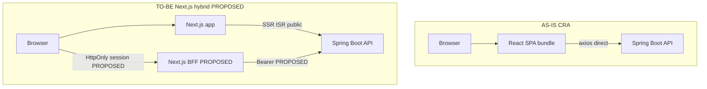
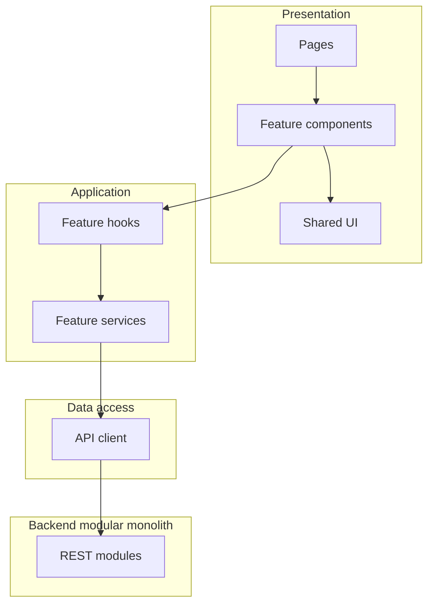
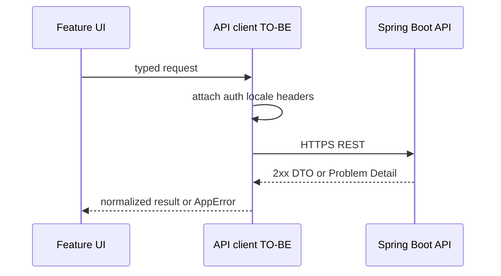
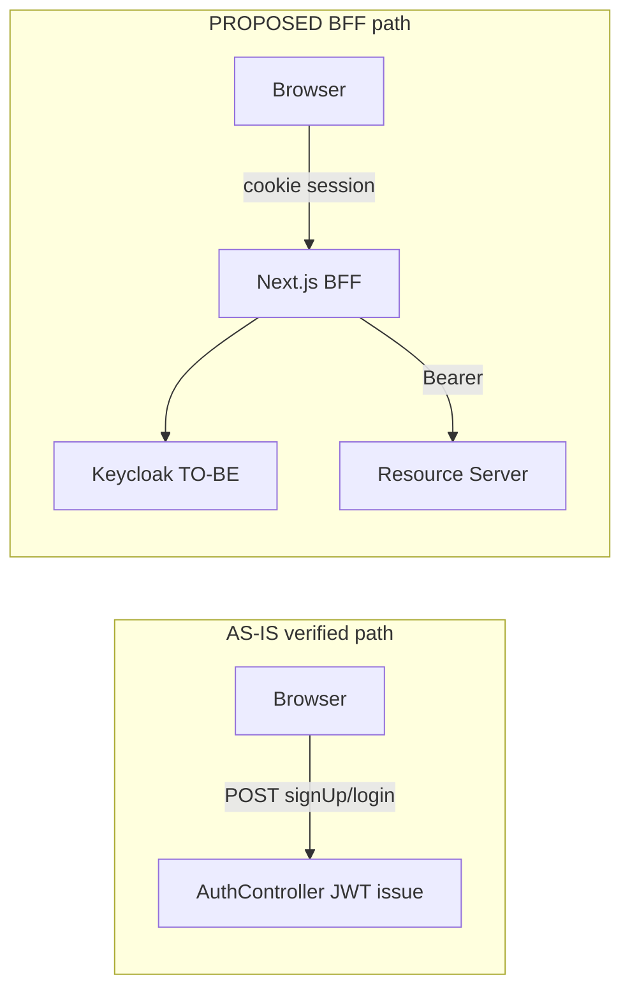

# Frontend Architecture, SEO & Backend Integration

**Canonical** web client architecture reference. The frontend **application source** lives in a **separate workspace root** (not inside the Backend Maven module):

| Item | Path (verified) |
|------|-----------------|
| Frontend repo root | `RealEstate/Frontend/` |
| CRA application | `RealEstate/Frontend/Frontend/` (`package.json`, `src/`) |

**Related backend architecture (do not duplicate here):**

| Concern | Document |
|---------|----------|
| System context | [SAD-001-system-context.md](../SAD/SAD-001-system-context.md) |
| Containers / deploy | [HLD-001-containers.md](../HLD/HLD-001-containers.md), [INFRASTRUCTURE-DEPLOYMENT-ARCHITECTURE.md](../infrastructure/INFRASTRUCTURE-DEPLOYMENT-ARCHITECTURE.md) |
| REST API | [API-ARCHITECTURE.md](../api/API-ARCHITECTURE.md), [API-INVENTORY.md](../api/API-INVENTORY.md), [ADR-002-public-read-api.md](../ADR/ADR-002-public-read-api.md) |
| Security & auth | [SECURITY-ARCHITECTURE.md](../security/SECURITY-ARCHITECTURE.md), [ADR-003-auth-token-bff-reconciliation.md](../ADR/ADR-003-auth-token-bff-reconciliation.md) |
| i18n / l10n | [I18N-L10N-ARCHITECTURE.md](../i18n/I18N-L10N-ARCHITECTURE.md) |
| Testing (backend) | [TESTING-ARCHITECTURE.md](../testing/TESTING-ARCHITECTURE.md) |
| Bounded contexts | [BOUNDED-CONTEXT-MAP.md](../bounded-contexts/BOUNDED-CONTEXT-MAP.md) |
| Verified stack versions | [TECHNOLOGY_BASELINE.md](../../05-infrastructure/TECHNOLOGY_BASELINE.md) § Frontend |
| Integrations | [INTEGRATIONS.md](../../05-infrastructure/INTEGRATIONS.md) |

**Labels:** **AS-IS** (verified in frontend repo), **TO-BE** (approved product direction), **PROPOSED** (not approved), **TBD**, **FUTURE**.

---

## 1. Frontend architecture principles

Aligned with the **modular monolith** backend ([ADR-001](../ADR/ADR-001-modular-monolith.md)):

| Principle | Meaning |
|-----------|---------|
| Feature-oriented UI | Organize by user journeys and bounded contexts — not by technical layer only |
| Separation | UI components ↔ application hooks/services ↔ HTTP/API access — **no business rules in UI** |
| Shared UI | Reusable layout, navigation, form controls, feedback patterns |
| State ownership | **Server-owned** data stays in server-state cache (TO-BE); **ephemeral UI** in client state only |
| Typed contracts | Prefer generated or shared types from OpenAPI (TO-BE) — avoid hand-duplicating DTOs per feature |
| Accessible UI | WCAG **2.2 AA** as target baseline ([NFR-A11Y-001](../../02-requirements/NFR/NFR-CATALOGUE.md)) |
| Secure auth | Backend authorization is **final**; UI may hide actions but **must not** rely on hiding for security |
| SEO-aware public surface | Public listing/detail pages need crawlable HTML and stable URLs (TO-BE with Next.js) |
| Consistent localization | UI i18n separate from advert **content** language ([I18N-L10N-ARCHITECTURE.md](../i18n/I18N-L10N-ARCHITECTURE.md)) |
| Simplicity | No second routing framework, no duplicate validation as security boundary, no unnecessary global state |

**Deployability:** **TO-BE** intent (SAD, INFRA diagrams) treats the web client as **independently deployable** from the Spring Boot JAR (static hosting or Next.js runtime). **AS-IS:** frontend is not built or deployed from Backend CI; no container or CDN config in Backend repo.

---

## 2. Framework and rendering strategy

### 2.1 AS-IS stack (verified `Frontend/Frontend/package.json`)

| Technology | Version / evidence | Used in `src/` |
|------------|-------------------|----------------|
| React | 18.2 | **Yes** — `index.js`, pages, components |
| Build | CRA `react-scripts` 5.0.1 | **Yes** — scripts `start` / `build` / `test` |
| TypeScript | **Not declared** | **No** — JavaScript only |
| Next.js | **Not in dependencies** | **No** |
| Package manager | npm (`package-lock.json`) | **Yes** |
| Styling | Sass (`styles/`), Bootstrap 5, Ant Design, PrimeReact | **Partial** — mixed UI libraries |
| Router | `react-router-dom` 6.18 | **Yes** — `createBrowserRouter` |
| HTTP | `axios` 1.6.7 | **Yes** — `SignUp/signUp.js` (hard-coded URL) |
| Forms | Formik + Yup | **Yes** — `SignUp/index.jsx` |
| State | Redux Toolkit + `react-redux` | **Declared only** — no `configureStore` / `Provider` in tree |
| i18n | `i18next` + `initReactI18next` in `locales/index.js` | **Partial** — `react-i18next` imported in source but **not** listed in `package.json` or `package-lock.json` |
| Token storage helper | `encrypt-storage` | **Helper exists** — not wired to auth flow in inspected pages |
| Dev proxy | `setupProxy.js` → `/api` → `localhost:8080` | **Configured** — SignUp bypasses proxy with absolute URL |
| Tests | `@testing-library/*` | **CRA default only** — **no** `*.test.*` files found |
| SEO | Static `public/index.html` | **CRA placeholder** title/description |

**Entry:** `src/index.js` → `App.js` → `RouterProvider`.

### 2.2 TO-BE / PROPOSED rendering platform

| Item | Status |
|------|--------|
| **Next.js** (App Router) | **TO-BE** per [SAD-001](../SAD/SAD-001-system-context.md) — **not implemented** in frontend repo |
| **Next.js BFF** (OIDC, HttpOnly session) | **PROPOSED** — [ADR-003](../ADR/ADR-003-auth-token-bff-reconciliation.md) **draft**, [SECURITY-ARCHITECTURE.md](../security/SECURITY-ARCHITECTURE.md) § BFF |

**Rendering modes (target — not AS-IS):**

| Mode | Role when Next.js is adopted |
|------|------------------------------|
| **SSR** | Fresh public catalog slices, SEO-critical HTML |
| **SSG** | Stable marketing/landing shells where data is slow-changing |
| **ISR** | Public listing indexes with bounded staleness |
| **CSR** | Authenticated dashboards, heavy interaction, user-specific data |
| **RSC** | Server components for data fetch on public pages; client components for interactivity |

**CRA AS-IS:** effectively **CSR only** — no server-rendered HTML for route-specific content; poor baseline for listing SEO.

### 2.3 Page-type rendering recommendations (TO-BE)

| Page class | Examples | Recommended | Rationale |
|------------|----------|-------------|-----------|
| **Public, SEO-critical** | Home, catalog, advert detail (slug), category/location landings | SSR or ISR + metadata | Crawlability, Open Graph, hreflang ([§10](#10-seo-and-search-visibility)) |
| **Public, low churn** | Legal, about | SSG | Cheap, cacheable |
| **Authenticated** | Dashboard, advert editor, favorites, messages, profile | CSR (client) or RSC + client islands | Personalization, auth gates |
| **Admin / staff** | Moderation, user admin | CSR behind auth | No indexing; strict authZ from API |
| **Legacy CRA pages today** | `/`, `/SignUp` | CSR only (AS-IS) | No listing/catalog routes implemented |



**Figure RE-FIG-FE-ARCH-004** — Rendering and integration: AS-IS vs TO-BE paths.

**Caption:** Solid AS-IS path is browser CSR → API; BFF path remains **PROPOSED**.

**Explanation:** Do not plan SSR/ISR until Next.js is adopted; until then public SEO remains **TBD**.

---

## 3. Frontend feature architecture

Frontend features **align conceptually** with backend bounded contexts — **not** 1:1 package mapping:

| Feature area (TO-BE) | Backend context | Frontend responsibility |
|---------------------|-----------------|-------------------------|
| Identity | Auth / users | Login, signup, profile, session UX |
| Catalog | Categories, types, reference data | Filters, lookups (read-mostly) |
| Listing | Adverts, translations, slug | Search, detail, create/edit flows |
| Engagement | Favorites, views (FUTURE) | User lists, saved searches |
| Communication | Contact, messaging (FUTURE) | Inboxes, notifications UI |
| Platform | Layout, i18n, API client, design system | Cross-cutting providers |

### 3.1 AS-IS folder layout (verified)

```
Frontend/Frontend/src/
  App.js, index.js
  router/router.js
  layouts/user-layout.jsx
  pages/ (Home, Contact, SignUp)
  components/common/ (menubar, footer, topbar, LanguageSelector)
  components/home-page/
  helpers/config/index.js
  helpers/functions/ (forms, encrypted-storage, swal, …)
  locales/ (en, tr, de JSON)
  styles/
```

**Gaps vs product:** No advert listing/detail routes, no dashboard, no auth login page in router; `helpers/config/index.js` still contains **legacy campus/school** `pageRoles` and `api.baseUrl` (`mycampusmates.com`) — **discrepancy** with RealEstate API.

### 3.2 TO-BE layer responsibilities

| Layer | Owns |
|-------|------|
| **Route / page** | Composition, layout, route params |
| **Feature components** | Feature-specific UI |
| **Feature hooks** | Orchestration, server-state hooks (TO-BE) |
| **Feature services** | API calls for one feature |
| **API client module** | Base URL, auth attachment, error normalization, versioning |
| **Shared UI** | Buttons, inputs, tables, modals, a11y patterns |
| **Layouts** | Shell, nav, footer, auth vs public |
| **Providers** | Theme, i18n, query client, auth context (TO-BE) |

**Rules:** Backend remains authoritative for validation, authorization, and business rules; frontend validation is **UX only**.



**Figure RE-FIG-FE-ARCH-001** — Frontend layering (TO-BE target).

**Caption:** API client is the single integration seam with the backend.

**Explanation:** AS-IS SignUp calls `axios` directly without a shared client module.

---

## 4. Routing and navigation

### 4.1 AS-IS (`router/router.js`)

| Route | Component | Auth guard |
|-------|-----------|------------|
| `/` | `Home` via `UserLayout` | **None** |
| `/SignUp` | `SignUp` | **None** |

`Contact.jsx` exists but is **not registered** in the router (dead page file).

**Implementation:** React Router 6 `createBrowserRouter` — **client-side** only.

### 4.2 TO-BE (Next.js App Router — not implemented)

When Next.js is adopted:

| Concern | Approach |
|---------|----------|
| Public routes | App Router segments; optional `[locale]` prefix per [I18N-L10N-ARCHITECTURE.md](../i18n/I18N-L10N-ARCHITECTURE.md) |
| Authenticated routes | Route groups + middleware session check (BFF cookie **PROPOSED**) |
| Admin | Separate segment; role hints from API — **not** UI-only |
| Dynamic advert routes | `/{locale}/adverts/{slug}` aligned with ADR-002 P2 — **TO-BE** |
| Localized routes | BCP 47 tags — **do not** second Language Registry |
| Errors | `not-found`, `error` boundaries with localized copy |

### 4.3 OPEN: routing migration

| ID | Topic |
|----|--------|
| **OPEN-FE-01** | **Next.js adoption** and version — **TBD** |
| **OPEN-FE-02** | **React Router vs App Router** — migrating AS-IS routes; **do not** run both long-term |
| **OPEN-FE-03** | **Localized URL strategy** (prefix vs domain) — align DEC-007 / ADR-002 |

---

## 5. API integration architecture

Align with [API-ARCHITECTURE.md](../api/API-ARCHITECTURE.md).

### 5.1 AS-IS integration evidence

| Aspect | Evidence |
|--------|----------|
| Client | Ad hoc `axios.post` in `signUp.js` |
| Base URL | Hard-coded `http://localhost:8080/api/v1.0/auth/EN/signUp` |
| Version | Uses **AS-IS** `/api/v1.0/` prefix |
| Language path | `EN` in URL — legacy **friendly-message locale** enum, not BCP 47 UI locale |
| Proxy | `setupProxy.js` maps `/api` — **unused** by current SignUp call |
| Auth header | **No** JWT attachment in inspected signup flow |
| Errors | Expects legacy shape (`validationErrors`, `errorMessages`) — **not** RFC 9457 |
| Public catalog | **No** frontend calls to ADR-002 endpoints found |

### 5.2 TO-BE API client design

| Capability | Target |
|------------|--------|
| Central client | Single module: base URL from env, `/api/v1/` (APPROVED target path) |
| Types | OpenAPI → TypeScript types (**FUTURE** / **PROPOSED**) — springdoc spec exists server-side |
| Errors | Normalize to Problem Details + `applicationCode` |
| Auth | Attach Bearer per AS-IS JWT or via BFF server-side (**PROPOSED**) |
| Cancellation | `AbortSignal` on navigations |
| Timeouts | Configurable per environment |
| Retry | Idempotent GET only; no blind POST retry |
| Pagination | Query params per API conventions |
| Uploads | Multipart aligned with [FILE-STORAGE-ARCHITECTURE.md](../storage/FILE-STORAGE-ARCHITECTURE.md) |



**Figure RE-FIG-FE-ARCH-002** — API integration through a single client (TO-BE).

**Caption:** AS-IS bypasses this pattern in SignUp.

**Explanation:** Contract tests remain backend-owned ([TESTING-ARCHITECTURE.md](../testing/TESTING-ARCHITECTURE.md)); frontend may add consumer contract tests **FUTURE**.

| ID | Topic |
|----|--------|
| **OPEN-FE-04** | **OpenAPI TypeScript generation** pipeline and CI gate — **PROPOSED** |
| **OPEN-FE-05** | **Runtime validation** (e.g. Zod) for untrusted responses — **TBD** |

---

## 6. Server state and client state

### 6.1 AS-IS

| Library | Declared | Used |
|---------|----------|------|
| Redux Toolkit | Yes | **No store** — `useDispatch` import in SignUp **commented out** |
| TanStack Query | **No** | **No** |
| Zustand | **No** | **No** |
| React Context | — | **No** global providers in `App.js` |

Local component `useState` drives SignUp; no shared server cache.

### 6.2 TO-BE / PROPOSED

| Concern | Recommended pattern | Status |
|---------|---------------------|--------|
| Server state | TanStack Query (or equivalent) | **PROPOSED** — not in repo |
| Client UI state | Zustand or colocated state | **PROPOSED** |
| Provider state | React Context for theme/i18n/query client | **TO-BE** |

**Rules:**

- Cache **invalidation** on mutations that change adverts, profile, favorites.
- **Isolate** caches per authenticated user after login/logout.
- Do not mirror full advert graphs in global client state when Query cache suffices.

| ID | Topic |
|----|--------|
| **OPEN-FE-06** | **Server-state library** choice and adoption — **PROPOSED** |
| **OPEN-FE-07** | **Client-state library** choice — **PROPOSED** |

---

## 7. Forms and validation

### 7.1 AS-IS

| Tool | Usage |
|------|--------|
| Formik + Yup | `SignUp/index.jsx` — client rules (password complexity, etc.) |
| React Bootstrap | Form layout |
| Backend errors | Mapped from `validationErrors` / `errorMessages` on 400 |

**Gaps:** Yup messages mostly English literals; not tied to i18n keys; email min length rule does not match backend semantics.

### 7.2 TO-BE

| Layer | Role |
|-------|------|
| React Hook Form + Zod (candidates) | **PROPOSED** — lighter re-renders, schema reuse with OpenAPI |
| Frontend validation | UX + early feedback |
| Backend validation | **Authoritative** — JWT roles, ownership, domain rules |

Advert create/edit (B2.x): expect large multipart forms — field-level errors must be **accessible** ([§11](#11-accessibility-and-ux-quality)).

| ID | Topic |
|----|--------|
| **OPEN-FE-08** | **Form library** standard (keep Formik vs migrate) — **TBD** |

---

## 8. Authentication and authorization integration

See [SECURITY-ARCHITECTURE.md](../security/SECURITY-ARCHITECTURE.md). **ADR-003 remains draft PROPOSED** — status not changed here.

### 8.1 AS-IS (frontend evidence)

| Topic | Finding |
|-------|---------|
| Login UI | **Not** in router |
| Sign-up | Calls backend `signUp` endpoint |
| Token storage | `encrypted-storage` helper + `REACT_APP_STORAGE_ENCRYPTION_KEY` — **not** used in SignUp flow inspected |
| JWT in requests | **Not** implemented in shared client |
| Integration path | Browser → API **direct** (matches SAD AS-IS line) |

### 8.2 TO-BE / PROPOSED paths

| Model | Summary | Status |
|-------|---------|--------|
| **Direct SPA + custom JWT** | Access token in memory or storage; refresh policy per Decision 14 | AS-IS backend issues JWT; FE **incomplete** |
| **Keycloak + Resource Server** | OIDC at API | **TO-BE** backend — not AS-IS |
| **Next.js BFF** | HttpOnly session cookie to browser; BFF holds tokens; API Bearer | **PROPOSED** ([ADR-003](../ADR/ADR-003-auth-token-bff-reconciliation.md)) |



**Figure RE-FIG-FE-ARCH-003** — Authentication integration: AS-IS direct API vs PROPOSED BFF.

**Caption:** Only signup HTTP call verified on AS-IS path today.

**Explanation:** CSRF relevance shifts with cookie-based BFF ([SECURITY-ARCHITECTURE.md](../security/SECURITY-ARCHITECTURE.md) §6).

**UI authorization:** Role-based nav from config (`pageRoles` in AS-IS config) is **legacy** and **not** RealEstate roles — replace with API-derived permissions **TO-BE**.

| ID | Topic |
|----|--------|
| **OPEN-FE-09** | **BFF vs direct SPA** — await ADR-003 acceptance |
| **OPEN-FE-10** | **Token storage** policy for SPA fallback if BFF rejected — **TBD** |

---

## 9. Internationalization and localization

Align with [I18N-L10N-ARCHITECTURE.md](../i18n/I18N-L10N-ARCHITECTURE.md).

### 9.1 AS-IS (CRA)

| Item | Evidence |
|------|----------|
| Library | `i18next` + `initReactI18next` in `locales/index.js` |
| Resources | `en`, `tr`, `de` JSON under `locales/translations/` |
| Detection | `localStorage.lang` \|\| `navigator.language`; fallback `navigator.language` — **not** product default **de** |
| Wiring | `i18n` module **not imported** from `index.js` / `App.js` in inspected entry |
| `LanguageSelector` | Uses `react-i18next` — component **not** mounted in active layout |
| API language | SignUp uses `.../auth/EN/signUp` — **separate** from UI locale |
| Formatting | `moment` dependency — **Intl/i18n formatters TBD** |

### 9.2 TO-BE

| Item | Direction |
|------|-------------|
| Product default | **German (`de`)** for UI |
| Locales | `de`, `en`, `tr` (BCP 47) |
| Next.js | `[locale]` routing, localized `metadata` — when Next.js lands |
| UI vs UGC | UI strings ≠ advert translation content (DEC-007) |
| Errors | Display API `detail`; branch on `applicationCode` when RFC 9457 lands |

| ID | Topic |
|----|--------|
| **OPEN-FE-11** | **i18next + Next.js** integration pattern — **TBD** |
| **OPEN-FE-12** | Fix **missing `react-i18next` dependency** and bootstrap i18n at entry — engineering task **FUTURE** (documented discrepancy) |

---

## 10. SEO and search visibility

**AS-IS:** CRA `public/index.html` — generic title/description; **no** `react-helmet` or per-route meta; **no** sitemap/robots in frontend repo; client-only rendering limits indexing.

**TO-BE** (public property product):

| Topic | Direction |
|-------|-----------|
| Localized URLs | Per-locale paths or subpaths; stable advert **slugs** (DEC-007, ADR-002 P2) |
| Metadata | Title, description per advert translation |
| Canonical | One canonical URL per logical advert |
| hreflang | `de` / `en` / `tr` alternates where translations exist |
| Sitemap | Generated from published adverts — owner **TBD** (BFF/Next vs backend) |
| robots.txt | Allow public catalog; disallow auth/admin |
| Open Graph / Twitter | Image from primary advert image |
| Structured data | Schema.org `RealEstateListing` / `Product` — **PROPOSED** types to confirm with PO |
| Pagination | Indexable listing pages; `rel=next/prev` or canonical strategy **TBD** |
| Duplicate content | 404 when translation missing (ADR-002) — **no** silent fallback |
| GEO | Supplementary discoverability for AI/search summaries — **not** a ranking guarantee |

Detail previously split to i18n doc §11 — **canonical SEO section is this document**; [I18N-L10N-ARCHITECTURE.md](../i18n/I18N-L10N-ARCHITECTURE.md) §11 remains a short pointer.

| ID | Topic |
|----|--------|
| **OPEN-FE-13** | **SEO metadata ownership** (Next metadata API vs CMS) — **TBD** |
| **OPEN-FE-14** | **Sitemap generator** location — **TBD** |

---

## 11. Accessibility and UX quality

**Target:** WCAG **2.2 Level AA** ([NFR-A11Y-001](../../02-requirements/NFR/NFR-CATALOGUE.md)).

### 11.1 AS-IS evidence (limited)

| Area | Finding |
|------|---------|
| Semantic HTML | Mixed — Bootstrap/PrimeReact/Ant Design |
| Keyboard | **Not verified** — no a11y test suite |
| Focus management | **TBD** — no routed modal flows inspected |
| Forms | Floating labels in SignUp — error association **partial** |
| Contrast / motion | **Not audited** |
| Language | `html lang="en"` static in `index.html` regardless of UI locale |

### 11.2 TO-BE

Keyboard navigation, visible focus, dialog focus trap, live regions for form errors, responsive layouts, `prefers-reduced-motion`, accessible auth flows.

| ID | Topic |
|----|--------|
| **OPEN-FE-15** | **Accessibility verification** tooling (axe, Playwright a11y) in CI — **TBD** |

---

## 12. Frontend testing and quality

| Practice | AS-IS | TO-BE |
|----------|-------|-------|
| Unit/component tests | CRA + Testing Library deps; **zero** test files | Feature and shared component tests |
| Hook tests | — | With Query client wrapper |
| API integration | — | MSW or contract against OpenAPI |
| a11y tests | — | axe / Playwright |
| E2E | — | Playwright **FUTURE** ([TESTING-ARCHITECTURE.md](../testing/TESTING-ARCHITECTURE.md) OPEN-TEST-10) |
| Typecheck | N/A (JS) | TypeScript **PROPOSED** |
| Lint | `eslintConfig` CRA default | Stricter CI gate **TBD** |
| Build validation | Local `npm run build` | CI job **FUTURE** |

**Backend CI does not build the frontend** ([INFRASTRUCTURE-DEPLOYMENT-ARCHITECTURE.md](../infrastructure/INFRASTRUCTURE-DEPLOYMENT-ARCHITECTURE.md)).

| ID | Topic |
|----|--------|
| **OPEN-FE-16** | **Frontend CI pipeline** (repo, workflows) — **TBD** |
| **OPEN-FE-17** | **E2E** scope with Backend test env — **FUTURE** |

---

## 13. Frontend security and performance

| Topic | AS-IS / note |
|-------|----------------|
| XSS | React escaping; `i18next` `escapeValue: false` — trust translation files |
| CSRF | Not applicable for pure Bearer SPA; **reassess** with BFF cookies |
| CSP | **Not configured** in CRA public folder |
| Secrets | Use `REACT_APP_*` only for non-secret config; encryption key must not be committed |
| API URL | Hard-coded localhost in source — must move to env |
| Images | Swiper on home — lazy loading **partial** |
| Code splitting | CRA default route-based **limited** (few routes) |
| CWV | `web-vitals` dependency — **not** wired in `index.js` inspected |
| Performance budgets | **TBD** — not approved |

---

## 14. AS-IS dependency versus usage summary

| Dependency | Declared | Used | Configured | CI |
|------------|----------|------|------------|-----|
| react / react-dom | Yes | Yes | — | — |
| react-scripts | Yes | Yes | Yes | No FE CI |
| react-router-dom | Yes | Yes | — | — |
| axios | Yes | Yes | partial proxy | — |
| formik / yup | Yes | Yes | — | — |
| @reduxjs/toolkit | Yes | No store | — | — |
| i18next | Yes | module exists | partial | — |
| react-i18next | **No** | imported | **broken risk** | — |
| antd / primereact / bootstrap | Yes | partial | — | — |
| encrypt-storage | Yes | helper only | env key | — |
| TypeScript / Next / TanStack / Zustand / RHF / Zod | No | No | — | — |

---

## 15. Risks and unresolved decisions

| ID | Topic | Status |
|----|--------|--------|
| OPEN-FE-01 | Next.js adoption and version | TBD |
| OPEN-FE-02 | React Router vs App Router migration | TBD |
| OPEN-FE-03 | Localized URL strategy | TBD |
| OPEN-FE-04 | OpenAPI → TypeScript generation | PROPOSED |
| OPEN-FE-05 | Runtime response validation | TBD |
| OPEN-FE-06 | Server-state library (e.g. TanStack Query) | PROPOSED |
| OPEN-FE-07 | Client-state library (e.g. Zustand) | PROPOSED |
| OPEN-FE-08 | Form stack standard | TBD |
| OPEN-FE-09 | BFF vs direct SPA auth | PROPOSED (ADR-003) |
| OPEN-FE-10 | SPA token storage if no BFF | TBD |
| OPEN-FE-11 | i18next + Next.js | TBD |
| OPEN-FE-12 | react-i18next dependency + bootstrap | FUTURE fix |
| OPEN-FE-13 | SEO metadata ownership | TBD |
| OPEN-FE-14 | Sitemap generator ownership | TBD |
| OPEN-FE-15 | A11y verification in CI | TBD |
| OPEN-FE-16 | Frontend CI pipeline | TBD |
| OPEN-FE-17 | E2E with Backend | FUTURE |
| OPEN-FE-18 | Legacy `config.pageRoles` / API baseUrl cleanup | TBD |
| OPEN-FE-19 | Independent frontend deployment target (CDN vs Node) | TBD |

---

## Change history

| Version | Date | Summary |
|---------|------|---------|
| 0.1.0 | 2026-11-18 | Initial frontend architecture (Group 12); AS-IS CRA evidence + TO-BE/PROPOSED alignment |