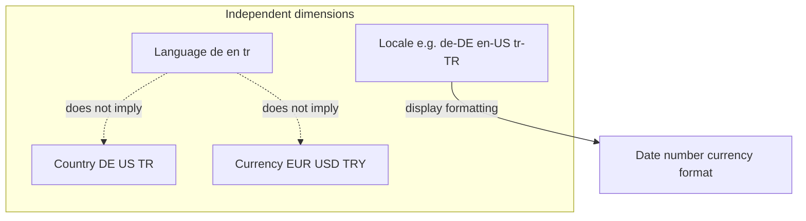
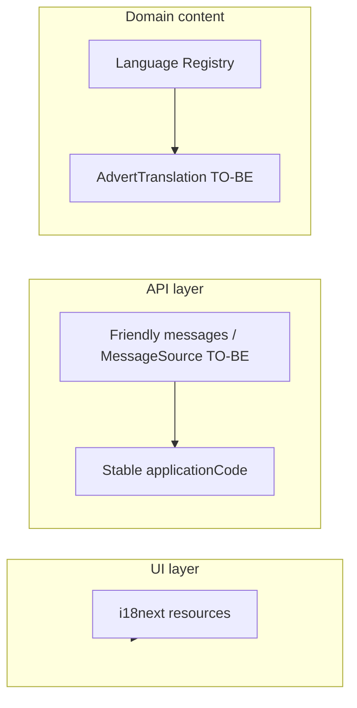

# Internationalization & Localization Architecture

**Canonical** architecture overview for multilingual behaviour. **Do not duplicate** the Language Registry specification — that remains authoritative in:

| Topic | Canonical document |
|-------|-------------------|
| Language Registry design (ARCH-2) | [LANGUAGE-REGISTRY-DESIGN.md](../domain/LANGUAGE-REGISTRY-DESIGN.md) |
| M1 implementation status | [LANGUAGE-REGISTRY-M1-IMPLEMENTATION-STATUS.md](../domain/LANGUAGE-REGISTRY-M1-IMPLEMENTATION-STATUS.md) |
| Product rules (DEC-007) | [PRODUCT_DECISIONS.md](../../08-project-management/PRODUCT_DECISIONS.md) §8 |
| Developer strategy summary | [I18N_STRATEGY.md](../../04-development/I18N_STRATEGY.md) |
| Public API content language | [ADR-002](../ADR/ADR-002-public-read-api.md) |
| Errors vs codes | [ERROR_HANDLING.md](../../04-development/ERROR_HANDLING.md), [API-ARCHITECTURE.md](../api/API-ARCHITECTURE.md) |
| Registry vs Redis cache | [CACHING-PERFORMANCE-ARCHITECTURE.md](../performance/CACHING-PERFORMANCE-ARCHITECTURE.md) |

**Labels:** AS-IS, **APPROVED**, TO-BE, FUTURE, TBD, **PROPOSAL** (registry design doc status).

---

## 1. Supported languages and defaults (APPROVED)

| Dimension | Approved initial set / policy |
|-----------|------------------------------|
| **Content & registry languages** | `de`, `en`, `tr` (DEC-007, Flyway V3 seed) |
| **Default product language** | **German (`de`)** — **APPROVED** target for UI/API message fallback and primary market framing |
| **Independence** | **Language**, **locale**, **country**, and **currency** are **separate** concepts |

**Figure RE-FIG-I18N-ARCH-001** — Language vs locale vs country vs currency (APPROVED model).

**Caption:** A user's language preference must not automatically set country or currency.

**Explanation:** Multiple locales may map to one language; one country may have multiple languages — do not assume 1:1 mappings.

### AS-IS gaps vs approved default

| Area | AS-IS | APPROVED TO-BE |
|------|--------|----------------|
| API friendly-message null language | `FriendlyMessageUtils` → **`EN`** if empty | Deterministic **`de`** fallback (with registry-backed UI codes) |
| Frontend i18next init | `localStorage` → `navigator.language` → **`en`** | **`de`** product default when no explicit user choice (**TBD** migration) |
| `FriendlyMessage_de.properties` | May be missing / incomplete | Full **de** bundle coverage |
| Registry seed order | `de` sort_order **10** (first) | Aligns with German-first catalog ordering |

---

## 2. BCP 47 and locale canonicalization (APPROVED)

**Standard:** [BCP 47](https://www.rfc-editor.org/rfc/rfc5646) language tags for registry and API validation.

| Stage | Behaviour (M1 implemented in registry foundation) |
|-------|-----------------------------------------------------|
| Syntax | `LanguageTagSyntaxValidator` + `LanguageCodeCanonicalizer` — trim, lowercase subtags |
| Registry lookup | `requireActive` / `supports` after canonicalization |
| Public content | **Exact** registry `code` with `is_content_supported`; **no** parent fallback (DEC-007) |
| Unsupported tag | Fail closed in registry API (`UnsupportedLanguageException` pattern) |

**AS-IS:** Canonicalizer exists; **legacy** controllers still bind **`Language` enum** (`EN`/`TR`/`DE` uppercase paths) for messages — **not** registry-backed.

**Library choice for full ICU/Locale matching (e.g. JDK `Locale.forLanguageTag` vs dedicated lib):** **TBD** where not already implemented.

**Business preference** (user-selected UI language) remains **separate** from tag canonicalization.

---

## 3. Backend localization (APPROVED direction)

| Concern | APPROVED TO-BE | AS-IS |
|---------|----------------|--------|
| Mechanism | Spring **`MessageSource`** (module-organized bundles) | `ResourceBundle` + `FriendlyMessageUtils` — **no** `MessageSource` bean |
| Locales | `de`, `en`, `tr` | `FriendlyMessage_en.properties`, `FriendlyMessage_tr.properties` |
| Stable codes | `FriendlyMessageCodes` / `applicationCode` — **independent** of translated text | **AS-IS** numeric enum codes |
| HTTP status | Separate from message text | **AS-IS** |
| Errors | RFC 9457 Problem Details + stable `applicationCode` | `InternalApiResponse` / `ApiErrorResponse` |

**Rules:**

- Frontend/clients use **codes** for branching — **not** parsed translated strings.
- Business rules stay in application/domain — **not** in `.properties` files.
- Effective message locale follows request/user resolution (§7); **TO-BE** fallback **de**.

Path `{language}` on legacy routes today = **friendly-message locale** (enum), **not** advert content language — see [I18N_STRATEGY.md](../../04-development/I18N_STRATEGY.md) §3.

---

## 4. Frontend localization (APPROVED direction)

| Item | Direction | AS-IS (CRA frontend — read-only) |
|------|-----------|----------------------------------|
| Library | **i18next** + `react-i18next` | Present (`Frontend/src/locales/`) |
| Resources | `en`, `tr`, `de` JSON by feature/module where practical | Flat `translations/*.json` |
| Detection | User selector + `localStorage` + browser | `localStorage.getItem("lang")` \|\| `navigator.language` |
| Formatting | Locale-aware **Intl** / i18n formatters for date, number, currency | **TBD** uniform usage |
| vs UGC | UI strings ≠ advert/listing **content** translations | Distinct (DEC-007) |

**API errors:** Display `detail` from API; business logic uses **`applicationCode`** when RFC 9457 lands — not message text parsing.

---

## 5. Language Registry (preserve M1 — do not duplicate)

**Single registry** — platform module; PostgreSQL `languages` + in-memory snapshot.

**M1 preserved behaviour** ([LANGUAGE-REGISTRY-M1-IMPLEMENTATION-STATUS.md](../domain/LANGUAGE-REGISTRY-M1-IMPLEMENTATION-STATUS.md)):

| Item | Status |
|------|--------|
| Flyway **V3** seed `de`, `tr`, `en` | **Implemented** |
| `ApplicationReadyEvent` → `reloadSnapshot()` | **Implemented**; startup fails on error |
| State | `AtomicReference<LanguageRegistrySnapshot>` — **not** Spring Cache |
| Capabilities | `UI_MESSAGE`, `ADVERT_CONTENT` |
| Out of M1 scope | Public P1/P2 wiring, `AdvertTranslation`, admin CRUD, enum route migration |

**Ownership / lifecycle:** See [LANGUAGE-REGISTRY-DESIGN.md](../domain/LANGUAGE-REGISTRY-DESIGN.md) — **do not** create a competing registry.

---

## 6. Language Registry and caching (preserve distinction)

| Concern | Policy |
|---------|--------|
| Registry snapshot | **In-memory** on each JVM — **M1 AS-IS** |
| Redis / Spring Cache | **Not required** for registry M1 ([CACHING-PERFORMANCE-ARCHITECTURE.md](../performance/CACHING-PERFORMANCE-ARCHITECTURE.md)) |
| Multi-instance coherence | **Unresolved** — OPEN in registry design §7.4 |
| Do **not** silently fix via Redis | Future options only: restart sync, admin refresh API, versioned snapshot, **FUTURE** event-based reload |

Post-commit `reloadSnapshot()` on admin updates remains **TO-BE** (design §7.3); M1 seed-only data.

---

## 7. User language preferences (APPROVED direction)

| Actor | Storage | AS-IS |
|-------|---------|--------|
| **Logged-in user** | **Identity** module — persisted preference | **No** `User` language field verified |
| **Guest** | Browser / `localStorage` (frontend) | `localStorage` key `lang` |
| **Effective locale** | Deterministic resolution — **full precedence TBD** | Mixed path enum + browser |

**Rules:** Changing UI language must **not** change advert **content language**, country, or currency without explicit user action.

Possible resolution inputs (order **not mandatory** until PO/engineering approves): explicit request path (legacy enum), authenticated profile, `Accept-Language` (**TBD**), product default **`de`**.

---

## 8. Date, number and currency formatting (APPROVED)

| Layer | Rule |
|-------|------|
| Storage | Business values in DB — e.g. `Advert.price` AS-IS `Double` (**TO-BE** money type **TBD**) |
| Currency | Explicit currency code with monetary amounts when modeled — **do not** infer from UI language alone |
| Display | Locale-aware formatting only in presentation (API DTO formatting or frontend **Intl**) |
| Finance | Avoid float for money calculations (**TO-BE**); no exchange-rate conversion in localization layer |
| Timestamps | Define timezone semantics per field (UTC instants vs local dates) — **TBD** catalog-wide policy |

Formatting changes **display** only — not underlying business instants/amounts.

---

## 9. User-generated content (APPROVED)

| Rule | Statement |
|------|-----------|
| Store | **Original** user content preserved |
| Overwrite | **Do not** auto-replace original with translations |
| Translations | Separate rows (`AdvertTranslation` TO-BE) with explicit language + provenance |
| Publication | Review/approval per language (DEC-007 lifecycle) |
| Distinction | UI i18n ≠ listing content translations |

**AS-IS:** `Advert.title` / `description` / `slug` monolingual columns until ARCH-2 migration.

---

## 10. AI-assisted translation (FUTURE)

**Not implemented.** Considerations only:

- Provider abstraction; source/target language; link to original content
- Translation version/status; human review gate
- Cost/usage tracking; retry/failure; consent/privacy; provenance metadata
- `is_translation_supported` registry flag — **M2** in design doc

**No** approved AI vendor; **no** new implemented AI module.

---

## 11. SEO and localized public content (TO-BE — pointer only)

**Canonical SEO / public web surface:** [FRONTEND-ARCHITECTURE.md](../frontend/FRONTEND-ARCHITECTURE.md) §10.

Align with **Next.js** TO-BE client ([SAD-001](../SAD/SAD-001-system-context.md)) and **language-scoped slugs** (DEC-007).

- Localized URLs, `hreflang`, canonical URLs, sitemaps, structured data — detailed in FRONTEND-ARCHITECTURE
- **Original vs translated** public content visibility (404 when missing — ADR-002)

**Do not** claim translated content automatically improves ranking.

---

## 12. Testing and quality (TO-BE / partial AS-IS)

| Area | AS-IS evidence | TO-BE |
|------|----------------|--------|
| Registry canonicalization | Unit + PostgreSQL acceptance tests | — |
| BCP 47 edge cases | `LanguageCodeCanonicalizerTest` | Expand with locale matching **TBD** |
| Missing translations (public) | Registry only — no public routes | 404 tests per ADR-002 |
| Friendly message fallback | **Gap** (EN vs de target) | Assert **de** fallback |
| Frontend i18n coverage | Manual | Missing-key detection **TBD** |
| Multi-instance registry | N/A single JVM | Coherence tests **FUTURE** |
| Error code stability across languages | Enum codes stable | RFC 9457 contract tests |

---

## 13. Concept separation summary

**Figure RE-FIG-I18N-ARCH-002** — Three localization concerns (APPROVED).

**Caption:** UI strings, API messages, and advert content use different resolution paths.

**Explanation:** Public `{language}` on P1/P2 is **content language**; legacy `{language}` enum paths are **message locale** until migration.

## Change history

| Version | Date | Summary |
|---------|------|---------|
| 0.1.0 | 2026-11-18 | Initial i18n/l10n architecture (Group 8); preserves Language Registry M1 |
| 0.1.1 | 2026-11-18 | SEO §11 pointer to FRONTEND-ARCHITECTURE (Group 12) |