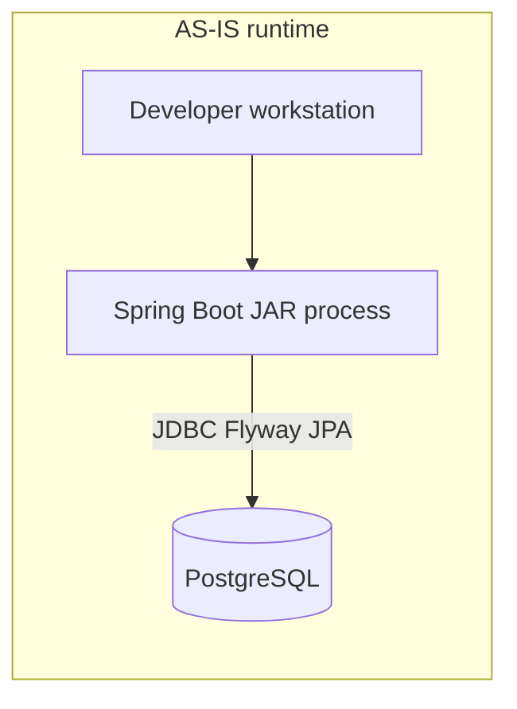
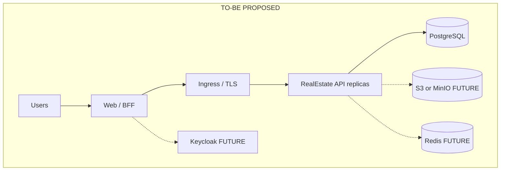
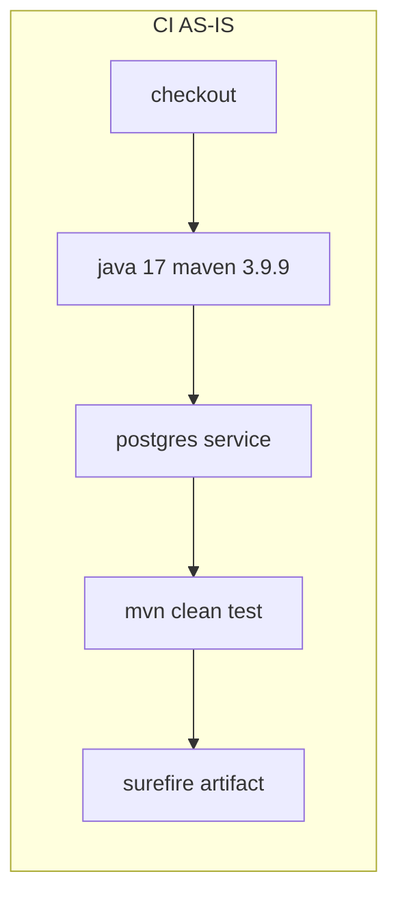
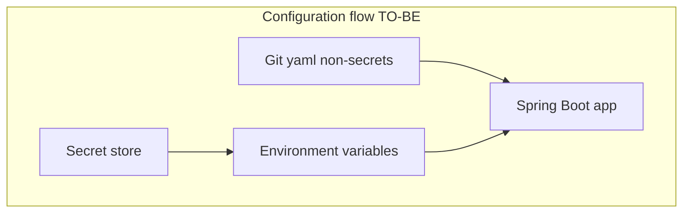

# Infrastructure, DevOps & Deployment Architecture

**Canonical** reference for packaging, environments, CI/CD, configuration, and operational boundaries. Operational runbooks: [RUNBOOK.md](../../06-operations/RUNBOOK.md), [MONITORING.md](../../05-infrastructure/MONITORING.md).

**Cross-references (detail lives elsewhere):**

| Topic | Document |
|-------|----------|
| Modular monolith deployable | [HLD-001](../HLD/HLD-001-containers.md), [ADR-001](../ADR/ADR-001-modular-monolith.md) |
| System context | [SAD-001](../SAD/SAD-001-system-context.md) |
| Stack versions | [TECHNOLOGY_BASELINE.md](../../05-infrastructure/TECHNOLOGY_BASELINE.md) |
| Integrations | [INTEGRATIONS.md](../../05-infrastructure/INTEGRATIONS.md) |
| PostgreSQL / Flyway | [PERSISTENCE-ARCHITECTURE.md](../database/PERSISTENCE-ARCHITECTURE.md) |
| Object storage | [FILE-STORAGE-ARCHITECTURE.md](../storage/FILE-STORAGE-ARCHITECTURE.md) |
| Redis | [CACHING-PERFORMANCE-ARCHITECTURE.md](../performance/CACHING-PERFORMANCE-ARCHITECTURE.md) |
| Security / secrets | [SECURITY-ARCHITECTURE.md](../security/SECURITY-ARCHITECTURE.md) |
| CI tests | [TESTING-ARCHITECTURE.md](../testing/TESTING-ARCHITECTURE.md) |
| Web client deploy (CRA / Next.js TO-BE) | [FRONTEND-ARCHITECTURE.md](../frontend/FRONTEND-ARCHITECTURE.md) §1, §12–§13 — **no** frontend CI AS-IS |

**Labels:** **AS-IS**, **TO-BE**, **PROPOSED**, **TBD**, **FUTURE**, **LEGACY** (README/marketing drift).

---

## 1. Infrastructure principles (APPROVED)

- **One** Spring Boot **modular monolith** JAR — not six network services.
- Infrastructure concerns stay in **infrastructure** adapters; domain remains free of deployment types.
- Environments must be **reproducible** (documented Postgres, env vars, Flyway).
- **Configuration externalized**; **secrets never in Git** (use `.env` locally, CI/org secrets in TO-BE).
- **Immutable** release artifacts once built (TO-BE tagging policy).
- **Flyway** forward-only, versioned migrations ([PERSISTENCE-ARCHITECTURE.md](../database/PERSISTENCE-ARCHITECTURE.md)).
- Infra changes reviewable (Git + optional IaC **FUTURE**).
- Local dev remains manageable: Compose for Postgres; app often on host JVM.

**No microservices** or multi-artifact split without explicit product/architecture decision.

---

## 2. Deployment architecture

### AS-IS (verified)

| Item | Evidence |
|------|----------|
| Packaging | Maven `jar` (default) + `spring-boot-maven-plugin` → executable Spring Boot JAR (`pom.xml`) |
| Deploy model | Developer runs JVM locally (`server.port` **8080**); **no** app container in repo |
| Runtime instances | Single process; horizontal scale **not** configured |
| Staging / production | **No** deployment manifests, **no** CD workflow in repository |
| Reverse proxy / ingress | **Not** in repository |

**Figure RE-FIG-INFRA-ARCH-001** — AS-IS deployment (local-centric).

**Caption:** Application is not containerized in this repository today.

**Explanation:** Compose provides **database only**; the API runs outside Compose unless teams adopt a future app image.

### TO-BE topology (PROPOSED — not deployed)

- One or more **stateless** backend instances behind a reverse proxy / ingress.
- Shared **PostgreSQL** (managed or self-hosted).
- **External** object storage (MinIO dev / S3 prod), Redis, Keycloak per [INTEGRATIONS.md](../../05-infrastructure/INTEGRATIONS.md) — **FUTURE** wiring.

**Figure RE-FIG-INFRA-ARCH-002** — Target deployment topology (dashed = not in repo).

### Environment ladder

| Environment | AS-IS | TO-BE |
|-------------|--------|--------|
| Workstation | JVM + Compose Postgres (`compose.yaml`, `.env.example`) | Same + optional app Docker image |
| CI | GitHub Actions Ubuntu + Postgres service | Add package/scan stages **PROPOSED** |
| Development / Staging / Production | **Not defined** in repo | **TBD** hosting & promotion |

---

## 3. Maven and application packaging (AS-IS)

| Item | Verified value |
|------|----------------|
| Java | **17** (`java.version`) |
| Spring Boot parent | **4.1.2** (`pom.xml`) |
| Artifact | `com.prettier:real-estate:1.0.0` |
| Packaging | **jar** (default) |
| Executable repackage | `spring-boot-maven-plugin` |
| Tests | `maven-surefire` via `mvn test` only — **no** Failsafe profile |
| Maven Wrapper | **`mvnw` / `mvnw.cmd` present** |
| Profiles in `application.yaml` | `spring.profiles.active: **localhost**` |

**Documentation discrepancy (recorded, not fixed in pom):**

| Source | Spring Boot claim |
|--------|-------------------|
| **`pom.xml` (authority for runtime)** | **4.1.2** |
| `TECHNOLOGY_BASELINE.md` (before Group 10 sync) | Incorrectly cited **3.5.16** |
| `README.md` | **LEGACY** “Spring Boot 3.0” |
| `effective-pom-3516` (untracked) | Historical **3.5.16** effective POM artifact — **not** current parent |
| `M1-IMPLEMENTATION-PLAN.md` | References older **3.0.0** stack — **stale** vs current pom |

**jjwt:** **0.12.7** in pom (baseline previously cited 0.11.5). **springdoc:** **3.2.0** (baseline previously 2.10.0).

**Health:** `spring-boot-starter-actuator` on classpath; actuator endpoint exposure largely **commented** in `application.yaml` — see [MONITORING.md](../../05-infrastructure/MONITORING.md).

---

## 4. Docker architecture

| Artifact | AS-IS |
|----------|--------|
| `Dockerfile` | **Not found** |
| `.dockerignore` | **Not found** |
| `compose.yaml` | **PostgreSQL 16 only** — `name: realestate-backend`, volume `realestate_pg_data` |
| App container | **None** |
| MinIO / Redis / Keycloak in Compose | **None** |

**Compose Postgres:** port `127.0.0.1:${POSTGRES_PORT}:5432` (`.env.example` suggests **5433** host port); healthcheck `pg_isready`.

**TO-BE image recommendations (PROPOSED — no file changes):**

- Multi-stage build (Maven build → slim JRE runtime).
- Non-root user, pinned base image digest.
- **No secrets** in layers; config via env at runtime.
- Image vulnerability scanning in CI **FUTURE**.

---

## 5. CI/CD architecture

### Terminology

| Term | AS-IS repo |
|------|------------|
| **Continuous Integration** | **Yes** — compile + test on GitHub Actions |
| **Continuous Delivery** | **No** — no artifact publication or deploy job |
| **Continuous Deployment** | **No** |

### AS-IS workflow (`.github/workflows/backend-ci.yml`)

- **Triggers:** push to `feature/boot-3.5.16`, `feature/boot-4.1.2`, `Fatih`; PRs to `Fatih`; `workflow_dispatch`
- **Not triggered:** current branch `feature/b2.1-advert` (**OPEN-INFRA-02**)
- **Job:** `mvn -B clean test`
- **Service:** `postgres:16-alpine` on port **5432** (credentials in workflow env — non-prod placeholders)
- **Env injected:** `SPRING_DATASOURCE_*` only — **no** `JWT_SECRET` at workflow level (tests override locally)
- **Caching:** Maven cache via `setup-java`
- **Artifacts:** Surefire reports upload
- **Missing:** `mvn package` verification, security scan, image build, deploy, environment gates

**Figure RE-FIG-INFRA-ARCH-003** — Implemented CI stages only.

### TO-BE pipeline stages (PROPOSED — not implemented)

1. Checkout  
2. Compile  
3. Unit tests (Surefire)  
4. Integration tests (Failsafe or tagged — **TBD**)  
5. ArchUnit (**PROPOSED**)  
6. Static analysis / quality (**TBD**)  
7. Dependency & container scan (**FUTURE**)  
8. `mvn package`  
9. Container image build (**FUTURE**)  
10. Registry push (**FUTURE**)  
11. Staging deploy + smoke (**FUTURE**)  
12. Production approval + deploy (**FUTURE**)

Dashed stages are conditional on hosting and release policy decisions.

---

## 6. Branching and release strategy

**AS-IS (observed):**

- Active feature work on `feature/b2.1-advert` (and historical boot upgrade branches).
- CI watches **Fatih** and specific feature branches — **not** all `feature/*`.
- No documented release tags or SemVer automation in repo.

**TO-BE (PROPOSED — requires team agreement):**

- PRs into agreed integration branch; protected main.
- Semantic versioning for `real-estate` artifact **TBD**.
- Immutable build promotion staging → prod **TBD**.
- Hotfix branch policy **TBD**.

Do **not** assume GitFlow unless adopted and documented in `DECISION_LOG`.

---

## 7. Environment and configuration strategy

### Configuration layers

| Layer | AS-IS |
|-------|--------|
| `application.yaml` | Multi-document YAML; default profile **`localhost`** |
| Profile | `spring.config.activate.on-profile: localhost` block — datasource from **env vars** |
| `.env.example` | `POSTGRES_*`, `JWT_SECRET` placeholders — copy to gitignored `.env` |
| Spring Cloud Config | `spring.cloud.config.uri: http://localhost:8080` — **no** config server verified; likely **placeholder** |

### Precedence (Spring Boot)

Environment variables / system properties override `application.yaml` (standard Spring order).

**CI:** Workflow sets `SPRING_DATASOURCE_*`; local Compose uses `.env` for Postgres port **5433** vs CI **5432** — document for developers ([TESTING-ARCHITECTURE.md](../testing/TESTING-ARCHITECTURE.md) OPEN-TEST-02).

### Non-secrets vs secrets

| Kind | Examples | Storage |
|------|----------|---------|
| Non-secret | `server.port`, CORS policy, logging levels | Git-tracked yaml **TO-BE** tighten prod |
| Secret | `JWT_SECRET`, `POSTGRES_PASSWORD` | `.env` local; GitHub Secrets **TO-BE**; Vault **FUTURE** |

**Figure RE-FIG-INFRA-ARCH-004** — Externalized config and secrets (target pattern).

**Never** document actual secret values.

---

## 8. Secrets management

| Approach | Status |
|----------|--------|
| Committed secrets | **Must not** — `.env` gitignored pattern |
| `.env.example` | Placeholders only |
| `JWT_SECRET` | Required at runtime via env (`application.yaml` reference) |
| GitHub Actions secrets | **Not used** in current workflow for JWT |
| HashiCorp Vault | **Not** in repository — **FUTURE** option |

**TO-BE:** Least-privilege CI `permissions: contents: read` (**AS-IS**); rotate JWT and DB credentials per environment; audit secret access **TBD**.

---

## 9. Database and migration deployment

Aligned with [PERSISTENCE-ARCHITECTURE.md](../database/PERSISTENCE-ARCHITECTURE.md):

| Rule | Deployment implication |
|------|-------------------------|
| Flyway **enabled** at startup (`spring.flyway.enabled: true`) |
| V1–V3 **immutable** | New migrations only via new version files |
| Forward-only | Rollback = **forward-fix** migration, not Flyway undo by default |
| Expand–contract | App **N** and **N+1** may coexist during rollout **TBD** playbook |

**Ordering:** Start app → Flyway migrate → JPA `validate`. Failed migration **blocks** startup.

**App rollback ≠ DB rollback:** Reverting an old JAR does not revert schema; coordinate migration compatibility explicitly.

---

## 10. Kubernetes and orchestration (FUTURE / PROPOSED)

**AS-IS:** No `k8s/`, Helm charts, Kustomize, Terraform, Traefik, or Gateway API manifests in repository.

**TO-BE direction (documentation elsewhere — not deployed):**

| Layer | Role |
|-------|------|
| **Terraform** | Cloud networking, managed Postgres, IAM **FUTURE** |
| **Kubernetes** | Run stateless API pods **FUTURE** |
| **Helm** | Package chart for monolith + config **FUTURE** |
| **Ingress / Gateway API / Traefik** | TLS termination, routing **TBD** provider |

**Probes:** Actuator health for `liveness`/`readiness` **TO-BE** when exposure configured.

**Still one deployable** — do not split modules into separate K8s services without ADR.

---

## 11. Infrastructure integrations (status summary)

| System | Deploy AS-IS | See |
|--------|--------------|-----|
| PostgreSQL | Local Compose + CI service | This doc §4 |
| MinIO / S3 | **Not deployed** | FILE-STORAGE-ARCHITECTURE |
| Redis | **Not deployed** | CACHING-PERFORMANCE-ARCHITECTURE |
| Keycloak | **Not deployed** | SECURITY-ARCHITECTURE, INTEGRATIONS |
| Email SMTP | **Not wired** | INTEGRATIONS |
| Monitoring | Actuator partial; Prometheus **FUTURE** | [MONITORING.md](../../05-infrastructure/MONITORING.md), [OBSERVABILITY-RELIABILITY-ARCHITECTURE.md](../operations/OBSERVABILITY-RELIABILITY-ARCHITECTURE.md) |

---

## 12. Deployment safety and reliability (TO-BE)

| Practice | Status |
|----------|--------|
| Health checks before traffic | **TBD** (actuator exposure) |
| Graceful shutdown | Spring Boot default **assumed**; K8s `preStop` **FUTURE** |
| Rolling updates | **FUTURE** with orchestrator |
| Migration safety gates | Manual discipline + Flyway **AS-IS** |
| Smoke tests post-deploy | **FUTURE** |
| Artifact traceability (git sha in build) | **Not** in CI today |

Zero-downtime **not** claimed for current single-instance model.

---

## 13. Infrastructure security (summary)

Cross-reference [SECURITY-ARCHITECTURE.md](../security/SECURITY-ARCHITECTURE.md):

- TLS at ingress **TO-BE**; local HTTP AS-IS.
- Network boundaries between public API, DB, future Redis/S3 **TBD**.
- CI `permissions: contents: read` **AS-IS**.
- Dependency scanning **not** in workflow.
- CORS `*` in yaml — production hardening **TO-BE**.

---

## 14. Risks and open decisions

| ID | Topic |
|----|--------|
| OPEN-INFRA-01 | Target hosting (VM vs K8s vs PaaS) |
| OPEN-INFRA-02 | CI branch filters vs active `feature/b2.1-advert` |
| OPEN-INFRA-03 | Application Docker image — absent |
| OPEN-INFRA-04 | CD vs CI-only |
| OPEN-INFRA-05 | Container registry and image promotion |
| OPEN-INFRA-06 | Staging/production environment definition |
| OPEN-INFRA-07 | Terraform state backend and ownership |
| OPEN-INFRA-08 | Vault vs GitHub Secrets only |
| OPEN-INFRA-09 | Flyway + blue/green coordination |
| OPEN-INFRA-10 | Local Postgres port 5433 vs CI 5432 standardization |
| OPEN-INFRA-11 | README / M1 plan stack version drift vs `pom.xml` 4.1.2 |

## Change history

| Version | Date | Summary |
|---------|------|---------|
| 0.1.0 | 2026-11-18 | Initial infrastructure & deployment architecture (Group 10) |