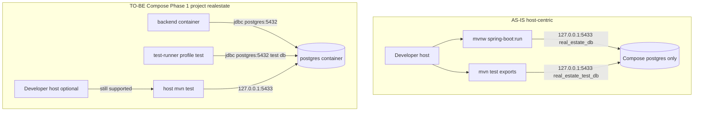
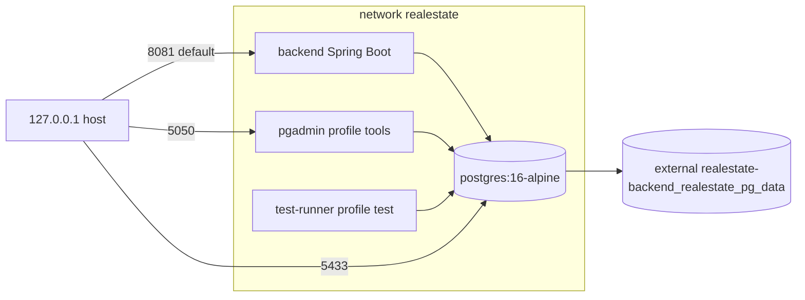
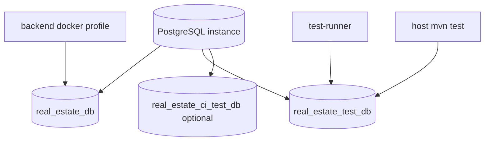
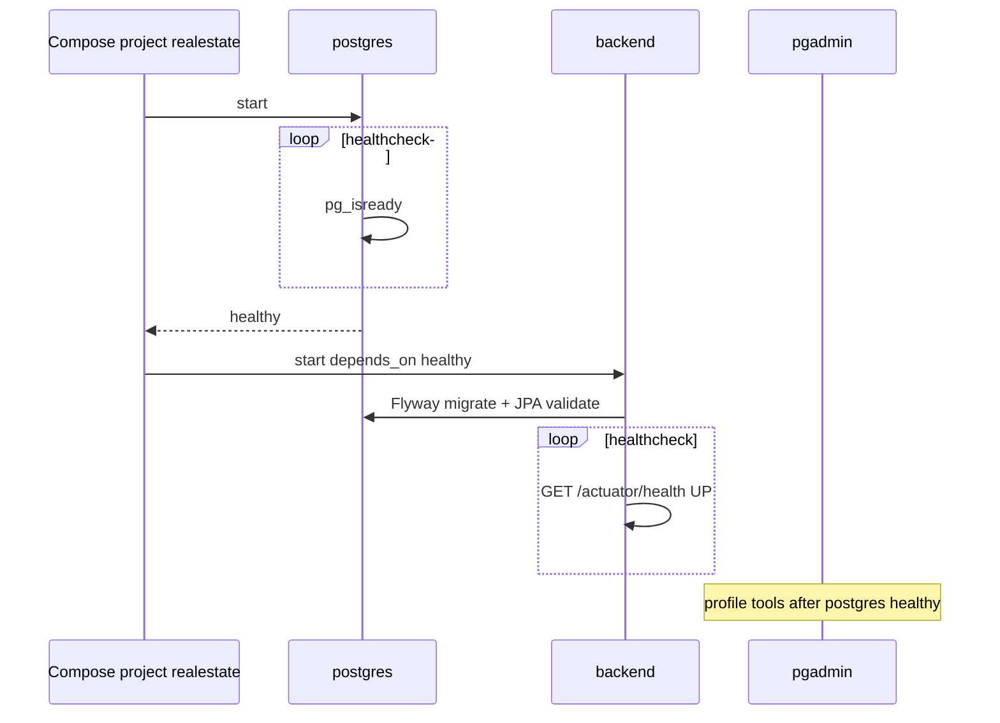

# Docker Compose — local development architecture

**Scope:** Phase 1 — project **`realestate`**; services `postgres`, `backend`, optional `pgadmin` (profile `tools`), `test-runner` (profile `test`). Future `frontend` may join the same project. No Redis, Keycloak, MinIO, or other services (not required by AS-IS code).

**Volume safety:** Logical key `realestate_pg_data` is an **external** pin to physical volume `realestate-backend_realestate_pg_data`. **Never** `docker compose down -v` or `docker volume rm`.

---

## 1. AS-IS versus TO-BE runtime

| Aspect | AS-IS (pre Phase 1) | TO-BE (Phase 1) |
|--------|---------------------|-----------------|
| Postgres | Compose only | Same **external** volume + init hook for **new** volumes |
| API | Host JVM `mvnw spring-boot:run` | **Also** `backend` container (profile `docker`) |
| JDBC (dev) | `127.0.0.1:5433` | Container: `postgres:5432`; host workflow unchanged |
| Integration tests | Host `mvn test` + exported env | **Also** `docker compose --profile test run --rm test-runner` |
| DB admin | External / ad hoc | pgAdmin (profile `tools`, `127.0.0.1`) |
| CI | GHA Postgres service | **Unchanged** (not Compose) |



**Figure RE-FIG-DOCKER-001** — AS-IS vs TO-BE local runtime.

---

## 2. Compose service topology



**Figure RE-FIG-DOCKER-002** — Service topology (published ports localhost only).

| Service | Default `up` | Port (host) |
|---------|--------------|-------------|
| `postgres` | yes | `127.0.0.1:${POSTGRES_PORT}` → 5432 |
| `backend` | yes | `127.0.0.1:${BACKEND_PORT:-8081}` → 8080 |
| `pgadmin` | profile `tools` | `127.0.0.1:${PGADMIN_PORT}` → 80 |
| `test-runner` | profile `test` (one-shot) | none |

Container names are **Compose-generated** (for example `realestate-backend-1`) — no hardcoded `container_name`. Prefer `docker compose exec postgres …` over fixed names.

---

## 3. Development vs integration-test database isolation

| Database | Purpose | JDBC from `backend` | JDBC from `test-runner` / host `test` |
|----------|---------|---------------------|----------------------------------------|
| `real_estate_db` | Development + Flyway + `DataInitializer` | **yes** | **forbidden** (`PostgresIntegrationTestSupport` + runner script) |
| `real_estate_test_db` | Local integration tests | **no** | **yes** |
| `real_estate_ci_test_db` | CI parity / optional local | **no** | optional (CI uses GHA, not Compose) |

**New empty volume:** `docker/postgres/init/01-create-test-databases.sh` creates `real_estate_test_db` and `real_estate_ci_test_db` once.

**Existing volume (typical developer):** init **does not re-run**. Create test DB manually (approved procedure in [LOCAL_ENV.md](../../../../04-development/LOCAL_ENV.md) §5) — **do not** recreate the volume.



**Figure RE-FIG-DOCKER-003** — Database isolation.

---

## 4. Startup and health dependency flow



**Figure RE-FIG-DOCKER-004** — Startup order.

**Health endpoints:** `pg_isready` (Postgres); `GET /actuator/health` (`backend` — `permitAll` in `SecurityFilterChainConfig`; exposure enabled in `application-docker.yaml`).

---

## 5. Build note (Maven wrapper)

The repository contains `mvnw` / `mvnw.cmd` but **not** `.mvn/wrapper/`. The **Dockerfile** build stage and **test-runner** service use **Maven 3.9.9 + Temurin 17** from the official image (`mvn` on `PATH`). Host workflows may use a global `mvn` or restore the wrapper (`mvn wrapper:wrapper`) in a follow-up task.

---

## 6. Commands (reference)

```bash
# Development stack (postgres + backend)
docker compose up -d --build

# pgAdmin (optional)
docker compose --profile tools up -d pgadmin

# Integration tests inside Compose (requires real_estate_test_db + JWT_SECRET_TEST)
docker compose --profile test run --rm test-runner

# Host-based tests (unchanged) — export SPRING_* and JWT per LOCAL_ENV.md
mvn -B test
```

**Volume rule:** only one Postgres container may mount `realestate-backend_realestate_pg_data`. Never `down -v` or `docker volume rm`.

---

## Change history

| Version | Date | Summary |
|---------|------|---------|
| 1.0.0 | 2026-11-26 | Phase 1 Compose architecture diagrams and service contract |
| 1.1.0 | 2026-11-26 | Intermediate project `re`, service `api`, volume pin, host port 8081 |
| 1.2.0 | 2026-11-26 | Project `realestate`, service `backend`, external volume pin |
