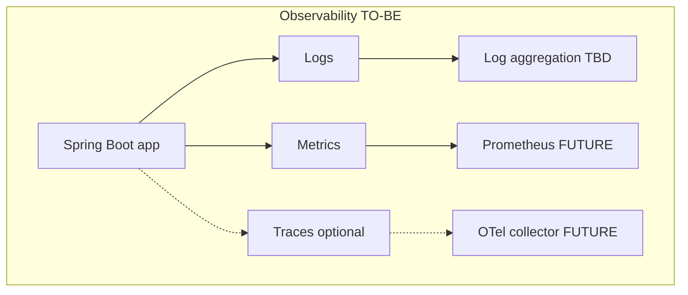
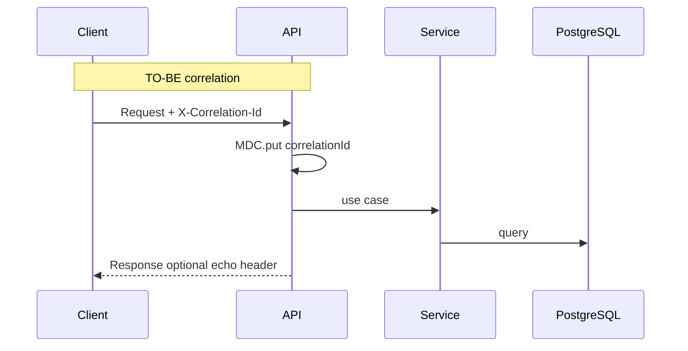
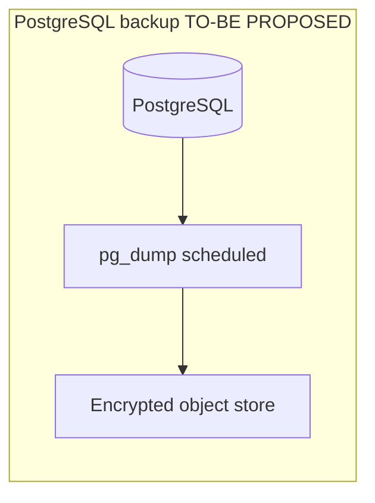
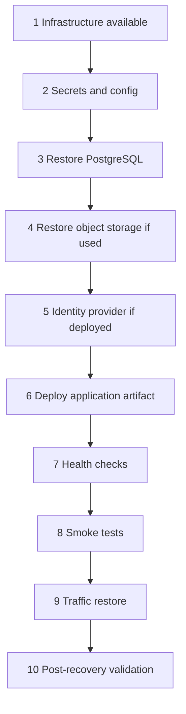

# Observability, Reliability & Backup Architecture

**Canonical** operational architecture. Short guides:

| Topic | Document |
|-------|----------|
| Monitoring summary | [MONITORING.md](../../05-infrastructure/MONITORING.md) |
| Runbook | [RUNBOOK.md](../../06-operations/RUNBOOK.md) |
| Backup / restore (proposal) | [BACKUP_RESTORE.md](../../05-infrastructure/BACKUP_RESTORE.md) |
| Disaster recovery (proposal) | [DISASTER_RECOVERY.md](../../05-infrastructure/DISASTER_RECOVERY.md) |
| Deployment / actuator | [INFRASTRUCTURE-DEPLOYMENT-ARCHITECTURE.md](../infrastructure/INFRASTRUCTURE-DEPLOYMENT-ARCHITECTURE.md) |
| Persistence / Flyway | [PERSISTENCE-ARCHITECTURE.md](../database/PERSISTENCE-ARCHITECTURE.md) |
| Object storage ops | [FILE-STORAGE-ARCHITECTURE.md](../storage/FILE-STORAGE-ARCHITECTURE.md) §10 |
| Cache ops | [CACHING-PERFORMANCE-ARCHITECTURE.md](../performance/CACHING-PERFORMANCE-ARCHITECTURE.md) §10 |
| Security / audit | [SECURITY-ARCHITECTURE.md](../security/SECURITY-ARCHITECTURE.md) §8 |
| Events (non-audit) | [HLD-003](../HLD/HLD-003-event-driven-architecture.md) |

**Labels:** **AS-IS**, **TO-BE**, **PROPOSED**, **TBD**, **FUTURE**.

---

## 1. Operational principles (APPROVED direction)

- Observability supports diagnosis **without** logging secrets, tokens, or unnecessary PII.
- **Technical metrics/logs** are distinct from **business audit** and **security audit**.
- Logs, metrics, and traces are complementary — not interchangeable.
- **PostgreSQL** remains authoritative for persisted business state.
- Backup usefulness requires **tested restore** — not dump files alone.
- RPO/RTO are **targets** only when explicitly approved and validated (**not** guaranteed today).
- Failure handling (cache, storage, DB) must be **explicit** per architecture docs — not assumed.
- Avoid operational complexity disproportionate to a **single-deployable** modular monolith.

---

## 2. Observability model

| Pillar | Purpose | AS-IS | TO-BE / FUTURE |
|--------|---------|--------|----------------|
| **Logs** | Request/error diagnosis, support | Console plain text via Logback default; `com.prettier: DEBUG` in `application.yaml` | Structured JSON, correlation ID |
| **Metrics** | SLOs, capacity, alerting | Actuator on classpath; **no** Prometheus registry dependency in `pom.xml`; **no** scrape config | Micrometer → Prometheus **FUTURE** |
| **Traces** | Latency, dependency diagnosis | **None** configured | OpenTelemetry **FUTURE** (optional for monolith) |

Full cluster-wide tracing is **not mandatory** for one JVM; **correlation IDs** in logs suffice initially.

**Figure RE-FIG-OPS-ARCH-001** — Target observability stack (dashed = not deployed).

**Caption:** AS-IS collects logs to stdout only.

**Explanation:** External aggregation is an operational choice, not implemented in repo.

---

## 3. Logging architecture

### AS-IS (verified)

| Item | Evidence |
|------|----------|
| Logback XML | **Not found** — Spring Boot defaults |
| Level | `logging.level.com.prettier: DEBUG` (`application.yaml`) |
| Format | **Plain text** console (default) |
| Structured JSON | **No** |
| Correlation / MDC | **No** matches in `src/` |
| `traceId` in API errors | **FUTURE** per [ERROR_HANDLING.md](../../04-development/ERROR_HANDLING.md) |
| Exception logging | `@Slf4j` in handlers/managers; `GlobalExceptionHandler` |

### TO-BE (PROPOSED)

- JSON logs with `timestamp`, `level`, `application`, `environment`, **`correlationId`**, optional `traceId`
- Consistent timezone (**UTC** recommended **TBD**)
- Module or use-case context field where useful
- **Mask** passwords, JWTs, refresh tokens, `JWT_SECRET`, DB passwords, message bodies with PII

### Must not appear in logs

Passwords, tokens, API keys, full credit card data, private message content (unless explicitly approved and protected).

**Retention / access:** **TBD** — no approved retention period in repository.

---

## 4. Correlation and tracing

| Capability | AS-IS | TO-BE |
|------------|--------|--------|
| Request correlation ID | **Not implemented** | Filter or middleware generates/propagates `X-Correlation-Id` **PROPOSED** |
| MDC | **No** | Bind correlation ID in MDC |
| W3C Trace Context | **No** | With OpenTelemetry **FUTURE** |
| Sampling | N/A | **TBD** when tracing adopted |

Distributed tracing remains **FUTURE** unless product requires cross-service view (BFF + API later).

**Figure RE-FIG-OPS-ARCH-002** — Correlation flow (TO-BE PROPOSED).

---

## 5. Metrics and health checks

### AS-IS

| Item | Status |
|------|--------|
| `spring-boot-starter-actuator` | **Declared** (`pom.xml`) |
| `management.endpoints` exposure | Largely **commented** in `application.yaml` |
| Custom health indicators | **Not found** |
| `micrometer-registry-prometheus` | **Not** in `pom.xml` |
| Security | `GET /actuator/**` **`permitAll`** (`SecurityFilterChainConfig`) |

**Implication:** Health/metrics endpoints may be reachable without JWT when exposed by Boot defaults — **review for production** ([SECURITY-ARCHITECTURE.md](../security/SECURITY-ARCHITECTURE.md)).

### TO-BE signal catalogue (PROPOSED)

| Signal | Use |
|--------|-----|
| HTTP rate, errors, latency | SLO, alerting |
| JVM memory, GC, threads | Capacity |
| HikariCP pool | DB saturation |
| PostgreSQL connectivity | Readiness |
| Redis / MinIO | When deployed — dependency health, not necessarily readiness blocker |
| Outbox lag | **FUTURE** |

| Probe | Meaning |
|-------|---------|
| **Liveness** | Process up |
| **Readiness** | Can serve traffic (DB + critical deps) |
| **Dependency** | Optional components reported but may not fail readiness |

---

## 6. Alerting and operational response

**AS-IS:** No Alertmanager, PagerDuty, or on-call definitions in repository.

**PROPOSED principles:** actionable alerts, severity S1–S4 ([INCIDENT_MANAGEMENT.md](../../06-operations/INCIDENT_MANAGEMENT.md) draft), runbook link, deduplication, **no invented SLA response times**.

Cross-reference [RUNBOOK.md](../../06-operations/RUNBOOK.md), [TROUBLESHOOTING.md](../../06-operations/TROUBLESHOOTING.md).

---

## 7. Audit architecture

| Category | Owner / store | AS-IS |
|----------|---------------|--------|
| **Technical logs** | Platform / ops | Logback stdout |
| **Business audit** | **TBD** module (`audit` future) | `Log` **entity** + `LogRepository` exist; `LogController` — REST exposure **TBD**; **not** a complete audit product |
| **Security audit** | Identity / security | Login failures via handlers; **no** structured security event stream |
| **Infrastructure audit** | Cloud / Vault **FUTURE** | **None** |

**Spring Application Events** are **not** durable audit storage ([HLD-003](../HLD/HLD-003-event-driven-architecture.md)).

Durable audit (retention, integrity, legal hold) → **separate capability** — **FUTURE**.

---

## 8. Reliability and failure handling

Documented in sibling architectures — summary:

| Failure | AS-IS behaviour | Reference |
|---------|-----------------|-----------|
| PostgreSQL down | Startup/test failure; requests fail | Persistence, Flyway on startup |
| Pool exhaustion | Default Hikari behaviour | **TBD** explicit timeouts |
| Redis cache down | N/A — Redis **not** deployed | Cache doc: fail-open for read cache **TBD** |
| Object storage down | N/A — S3/MinIO **not** deployed | FILE-STORAGE |
| Keycloak down | N/A | SECURITY |
| Event handler failure | In-process only | HLD-003; no outbox **AS-IS** |
| Graceful shutdown | Spring Boot default | K8s `preStop` **FUTURE** |

**No** verified Resilience4j / circuit breaker in `pom.xml`. Do **not** assume retries in application code without reading the use case.

---

## 9. PostgreSQL backup and recovery

### AS-IS

| Item | Status |
|------|--------|
| Backup scripts in repo | **Not found** |
| `pg_dump` / WAL / PITR automation | **Not found** |
| Compose volume | `realestate_pg_data` — **local dev only**; **no** backup job |
| Documentation | [BACKUP_RESTORE.md](../../05-infrastructure/BACKUP_RESTORE.md) — **proposal** text only |

### TO-BE (PROPOSED — not implemented)

| Method | Role |
|--------|------|
| **Logical** (`pg_dump` / `pg_dumpall`) | Periodic full backup; simpler restore test |
| **Physical** + **WAL** archiving | Lower RPO; PITR — **TBD** requirement |
| Encryption at rest / in transit | **TBD** |
| Off-site copy | Separate failure domain |
| Restore drills | Quarterly **proposed** in BACKUP_RESTORE — **not** executed in repo |

Align migrations: restore DB then deploy app version compatible with schema (Flyway forward-only — [PERSISTENCE-ARCHITECTURE.md](../database/PERSISTENCE-ARCHITECTURE.md)).

**Figure RE-FIG-OPS-ARCH-003** — Logical backup path (not active in repo).

---

## 10. Object storage backup and recovery

**AS-IS:** Object storage **not** deployed.

**TO-BE** (when MinIO/S3 active — [FILE-STORAGE-ARCHITECTURE.md](../storage/FILE-STORAGE-ARCHITECTURE.md)):

- Versioning, replication, lifecycle rules **TBD**
- Recovery = **metadata in PostgreSQL** + **bytes in bucket** — coordinated restore
- Orphan detection — FILE-STORAGE §9 **FUTURE**

PG backup **does not** replace object binaries.

---

## 11. Other infrastructure backup scope

| Component | Deployed AS-IS | Backup scope |
|-----------|----------------|--------------|
| Keycloak | **No** | DB + realm export **FUTURE** |
| Vault | **No** | Snapshots **FUTURE** |
| Redis | **No** | Usually ephemeral cache; rate-limit state **TBD** |
| Terraform state | **No** IaC in repo | **FUTURE** |
| K8s / Helm | **No** | Git is source; cluster etcd backup **hosting** concern |
| CI workflows | Git | `.github/workflows` versioned |
| Release JAR | Local/CI `target/` | **TBD** artifact registry retention |

Distinguish **Git-tracked config** from **runtime state**.

---

## 12. RPO and RTO

| Item | Repository status |
|------|-------------------|
| Documented RPO/RTO values | [DISASTER_RECOVERY.md](../../05-infrastructure/DISASTER_RECOVERY.md): **RPO/RTO targets TBD** |
| NFR-BAK-001 | Procedures **TO-BE** |
| NFR-AVAIL-001 | 99.5% **proposal**, not measured |

**Engineering discussion candidates** (e.g. RPO **15 minutes**, RTO **4 hours**) appear in architecture review briefs but are **not approved**, **not** in `DECISION_LOG`, and **not validated** by restore tests.

| Term | Meaning |
|------|---------|
| **RPO** | Maximum acceptable **data loss** window |
| **RTO** | Target time to restore **service** |

Achieving numeric targets requires backup method, hosting, drills, and runbooks — **none verified AS-IS**.

---

## 13. Disaster recovery sequence (TO-BE PROPOSED)

**Figure RE-FIG-OPS-ARCH-004** — DR sequence (target playbook).

**Caption:** Full DR differs from rolling back a single JAR without DB coordination.

**Explanation:** No secondary region or provider documented in repository.

---

## 14. Risks and open decisions

| ID | Topic |
|----|--------|
| OPEN-OPS-01 | Structured JSON logging |
| OPEN-OPS-02 | Correlation ID propagation |
| OPEN-OPS-03 | Actuator exposure policy in production |
| OPEN-OPS-04 | Metrics backend (Prometheus vs managed) |
| OPEN-OPS-05 | Log aggregation (Loki/ELK/cloud) |
| OPEN-OPS-06 | OpenTelemetry adoption |
| OPEN-OPS-07 | Alert ownership and channels |
| OPEN-OPS-08 | Backup method (logical vs WAL/PITR) |
| OPEN-OPS-09 | Backup retention and encryption |
| OPEN-OPS-10 | Object storage DR when live |
| OPEN-OPS-11 | RPO/RTO approval and restore-test evidence |
| OPEN-OPS-12 | `Log` entity vs future audit module |
| OPEN-OPS-13 | DR environment / secondary site |

## Change history

| Version | Date | Summary |
|---------|------|---------|
| 0.1.0 | 2026-11-18 | Initial observability, reliability, backup architecture (Group 11) |