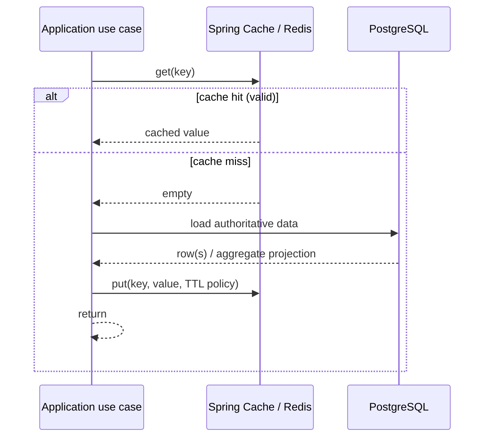
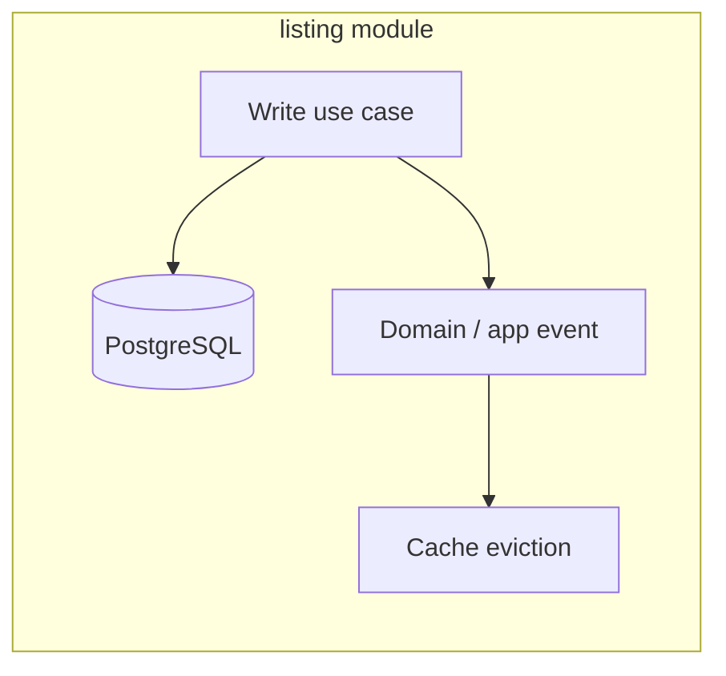

# Caching & Performance Architecture

**Canonical** reference for **application caching** (Redis + Spring Cache) and how it relates to performance, consistency, events and **separate** Redis uses (rate limiting). Related:

| Topic | Document |
|-------|----------|
| Source of truth / PostgreSQL | [PERSISTENCE-ARCHITECTURE.md](../database/PERSISTENCE-ARCHITECTURE.md) |
| Layers and ports | [HLD-002-clean-architecture.md](../HLD/HLD-002-clean-architecture.md) |
| Events, `AFTER_COMMIT`, outbox | [HLD-003-event-driven-architecture.md](../HLD/HLD-003-event-driven-architecture.md) |
| Public catalog + HTTP caching headers | [ADR-002](../ADR/ADR-002-public-read-api.md), [M1-PUBLIC-CATALOG-ARCHITECTURE-DECISIONS.md](../../08-project-management/M1-PUBLIC-CATALOG-ARCHITECTURE-DECISIONS.md) |
| Language registry in-memory snapshot | [LANGUAGE-REGISTRY-DESIGN.md](../domain/LANGUAGE-REGISTRY-DESIGN.md) §7 |
| Integrations | [INTEGRATIONS.md](../../05-infrastructure/INTEGRATIONS.md) |
| Security / rate limiting | [SECURITY-ARCHITECTURE.md](../security/SECURITY-ARCHITECTURE.md) §7 |
| NFRs | [NFR-CATALOGUE.md](../../02-requirements/NFR/NFR-CATALOGUE.md) |
| Observability | NFR-OBS-001/002 — Prometheus/Grafana **not** implemented |

**Labels:** AS-IS, **APPROVED**, TO-BE, FUTURE, TBD.

**Distinction:** This document covers **server-side application cache** (Redis + Spring Cache). **HTTP `Cache-Control`** on public responses is a **CDN/browser** concern — complementary, not a substitute for application cache policy.

---

## 1. Redis role and Spring Cache (APPROVED)

| Rule | Statement |
|------|-----------|
| **PostgreSQL** | **Source of truth** for persistent business data |
| **Redis** | Initial **distributed cache** infrastructure (TO-BE — **not deployed** AS-IS) |
| **Spring Cache** | Initial **application-level** caching abstraction (TO-BE) |
| **Cache entries** | **Disposable** — must be reconstructable from authoritative data |
| **Anti-pattern** | Redis must **not** become a second business database or replace PostgreSQL |

**AS-IS evidence:**

| Item | Status |
|------|--------|
| `spring-boot-starter-data-redis` / `spring-boot-starter-cache` in `pom.xml` | **Absent** |
| Redis in `application.yaml` | **Absent** |
| `docker compose` | **PostgreSQL only** (`compose.yaml`) |
| `@Cacheable` / `CacheManager` in `src/` | **Absent** |
| Platform language registry | **In-memory** `AtomicReference` snapshot — **not** Spring Cache / Redis ([LANGUAGE-REGISTRY-DESIGN.md](../domain/LANGUAGE-REGISTRY-DESIGN.md)) |

Redis may also host **infrastructure state** (rate limiting — §9). That use is **logically separated** from business caching.

---

## 2. Cache-Aside pattern (APPROVED initial)



**Figure RE-FIG-CACHE-001** — Cache-Aside read path (TO-BE).

**Caption:** Cache is an optimization layer, not authority.

**Explanation:** On miss, behavior must match a no-cache code path.

### Write / invalidation flow

1. Use case updates **PostgreSQL** in the owning module transaction.
2. **Invalidate** or refresh cache entries affected by the change (same module).
3. Subsequent reads reload from DB on miss.

| Rule | Statement |
|------|-----------|
| Authority | Cache is **never** authoritative for business state |
| Misses | Handled normally — no correctness dependency on hit |
| Negative caching | Avoid unless explicitly justified |
| Consistency | Cache-Aside does **not** guarantee **strong** consistency |

---

## 3. Cache candidates and scope (APPROVED — conservative)

**Principle:** Measure before caching. Each entry needs **owner module**, **key strategy**, **TTL**, and **invalidation** policy.

| Category | TO-BE eligibility (conditional) | Default |
|----------|----------------------------------|---------|
| Reference / catalog metadata | Stable read-heavy data with clear invalidation (e.g. geography, category trees) | **TBD** per feature — **not pre-approved** by name |
| Public catalog projections | Only after **measured** DB/latency pressure | **FUTURE** |
| User-specific data | Session, permissions, owned resource lists | **Do not cache initially** |
| Authorization / RBAC decisions | Role matrices, ownership outcomes | **Do not cache by default** |
| Security-sensitive payloads | Tokens, secrets, PII | **Must not** cache |

**AS-IS:** No application cache entries. Language registry uses a **module-local** in-memory snapshot (platform) — separate from Redis strategy; multi-instance coherence **OPEN** (LANGUAGE-REGISTRY-DESIGN §7.4). See [I18N-L10N-ARCHITECTURE.md](../i18n/I18N-L10N-ARCHITECTURE.md) §6 — **do not** conflate registry snapshot with Redis cache.

**Do not** list specific endpoints or queries as approved cache targets without measurement evidence.

---

## 4. Cache key design (APPROVED guidance)

Keys must be:

- **Namespaced** (module + use case)
- Free of **secrets**, tokens, unnecessary PII
- Stable for operations troubleshooting
- Collision-safe across modules and infrastructure Redis uses

**Illustrative** structure (example only — **not** a mandatory approved convention):

```text
<application>:<environment>:<module>:<use-case>:<identifier>
```

Example dimensions: content `language`, catalog `categoryId`, pagination cursor ids — include only what the cached value depends on.

**Rate-limit keys** use a **different namespace** (§9) — never share prefixes with `@Cacheable` regions.

---

## 5. TTL and expiration (APPROVED)

| Rule | Statement |
|------|-----------|
| Every entry | **Defined** expiration (no indefinite default) |
| Volatility | TTL reflects staleness tolerance |
| Invalidation vs TTL | **Complementary** — invalidation on writes; TTL as safety net |
| Stampede risk | Avoid synchronized mass expiration — consider **TTL jitter** (TO-BE) |

**Exact durations** (per module, per cache region): **TBD** — do not invent numbers without measurement or explicit approval.

---

## 6. Invalidation and domain events (APPROVED)

| Rule | Statement |
|------|-----------|
| Ownership | Module that **owns** the data **invalidates** cache derived from it |
| Cross-module | Consumers **do not** mutate another module's Redis keys — use **event contracts** or module APIs |
| Timing | Handlers that read committed DB state use **`@TransactionalEventListener(phase = AFTER_COMMIT)`** ([HLD-003](../HLD/HLD-003-event-driven-architecture.md)) |
| Spring Application Events | **In-process**, **non-durable** — **not** a guarantee across restarts |
| Fallback | TTL limits staleness if invalidation is missed |
| Durable invalidation | **FUTURE** — outbox or similar if required |



**Figure RE-FIG-CACHE-002** — Owning module invalidates its cache (TO-BE).

**Caption:** Invalidation follows successful persistence; prefer AFTER_COMMIT when reading DB.

**Explanation:** Other modules react through contracts; they invalidate **their own** denormalized caches only.

**AS-IS:** No cache invalidation handlers. `ApplicationReadyEvent` loads language snapshot at startup — not a cache invalidation pattern for business data.

---

## 7. Consistency and Redis failure behavior (APPROVED)

| Aspect | Model |
|--------|--------|
| Authority | **PostgreSQL** |
| Staleness | Possible within TTL / invalidation window |
| Invalidation | Reduces staleness; not strong consistency |
| Business invariants | Evaluated against **authoritative** data or trusted app state — **not** cache |
| Authorization | **Never** rely on cache as sole source |

**Fallback before production (TBD per use case):**

| Use case | Typical direction |
|----------|-------------------|
| Non-critical read cache | **Fail open** — bypass Redis, read DB; log degradation |
| Rate limiting / security infra | **TBD** — may require **fail closed** or proxy fallback per policy |
| Timeouts | Bounded Redis client timeouts to avoid cascade |

Do **not** approve one global fail-open/fail-closed rule for all Redis usages.

---

## 8. Stampede and performance controls (APPROVED awareness)

| Risk | Mitigation (conditional TO-BE) |
|------|-------------------------------|
| Thundering herd / cache stampede | TTL jitter; single-flight / request coalescing |
| DB load after mass expiry | Staggered TTL; warming **TBD** |
| Oversized values | Bounded entry size; store IDs not graphs |
| High-cardinality keys | Avoid unbounded key spaces |
| Memory / eviction | Redis `maxmemory-policy` **TBD** per environment |
| Repeated invalidation | Batch eviction where safe |
| Serialization cost | Prefer lean DTO projections |

**Order of operations:** Optimize queries and indexes ([PERSISTENCE-ARCHITECTURE.md](../database/PERSISTENCE-ARCHITECTURE.md) §8) **before** adding cache layers.

Advanced mitigations are **conditional**, not mandatory implementation.

---

## 9. Redis separation — application cache vs rate limiting (APPROVED)

Three **distinct** Redis conceptual uses:

| # | Use | Mechanism | Owner |
|---|-----|-----------|--------|
| 1 | **Application / business cache** | **Spring Cache** → Redis `CacheManager` | Owning **module** (invalidation in application) |
| 2 | **Rate limiting** | **Redis + Bucket4j** token bucket (TO-BE) | **Infrastructure / security** — **not** Spring Cache |
| 3 | **Other infra** (e.g. BFF session store **TBD**) | Dedicated config | Separate namespace |

**Rate limiting (approved engineering direction):**

- **Redis + Bucket4j** token bucket for **distributed** IP/client throttling on public catalog routes (TO-BE).
- **ADR-002 (product):** IP-based throttling **mandatory before production**; **Redis not mandatory** — in-process or edge proxy remains valid where single-instance or ops policy allows.
- Separate **key prefix**, **TTL/eviction policy**, and **metrics** from `@Cacheable` regions.
- Rate-limit state must **not** be evicted by business cache maintenance.

**Do not** document rate limiting as `@Cacheable`.

---

## 10. Observability and operations (TO-BE)

Use existing observability direction (Actuator — partial AS-IS; structured logs TO-BE). Useful cache signals:

- Hit / miss counts, hit ratio
- Operation latency (get/put/evict)
- Evictions, expirations
- Redis availability, connection errors, memory
- Serialization errors
- Invalidation failures

**Rules:** Do not log cache **values** containing PII or secrets; avoid high-cardinality metric labels; keep telemetry **technical**, not business audit.

**Prometheus / Grafana:** **FUTURE** — not claimed as implemented.

---

## 11. Testing strategy (TO-BE)

| Level | Expectation |
|-------|-------------|
| Unit | Cache orchestration in application services (mock `Cache` / port) |
| Integration | Redis adapter with **Testcontainers** or embedded Redis — **FUTURE** (Testcontainers redis module not in `pom.xml` AS-IS) |
| Behavior | Hit/miss, TTL expiry, invalidation after write |
| Failure | Redis down → defined fallback |
| Isolation | Dedicated cache **namespace** per test run |

Business correctness tests must pass **with cache disabled** or cold cache.

**AS-IS:** No Redis/cache integration tests.

---

## 12. AS-IS summary

| Fact | Evidence |
|------|----------|
| No Redis runtime | `pom.xml`, `compose.yaml`, `application.yaml` |
| No Spring Cache | No starter, no annotations |
| HTTP caching | Product notes `Cache-Control` for stable public assets — **response header policy**, not Redis |
| Public rate limit | ADR-002 policy approved; **not implemented** |
| Performance NFR | NFR-PERF-001 TO-BE without baseline |

## Change history

| Version | Date | Summary |
|---------|------|---------|
| 0.1.0 | 2026-11-18 | Initial caching & performance architecture (Group 7) |