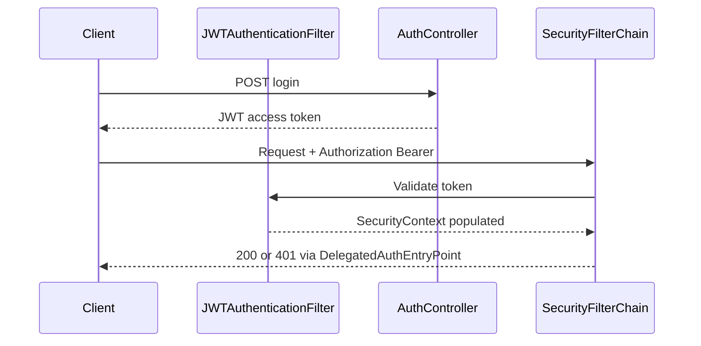
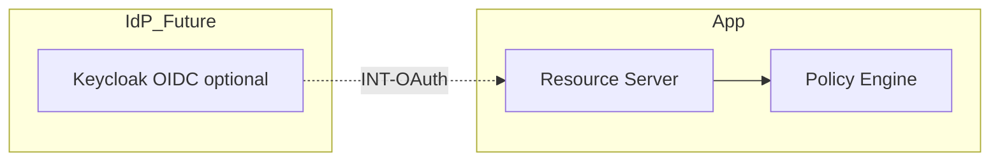

# Security Architecture

## AS-IS authentication flow

**Figure RE-FIG-SEC-001** — JWT login and request authentication (AS-IS).

## AS-IS configuration summary

| Control | State | Evidence |
|---------|-------|----------|
| Session | Stateless | SRC-006 |
| CSRF | Disabled | SRC-006 |
| CORS | Permissive `*` | SRC-004 (document keys only) |
| JWT secret | Configuration property `backendapi.app.jwtSecret` | **Never copy real value to docs** |
| Password encoding | Spring Security `AuthenticationProvider` | **TBD** algorithm review |
| Method security | Largely disabled / commented | SRC-005 |

## Authorization model

| Layer | AS-IS | TO-BE |
|-------|-------|-------|
| URL | Minimal `permitAll` | Public read routes for catalog |
| Method | `@PreAuthorize` commented | Enable + role mapping |
| Domain | N/A | Policy in application services |

## Threat notes (documentation assessment)

1. **Over-broad CORS** — production risk (NFR-SEC-003).
2. **Missing role enforcement** — any authenticated user may hit admin endpoints (verify service checks — **TBD**).
3. **Actuator exposure** — permitAll on GET — lock down in production.

## Target architecture (TO-BE)

**Figure RE-FIG-SEC-002** — Future OAuth2/OIDC option (not implemented).

See [INTEGRATIONS.md](../../05-infrastructure/INTEGRATIONS.md) for Keycloak classification.

## Audit

`Log` entity exists; REST exposure **TBD**. TO-BE: structured security event logging (NFR-OBS).
