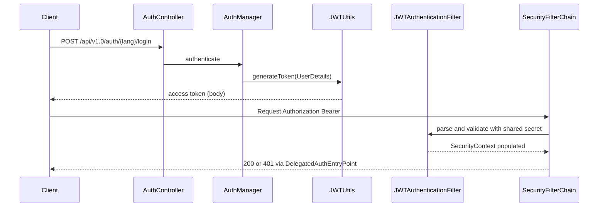
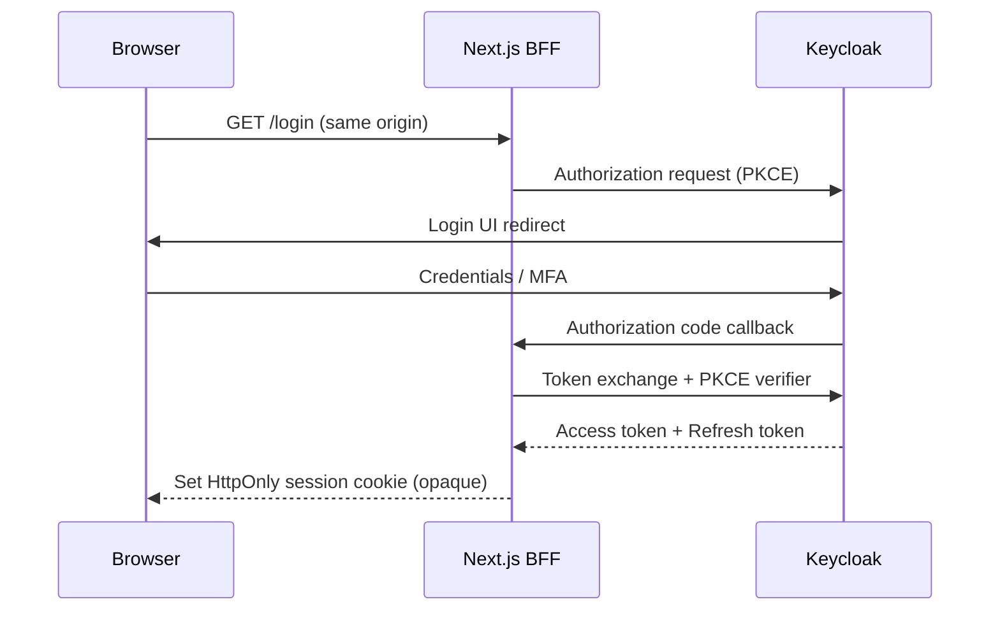
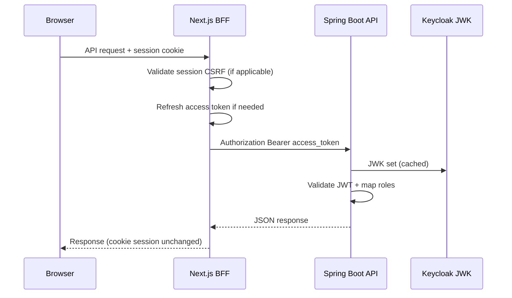

# Security Architecture

Authentication, authorization, token lifecycle, and security boundaries for the RealEstate backend. Related: [INTEGRATIONS.md](../../05-infrastructure/INTEGRATIONS.md), [HLD-002-clean-architecture.md](../HLD/HLD-002-clean-architecture.md), [LLD-001-auth-module.md](../LLD/LLD-001-auth-module.md), [FRONTEND-ARCHITECTURE.md](../frontend/FRONTEND-ARCHITECTURE.md) §8 (browser boundary; ADR-003 **unchanged**).

**Label legend:** **AS-IS** (verified code/config); **LEGACY** (historical product docs); **TO-BE** (target); **FUTURE** (planned, not built); **PROPOSED** (needs formal decision record).

---

## 1. Authentication — AS-IS (custom JWT)

The backend **issues and validates its own JWTs** today. This is **not** Keycloak and **not** OAuth2 Resource Server.



**Figure RE-FIG-SEC-001** — Custom JWT login and request authentication (AS-IS).

**Caption:** Symmetric secret validation in `JWTUtils`; tokens returned to client in response body.

**Explanation:** Evidence: `com.prettier.security.jwt.JWTUtils`, `JWTAuthenticationFilter`, `AuthController`. **No refresh token** flow documented in API inventory AS-IS.

### AS-IS configuration summary

| Control | State | Evidence |
|---------|-------|----------|
| Session | Stateless (`SessionCreationPolicy.STATELESS`) | `SecurityFilterChainConfig` |
| CSRF | Disabled | AS-IS stateless JWT pattern |
| CORS | Permissive `*` in config | `application.yaml` — **not** production target |
| JWT | Symmetric HMAC; config keys `backendapi.app.jwtSecret`, `backendapi.app.jwtExpirationMs` | `JWTUtils` — **never document secret values** |
| Principal | `UserDetails`; username = **email** | `User.getUsername()` returns email |
| Authorities | `SimpleGrantedAuthority(role.getName())` — e.g. `CUSTOMER` **without** `ROLE_` prefix | `User` constructor |
| Password | BCrypt in application database | `AuthManager` / `AuthenticationProvider` — **TO-BE** migrates to Keycloak |
| Method security | `@EnableMethodSecurity`; advert create `@PreAuthorize("hasAuthority('CUSTOMER')")` | B2.1.1 WIP |
| Domain check | `AdvertManager.assertCustomerAuthority` duplicates CUSTOMER check | B2.1.1 WIP |

---

## 2. Authentication — TO-BE (Keycloak + Resource Server)

**FUTURE / not implemented.** Authoritative direction:

| Component | Responsibility |
|-----------|----------------|
| **Keycloak** | External IdP and OIDC Authorization Server |
| **Spring Boot API** | OAuth2 **Resource Server** — validates Keycloak **access tokens** only |
| **identity module** | Application profile, preferences, **internal roles/mapping**, account status — **not** passwords |

### Keycloak owns (TO-BE)

Login, logout, password reset, credential validation, MFA (where enabled), OIDC/OAuth2 flows, token issuance/refresh, IdP session lifecycle, federation (**FUTURE** where required).

The application **must not** duplicate password or credential management after migration.

### identity module owns (TO-BE)

| Data / concern | Owner |
|----------------|--------|
| Application user profile | identity |
| User preferences | identity |
| Internal application roles and **mapping** from token claims | identity |
| Application account status | identity |
| Stable external reference | Keycloak **`sub`** — **not** email as primary key |
| Internal user id | Application identifier with explicit **`sub` ↔ userId** mapping |
| Password hash | **Must not** be stored post-migration |

### JWT validation (Resource Server — TO-BE)

Validation **must** include cryptographic verification and standard claim checks:

| Check | Required |
|-------|----------|
| Signature (JWK / key rotation) | Yes |
| `iss` (issuer) | Yes |
| `exp` | Yes |
| `nbf` | Where present |
| `aud` | Per agreed API client / resource configuration |

**Rules:**

- Do **not** trust claims without signature validation.
- Do **not** call Keycloak on every request solely to validate a self-contained JWT (use JWK cache / resource server machinery).
- Configure JWK set URI and rotation handling per Spring Security OAuth2 Resource Server.

---

## 3. Token architecture — Decisions 14 & 23 reconciliation

**Context:** Architecture programme **Decision 14** (short-lived access token, refresh protected by HttpOnly/Secure/SameSite cookie, CSRF, strict CORS) and **Decision 23** (Keycloak IdP, Authorization Code + PKCE, Spring Resource Server) must compose coherently.

**Repository note:** Numbered decisions **14** and **23** are **authoritative per security architecture programme** but are **not** separately indexed in `DECISION_LOG.md` at time of writing. Reconciliation below is **PROPOSED** documentation until recorded in the decision register ([ADR-003](../ADR/ADR-003-auth-token-bff-reconciliation.md)).

### PROPOSED: Next.js BFF (recommended TO-BE — **not approved**)

| Actor | Token / session handling |
|-------|---------------------------|
| **Browser** | **No** Keycloak access token in JS memory/storage; **no** refresh token in `localStorage`/`sessionStorage`; **opaque session cookie** (HttpOnly, Secure, SameSite per environment); same-origin calls to BFF |
| **Next.js BFF** | Confidential OAuth2/OIDC client; Authorization Code + **PKCE**; holds access + refresh **server-side**; refreshes server-side; calls API with `Authorization: Bearer <access_token>`; **never** exposes refresh token to browser JS; logout / session invalidation |
| **Keycloak** | Authentication; issues tokens; OIDC discovery; IdP sessions |
| **Spring Boot API** | Resource Server JWT validation; authorization; **no** browser session cookies for auth |

This **reconciles** Decision 14 with Decision 23 by shifting browser-visible session to an **opaque cookie** while access/refresh tokens remain **server-side** at the BFF — **not** by requiring the browser to hold Keycloak access tokens in memory.

**Decision status:** **PROPOSED — formal approval required** before treating as amendment to Decision 14. Do **not** silently change approved register entries.

### Alternative: Direct SPA (Authorization Code + PKCE)

| Aspect | Implication |
|--------|-------------|
| Access token | Typically held in **browser memory** |
| Refresh token | Depends on Keycloak client settings; may imply XSS risk |
| HttpOnly cookie | **Not automatic** for tokens in pure SPA-to-API |
| CSRF / CORS | Browser calls API directly — CORS must be explicit; CSRF if cookies used at API |

**Why BFF is recommended (PROPOSED):** Better alignment with HttpOnly session requirement, reduced token exposure to XSS, fits Next.js hybrid rendering, and keeps API authentication as **Bearer-only** server-to-server from BFF.

See sequence diagrams in §4.

---

## 4. Token lifecycle diagrams (TO-BE / PROPOSED — not implemented)

### 4.1 Login — Authorization Code + PKCE via BFF



**Figure RE-FIG-SEC-003** — OIDC login through Next.js BFF (PROPOSED TO-BE).

**Caption:** Keycloak tokens remain on the BFF; browser receives only an opaque session cookie.

**Explanation:** BFF stores Keycloak tokens in server-side session storage (**TBD** store: encrypted server session, Redis, etc.).

### 4.2 API call — BFF to Resource Server



**Figure RE-FIG-SEC-004** — BFF to API Bearer flow (PROPOSED TO-BE).

**Caption:** API authenticates Bearer tokens only; cookies are not API authentication transport.

**Explanation:** Resource Server does not manage browser sessions.

### 4.3 Logout (PROPOSED)

- BFF clears server session and cookie.
- BFF may invoke Keycloak **end-session** / logout endpoint (**TBD** client config).
- API remains stateless; token revocation via short TTL + optional introspection policy (**TBD**).

---

## 5. Authorization model

### 5.1 Authentication vs authorization

| Question | Layer |
|----------|--------|
| Who is the user? | Authentication (JWT / Resource Server) |
| What may they do? | Authorization (roles + policies) |

### 5.2 Global application roles (technical)

| Role | Typical use |
|------|-------------|
| `CUSTOMER` | End-user capabilities |
| `MANAGER` | Staff operations |
| `ADMIN` | Administrative operations |

**Role mapping (TO-BE):** Explicit mapping from Keycloak claims (e.g. realm/client roles) to Spring `GrantedAuthority` values. Avoid double prefix (`ROLE_ROLE_ADMIN`). **AS-IS:** authorities use role **name** without `ROLE_` prefix — align `@PreAuthorize` with `hasAuthority('CUSTOMER')`, not `hasRole` unless convention changes (**decision required**).

### 5.3 Product permission boundary — DEC-002

| Topic | Status |
|-------|--------|
| Detailed CUSTOMER / MANAGER / ADMIN **business** matrix | **Not approved** — [PO_DECISION_REVIEW.md](../../08-project-management/PO_DECISION_REVIEW.md): DEC-002 **Not approved** |
| Technical authorization architecture (layers, modules) | Documented here (**approved programme**) |
| B2.1.1 create CUSTOMER-only | **AS-IS WIP** — engineering; **not** equivalent to DEC-002 PO approval |

Do **not** invent permission grants. Separate LEGACY poster matrix from PO-approved rules.

### 5.4 Authorization by layer (approved)

| Layer | Responsibility |
|-------|----------------|
| **API / Controller** | Coarse endpoint security (`@PreAuthorize`, `permitAll` whitelist per ADR-002); **no** embedded business authorization |
| **Application** | Use-case authorization; resource ownership; operation policies; cross-module checks via **ports** |
| **Domain** | Invariants; valid state transitions; rules independent of Spring Security |

**Module ownership (resource policies):**

| Module | Owns (examples) |
|--------|-----------------|
| listing | Advert ownership; moderation policies (**TO-BE**) |
| engagement | Favorite / following access (**TO-BE**) |
| communication | Conversation / message access (**TO-BE**) |
| identity | Profile, application roles, account status capabilities |

Do **not** centralize all business rules in identity or platform.

### 5.5 Authorization layers diagram

```mermaid
flowchart TB
  subgraph API
    EP[REST endpoint]
    PA[@PreAuthorize coarse]
  end
  subgraph Application
    UC[Use case service]
    OW[Ownership checks]
    PORT[Cross-module ports]
  end
  subgraph Domain
    INV[Invariants]
  end
  EP --> PA --> UC
  UC --> OW
  UC --> PORT
  UC --> INV
```

**Figure RE-FIG-SEC-005** — Authorization layers and module ownership (TO-BE target).

**Caption:** Controllers gate endpoints; application owns resource rules; domain owns invariants.

**Explanation:** Listing module enforces advert ownership in **listing.application**, not in identity.

### 5.6 AS-IS enforcement gaps (evidence)

| Gap | Evidence |
|-----|----------|
| Partial method security | Many controllers without `@PreAuthorize` |
| Update/delete advert | Authenticated only — no ownership RBAC AS-IS |
| CORS `*` | `application.yaml` |
| Public catalog vs authenticated routes | ADR-002 whitelist **approved** — implementation **TO-BE** |

---

## 6. CSRF, CORS, and cookie boundaries

### 6.1 Browser → Next.js BFF (PROPOSED)

| Control | Direction |
|---------|-----------|
| CSRF | **Required** for cookie-authenticated mutating requests — SameSite, Origin/Referer, CSRF token strategy **TBD** |
| Cookies | HttpOnly, Secure, SameSite per deployment |
| Session | Expiration, logout, fixation protection **TBD** in BFF |

### 6.2 Next.js BFF → Spring Boot API

| Control | Direction |
|---------|-----------|
| Auth transport | `Authorization: Bearer` access token |
| CSRF | **Not required** for Bearer-only API auth (reassess if API ever accepts browser cookies directly) |
| Cookies | API must **not** rely on browser cookies for authentication |

### 6.3 CORS

| Path | TO-BE |
|------|-------|
| Browser → BFF (same origin) | No broad CORS required |
| Browser → API direct (SPA alternative) | Explicit trusted origins per environment — **never** `*` in production |
| AS-IS | Permissive `*` — **gap** (NFR-SEC-003) |

CSRF is **not** universally on or off — it follows **authentication transport** (cookie vs Bearer).

---

## 7. Public API access (ADR-002)

API conventions and error target: [API-ARCHITECTURE.md](../api/API-ARCHITECTURE.md), [ERROR_HANDLING.md](../../04-development/ERROR_HANDLING.md).

Anonymous **GET** catalog/detail/image whitelist and visibility **V3** are **product-approved** ([ADR-002](../ADR/ADR-002-public-read-api.md)). Resource Server and BFF must preserve **authenticated-by-default** for all other routes.

### 7.1 Rate limiting (product + infrastructure)

| Layer | Direction |
|-------|-----------|
| **Product (ADR-002)** | **IP-based** throttling **mandatory before production** on P1/P2/public images; numeric thresholds = engineering |
| **Product** | **Redis not mandatory** — in-process filter or reverse proxy acceptable when justified |
| **Engineering (TO-BE)** | Preferred distributed path: **Redis + Bucket4j** token bucket — **not** Spring Cache; separate Redis namespace ([CACHING-PERFORMANCE-ARCHITECTURE.md](../performance/CACHING-PERFORMANCE-ARCHITECTURE.md) §9) |
| **AS-IS** | **No** rate limiting implementation verified |

Rate limits enforce **abuse control**; they do **not** replace **V3** visibility or authorization.

---

## 8. Audit and observability

`Log` entity exists; REST exposure **TBD**. **TO-BE:** structured security events (NFR-OBS); audit module ownership **TBD** (ADR-001).

---

## 9. Related documents

| Document | Purpose |
|----------|---------|
| [ADR-003-auth-token-bff-reconciliation.md](../ADR/ADR-003-auth-token-bff-reconciliation.md) | Decision 14/23 BFF reconciliation (**draft PROPOSED**) |
| [INTEGRATIONS.md](../../05-infrastructure/INTEGRATIONS.md) | Keycloak classification |
| [NFR-CATALOGUE.md](../../02-requirements/NFR/NFR-CATALOGUE.md) | Security NFRs |
| [CACHING-PERFORMANCE-ARCHITECTURE.md](../performance/CACHING-PERFORMANCE-ARCHITECTURE.md) | Redis cache vs rate-limit separation |
| [TESTING-ARCHITECTURE.md](../testing/TESTING-ARCHITECTURE.md) | Security / JWT integration tests (AS-IS) |
| [OBSERVABILITY-RELIABILITY-ARCHITECTURE.md](../operations/OBSERVABILITY-RELIABILITY-ARCHITECTURE.md) | Security audit vs technical logs; actuator exposure |

## Change history

| Version | Date | Summary |
|---------|------|---------|
| 0.1.0 | 2026-11-13 | AS-IS JWT; B2.1.1 method security note |
| 0.2.0 | 2026-11-18 | Keycloak/Resource Server TO-BE; identity module; BFF PROPOSED; CSRF/CORS; authorization layers; DEC-002 boundary |
| 0.2.1 | 2026-11-18 | Public API rate limiting; Bucket4j/Redis vs Spring Cache (Group 7) |
| 0.2.2 | 2026-11-18 | Related TESTING-ARCHITECTURE link (Group 9) |
| 0.2.3 | 2026-11-18 | OBSERVABILITY-RELIABILITY-ARCHITECTURE link (Group 11) |