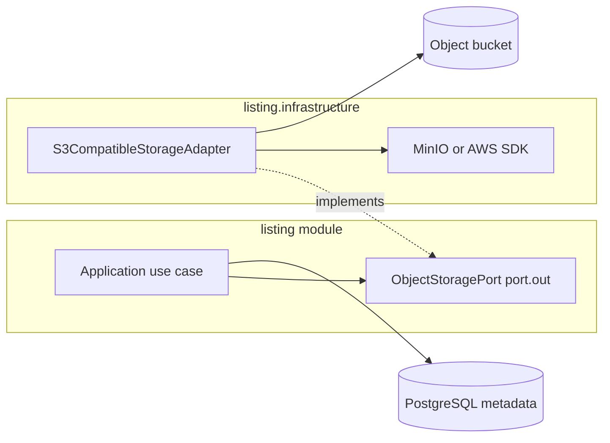
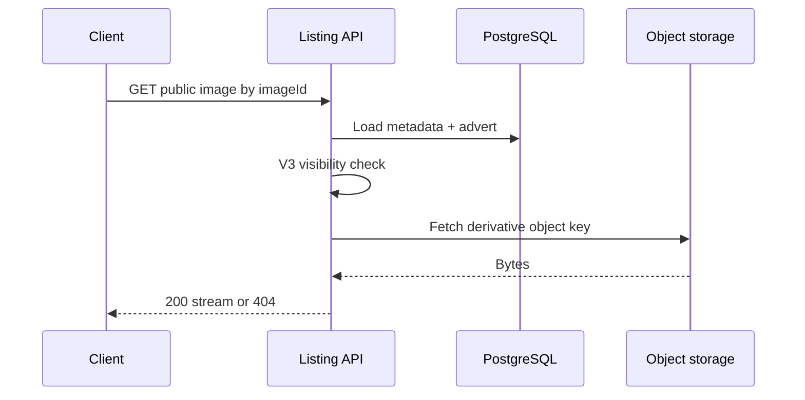

# File & Object Storage Architecture

**Canonical** storage design. Related:

| Topic | Document |
|-------|----------|
| Table ownership | [PERSISTENCE-ARCHITECTURE.md](../database/PERSISTENCE-ARCHITECTURE.md) |
| Public image delivery | [ADR-002-public-read-api.md](../ADR/ADR-002-public-read-api.md) §4, [M1-IMPLEMENTATION-PLAN.md](../../08-project-management/M1-IMPLEMENTATION-PLAN.md) IMPL-060 |
| Integrations | [INTEGRATIONS.md](../../05-infrastructure/INTEGRATIONS.md) |
| Ports & layers | [HLD-002-clean-architecture.md](../HLD/HLD-002-clean-architecture.md) |
| Data lifecycle / GDPR | [PERSISTENCE-ARCHITECTURE.md](../database/PERSISTENCE-ARCHITECTURE.md) §7 |
| API public access | [API-ARCHITECTURE.md](../api/API-ARCHITECTURE.md) |

**Labels:** AS-IS, **APPROVED**, TO-BE, FUTURE, TBD.

---

## 1. Object storage provider strategy (APPROVED)

| Environment | Provider | Status |
|-------------|----------|--------|
| **Local / development** | **MinIO** (S3-compatible) | **Not deployed** in repo — TO-BE |
| **Production target** | **AWS S3** (S3-compatible API) | **Not deployed** — TO-BE |
| **Selection** | Configuration-driven adapter | TO-BE |

**Rules:**

- PostgreSQL stores **metadata** and relationships only — **not** binary payloads (LOB on `Image` is commented out AS-IS).
- Binary content lives in **object storage** (TO-BE).
- MinIO / AWS SDK types stay in **infrastructure** adapters only.
- `application.yaml` contains **commented** AWS/S3 placeholders — **not** active configuration.

**AS-IS:** `images` / `files` tables store `name`, `type`, `path` (`V1__baseline_schema.sql`); no object store integration; `ImageManager` is repository-only stub; `ImageController` has **no** mappings.

---

## 2. Storage port and adapter architecture (APPROVED)

**Figure RE-FIG-STORAGE-001** — Listing-owned storage port (TO-BE).

**Caption:** Application uses port; SDK confined to adapter.

**Explanation:** No global god-storage service owning all module metadata.

| Module | Owns (business lifecycle) |
|--------|---------------------------|
| **listing** | Advert images (`images` table, `Image` entity), advert file metadata in aggregate scope |
| **communication** | Message attachments (`files` / `AttachFile` → `Message`) |
| **identity** | Profile image **use case** (endpoint exists; implementation **stub** — `UserManager.uploadUserProfileImage` returns `null`) |
| **platform** | Shared technical adapter wiring only — **not** business file ownership |

Other modules use **their own** `ObjectStoragePort` (or narrower ports) in `application/port/out` — **not** a bypassing global facade.

---

## 3. File metadata vs binary content (APPROVED)

| Store | Contents |
|-------|----------|
| **PostgreSQL** | IDs, FK to aggregate, original filename (display), **system object key**, MIME, size, checksum **TBD**, timestamps, processing status **TBD**, visibility class **TBD**, soft-delete flags |
| **Object storage** | Bytes for original and derivatives |

**Rules:**

- **Never** use user filename as object key — generate server-side keys (TO-BE).
- Do **not** expose internal object keys as stable public API identifiers (ADR-002: public image by **`imageId`**, not storage path).
- Do **not** duplicate binary in PostgreSQL.

**AS-IS metadata columns:** `name`, `type`, `path`, `featured`, `advert_id` (images); similar on `files`.

**TO-BE optional fields** (add via Flyway when required — not all mandatory today): `content_hash`, `processing_status`, `variant`, `storage_provider`, `bucket` **TBD**.

---

## 4. Advert image ownership and lifecycle (APPROVED)

**Owner:** **listing** module. **Aggregate:** `Advert` may own `AdvertImage` collection in domain (TO-BE); **AS-IS** JPA `Image` → `Advert` `@ManyToOne`.

| Phase | TO-BE behavior | AS-IS |
|-------|----------------|-------|
| Upload initiated | API → application command | **No** upload API |
| Validated | Layered validation §6 | — |
| Stored | Port `putObject` + metadata row | — |
| Processing | Variants **FUTURE** async | **None** |
| Associated with advert | FK / aggregate rule | Schema FK exists |
| Public visibility | Parent advert **V3** (ADR-002 **approved**) | Not implemented |
| Remove/archive/delete | Owning module lifecycle + cleanup | Soft-delete patterns **TBD** |

**Cross-module:** Engagement/communication must **not** manipulate `Image` JPA/repos directly — use listing ports/APIs.

---

## 5. Image variants and processing (APPROVED target — not implemented)

| Variant | Purpose |
|---------|---------|
| **Original** | Preserve source where retention/legal requires |
| **Thumbnail** | Lists / cards |
| **Medium** | Standard detail |
| **Large** | High-quality detail |

Exact dimensions, formats, quality — **TBD** (not in legacy PDF as fixed numbers).

**Capabilities (TO-BE):** derivative generation, link metadata original↔derivatives, reprocessing on rule change, failure/retry when async pipeline introduced (**FUTURE**).

**AS-IS:** No processing pipeline; no variant objects.

---

## 6. Upload validation and security (APPROVED)

| Layer | Checks |
|-------|--------|
| **API** | Multipart size limits, authn/authz, basic request validation |
| **Application** | Ownership, quotas per advert/user, business rules |
| **Infrastructure** | Magic-byte/content MIME (not filename alone), max size, safe decode, checksum **where justified** |

**Security:** server object keys, anti path-traversal, reject malformed content, no credential/path leakage, **do not execute** uploads, size caps.

**Malware scanning:** **FUTURE** (not implemented).

---

## 7. EXIF and privacy (APPROVED)

- **Remove GPS/location EXIF** from **public** derivatives.
- **Assess** whether originals remain private (recommended default — **TBD** PO/legal).
- Public APIs must not expose sensitive EXIF.
- Sanitization in **processing pipeline** (TO-BE/FUTURE).

Originals are **not** automatically safe to publish.

---

## 8. Public and private access (APPROVED)

### Public (listing images)

- **Approved:** `GET /api/v1.0/public/images/{imageId}` with parent advert **V3** check (ADR-002 Model 2) — **endpoint not implemented**.
- **Do not** make entire bucket public.
- Predictable image IDs are **not** sufficient authorization — server enforces **V3** each request.

### Private

- Documents/attachments (e.g. message `files`) — **private** by default.
- Access via application authorization + **short-lived signed URL** or controlled download endpoint (TO-BE).
- Signed URL = temporary mechanism; **application still authorizes** before issuance.
- No unrestricted object URLs or credentials in responses.

**Figure RE-FIG-STORAGE-002** — Public image access with application gate (TO-BE).

**Caption:** Storage does not bypass advert visibility rules.

**Explanation:** Matches ADR-002; implementation **FUTURE**.

---

## 9. Deletion and consistency (APPROVED)

- **Owner module** decides retain/archive/delete (see persistence GDPR terms).
- DB metadata and object deletion must **reconcile** — **no** silent partial failure.
- **No claim** of single atomic transaction across PostgreSQL and S3.

**FUTURE patterns:**

- Retryable cleanup job for failed `deleteObject`
- Outbox or domain event to trigger storage cleanup (see [HLD-003](../HLD/HLD-003-event-driven-architecture.md))
- Orphan detection (metadata without object, object without metadata) — **TBD** operations runbook

Avoid deleting objects still referenced by valid rows.

---

## 10. Observability (TO-BE)

Log/metrics (no file bytes, credentials, or full signed URLs in logs):

- Upload success/failure, validation rejections
- Processing duration/failures (**FUTURE**)
- Storage availability
- Download failures
- Orphan/cleanup failures

Distinguish **technical logs** vs **business audit** (audit module **TBD**).

---

## 11. Infrastructure and deployment (APPROVED direction)

| Item | Direction |
|------|-----------|
| Dev | MinIO (docker compose **TBD** — not in current `compose.yaml`, Postgres only) |
| Prod target | AWS S3 |
| Secrets | Environment/secret manager — **never** in Git |
| Buckets / IAM / regions | **TBD** — do not invent names |
| Terraform/K8s | **FUTURE** unless repo gains IaC |

---

## 12. AS-IS summary table

| Item | Evidence |
|------|----------|
| Tables `images`, `files` | Flyway V1 |
| Entity `Image`, `AttachFile` | JPA |
| Path string storage | `path` column — likely filesystem-era; object keys TO-BE |
| Upload REST | `ImageController` empty; profile upload **stub** |
| S3/MinIO runtime | **Not** active |
| ADR-002 image model | **Approved** product; code **not** implemented |

## Change history

| Version | Date | Summary |
|---------|------|---------|
| 0.1.0 | 2026-11-18 | Initial file/object storage architecture (Group 6) |