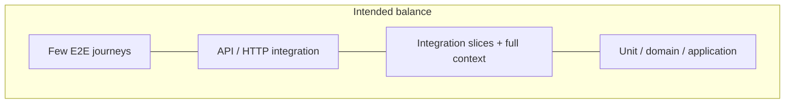
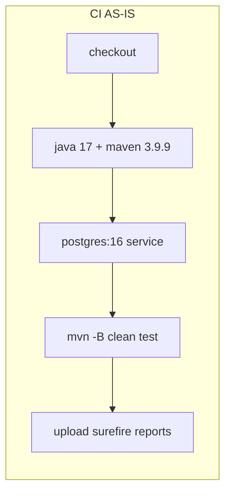
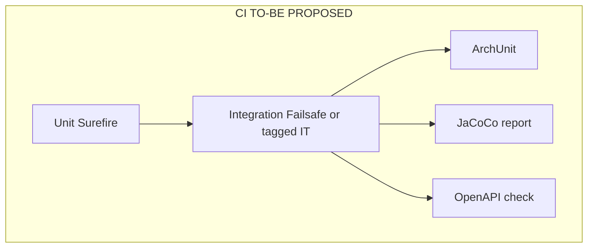

# Testing Architecture & Quality Strategy

**Canonical** backend testing reference. Developer summary: [TEST_STRATEGY.md](../../04-development/TEST_STRATEGY.md) — **do not duplicate** pyramid detail there without syncing.

**Related architecture:**

| Topic | Document |
|-------|----------|
| Layers & modules | [HLD-002](../HLD/HLD-002-clean-architecture.md), [ADR-001](../ADR/ADR-001-modular-monolith.md) |
| Events & transactions | [HLD-003](../HLD/HLD-003-event-driven-architecture.md) |
| PostgreSQL / Flyway | [PERSISTENCE-ARCHITECTURE.md](../database/PERSISTENCE-ARCHITECTURE.md) |
| API & RFC 9457 | [API-ARCHITECTURE.md](../api/API-ARCHITECTURE.md), [ERROR_HANDLING.md](../../04-development/ERROR_HANDLING.md) |
| Security | [SECURITY-ARCHITECTURE.md](../security/SECURITY-ARCHITECTURE.md) |
| Public catalog tests | [ADR-002](../ADR/ADR-002-public-read-api.md) |
| Cache (when introduced) | [CACHING-PERFORMANCE-ARCHITECTURE.md](../performance/CACHING-PERFORMANCE-ARCHITECTURE.md) |
| Tooling versions | [TECHNOLOGY_BASELINE.md](../../05-infrastructure/TECHNOLOGY_BASELINE.md) |
| CI / environments | [INFRASTRUCTURE-DEPLOYMENT-ARCHITECTURE.md](../infrastructure/INFRASTRUCTURE-DEPLOYMENT-ARCHITECTURE.md) §5, §11 |

**Labels:** **AS-IS** (verified in repo), **TO-BE**, **PROPOSED**, **TBD**, **FUTURE**.

**Scope:** `real-estate` Maven module — tests under `src/test/java`.

---

## 1. Testing principles (APPROVED direction)

Aligned with the modular monolith:

- Test **behaviour and contracts**, not private implementation details.
- Keep **unit** tests fast, deterministic, no network/DB unless necessary.
- Use **integration** tests where Spring, PostgreSQL, security filters, or Flyway matter.
- Protect **module boundaries** as packages evolve toward `com.prettier.<module>.*` (TO-BE).
- Avoid starting the **full** Spring context when a slice suffices.
- **No** external Redis, MinIO, Keycloak, or brokers in ordinary unit tests unless explicitly testing an adapter (not present AS-IS).
- Tests must be **order-independent**; avoid shared mutable static state.
- Prefer PostgreSQL for SQL/Flyway semantics — **do not** assume H2 equivalence (H2 dependency is **commented out** in `pom.xml`).

---

## 2. Testing pyramid and scope (TO-BE — no numeric ratios)

**Figure RE-FIG-TEST-ARCH-001** — Testing pyramid (qualitative TO-BE).

**Caption:** More tests at the base; fewer full-stack journeys.

**Explanation:** Exact counts and coverage percentages are **not** mandated.

| Level | Purpose | AS-IS in repo |
|-------|---------|---------------|
| **Unit** | Domain rules, application policies with mocked ports | `AdvertManagerTest`, registry canonicalizer tests, `SlugNormalizerTest`, `JWTUtilsTest` |
| **Slice** | JPA mapping/repo without full web stack | `LanguageEntityMappingTest`, `LanguageRepositoryTest` (`@DataJpaTest`) |
| **Integration (Spring)** | Full context + real PostgreSQL | `LanguageRegistryPostgreSqlAcceptanceTest`, `RealEstateApplicationTests` |
| **HTTP integration** | Live server port + real HTTP client | `AdvertCreationHttpIntegrationTest`, `AuthJwtIntegrationTest` |
| **Architecture** | Package dependency rules | **Not found** |
| **Contract** | OpenAPI vs responses | **Not found** |
| **E2E** | Cross-system journeys | **Not found** in Backend repo |

**Note:** Several “integration” tests use **`java.net.http.HttpClient`** + `@LocalServerPort`, not `MockMvc` (**AS-IS** choice; Boot 4.1.2 `TestRestTemplate` note in `AuthJwtIntegrationTest`).

---

## 3. Modular monolith testing strategy (TO-BE)

**Approved modules:** `identity`, `catalog`, `listing`, `engagement`, `communication`, `platform` ([ADR-001](../ADR/ADR-001-modular-monolith.md)).

**AS-IS packages:** largely `com.prettier.controller`, `service`, `repository`, `entity`, `shared` — tests follow the same layout.

| Module | Test focus (TO-BE) | AS-IS evidence |
|--------|-------------------|----------------|
| **platform** | Language Registry, error codes | Registry unit + PostgreSQL acceptance tests |
| **listing** | Advert use cases, ownership, public read (**FUTURE**) | `AdvertManagerTest`, `AdvertCreationHttpIntegrationTest` (B2.1 WIP) |
| **identity** | Auth, JWT, roles | `AuthJwtIntegrationTest`, security handler tests |
| **catalog** | Reference data validation | Indirect via advert create tests |
| **engagement** / **communication** | — | **No** dedicated module tests found |

**Architectural constraints to enforce (TO-BE / ArchUnit PROPOSED):**

- No cross-module JPA entity navigation in **application** code (target).
- Module interactions via **ports** or explicit APIs.
- Domain free of Spring/JPA types.
- Application owns `@Transactional` boundaries ([HLD-003](../HLD/HLD-003-event-driven-architecture.md)).
- Event handlers: test with `AFTER_COMMIT` semantics where relevant — **FUTURE** dedicated tests.

**Module-level** tests mock foreign modules; **full application** tests (e.g. advert HTTP) exercise cross-package wiring AS-IS.

---

## 4. Unit testing (TO-BE practices)

| Target | Guidance |
|--------|----------|
| Domain invariants | Pure JUnit when domain types exist — **sparse AS-IS** (anemic entities) |
| Application services | Mock **repositories and ports**; assert exceptions and state | `AdvertManagerTest` |
| Authorization | Assert thrown security exceptions without full filter chain | Partial in `AdvertManagerTest` |
| Mappers | Test non-trivial MapStruct/custom mapping when behaviour matters | **TBD** |
| Error mapping | Stable `FriendlyMessageCodes` — not localized string assertions alone | Partial |

**Mockito:** Appropriate for outbound ports; **do not** mock value you should assert directly. Prefer real validators/canonicalizers for pure logic (`LanguageCodeCanonicalizerTest`).

---

## 5. Spring slice and integration testing (TO-BE + AS-IS)

| Tool | TO-BE role | AS-IS |
|------|-----------|--------|
| `@WebMvcTest` | Controller + security slice | **Not found** |
| `@DataJpaTest` | Repository + mapping | `LanguageRepositoryTest`, `LanguageEntityMappingTest` |
| `@SpringBootTest` | Full context, Flyway, security | Registry acceptance, HTTP integration, `RealEstateApplicationTests` |
| `MockMvc` | MVC contract tests | **Not found** |
| **Testcontainers** | Optional portable PostgreSQL | **Not declared** in `pom.xml`; CI uses **GitHub Actions `services.postgres`** |
| PostgreSQL | `@AutoConfigureTestDatabase(replace = NONE)` + JDBC URL | Used in integration tests via `@DynamicPropertySource` or CI env |

**Infrastructure not in test scope AS-IS:** Redis, MinIO/S3, Keycloak, Kafka.

**Boundaries to cover (TO-BE):**

- REST + security (`permitAll` whitelist vs authenticated — ADR-002 **FUTURE** public tests).
- Flyway V1–V3 + JPA `validate`.
- Transactions and registry snapshot reload ([LANGUAGE-REGISTRY-M1-IMPLEMENTATION-STATUS.md](../domain/LANGUAGE-REGISTRY-M1-IMPLEMENTATION-STATUS.md)).
- Storage/cache adapters when implemented — **FUTURE**.

---

## 6. Architecture testing (PROPOSED — ArchUnit)

**Status:** **PROPOSED** — `archunit` **not** in `pom.xml`; **no** ArchUnit tests found.

Candidate rules (derive packages from **AS-IS** `com.prettier.*` and **TO-BE** `com.prettier.<module>.{domain,application,infrastructure,api}`):

| Rule | Intent |
|------|--------|
| `..domain..` must not depend on `org.springframework..` | Clean domain |
| `..domain..` must not depend on `jakarta.persistence..` | No JPA in domain |
| `controller` must not access `repository` directly | Layering |
| Cross-module: no `repository` imports from foreign module packages (when modular packages exist) | Modular monolith |
| Infrastructure adapters implement application ports | Hexagonal |

**TBD:** Approve ArchUnit version, rule set location (`src/test/java/.../ArchitectureTest.java`), and CI execution.

---

## 7. API and contract testing (TO-BE)

| Concern | Direction | AS-IS |
|---------|-----------|--------|
| Request/response shape | Assert JSON fields, status codes | HTTP integration tests (advert, auth) |
| Validation | 400 on bad input | Partial via integration |
| RFC 9457 | `application/problem+json` | **TO-BE** — not enforced in tests |
| Stable codes | `FriendlyMessageCodes` / future `applicationCode` | Exception tests use enums indirectly |
| ADR-002 public GET | V3 + translation rules | **Not found** (public endpoints not implemented) |
| OpenAPI contract CI | springdoc spec vs responses | **FUTURE** — springdoc on classpath, **no** contract gate |

OpenAPI **documentation** generation is **not** contract testing.

---

## 8. Test data and fixtures (TO-BE)

| Practice | Status |
|----------|--------|
| Deterministic IDs / titles | HTTP tests use UUID suffixes |
| `@Transactional` rollback | `LanguageRegistryPostgreSqlAcceptanceTest` |
| JDBC cleanup / `@AfterEach` | `AdvertCreationHttpIntegrationTest` |
| Java Faker (`com.github.javafaker`) | **Declared** in `pom.xml` — **not used** in `src/main` or `src/test` (grep) |
| Production seed dependency | Tests rely on `DataInitializer` for admin user in some auth flows — document and isolate |
| Test JWT secret | Overrides via `@DynamicPropertySource` in auth/advert HTTP tests |

Avoid uncontrolled randomness in assertions; isolate registry acceptance tests (documented in M1 status §4).

---

## 9. Coverage and quality gates (AS-IS)

| Capability | Declared | Used | CI enforced |
|------------|----------|------|-------------|
| JaCoCo | **No** | **No** | **No** |
| Coverage threshold | **N/A** | — | **TBD** |

**PROPOSED:** Measure coverage after JaCoCo adoption; prioritize **security** and **listing ownership** rules over blanket percentage gates.

Critical paths (auth, advert create authorization, registry) should have **explicit** tests even when overall coverage is low.

---

## 10. CI testing strategy

### AS-IS (verified: `.github/workflows/backend-ci.yml`)

**Figure RE-FIG-TEST-ARCH-003** — CI pipeline AS-IS.

**Caption:** Single job; Surefire only.

**Explanation:** No separate Failsafe, ArchUnit, JaCoCo, or contract stage.

| Item | Detail |
|------|--------|
| Trigger branches | `feature/boot-3.5.16`, `feature/boot-4.1.2`, `Fatih`, PRs to `Fatih` |
| **Note** | Current work branch `feature/b2.1-advert` is **not** listed — **TBD** CI coverage for feature branches |
| Database | `jdbc:postgresql://localhost:5432/real_estate_db` via Actions service |
| Command | `mvn -B clean test` (default Surefire) |
| Artifacts | `target/surefire-reports/` |

### TO-BE stages (PROPOSED — not implemented)

1. Compile  
2. Unit tests (fast profile **TBD**)  
3. Integration tests (PostgreSQL — service or Testcontainers **TBD**)  
4. Architecture tests (ArchUnit)  
5. Static analysis (**TBD** tool)  
6. JaCoCo report (**optional** gate)  
7. OpenAPI contract validation  
8. Package verify (`mvn package` without deploy)

**Figure RE-FIG-TEST-ARCH-002** — Target quality stages (PROPOSED).

---

## 11. Test environment strategy

| Environment | Role |
|-------------|------|
| **Local** | Developer-run `mvn test`; PostgreSQL required for integration tests (dynamic URL often `localhost:5433` in registry docs vs `5432` in CI — **TBD** standard port) |
| **CI** | Ephemeral Postgres 16; credentials in workflow env (non-production) |
| **Testcontainers** | **FUTURE** for local/CI parity without manual Docker compose |
| **Staging / prod smoke** | **FUTURE** — not documented in repo |

Never commit production credentials; test JWT secrets are test-only overrides.

---

## 12. AS-IS tooling inventory

| Tool | `pom.xml` | Test usage | Notes |
|------|-----------|------------|-------|
| JUnit 5 | via `spring-boot-starter-test` | **Yes** | |
| Mockito | starter | **Yes** | `AdvertManagerTest` |
| AssertJ | starter | **Yes** | Widespread |
| Spring Boot Test | starter | **Yes** | |
| `spring-boot-starter-data-jpa-test` | test scope | **Yes** | `@DataJpaTest` |
| MockMvc | starter (transitive) | **Not found** | |
| PostgreSQL driver | runtime | Integration tests |
| Testcontainers | **No** | **No** | |
| ArchUnit | **No** | **No** | |
| JaCoCo | **No** | **No** | |
| Java Faker | compile dep | **No usage found** | |
| H2 | commented | **No** | |

**Test class count (inspected):** **18** files under `src/test/java` (includes B2.1 WIP `AdvertManagerTest`, `AdvertCreationHttpIntegrationTest`).

**Boot parent:** `pom.xml` parent **4.1.2**; Java **17** — align with [TECHNOLOGY_BASELINE.md](../../05-infrastructure/TECHNOLOGY_BASELINE.md) when baseline is updated (**documentation note only**).

---

## 13. Frontend testing (cross-reference)

**Scope:** Backend module tests only in this document. **Canonical frontend quality strategy:** [FRONTEND-ARCHITECTURE.md](../frontend/FRONTEND-ARCHITECTURE.md) §12.

| Topic | Backend doc | Frontend doc |
|-------|-------------|--------------|
| E2E with API | OPEN-TEST-10 | OPEN-FE-17 |
| Contract / OpenAPI | §7 | OPEN-FE-04 |
| a11y automation | — | OPEN-FE-15 |

Do **not** duplicate CRA/Playwright toolchain detail here.

---

## 14. Risks and unresolved questions

| ID | Topic | Status |
|----|--------|--------|
| OPEN-TEST-01 | CI branch filters vs active feature branches | **TBD** |
| OPEN-TEST-02 | Local PostgreSQL port convention (5432 vs 5433) | **TBD** |
| OPEN-TEST-03 | Testcontainers vs Actions service only | **PROPOSED** |
| OPEN-TEST-04 | ArchUnit adoption and package rules for transitional `com.prettier.*` | **PROPOSED** |
| OPEN-TEST-05 | JaCoCo threshold policy | **TBD** |
| OPEN-TEST-06 | ADR-002 public catalog/image security tests | **FUTURE** |
| OPEN-TEST-07 | RFC 9457 contract assertions | **TO-BE** |
| OPEN-TEST-08 | Split Surefire unit vs Failsafe IT for runtime | **PROPOSED** |
| OPEN-TEST-09 | `DataInitializer` coupling in auth integration tests | **TBD** isolation strategy |
| OPEN-TEST-10 | E2E tooling (Playwright + Backend) | **FUTURE** (see Postman/application-testing skills — not Backend CI AS-IS) |

## Change history

| Version | Date | Summary |
|---------|------|---------|
| 0.1.0 | 2026-11-18 | Initial testing architecture (Group 9) |
| 0.1.1 | 2026-11-18 | Cross-reference FRONTEND-ARCHITECTURE §12 (Group 12) |