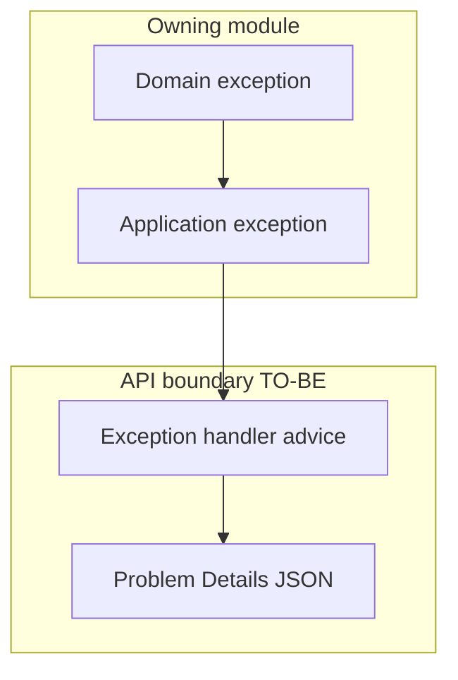

# Error Handling

**Canonical API context:** [API-ARCHITECTURE.md](../03-architecture/api/API-ARCHITECTURE.md). **i18n messages:** [I18N_STRATEGY.md](I18N_STRATEGY.md), [I18N-L10N-ARCHITECTURE.md](../03-architecture/i18n/I18N-L10N-ARCHITECTURE.md).

## AS-IS implementation (verified)

| Component | Location | Behavior |
|-----------|----------|----------|
| Central handler | `GlobalExceptionHandler` (`@RestControllerAdvice`) | Per-exception handlers |
| Success envelope | `InternalApiResponse<T>` + `FriendlyMessage` | Used by e.g. `AdvertController` success paths |
| Error envelope (many paths) | `InternalApiResponse<String>` | `hasError`, `friendlyMessage`, HTTP status via `@ResponseStatus` |
| Validation errors | `ApiErrorResponse` | `MethodArgumentNotValidException` → `400`, `validationErrors` map (field → message) |
| Stable codes | `FriendlyMessageCodes` enum (numeric codes e.g. `1502` ADVERT_NOT_FOUND) | Resolved via `FriendlyMessageUtils` + `{language}` |
| Properties | `FriendlyMessage_en.properties` (and bundles) | Localized **description** text |

**AS-IS issues (documentation assessment):**

- **Two** error shapes (`InternalApiResponse` vs `ApiErrorResponse`) — not RFC 9457.
- Some successes and errors both use custom envelopes; not all failures use consistent HTTP body.
- Module exceptions live under `shared.exception.exceptions.*` — **TO-BE** move toward module-owned types.
- Do **not** expose stack traces in responses (`include-stacktrace: never` in server config — AS-IS).

## TO-BE target — RFC 9457 Problem Details (**APPROVED**)

Content type: `application/problem+json` (or `application/problem+xml` if ever needed — default JSON).

| RFC field | Mapping |
|-----------|---------|
| `type` | URI template per error category **TBD** (e.g. `/problems/validation`) |
| `title` | Short English default; localized `detail` preferred for humans |
| `status` | HTTP status code |
| `detail` | Localized message from `FriendlyMessageUtils` or domain message |
| `instance` | Request path or correlation id |

**Extensions (proposal):**

| Extension | Purpose |
|-----------|---------|
| `applicationCode` | Stable integer/string from `FriendlyMessageCodes` (machine-readable) |
| `traceId` | Correlation / tracing (NFR-OBS TO-BE) |
| `errors` | Field-level validation array `{ field, message }` |

### HTTP status mapping (TO-BE)

| Situation | Status |
|-----------|--------|
| Bean Validation / malformed JSON | **400** |
| Unauthenticated | **401** |
| Forbidden (e.g. `AdvertCreateForbiddenException`) | **403** |
| Resource not found | **404** |
| Optimistic lock conflict | **409** |
| Business rule violation | **409** or **422** — **TBD** standard pick |
| Unexpected server error | **500** — generic `detail`, no SQL/class names |

**Rule:** Never **200** for failed operations.

### Client vs server errors

Clients should use **`applicationCode`** (stable) for branching; **`detail`** for display (language may vary). Do not rely on English `title` alone for logic.

**Figure RE-FIG-ERR-001** — Target exception translation (module → RFC 9457).

**Caption:** Domain types stay free of Spring HTTP classes.

**Explanation:** Global advice only **translates**; it does not own business exception definitions.

## Global handler responsibilities (TO-BE)

- Map known application exceptions to Problem Details + correct status.
- Map validation to field extensions without leaking sensitive values.
- Map unknown exceptions to safe **500**.
- Attach **traceId** when observability stack provides it (**FUTURE**).
- **Do not** consolidate all exception **classes** into `shared` for convenience.

## FUTURE

- OpenAPI documents Problem Details schemas per endpoint.
- CI checks error response shape.
- Align `DelegatedAccessDeniedHandler` / entry point JSON with Problem Details (**TBD**).

## Change history

| Version | Date | Summary |
|---------|------|---------|
| 0.1.0 | 2026-11-13 | Brief AS-IS note |
| 0.2.0 | 2026-11-18 | AS-IS envelopes; RFC 9457 TO-BE; status table; module ownership |