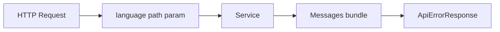

# I18n Strategy

Three concerns: **UI**, **API messages**, **domain content**.

## 1. UI localization (Frontend — read-only)

- i18next with `en`, `tr`, `de` JSON (`SRC-012`)
- Language selector component present

## 2. API message localization (AS-IS)

- Path parameter `{language}` on controllers
- `Language` enum, `Messages`, `FriendlyMessageUtils`
- `GlobalExceptionHandler` returns localized friendly messages

**Figure RE-FIG-I18N-001** — API error localization path.

## 3. Domain content localization (DEC-007 — approved)

**Approved model:** [PRODUCT_DECISIONS.md](../08-project-management/PRODUCT_DECISIONS.md) §8 — **Language Registry** + **Advert** (shared) + **AdvertTranslation** per content language (`de`, `tr`, `en` initially).

| Concept | Policy |
|---------|--------|
| UI language | Frontend i18next — **not** advert content |
| API `{language}` on **public P1/P2** | **Advert content language** ([ADR-002](../03-architecture/ADR/ADR-002-public-read-api.md) v0.6.0) |
| API `{language}` on **legacy mutating routes** | Friendly messages today — **route disambiguation open** (§8.6) |

AS-IS `Advert.title` / `desc` / `slug` remain until ARCH-2 migration; target is translation table.

## Accept-Language (open — not approved)

Proposal: honor `Accept-Language` when path omits language (API v2). **Does not apply** to approved public advert content policy below.

## Missing translation behavior (public advert content — approved)

Per **DEC-007** / **ADR-002:** HTTP **404** when translation missing or not publicly available. **No** automatic fallback to another content language.

**Supersedes** prior draft proposal (default EN + warning) for **public catalog/detail only**.

## Product content languages (registry)

| Code | Initial content support |
|------|-------------------------|
| `de` | Approved M1 |
| `tr` | Approved M1 |
| `en` | Approved M1 |

Further languages: registry data/configuration without per-language schema columns.

### Registry runtime (M1 — implemented)

Backend **Language Registry** (DEC-007 foundation): Flyway `languages` seed, `LanguageRegistryService` snapshot, `ApplicationReadyEvent` initial load, capabilities `UI_MESSAGE` / `ADVERT_CONTENT`. Controllers and legacy `Language` enum are **not** migrated yet. Details: [LANGUAGE-REGISTRY-M1-IMPLEMENTATION-STATUS.md](../03-architecture/domain/LANGUAGE-REGISTRY-M1-IMPLEMENTATION-STATUS.md).
