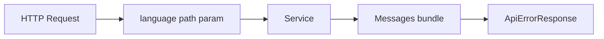

# I18n Strategy

Three concerns: **UI**, **API messages**, **domain content**.

## 1. UI localization (Frontend — read-only)

- i18next with `en`, `tr`, `de` JSON (`SRC-012`)
- Language selector component present

## 2. API message localization (AS-IS)

- Path parameter `{language}` on controllers
- `Language` enum, `Messages`, `FriendlyMessageUtils`
- `GlobalExceptionHandler` returns localized friendly messages

**Figure RE-FIG-I18N-001** — API error localization path.

## 3. Domain content localization

| Approach | Use case |
|----------|----------|
| Single column per language | Simple titles — **TBD** |
| JSONB `localized_fields` | Flexible search — TO-BE |
| Translation table | Normalized i18n — TO-BE |

`Advert.title` single string AS-IS — search implications for EN/TR/DE **TBD**.

## Accept-Language (TO-BE)

Proposal: honor `Accept-Language` header as fallback when path omits language (API v2).

## Missing translation behavior

Return default locale (EN) + log warning (TO-BE).

## Product languages

| Lang | Status |
|------|--------|
| EN | AS-IS |
| TR | AS-IS |
| DE | FE only initially |
