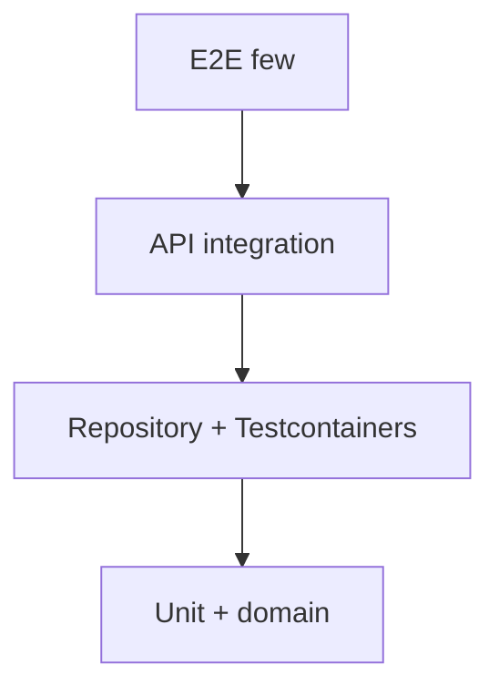

# Test Strategy

## AS-IS gap

Only `@SpringBootTest contextLoads` (SRC-007).

## Target pyramid (TO-BE)

**Figure RE-FIG-TEST-001** — Target test pyramid.

## Layer policy

| Layer | Scope | PostgreSQL needed |
|-------|-------|-------------------|
| Domain unit | Value objects, policies | No |
| Application | Use case with mocks | No |
| Repository | `@DataJpaTest` or Testcontainers | **Yes** |
| API | `@AutoConfigureMockMvc` + security | Optional embedded / Testcontainers |
| Security | JWT filter + authorization | No / MockMvc |
| Contract | OpenAPI vs responses | No (WireMock) |
| E2E | Critical journeys | Yes (Testcontainers) |

## RealEstate examples (TO-BE)

| TEST ID | Scenario | FR |
|---------|----------|-----|
| TEST-AUTH-01 | Login returns JWT | FR-AUTH-002 |
| TEST-ADV-01 | Active list returns only active | FR-ADV-002 |
| TEST-TOUR-01 | Create tour request | FR-TOUR-001 |
| TEST-SEC-01 | Anonymous cannot delete user | NFR-SEC-001 |

## Coverage policy (proposal)

- Domain + application: **80%** line coverage goal (TO-BE)
- Controllers: contract tests for all documented endpoints

## Test data

Java Faker on classpath (SRC-003) — use for fixtures; isolate per test with `@Transactional` rollback.
